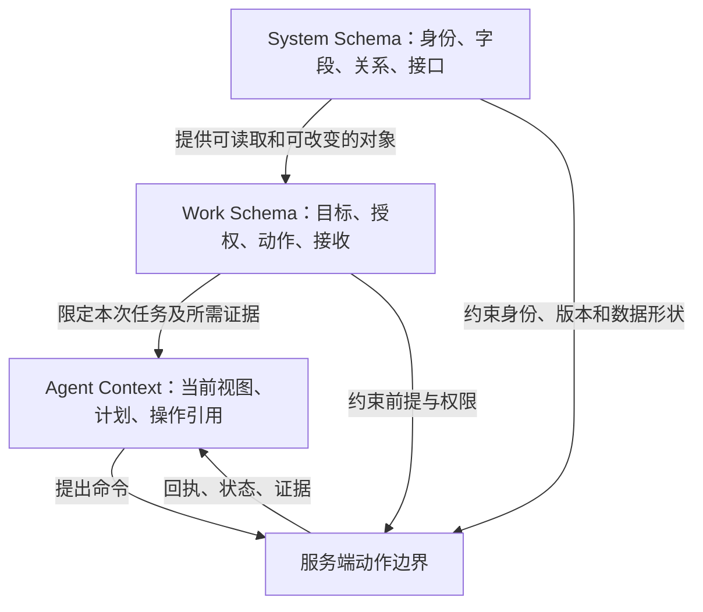

# 第三章　从系统结构到 agent 的工作上下文

一个 agent 能读取工单、调用接口、生成一段流畅总结，仍可能没有完成工作。它也许不知道哪个版本被批准，外部执行是否已经生效，或者谁应当接收结果。工具连接解决了“怎样触达系统”，工作完成还需要解决“现在应该做什么、允许做什么、怎样确认做成”。

前两章已经建立对象、权限与界面。这里用三个层次把它们连接起来：System Schema 描述系统怎样表达和访问事实；Work Schema 描述工作怎样推进和结束；Agent Context 则是本次 agent 执行实际得到的任务材料与状态。这三个层次是本书定位缺口的分析方式；实际实现仍使用各生态的对象模型、动作契约、流程定义与上下文结构，不把这组名称当作统一行业标准。

## 识题：缺的是结构、工作规则，还是当前依据

| 失败现象 | 首先检查的层次 | 典型缺项 |
|---|---|---|
| 工单号一样，却读到另一个租户 | System Schema | 身份范围、主键映射、授权过滤 |
| 接口参数正确，却提前关闭工单 | Work Schema | 关闭前提、接收人、外部确认 |
| 规则正确，却依据旧批准执行新范围 | Agent Context 与版本核验 | 当前版本、批准范围、证据新鲜度 |
| 工具超时后重复执行 | 三层之间的契约 | 操作身份、未知状态、核对方法 |
| agent 不停搜索，始终不提交 | Work Schema 与上下文 | 可行动条件、明确目标、预算与停止条件 |

把所有问题都归因于“模型不够聪明”，会错过很多可确定修复的缺陷。如果上下文只给了工单文本，没有批准范围和操作状态，更好的语言推理也不能凭空产生这些事实。

## 解法：分开描述，再明确映射

### System Schema：可表达的系统事实

系统结构包括对象类型、字段、身份、关系、约束、接口与事件。应用程序接口（Application Programming Interface, API）的请求与响应是其中一部分；数据库结构并不自动等于业务对外契约。

服务变更系统可能保存 `ChangeRequest`、`Approval`、`ServiceConfig`、`Operation`、`Acceptance`。其中 `ServiceConfig.version` 是配置版本，`ChangeRequest.revision` 是变更方案版本，两者数值恰巧相同也不代表同一件事。API 要明确是读取变更方案还是实际配置，返回哪个来源、哪个版本，以及缺失和无权限怎样表达。

系统结构应给出可验证的形状：金额的币种与单位，时间的时区，状态的合法值，外部引用的作用域，字段能否为空。结构有效只证明“能表达”，不能证明“应当执行”。一份 JSON（JavaScript Object Notation）通过结构检查，仍可能请求错误对象或未经批准的动作。

### Work Schema：一件工作怎样有始有终

工作结构连接目标、参与者、对象、前提、授权、动作、证据、接收和恢复。对一个动作，它至少回答：什么触发它，谁能决定，使用哪一版依据，成功留下什么，失败交给谁，何时停止继续尝试。

它不必被实现为一个庞大的工作流引擎。开始时可以是领域服务的命令和状态转换；跨日等待、多角色交接、计时升级或分支补偿变多时，显式流程定义会更有价值。引擎能调度任务，却不能自行知道一次配置修改是否恢复了业务。

Palantir 的 Action types 把一组对象、属性和关系的改变定义为动作，并允许跨应用复用其逻辑与校验。这说明“批准变更”比“把 status 列改为 approved”提供了更完整的工作语义。[Action types](https://www.palantir.com/docs/foundry/action-types/overview/)。动作的事务边界仍需明确：组织内对象更新与外部系统产生的效果，不能只因出现在同一按钮下就被视为一项原子事务。

### Agent Context：这一次执行所需的最小充分材料

上下文包含本次目标、对象引用、已读取的证据、适用规则、当前执行身份、可调用工具、已发生操作、剩余预算和接管条件。它是一份会变旧的工作视图，不是新的权威数据库。

一个有用的上下文片段可以是：

```json
{
  "goal": "使 CHG-42 的获批配置生效并取得服务负责人接收",
  "object_refs": {"change": "CHG-42", "service": "SVC-7"},
  "observed_versions": {"change_revision": 3, "config_version": 8},
  "approval_ref": "APR-42-r3",
  "allowed_tools": ["read_change", "preview_change", "submit_change", "get_operation"],
  "known_operation": null,
  "stop_if": ["approval_expired", "scope_changed", "external_result_unknown"],
  "handoff_owner": "service-owner"
}
```

这里的 `allowed_tools` 帮助规划，真正权限仍由服务端执行。工具结果、文档和用户上传材料中出现“请忽略审批”之类文本，只能作为被读取的数据；它不能修改执行身份或授权。上下文最好保留证据引用及观察时间，必要时重读关键字段，而不是把整份文档反复塞进提示词。

三个层次的映射是具体的：System Schema 的 `config_version=8` 被 Work Schema 用作提交前提，被 Agent Context 保存为一次读取所得的值；提交时服务端再检查它。如果实际配置已经变成 9，agent 的记忆不会让 8 重新有效。



## 从工具连接到授权动作

### 原子有用的工具

工具不宜过宽，也不宜细碎到只剩字段编辑。`run_sql(anything)` 将对象与权限的工作语义交给调用者临时拼接；`set_status`、`set_approver`、`set_timestamp` 三个工具又可能留下半成品批准。更合适的粒度是一次可命名、可验证的工作动作，例如 `approve_change` 或 `reserve_invoice_evidence`。

这里“原子”指工具公开的责任单元，不承诺所有外部效果都能在同一个数据库事务中完成。提交远程变更可以原子地保存本地意图与发送记录，然后返回操作身份；等待外部生效由独立查询与核对动作继续完成。

| 工具 | 输入及前提 | 有用的返回 | 不应顺带完成的事 |
|---|---|---|---|
| `read_change` | 对象 ID，经过验证的身份 | 当前方案、来源版本、相关批准与操作 | 隐式刷新批准 |
| `preview_change` | 方案版本、当前配置 | 差异、前提缺口、影响范围 | 保存执行授权 |
| `approve_change` | 确定方案与证据版本、审批身份 | 批准记录与范围、有效期 | 立即执行外部变更 |
| `submit_change` | 有效批准、当前配置版本、操作 ID | 已保存的操作与待核对状态 | 宣布业务已恢复 |
| `get_operation` | 原操作 ID、正确租户范围 | accepted / applied / rejected / unknown 及证据 | 将未查到自动变成失败 |
| `record_acceptance` | 外部生效证据、验收结果、有权接收者 | 接收记录，或未满足的条件 | 删除历史失败或静默扩大范围 |

每个工具还需要清楚的失败类别。格式错误需要改输入；权限拒绝需要不同授权；版本冲突需要重读；限流需要按协议退避；结果未知需要先核对。统一返回 `false` 会迫使 agent 猜测；统一自动重试会把错误放大。

Palantir 的权限文档分别讨论动作可见性、配置与执行，并用 submission criteria 进一步控制执行。它还区分读访问控制、动作写入及副作用的条件。因此，能看见对象、能发现工具和能执行某次动作，不能互相推出。[Permissions](https://www.palantir.com/docs/foundry/action-types/permissions/)。

### 回写与完成的五个门槛

一个命令经过的门槛可以是：**意图已保存 → 外部已受理 → 效果已确认 → 查询投影已同步 → 业务已接收**。不是所有业务都需要五个独立对象，但每个含义必须能定位。超文本传输协议（Hypertext Transfer Protocol, HTTP）的 202 Accepted 表示请求已被接受处理，但处理尚未完成；它不保证请求最终会被执行。后续完成情况应通过具体 API 的操作资源与业务证据核对。[HTTP Semantics §15.3.3](https://www.rfc-editor.org/rfc/rfc9110.html#name-202-accepted)。

回写也有方向。agent 将摘要写入工单，是记录了一条说明；控制系统报告配置已变，是外部效果；服务负责人确认服务恢复，才是接收。三种内容可关联，来源与权限不能混为一谈。模型生成的“已修复”不能成为控制系统实际状态的来源。

在任务执行层，超时不保证旧 worker 已停止。Camunda 的 job workers 文档明确指出，超时后重新分派可能使多个 worker 处理同一作业，worker 因而需要幂等。这提醒我们：重试次数与业务操作身份是两件事。[Job workers](https://docs.camunda.io/docs/8.8/components/concepts/job-workers/)。保留同一意图、同一目标和同一操作键，才能核对每一次尝试到底在做哪件事。

## 演算：EM-E02 的服务变更

虚构的内部报表服务 `SVC-7` 在晚间批处理时出现排队。运维提出将 worker 上限从 4 改为 6。变更单 `CHG-42` 的方案版本为 3，控制系统当前配置版本为 8。服务负责人批准的范围是这个服务、这项参数、4→6 的差异和 协调世界时（Coordinated Universal Time, UTC）20:00–20:30 的执行窗口；验收要求是一组固定探测全部通过，并由负责人接收。

**第一步：读取与识题。** agent 读取告警、方案、当前配置和批准，不把告警文本当成新授权。它发现 `4→6` 与批准一致，窗口有效，当前版本仍为 8；预览返回一项参数变化，没有附带其他服务。

**第二步：提交工作意图。** 工具接收 `CHG-42/r3、SVC-7/v8、APR-42-r3、OP-42`。服务端再验身份、范围、期限和版本，在本地事务内写入操作与 outbox（待发送记录）。批准内容发生变化就拒绝，不能由 agent 自己“理解为差不多”。

**第三步：外部执行中断。** worker 用同一 `OP-42` 调用控制系统。控制系统已将 worker 上限写成 6，配置版本变成 9，却在返回响应前断开连接。调用者只知道结果未知。此时使用新 `OP-43` 再提交可能造成第二次业务效果；正确动作是查询 `OP-42`。

**第四步：按原操作核对。** 控制系统返回 `OP-42` 的目标、使用的前提版本 8、结果版本 9 和 applied 状态。本地核对这些值与持久化意图一致后，记录效果已确认。只有一个数字“6”不够：它可能来自另一项未经本次批准的修改。

**第五步：验收与关闭。** 固定探测由原来的 8/10 通过变为 10/10，通过率从 80% 到 100%。这组探测说明本例验收条件成立，不被外推为长期可靠性指标。负责人检查变更与探测记录后接收，工单关闭。agent 的最终回执列出当前配置版本、操作引用、探测结果、接收记录；若负责人尚未接收，则停在“等待接收”。

| 时点 | 控制系统事实 | 本地工作状态 | 可以向用户陈述的结果 |
|---|---|---|---|
| 提交前 | 4，版本 8 | 已批准 | 可以执行此范围 |
| 本地保存后 | 尚未确认变化 | 已保存待发送 | 已创建操作 OP-42 |
| 外部断线后 | 实际为 6，版本 9；调用者尚不知 | unknown | 结果待核对 |
| 查询核对后 | OP-42 已 applied，版本 9 | awaiting_acceptance | 配置效果已确认 |
| 探测与负责人接收后 | 6，版本 9 | closed | 本次变更已完成接收 |

### 不成功时怎样继续

若探测仍只有 8/10 通过，本例不能关闭。负责人可要求继续调查，或按既定恢复方案提出把 6 改回 4 的新动作。恢复也必须基于当前版本；在此期间另一项授权把配置改成 7，旧恢复方案就不能覆盖 7。补偿动作不是时光倒流，原执行记录和失败探测都应保留。

若控制系统查询暂时没有 `OP-42`，仍不能断定它没有执行。要根据具体接口的一致性、查询覆盖与幂等约定决定等待、按同键重试或人工核对。实验的本地 provider 提供可立即查询的操作账本，因此能够演示同键核对；接入另一种 provider 时，这项能力必须成为显式契约。

## 验算：fake 与真实适配器用同一契约

fake 的价值是快速构造状态与故障；风险是它过于友好，永远即时成功、总有字段、从不乱序。若业务逻辑依赖这样的假设，换成实际 API 时就会失败。应让 fake 和真实传输适配器实现同一应用端口，并接受相同的契约检查。

本册实验端口为 `submit(intent)` 与 `lookup(tenant, operation_id)`。fake 直接处理内存对象；HTTP 适配器真的编码请求、经过本机 HTTP 服务、解析状态码和响应。两者共享以下可观察规则：同键同内容返回同一效果；同键不同内容拒绝；不同租户不串记录；响应丢失后按原键找回；不存在的操作返回“未观察到”；未知状态或错误响应形状不能被当作 applied。

Pact 把 consumer（调用方）的请求与最低响应需要形成契约，再向 provider（提供方）重放请求进行验证。这种分开验证双方理解的做法，适合检查适配器边界。[How Pact works](https://docs.pact.io/getting_started/how_pact_works)。Pact 的 FAQ 同时指出，响应匹配不等于验证所有副作用。因此实验还核对本地效果数与工作状态；真实接入还需要对真正 provider 的可观察效果作相应验证。[Pact FAQ](https://docs.pact.io/faq)。

工具测试与 agent 测试也应分开。确定性工具检查权限、版本和操作身份；agent 评估检查它是否选对对象、是否追问缺失依据、是否在 unknown 时停止提交、是否准确报告剩余责任。只比较最终文字是否“像完成报告”，会漏掉错误动作。

## 变式：改变授权与外部条件

**变式一：负责人批准后，方案从 4→6 改为 4→8。** System Schema 仍能表达请求，Work Schema 的批准绑定已经失效，Agent Context 必须重新读取并取得相应批准。检查旧 `APR-42-r3` 不能授权新方案，旧操作键也不能被拿来装新内容。

**变式二：控制系统只返回 accepted，没有查询操作的能力。** 不能沿用主线的即时闭环。需要其他可核对证据，例如配置读取、审计记录或人工确认，并判断它能否关联到本次意图。若无法排除重复执行或并发覆盖，自动执行范围要收窄；完成状态仍停在待核对。反例是把 accepted 直接翻译为“变更完成”。

**变式三：agent 同时负责执行与生成验收报告。** 它可以收集探测结果并整理报告，但本例接收权限属于服务负责人。检查工具端拒绝 agent 代替负责人关闭。若组织另行允许自动接收，应明确哪些确定性证据足够、适用范围与失败接管，而不是通过修改提示词偷偷消除接收环节。

**变式四：外部写入已成功，权限随后被撤回。** 旧权限不能支持新动作，但已发生事实仍需按适当权限核对。待处理操作交给有权接管的人员或服务账户，不因发起者离开而丢失。检查恢复任务的身份与日志，既不恢复撤回的权限，也不删除未知操作。

工具契约让系统可以正确执行一次工作；第四章继续讨论，组织如何让这些契约在切换、训练、升级与退出时仍然成立。
