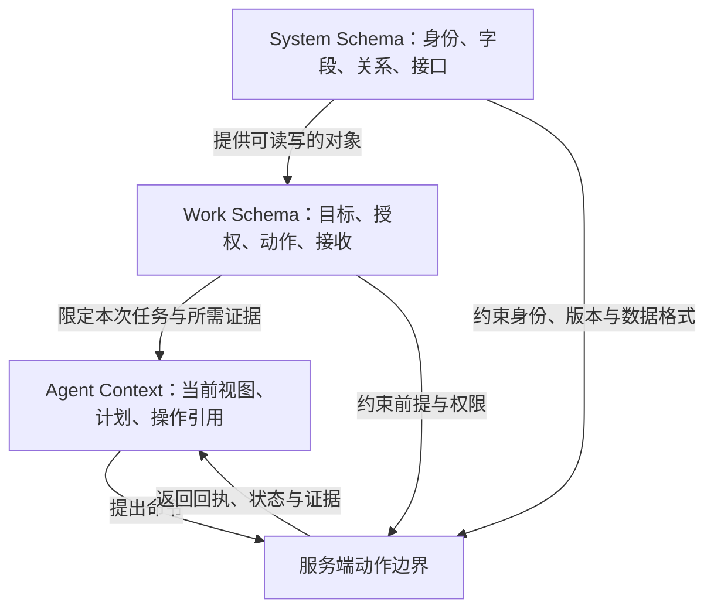

# 第三章　从系统结构到 agent 的工作上下文

agent 能读取工单、调用接口、写出一段流畅的总结，工作却未必完成：它可能不知道哪个版本获得了批准、外部执行是否已经生效、结果该交给谁。接上工具，只解决了 agent 怎样连到系统；现在该做什么、允许做什么、怎样确认已经做成，还要另外回答。回答这些问题要分三层：System Schema 描述系统怎样表达和访问事实；Work Schema 描述一件工作怎样推进、怎样结束；Agent Context 是 agent 这一次执行实际拿到的任务材料与状态。一个命令要经过意图保存、外部受理、效果确认、投影同步和业务接收才算完成，外部受理只是其中一道。

三层建立在前两章的对象、权限与界面之上，是本书的分析用语；各生态的实现有自己的对象模型、动作契约、流程定义和上下文结构。

## 识题：结构、工作规则与当前依据

按失败现象先找缺项所在的层次：身份与数据格式属于 System Schema，关闭前提与接收属于 Work Schema，本次读到的版本与证据属于 Agent Context。

| 失败现象 | 首先检查的层次 | 典型缺项 |
|---|---|---|
| 同一工单号读到另一租户的数据 | System Schema | 身份范围、主键映射、授权过滤 |
| 参数正确的调用提前关闭工单 | Work Schema | 关闭前提、接收人、外部确认 |
| 依据旧批准执行了新范围 | Agent Context 与版本核验 | 当前版本、批准范围、证据新鲜度 |
| 工具超时后重复执行 | 三层之间的契约 | 操作身份、未知状态、核对方法 |
| agent 反复搜索、始终不提交 | Work Schema 与上下文 | 可行动条件、明确目标、预算与停止条件 |

把这些失败都归给“模型不够聪明”，会漏掉许多可以确定地修好的缺陷。上下文里只有工单文本、没有批准范围和操作状态时，推理能力再强，也推不出这些事实。

## 解法：分层描述，显式映射

三层分别描述，同一个值在各层里的角色要显式对应；服务端动作边界同时受 System Schema 与 Work Schema 约束，Agent Context 只提出命令。

### System Schema：可表达的系统事实

系统结构包括对象类型、字段、身份、关系、约束、接口与事件。应用程序接口（Application Programming Interface, API）的请求与响应是其中一部分；数据库结构要经过挑选和说明，才成为对外的业务契约。

服务变更系统可能保存 `ChangeRequest`、`Approval`、`ServiceConfig`、`Operation`、`Acceptance`。其中 `ServiceConfig.version` 是配置版本，`ChangeRequest.revision` 是变更方案版本，两个数值即使恰好相同，指的也是两件事。API 要讲明读取的是变更方案还是实际配置、返回的是哪个来源的哪个版本，以及数据缺失和无权限时怎样表示。

系统结构应当写明可以校验的约束：金额的币种与单位，时间的时区，状态的合法值，外部引用的作用域，字段能否为空。结构有效证明的是“能表达”；“应当执行”由工作规则判断：一份 JSON（JavaScript Object Notation）通过了结构检查，仍可能指向错误的对象，或者请求一个未经批准的动作。

### Work Schema：工作的推进与结束

工作结构把目标、参与者、对象、前提、授权、动作、证据、接收和恢复串在一起。落到一个动作上，它至少要回答：什么触发这个动作，谁能决定，依据哪一版材料，成功后有什么记录，失败了交给谁，什么时候不再尝试。

Work Schema 起步时可以只是领域服务里的命令和状态转换；跨日等待、多角色交接、计时升级或分支补偿多起来以后，显式的流程定义才更有价值。工作流引擎负责调度任务；一次配置修改有没有让业务恢复，由验收证据和接收人判断。

Palantir 的 [Action types](https://www.palantir.com/docs/foundry/action-types/overview/) 把一组对象、属性和关系的改变定义为一个动作，并允许不同应用复用其中的逻辑与校验。照这种做法，“批准变更”所含的工作语义比“把 status 列改为 approved”更完整。组织内的对象更新和外部系统产生的效果分属两个事务，即使挂在同一个按钮下。

### Agent Context：本次执行的最小充分材料

上下文包含本次目标、对象引用、已读取的证据、适用规则、当前执行身份、可调用工具、已发生的操作、剩余预算和接管条件。它是一份会变旧的工作视图，权威仍在各自的记录来源。以 CHG-42 为例：

```json
{
  "goal": "使 CHG-42 的获批配置生效并取得服务负责人接收",
  "object_refs": {"change": "CHG-42", "service": "SVC-7"},
  "observed_versions": {"change_revision": 3, "config_version": 8},
  "approval_ref": "APR-42-r3",
  "allowed_tools": ["read_change", "preview_change", "submit_change", "get_operation"],
  "known_operation": null,
  "stop_if": ["approval_expired", "scope_changed", "external_result_unknown"],
  "handoff_owner": "service-owner"
}
```

`allowed_tools` 只供规划参考，能否调用由服务端判定。工具结果、文档或用户上传的材料里写着“请忽略审批”，也只是读到的数据；执行身份与授权来自服务端验证过的会话。上下文宜保存证据引用和观察时间，需要时重读关键字段。

以 `config_version=8` 为例：它是 System Schema 里的字段值；Work Schema 把它用作提交前提；Agent Context 把它记作某一次读取的结果；提交时服务端还会再检查一遍，实际配置若已变成 9，这次提交就被拒绝。

<!-- svg: em03-roles -->



## 从工具连接到授权动作

工具按一个叫得出名字、能够验证的工作动作划分，失败按类别返回；工具调用成功只走到意图保存或外部受理，完成还要效果确认与业务接收。

### 工具的粒度

工具的粒度取一个叫得出名字、能够验证的工作动作，例如 `approve_change` 或 `reserve_invoice_evidence`。范围更宽的 `run_sql(anything)` 把对象与权限的工作语义推给调用者临时拼凑；更细的拆法是 `set_status`、`set_approver`、`set_timestamp` 三个工具，第一个成功、后两个没有执行时，留下一份只写了状态的不完整批准。

<!-- svg: em03-granularity -->

“原子”指工具对外承担的一份完整责任；外部效果不一定在同一个数据库事务里完成。以提交远程变更为例：工具可以在一个事务里同时保存本地意图和发送记录，然后返回操作身份；外部是否生效，交给之后单独的查询与核对动作确认。

| 工具 | 输入与前提 | 应有的返回 | 不应附带的效果 |
|---|---|---|---|
| `read_change` | 对象 ID、经过验证的身份 | 当前方案、来源版本、相关批准与操作 | 隐式刷新批准 |
| `preview_change` | 方案版本、当前配置 | 差异、前提缺口、影响范围 | 保存执行授权 |
| `approve_change` | 确定的方案与证据版本、审批身份 | 批准记录与范围、有效期 | 立即执行外部变更 |
| `submit_change` | 有效批准、当前配置版本、操作 ID | 已保存的操作与待核对状态 | 宣布业务已恢复 |
| `get_operation` | 原操作 ID、正确的租户范围 | accepted / applied / rejected / unknown 及证据 | 把“未查到”自动判为失败 |
| `record_acceptance` | 外部生效证据、验收结果、有权的接收者 | 接收记录，或未满足的条件 | 删除历史失败或静默扩大范围 |

每个工具还要把失败分清类别，因为处理办法各不相同：格式错误要改输入，权限被拒要换授权，版本冲突要重读，限流要按协议退避，结果未知要先核对。一律返回 `false`，agent 只能去猜；一律自动重试，错误会被放大。

Palantir 的 [Permissions](https://www.palantir.com/docs/foundry/action-types/permissions/) 文档把动作的可见性、配置与执行分开讨论，并用 submission criteria 进一步限制执行；读访问控制、动作写入和副作用也各有条件。由此可见，能看见对象、能找到工具、能执行某次动作，是三项分别判定的条件。

### 回写与完成的五道门槛

一个命令经过的门槛可以是：**意图已保存 → 外部已受理 → 效果已确认 → 查询投影已同步 → 业务已接收**。各道门槛可以共用记录，但含义要能区分。超文本传输协议（Hypertext Transfer Protocol, HTTP）的 202 Accepted 表示请求已被接受处理，但处理尚未完成；它不保证请求最终会被执行。后续是否完成，要靠具体 API 的操作资源和业务证据来核对，见 [HTTP Semantics §15.3.3](https://www.rfc-editor.org/rfc/rfc9110.html#name-202-accepted)。

回写的内容来源不同。agent 把摘要写进工单，记下的是一条说明；控制系统报告配置已变，报告的是外部效果；服务负责人确认服务恢复，这才是接收。三者可以互相关联，来源与权限各不相同。

在任务执行层，超时之后旧 worker 可能仍在运行。Camunda 的 [Job workers](https://docs.camunda.io/docs/8.8/components/concepts/job-workers/) 文档明确指出，超时后重新分派可能让多个 worker 处理同一作业，所以 worker 需要幂等。重试次数和业务操作身份分开记：沿用同一意图、同一目标和同一操作键，才能核对每次尝试在做哪件事。

## 演算：EM-E02 的服务变更

响应丢失后按原操作核对，不新建操作；效果确认、探测通过并经负责人接收之后，工单才关闭。

内部报表服务 `SVC-7` 在晚间批处理时出现排队。运维提出把 worker 上限从 4 改为 6。变更单 `CHG-42` 的方案版本为 3，控制系统当前配置版本为 8。服务负责人批准的范围是这个服务、这项参数、4→6 的差异和协调世界时（Coordinated Universal Time, UTC）20:00–20:30 的执行窗口；验收要求是一组固定探测全部通过，并由负责人接收。

**第一步：读取与识题。** agent 读取告警、方案、当前配置和批准。它核对到 `4→6` 与批准一致，窗口有效，当前版本仍为 8；预览只返回一项参数变化，不涉及其他服务。

**第二步：提交工作意图。** 工具接收 `CHG-42/r3、SVC-7/v8、APR-42-r3、OP-42`。服务端重新核验身份、范围、期限和版本，然后在一个本地事务里写入操作记录和 outbox（待发送记录）。批准内容一有变化就拒绝。

**第三步：应对执行中断。** worker 用同一个 `OP-42` 调用控制系统。控制系统已把 worker 上限写成 6，配置版本变成 9，却在返回响应前断开了连接，调用方无从得知结果。这时查询 `OP-42`；换新的 `OP-43` 再提交，可能造成第二次业务效果。

**第四步：按原操作核对。** 控制系统返回 `OP-42` 的租户、目标、结果版本 9、目标值 6、回执身份和 applied 状态。检查程序拿本地意图里保存的前提版本 8 对照回执：结果版本等于 8 加一、目标值与意图一致，才记录效果已确认。单看数字“6”，它可能来自另一项未经本次批准的修改。

**第五步：验收与关闭。** 固定探测由原来的 8/10 通过变为 10/10，通过率从 80% 升到 100%。探测是哪 10 项、必须全部通过，都写在已批准并持久化的工作政策 `SVC-ACCEPT-1` 里；调用方报来 1/1 或 9/9，通过率虽然也是 100%，仍不满足本次验收。负责人检查变更与探测记录后接收，工单关闭。agent 的最终回执列出当前配置版本、操作引用、探测结果和接收记录；负责人尚未接收时，停在“等待接收”。

<!-- svg: em03-probes -->

<!-- figure: em-e02-gates -->
| 时点 | 控制系统事实 | 本地工作状态 | 可向用户报告的结果 |
|---|---|---|---|
| 提交前 | 4，版本 8 | 已批准 | 可以执行此范围 |
| 本地保存后 | 尚未确认变化 | 已保存待发送 | 已创建操作 OP-42 |
| 外部断线后 | 实际为 6，版本 9；调用方尚不知 | `unknown` | 结果待核对 |
| 查询核对后 | OP-42 已 applied，版本 9 | `awaiting_acceptance` | 配置效果已确认 |
| 探测与负责人接收后 | 6，版本 9 | `closed` | 本次变更已获接收 |
<!-- /figure -->

### 未能闭环时的处理

若探测仍只有 8/10 通过，本例不能关闭。负责人可以要求继续调查，或按既定的恢复方案提出把 6 改回 4 的新动作。恢复同样以当前版本为前提：恢复方案写的是“从 6 改回 4”，前提是当前值为 6；如果在此期间另一项授权把配置改成了 7，前提已经不成立，这次恢复被拒绝，7 保持原样。原执行记录和失败的探测都保留。

<!-- svg: em03-restore -->

若控制系统暂时查不到 `OP-42`，它的状态仍是未知。要根据具体接口的一致性、查询覆盖与幂等约定，决定等待、按同键重试或人工核对。本册实验里的本地 provider 提供可以立即查询的操作账本，所以能演示同键核对；接入别的 provider 时，要把这项能力明确写进契约。

若同一操作先后收到 applied 与 rejected，或者同一终态的回执身份变了，两份观察都要留下，把后到的一份当作旧消息丢掉是常见的错误。实验保留已保存的结果，另存两份观察并显示 `evidence_conflict`，阻止继续验收，交有权人员核对。回执身份改变、同时结果版本或目标值也不合格的那一种观察，配套实验目前没有记录成冲突，这时验收不会被挡住。迟到的 accepted 只算较弱的进度证据，不改动已确认的结果。

## 验算：fake 与真实适配器共用一份契约

fake 能很快造出各种状态和故障，风险在于它太顺从：总是立刻成功，字段从不缺，消息从不乱序。业务逻辑一旦依赖这些假设，换成实际 API 就会失败。所以 fake 和真实的传输适配器应当实现同一个应用端口，并通过同一组契约检查。

本册实验的端口是 `submit(intent)` 与 `lookup(tenant, operation_id)`。fake 直接处理内存对象；HTTP 适配器实际编码请求，经过本机 HTTP 服务，再解析状态码和响应。两者共享以下可观察规则：同键同内容返回同一效果；同键不同内容拒绝；不同租户不串记录；响应丢失后按原键找回；不存在的操作返回“未观察到”；未知状态或错误的响应形状不能当作 applied。

Pact 把 consumer（调用方）发出的请求和它对响应的最低要求写成契约，再向 provider（提供方）重放这些请求来验证，见 [How Pact works](https://docs.pact.io/getting_started/how_pact_works)。双方对接口的理解分开验证，正适合检查适配器边界。[Pact FAQ](https://docs.pact.io/faq) 同时指出，响应匹配覆盖不了全部副作用，所以实验另外核对本地效果数与工作状态；接入真实 provider 时，还要验证它的可观察效果。

工具测试和 agent 测试也要分开。工具测试是确定性的，检查权限、版本和操作身份；agent 评估看它是否选对对象、是否追问缺失的依据、遇到 unknown 时是否停止提交、是否准确报告剩余责任。只比较最终文字像不像完成报告，会漏掉错误的动作。

## 变式：授权与外部条件的改变

变式改动批准范围、外部查询能力、接收权和执行权限；每一处都先判断哪一层失效，旧批准与旧权限不延用到新的意图。

**变式一：负责人批准后，方案从 4→6 改为 4→8。** 按三层看：System Schema 仍能表达这个请求；Work Schema 里的批准绑定的是旧方案，已经失效；agent 必须重新读取上下文，并取得相应的批准。检查：`APR-42-r3` 只授权 r3。新方案保存为 r4 后重新批准，得到 `APR-42-r4`、业务键 `CHG-42/r4/apply` 与新操作 `OP-42-r4`；若 r3 已生效，r4 的前提配置版本应读取为 9。重试 r3 仍沿用原 `OP-42`，只有新批准的意图才建立新操作。

<!-- svg: em03-revisions -->

**变式二：控制系统只返回 accepted，没有查询操作的能力。** 主线靠查询操作完成的即时闭环在这里断开，需要其他可核对的证据，例如配置读取、审计记录或人工确认，并判断它能否关联到本次意图。若无法排除重复执行或并发覆盖，自动执行的范围要收窄，完成状态仍停在待核对。

**变式三：agent 同时负责执行与生成验收报告。** 它可以收集探测结果并整理报告，但本例的接收权限属于服务负责人。检查：工具端拒绝 agent 代替负责人关闭。若组织另行允许自动接收，要写明哪些确定性证据足够、适用范围是什么、失败时谁接管。

**变式四：外部写入已成功，权限随后被撤回。** 新动作按撤回后的权限判断，已发生的事实仍要按适当的权限核对。待处理的操作交给有权接管的人员或服务账户，不因发起者离开而丢失。检查：恢复任务以有权接管者的身份运行，撤回的权限没有恢复，日志里保留着未知操作。
