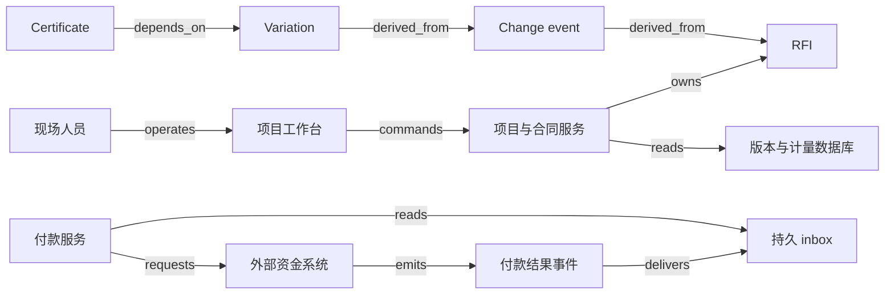

# V15 · 建造变更、计量与付款

一栋楼的风管需要绕开刚发现的梁。设计师可以回答怎样绕行，施工方可以报出费用，业主可以批准增加合同价，计量员可以确认已经装了多少，财务可以支付一部分款项。这五个决定解决不同的问题。把它们压成一张“变更已完成”卡片，会让一个技术答复看起来像付款许可，也会让一笔付款看起来像工程已经验收。

本例接续本包的“承诺、资源、履约证据、资金”模型：设计版本说明应当建成什么，变更批准修改承诺，计量证明完成数量，付款结清已到期义务。以下项目、金额、状态、算法和技术栈均为 synthetic 教学设计，不是某厂商内部实现或通用合同规则。假设只有一份业主合同、一种币种，不计税、保留金、预付款和索赔利息；现场安全与专业设计判断由有资质的人承担，不能由系统的价格校验替代。

## 识题：答了问题、批了范围、做了多少各有证据

工程变更先识别“变化的消息”有没有变成“确定的承诺”，然后才计算已完成与已付款。图中的多条解释路径有助于追溯，但不会创造第二份工程量。

| 识题线索 | 先选的解法与适用条件 | 怎样验算、接着查什么 |
|---|---|---|
| RFI 已答，估价仍待定 | 技术澄清、粗略量级估算（rough order of magnitude，ROM） 与合同批准分对象，审批固定提交版本 | 1,500 的 ROM 不能覆盖只有 1,000 的批准；查合同分层和授权矩阵 |
| 同一变更在多条路径出现 | 用集合按批准行身份去重；来源回查与下游影响选择相应方向 | A1 到达两次仍只计一次；查关系类型、版本替代与图访问权限 |
| 每期都报累计完成量 | 本期取新旧有效累计之差，付款再减已确认及未决占额 | 第二期是 2,350，不是再付 5,750；查计量单位、前序证书和调价范围 |

## 解法：先把不确定性留在正确对象上

发布设计不等于发布一张随时可变的图片。设计包 `D-17/rev-B` 保存文件摘要、适用区域、发布者和取代关系；现场提交的 Request for Information（RFI，信息请求）引用这个确定版本。若 RFI 只保存“最新图纸”链接，两个月后链接指向 rev-C，审核人便无法解释当时为何施工。Autodesk 的 计算机辅助设计（computer-aided design，CAD）/计算机辅助制造（computer-aided manufacturing，CAM） 页面说明 CAD 用于二维、三维设计和技术文档，CAM 将设计用于制造；该页并不说明建筑变更审批。这里的发布对象与版本 guard 是教学设计。[CAD/CAM FAQ](https://www.autodesk.com/ca-en/solutions/cad-cam)。

RFI 的问题是“梁与风管冲突如何处理”，答复可以是按原设计施工、修改设计或继续调查。它首先消除技术歧义，不自动解决谁付款。Autodesk 的 RFI 页面说明可以把图纸、模型位置和现场照片关联到 RFI，配置各角色动作，并从 RFI 建立或关联 Potential Change Order（PCO，潜在变更单）。这些关系支持追溯来源；不证明 RFI 答复已经取得本例的合同授权。`P05-SRC-autodesk-rfi-C1`：[RFIs，Manage / Configure / Connect](https://construction.autodesk.com/tools/construction-rfi-tracking/)。

Change event（变更事件）记录可能影响范围、工期或成本的事实；它可以先于定价存在。Procore 文档把它用于准备潜在成本变化，提供 `In Scope / Out of Scope / TBD` 范围选项，并说明 Cost ROM（粗略估算）输入本身不会改变其它工具的财务值，预算视图可以另行配置显示。因而一笔 1,500 的估算不能直接当成 1,500 的批准支出。[Background；Scope；Cost ROM](https://support.procore.com/products/online/user-guide/project-level/change-events/tutorials/create-change-events)。

合成系统将确认的 change event 转为独立 variation（变更批准对象）：具体工作行、数量上限、单价、合同版本、授权人和依据均固定下来。Procore 的 Change Orders 入口区分 Prime Contract 与 Commitment 等变更单；业主合同与分包承诺是两个可能相关但不能直接相抵的方向。其 业主合同变更单（Prime Contract Change Order，PCCO） 审核文档要求指定审核人和待审状态，记录批准或拒绝结果。这里借用“变更与审查分离”的事实，不把本例的全部状态冒充 Procore 状态。[Change Orders 分类](https://support.procore.com/products/online/user-guide/project-level/change-orders)；[Background；Things to Consider；Steps](https://support.procore.com/products/online/user-guide/project-level/change-orders/tutorials/approve-or-reject-prime-contract-change-orders)。

| 对象及权威 | 谁决定什么 | 独立生命周期与约束 |
|---|---|---|
| Design revision，合成设计登记服务 | 设计负责人发布，现场只确认收到 | `draft → published → superseded`；旧版本保留，发布新版本不回写旧 RFI |
| RFI，合成项目服务 | 施工方提问，指定技术审核人答复，协调人关闭 | `open → answered → closed`，可 `answered → open` 补问；关闭说明澄清结束，不生成应付款 |
| Change event，合成项目服务 | 项目经理登记影响与估算 | `identified → assessing → resolved` 或 `dismissed`；resolved 表示已记录处置，可同时有获批与拒绝的工作行 |
| Variation，合成合同服务 | 授权代表批准范围和价款，提案人不能自行批准 | `draft → submitted → approved / rejected`；批准快照不可覆盖，后续变化用新的补充变更 |
| Measurement / certificate，合成计量服务 | 现场提交实测，独立审核人签证 | `submitted → certified / rejected`；签证数量须有证据且不超已授权工作行余额 |
| Payment operation，合成付款服务及外部支付系统 | 财务发出已签证款项的付款指令，外部确认资金结果 | `prepared → submitted → confirmed / failed / unknown`；unknown 不能当作未付重新发款 |

“谁能看见”也需要单独表达。一个分包方可以看自己的报价和现场证据，但无权沿变更图读取另一分包方的价格。SaaS 租户、项目成员、合同参与方三级范围共同限制查询和图遍历；前端隐藏金额不是授权机制。

## 一张付款申请如何回到原来的问题

现场工作台默认并排显示适用设计版本、未关闭 RFI、待定金额、已批准金额、已计量金额和已确认付款。这样的并列不是多画几个标签：读者必须能看出“可施工但未定价”或“已签证但未到账”的组合。现场人员在图纸定位处提出 RFI，服务端检查项目成员资格、版本是否仍可引用、附件是否已经上传，然后保存问题、附件摘要和请求身份。断网草稿显示“仅在本设备”，成功写入后才显示 RFI 编号；离线草稿针对旧设计时，重新连接会要求确认是否仍然适用。

项目经理点击“提出变更”时，预览页列出引用的 RFI、估价、单位和未确定项。批准人看到的是提交快照而非仍可编辑的表格。服务端用版本条件更新提交状态，把批准人与时间、范围行、金额以及 outbox 事件写入同一事务。后台投影可以稍后更新，但再次批准时读取权威合同记录。另一人修改数量后，旧审批窗口返回版本冲突并展示差异，不把旧窗口的批准套到新价格上。

计量员随后提交累计完成量。服务端从已签证累计量计算本期增量，对每个工作行检查单位、批准数量余额和现场证据。财务的“支付已签证金额”生成一个固定 operation ID；发送给外部财务或银行接口的只是付款请求，未确认前页面保持“已提交，待核对”。外部状态由适配器读取或接收通知，先存 inbox，再确认本地资金记录。图纸文件存储、合同记录和资金事实各有权威边界，下载到本地的文件副本不会取得重新批准的权力。

图中 `derived_from` 说明证据来路，`depends_on` 说明允许签证的前提，均不表示钱已经支付。[V15.json](../../../../vault/distilled/saas-engineering-atlas/packages/commerce-property/V15.json) 保存完整边界与状态转换。

## 演算：沿图追溯，不沿路径重复求和

设原合同批准 100 米风管，每米 50 记账单位，金额 5,000。设计 rev-B 引出 RFI-R1，change event E1 估计额外需要 30 米，ROM 为 1,500。复核后批准变更 A1：只增加 20 米，仍按每米 50，因此合同上限为 `5,000 + 20 × 50 = 6,000`。未获批准的 10 米不能靠“ROM 已存在”进入可签证余额。

RFI-R1 和另一条现场 issue I1 都关联 E1；RFI-R1 又直接关联 A1。按影响传播顺序解释时，`rev-B → R1 → E1 → A1` 与 `rev-B → R1 → A1` 都成立，但 A1 只有一份。结构 JSON 中的 `derived_from` 从派生对象指向依据；从设计查找下游影响时遍历这些边的反向邻接，回查来源时沿原方向，不能为画顺流程而反转关系类型。若逐条路径累计批准金额，会把新增 1,000 算成 2,000。正确查询先在项目权限范围内遍历，得到可达 variation ID 的集合，再按获批工作行 ID 去重求和。发现依赖环时保留错误关系供修复，不递归到进程耗尽。技术澄清图可以有反馈；用于“先做什么”的依赖子图才要求无环，不能把两种边混用。

这对应 `ALG:graph-paths`。每次从根节点扫描全部记录的朴素方法会重复查找父子关系；用邻接表遍历可在访问子图的 `O(V + E)` 时间内找出受影响对象，访问集合占 `O(V)` 空间。路径本身可能指数增长，所以 UI 默认给影响对象与一条可解释路径，只有用户展开时才分页显示其它路径。查询结果用于追溯，不赋予被到达对象新的审批权限。

付款计算也要区别累计值与本期值。第一次累计验收原合同 60 米、变更 8 米，签证 `60 × 50 + 8 × 50 = 3,400`。第二次累计验收原合同 100 米、变更 15 米，累计应签证 5,750，本期增量为 `5,750 − 3,400 = 2,350`。假设第一期已付 3,400，第二期只付 2,000，当前状态是累计签证 5,750、累计付款 5,400、已签证未付 350、已批准未签证 250。四个数描述不同义务；合同上限 6,000 与付款之差 600 不能全叫逾期欠款。

第二个反例是把两期累计量相加：`3,400 + 5,750 = 9,150`，超过合同上限却很像正常的报表合计。合成 guard 以 `(合同, 工作行, 计量序列)` 保存版本，用新的累计量减去上一有效累计量；少报修正走冲减证书，不能偷偷改写已付期间。用集合防重复路径、用增量防重复计量是两种不同去重语义。

## 实现选择围绕文件、版本与局部争议

教学实现可以用 React 或 Vue 构建图纸旁的关联面板和计量表单；若首版只需审批与查询，服务端模板配少量交互代码更容易核查每个提交。先以 PDF 页码和标注区域定位已经足够；三维查看器增加模型处理、客户端内存与授权资源，只有需要构件级追踪时才值得引入。这些是本例的实现建议，不是 Autodesk 或 Procore 的技术栈。

后端可用 Django 或 NestJS 做模块化单体，PostgreSQL 保存项目、不可变批准快照、计量行、唯一操作键和 outbox；大图纸及照片放对象存储，数据库保留摘要和访问范围。关系表加递归查询适合早期有限深度追溯；专用图数据库适合大量跨模型关联的探索，但批准额度和付款仍需要有事务语义的权威记录，不能因为图搜索方便就把金额约束交给最终一致的视图。搜索索引可以找文字，不能授权“未读到批准记录，所以默认批准”。

合成负载目标是 50 个项目，每项目 10,000 份设计版本、20,000 条 RFI/变更关系、200 个活跃审批者；普通详情 API 在 40 个并发读取下 p95 小于 400 ms，授权范围内不超过 2,000 条边的影响查询 p95 小于 1 秒。文件下载和三维渲染另测，不能把缓存命中时间宣称为整个图纸首开时间。尚未实测。读缓存 key 包含 SaaS 租户、项目、对象版本和权限版本；批准时忽略缓存，版本发布或权限变化使关联视图失效。一个大项目的批量导入按项目分片排队，避免占满所有项目的查询预算。

这里最危险的恢复动作是“补一次”。外部付款超时可能已经成功，系统先按 operation ID 查询结果；若外部不能按唯一标识确认，就保留人工待核对，不能换一个 ID 重发。计量证书重复导入则以证书业务身份去重，并比较内容摘要：同 ID 同内容返回原结果，同 ID 不同金额必须冲突。设计发布晚到时保留每个版本的发布时间和适用时间，不以通知到达顺序回退现场适用版本。已批准变更后来撤回，也不能删除已施工事实；建立替代或冲减变更，显示已签证和已付金额需要怎样处理。

## 验算：正常路径、失败路径与检查

正常路径是发布 rev-B、提出 R1、技术答复、登记 E1、批准 A1、现场提交 8 米变更实测、审核计入首期 3,400、财务付款并核对确认。每一步的按钮结束后，前一步证据仍可追溯。失败路径可以从同一现场事实分叉：R1 已答复但 A1 被拒绝，现场自行施工的 8 米仍可登记为“发生、未授权”，却不能进入本例的签证；项目经理需要处理责任和补充授权，系统不能用删掉现场记录掩盖差异。

| 给定与动作 | 应观察的结果、失败后动作 |
|---|---|
| 批准数量 20 米，首期验收变更 8 米 | 首期总签证 3,400；页面可沿证书回到 A1 与 R1，不能从 RFI 直接付款 |
| 同一证书重复上传；同 ID 改成 9 米 | 前者一个效果，后者内容冲突，留给审核人处理 |
| rev-C 发布通知先到，rev-B 后到 | rev-C 仍为适用版；引用 rev-B 的历史 RFI 不被篡改 |
| 两个审核人同时批准同一个提交版本 | 只有一个批准快照；另一请求返回已有结果或版本冲突 |
| 两个 SaaS 租户都存在项目 P1、RFI-1 | 查询、缓存、图的中间节点和附件均不串租户 |
| 外部受理付款后本地超时 | operation 为 unknown；核对后只确认原付款，不另发一笔 |
| 签证写入成功、outbox 消费前 worker 崩溃 | 重启后重建投影一次，签证金额不翻倍 |
| A1 通过两条路径可达，计量报表含两期累计值 | 批准额仍为 6,000；第二期增量 2,350，不能得到 7,000 或 9,150 |
| 计量员提交变更累计 21 米，或把米改成平方米 | 拒绝本例的签证 guard；保留实测草稿与拒绝原因，不丢失现场事实 |

核心流程不需要 AI；若以后让模型提取 RFI 或推荐变更归类，应另建冻结样本、错误授权成本与人工审查评估。

## 变式：改变条件后再推一遍

**练习一：允许紧急抢修先施工，后定价。** RFI 已答复，但变更未批准；现场完成 6 米。能否沿用“已批准才能登记实测”的做法？

**短答：** 不能把“记录事实”与“可签证”放在同一 guard。增加有权限、限额和原因的紧急指令对象，允许登记 6 米及其依据；未完成价格确认时，金额留在待定账户。保持“付款须有明确授权与计量证据”不变。若紧急指令不规定数量或限额，原模型的批准余额上限便失效；检查 6 米能在现场清单出现，却不能凭 RFI 直接变成按 50 单位自动付款。

**练习二：另一条变更将每米价格由 50 改为 60，且只对批准后的新增施工生效。** 首期变更 8 米已按 50 签证，后续再做 7 米，该怎样计算？

**短答：** 把价格适用范围固定到工作批次或有效区间，不重写旧行。新增 7 米为 420，变更累计为 `8 × 50 + 7 × 60 = 820`；不能对全部 15 米重新计算成 900。检查旧证书摘要不变、新行指向价格修订及适用批次。若合同实际规定追溯调价，则要另建 80 的调价差额证书；不可以默默换掉规则。

**练习三：A1 同时影响业主收入和分包成本。** 两边都是 1,000，是否可以合并一个变更节点？

**短答：** 保留关联却不合并合同身份。业主尚未批准收入时，分包成本可能已承诺；二者之差是风险，不是数据重复。检查一方拒绝不会删除另一方已经批准的义务。可迁移的是 V04 的“同一来源关联多个履约对象”，失效点是不能把拆分数量直接当作合同金额的可加分区。

`TR:V15:V16:evidence-liability` 可迁移到 V16：维修事实、责任判断和扣款权分开，照片和工单只能提供证据。建造的合同变更单不能原样替代居民对押金的异议程序。`TR:V15:V07:version-impact` 可把版本追溯迁到 V07 的设计、生产与检验链，但可达不等于库存批次已返工，也不证明质量放行。演示可以改变图中的第二条路径、累计计量或批准上限，同时观察四个金额与拒绝理由。

## 进入建造业务时先查什么

选一项真实类型的现场冲突，收集脱敏的设计版本、RFI、估算、批准工作行、累计计量和付款凭据，先核对它们是否共享同一来源而承担不同责任。成熟解法是文档版本控制、可配置审批、变更成本台账、累计签证和付款核对；图遍历帮助找影响，商业额度仍由合同记录确定。下一步应查该项目的合同分层、授权矩阵、计量单位与调价适用范围，不能从某个审批软件状态推断合同效力。验证样本要同时有一项被拒但现场已施工的变化，以及一个经两条路径关联的获批行；系统既要保留事实，也不能重复增加批准金额。

证据身份与读取范围见 [evidence.json](../../../../vault/distilled/saas-engineering-atlas/packages/commerce-property/evidence.json)，执行边界与缺口见 [CHANGELOG.md](../../../../vault/distilled/saas-engineering-atlas/packages/commerce-property/CHANGELOG.md)。
