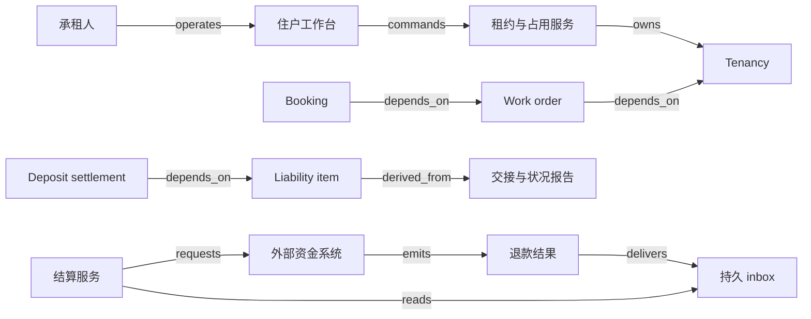

# V16 · 租约、维修与押金对账

物业向承租人承诺在一段时间内提供约定空间和服务。住户离开时，交回钥匙、完成维修、认定损坏责任、退回押金各自需要证据。维修人员更换门锁的记录只证明做过这项工作，证明不了门锁原来完好，也证明不了本次承租人要承担全部费用。租赁软件的难点是把同一空间的时间、状态、权利和资金连接起来，同时保留这些区别。

本例的公寓是合成的教学案例：单套住房只有一份有效独占占用权，租期用建筑所在地时区表达并保存对应时刻，所有区间取左闭右开；押金为 3,000 记账单位，无税、利息和汇率。为了演算，双方采用“无争议金额先退、争议部分暂留并有复核入口”的案例政策。这条政策只为演算设定，不说明任何法域对押金的收取、保管、扣除或延迟返还有何规定，也不是通用的 guard；实际产品要另行确定适用规则、期限与责任人。

## 识题：同一空间的期间、任务与责任

处理物业问题，先确定涉及哪一段占用关系，再看手上的证据证明的是“做过工作”还是“承担费用”。房号和维修发票各有用途，合在一起也代替不了租约身份和责任认定。

| 识题线索 | 首选解法与适用条件 | 验算与后续查证 |
|---|---|---|
| 同一个人换房，或未来租期相撞 | 组织、当事人、tenancy 各有身份；签署时预留独占时段 | 未入住的已签租期也参与冲突检查；查签署承诺、有效时间和实际交接规则 |
| 一次到场结束，整单尚有工作 | 工单汇总必需任务，booking 只代表一次资源安排 | no_access 不关闭工单，第二次进入前重新核对进入许可；查现场服务的任务和预约模型 |
| 维修完成但扣款有争议，退款超时 | 维修证据→责任行→押金分桶；结果未知的退款继续预留 | 3,000 始终有去处，新释放只退 300；查适用押金程序、责任认定和外部退款证据 |

## 解法：身份、租约与占用

有三个身份都容易被叫作 tenant。`org_id` 是 SaaS 数据所属的管理组织；`party_id` 是承租人或其他当事人；`tenancy_id` 是某批当事人与某一空间在某一期间的占用关系。同一人可以续租、搬家、共同承租，也可能先后租住两套房；同一套房可以不断换住户。若用邮箱或房号作押金账户主键，下一任住户就可能看见上一任的照片与争议，续租也可能重复收取或退回同一笔押金。

租约 `L1` 固定签署版本、空间、当事人、有效区间和费用条款。占用权 `T1` 是执行这些条款的时间关系；入住交接 `I1` 记录实际交钥匙时刻、物品清单、已有缺陷和双方意见。本例中，系统把租约确认为 signed 时，在同一事务里检查并预留整段独占的空间权利；尚未交接的 planned tenancy 也占住未来的时段，两份已签租约重叠要在签署时发现，不能等到入住。租约有效时，住户未必已经入住；住户还拿着钥匙，合同结束日也不会因此改写。提前进入、延期交还和合同续签都要有明确的事件，系统才能解释某一时刻谁有进入权、谁收到维修通知、账单属于谁。

ServiceNow 介绍集成工作场所管理系统（integrated workplace management system，IWMS）时，把空间、租约信息、占用情况、维护请求和工单都纳入工作场所管理。这可以作为“资产、空间与维护相互关联”这一产品类别的参照；本例的住宅押金扣除政策不在其中。参见 [Facilities management / Facilities maintenance / Real estate lifecycle management](https://www.servicenow.com/in/workflows/employee-workflows/what-is-iwms.html)。

| 对象与权威 | 决定权与证据 | 状态与约束 |
|---|---|---|
| Lease，租约服务 | 双方确认签署快照；管理员不能无痕改旧租约 | `draft → signed → ended`；signed 同时预留整段独占权利，签署后修改另建修订 |
| Tenancy，占用服务 | 管理员核对租期、交接和必要条件 | `planned → active → vacated`；vacated 不表示押金已结清 |
| Inventory / condition report，交接服务 | 双方记录设备、缺陷与异议；不同意见共同保留 | `draft → acknowledged` 或 `contested`；acknowledged 只说明双方确认了记录内容 |
| Work order，维护服务 | 住户报修，调度安排，技师登记，经理验收 | `open → scheduled → in_progress → awaiting_review → closed`；未完成可回到 scheduled |
| Booking，调度服务 | 为特定资源预留时间，另外核对进入许可 | `proposed → confirmed → completed / cancelled / no_access`；一单可有多次 booking |
| Liability item，结算服务 | 负责人按证据提出责任，承租人接受或异议 | `proposed → accepted / disputed → resolved`；费用支出不自动生成责任 |
| Deposit settlement，账务服务 | 财务核对已收、已分配、已退和争议余额 | `open → partial → reconciled`；外部退款结果未知时不能进入 reconciled |

Dynamics 365 Field Service 的架构文档把工作需求与 Booking 分开：同一 requirement 可以多次安排；技师更新 booking 状态，经理再复核关闭工单。所以一次到场结束，不能当作全部工作结束。参见 [The work order is scheduled to resources；A field technician performs；The work order is reviewed and completed](https://learn.microsoft.com/en-us/dynamics365/field-service/field-service-architecture)。

## 时间区间与进入许可

假设 T1 对房间 U7 的租期为 `[10月1日 12:00, 11月1日 12:00)`。10 月 31 日 12:00 开始的维修预约在租期内；11 月 1 日 12:00 开始的预约已不在其中。两个相邻住户的区间共享边界却不重叠。这个约束在签署、续租或改变有效区间时就检查，包含所有已签但尚未入住的计划关系；实际入住前再核对交接、当前权利和迟到变更。系统可以用 `start_a < end_b 且 start_b < end_a` 判断两段独占占用是否冲突，不能用日期字符串相等或“当前住户”字段推断整段权利。

预约还需要维修资源与进入许可。T1 同意周一 09:00—10:00 的普通入户维修，这份许可不延续到周二；预约改期时要重新核对有效区间和授权。公共区域维护可以依据另一种权限，工单不必都关联某个住户。紧急进入若适用，要单独定义授权依据和审核流程；本例不凭“紧急”标签自动放行。

后端每次接受 command 时按当时有效的权限核验，保存 `effective_at` 与 `recorded_at`：前者说事实何时发生，后者说系统何时知道。住户周五迁出、周一才补录时，周末的维修不能错算到后来才建档的新住户名下。迟到记录与已安排的工作冲突时，系统保留事实并发起待复核项，不能改历史时间把冲突藏起来。门禁权失效后，住户查阅历史结算和自己档案的权限不必随之消失，按单独的访问目的和期限管理。

## 报修、预约与退租检查

住户工作台展示自己的租约、入住清单、报修进度和押金明细，不展示整栋楼的“当前住户表”。报修表单先选择空间和设备，再说明症状、可进入时段与附件。提交只表示请求已接收，页面随后显示分配的负责人、预约和下一次动作。技师只能看到工作需要的设备、地址和有效进入说明；押金争议和其他住户的私人附件不在维修任务的默认权限内。

调度员在日历上拖动 booking 时，服务端重新核验人员时间、设备要求和进入许可。浏览器中的空档可能已被别人占用，所以预约成功以事务提交后的确认号为准；失败时返回冲突区间及可选时段。技师到场无法进入时记录 `no_access`，这次预约失败，工单仍为 open 或等待重排。若首次检修发现要换零件，保存检查结果，另建第二次 booking；第一次 booking 为 completed，工单不随之变为 closed。

离场检查引用入住清单中的同一资产 ID，逐项并排显示前后状况、照片采集时刻、双方意见与维修报价。经理提出“门板更换支出 900，其中本次责任建议 600”时，系统保存支出、分摊依据、提出人和待答复金额。住户可以接受 600 或提出异议，不必靠撤回工单来表达争议。财务工作台看到的是责任行与结算余额；财务点击“生成退款”时，系统先锁定本次可退金额与 settlement version，再创建退款 operation。

`Work → Tenancy` 只用于本例需要核对占用与进入许可的室内工作。结构数据另有权威记录、存储与界面投影边，见 [V16.json](../../../../vault/distilled/saas-engineering-atlas/packages/commerce-property/V16.json)。

## 演算：责任核定与押金守恒

押金收到 3,000。退租时有三项记录：拖欠费用 300 已由双方确认；清洁 200 已确认；门板更换实际支出 900，其中提出的本次住户责任为 600，住户对此有异议。剩余 300 更换支出由物业承担，是本例政策，不是押金责任。当前无争议扣除 `300 + 200 = 500`，争议保留 600，可先退 `3,000 − 500 − 600 = 1,900`。

这时账面关系为 `3,000 = 500 已分配扣除 + 600 待裁定 + 1,900 退款预留`。预留不能写作已退。外部确认退回 1,900 后，才把这部分移到已退；如果超时，1,900 仍被同一 operation 占用。后来双方确认门板责任只有 300，争议的 600 就拆成新增扣除 300 与新增退款 300。最终 `3,000 = 800 扣除 + 2,200 已退 + 0 待裁定 + 0 退款预留 + 0 未分配`，押金结清。900 的维修支出始终可以保留，不必为了让押金数字相等而改写工单成本。

朴素报表从所有现金流水重算余额，容易把待发送的退款和实际到账混在一起。`ALG:lookup` 用 `(org_id, tenancy_id, deposit_account_id)` 找到押金账户，逐行扫描不可变流水求各桶余额；`ALG:windows` 用有效时段把费用归属到正确的占用关系，再按明确的责任规则分摊。预聚合可以缩短查询；防止两人各退 1,900，靠的是唯一的退款操作和事务里的可用余额检查。扫描 n 条结算流水是 `O(n)`；带账户索引的读取先定位账户范围，仍要处理该账户的 k 条记录，整体计算不是 `O(1)`。

一个反例是看到支出 900 就扣 900，先退 `3,000 − 300 − 200 − 900 = 1,600`：它把成本当成责任，还隐藏了 600 的异议。另一个反例是把“已请求退 1,900”立即记为到账，超时后再请求 1,900，最终可能退出 3,800。守恒检查若只看本地期望值，仍可能全部通过；所以要同时核对已提交的 operation、外部结算结果和争议桶。

## 实现与性能

住户端可选 Vue 或 React 做响应式表单、照片清单与时间线，管理端可以先用 Django 模板或同一前端框架实现。确实存在离线入户检查时，才增加本地草稿与离线上传队列：每份草稿保留原始采集时刻、资产身份、租约版本和客户端操作 ID，联网后仍由服务器核验归属。照片上传进度与报修提交结果分开显示，避免“按钮已成功”却丢失关键证据。

模块化后端可用 Django 加 PostgreSQL，也可选 ASP.NET Core 加关系数据库。占用区间、审批版本、责任行、退款预留与唯一业务键需要一起提交；单套房的冲突可以先锁定空间记录，再检查区间并写入，首版不必自建分布式锁。照片存对象存储，数据库保留摘要、资产、tenancy 与访问目的；搜索与缓存只投影经过授权的内容。若接入 Dynamics 365，可由适配器映射工单和预约，租约与押金仍以本地记录为准。以上都是教学选型，本文不假设该集成已经存在。

设 100 个管理组织、每组织 1,000 个单元、每月 2,000 张工单，每张最多 10 个预约，照片中位数 3 张。目标是在每组织 30 个并发操作下，普通列表 API p95 小于 500 ms，单空间预约确认 p95 小于 700 ms；二者都不含图片上传，尚未实测。月初批量起租与月末集中退租是不同的热点：前者竞争空间权利，后者竞争押金账户。按组织和账户限制并发、分批生成待处理清单，不能让一个大物业的图片识别任务阻塞其它组织的退款核对。

缓存 key 至少包含组织、当事人或权限范围、tenancy、查询窗口及权限版本；权限或占用变化时，相关投影失效。旧住户失去门禁权后，服务端不能依据“几分钟前的住户列表”允许新预约。持久任务按账户处理退款，超时后先查原 operation；工单预约则按外部 booking ID 对账。外部无法查询时保留 unknown 和人工入口，不按失败处理。设备归属有误时，写一条可追溯来源的更正记录；不能把旧住户的照片移到新 tenancy 下来修正报表。

## 验算：正常路径、失败路径与检查

正常路径是签署 L1、记录并确认 I1、T1 入住、生效期间报修、两次预约完成、经理关闭工单、退租检查、逐项认定责任、先退 1,900、复核争议后再退 300、核对押金守恒。页面应允许 T1 已 vacated、工单已 closed、押金仍 partial 同时存在。

失败路径是第一次预约未能进入，第二次到场发现配件待订，第三次完成维修。任何一次 booking 都不能代替经理验收。退租时发现入住照片缺失，责任行保持 disputed 或待补证，不能因为已经付了维修商就自动转为 accepted。退款超时则显示“该笔结果待核对，余额已预留”，住户可以看到金额和操作身份，财务可以继续处理其它不相关的账户。

| 给定与动作 | 预期结果与责任 |
|---|---|
| 完整入住证据、两次必需预约完成、经理验收 | 工单可关闭；押金仍独立 open，不自动扣款 |
| 同一维修完成事件到达两次 | 同一预约只完成一次，零件消耗与时间不翻倍 |
| 收到退租后，又收到旧的“入住已生效”通知 | 核对权威版本与有效时间，T1 不被重新激活 |
| 两位财务同时申请先退 1,900 | 一笔预留与一笔有效 operation；另一次返回相同结果或冲突 |
| 两个组织各有 U7；一个人有两段 tenancy | 组织隔离与占用关系隔离都成立，附件和押金不串账 |
| 外部已退款，本地响应超时 | 1,900 保持预留，查原操作后转已退；不再次发送 |
| 退款确认写入后、投影前崩溃 | 恢复后已退仍为 1,900；住户页面最终一致，并能看到更新延迟 |
| 一单三次预约，第一次 no_access | 工单不能关闭；新预约重新核对进入许可 |
| 门板支出 900，责任争议 600；后来责任定为 300 | 先退 1,900，后退 300，总扣除 800；支出仍为 900 |
| 旧租期在 12:00 结束，新租期 12:00 开始；改为 11:59 | 前者相邻允许，后者重叠拒绝；服务器同时提交时也成立 |
| 同一空间已有未来已签租约，两者均未入住；再签重叠区间 | 签署事务拒绝第二份独占承诺，第一份 planned 权利仍保留；不能等到入住才检测 |

实现时，检查要看持久记录、用户界面和外部结果，只验证计算函数的返回值不够。当前 AI 不参与责任认定或财务决定，没有模型评估结果。若以后加入照片损坏建议，至少冻结“已有缺陷、正常磨损、缺证、视角不同、明确新增损坏”分层留出样本，由两名人工标注并裁决分歧，分别报告误归责率与缺证拒答率及分母。误归责会造成错误扣款，所以模型给出的任何建议都要人工确认。

## 变式：条件改变后的判断

**练习一：同一个人换房，旧房押金尚有 600 争议，新房要求 3,000 押金。** 能否直接把 person 表上的押金余额搬过去？

简答：不能。旧 tenancy 的责任与退款义务仍在，新的 tenancy 有自己的入住房况和押金账户。若双方允许转移无争议余额，应生成两边关联的转出、转入记录和授权，600 继续留在旧账户；不能只改 `unit_id`。资金守恒与证据归属不变；原模型失效的前提是“一个人只有一段占用”。检查新房账户不能消费旧房的争议桶，也看不到无关前任住户的附件。

**练习二：争议责任从 600 降到 300，但首笔 1,900 退款仍然 unknown。** 可以再退多少？

简答：只能释放新确定的 300，并且仍受独立操作与可用余额检查约束。原 1,900 继续预留，不能因为还没看到到账就把它重新算成可用。当前守恒为 `3,000 = 800 扣除 + 1,900 原退款预留 + 300 新可退`。检查重复运行争议处理只释放一次 300；原操作确认后，只改变预留与已退两个桶，总余额不变。

**练习三：维修单需要水电两位技师，水电预约时间相同。** 原来“同一时间只能有一个 booking”的冲突规则还能用吗？

简答：不能照用。冲突应按资源与进入许可计算，不按工单全局互斥。两位不同技师可以共享允许入户的窗口；同一技师不能同时出现在两个房间。若现场规定同一狭小空间不能同时施工，还要加空间容量约束。检查不同资源可以并行、相同资源被拒绝，工单仍要等全部必需任务验收。

`TR:V16:V06:temporal-rights` 可把时间区间与占用权带到 V06 的住宿预订；失效点在于酒店通常还涉及房型容量、换房与按夜计价，不能照搬本例“单单元独占租约”的全部 guard。`TR:V16:V20:booking-work` 可把一工单多 booking 与复核关闭带到现场服务；资产服务未必有住户占用关系，所以不继承租约与押金规则。演示可拖动交接时间、改变责任金额、制造一次 no_access 或退款 unknown，观察哪些对象变化、哪些证据保持不变；呈现这些因果关系用不着三维房屋浏览器。

## 进入物业租赁的先查项

先把管理组织、房屋、当事人、租约、实际占用和押金账户画成身份关系，再跟踪一段续租或换房。成熟解法包括租约与空间时段管理、工单/多次预约、前后状况记录、责任争议与资金分桶；设施维护平台可以支撑其中一段，但不等于已经覆盖住宅租赁结算。下一步要向业务负责人确认未来权利何时被承诺、预约进入许可如何取得、维修费用怎样转为住户责任，并另行查明适用的押金保管与争议程序。验证从同一人两个 tenancy、尚未入住的重叠租期、缺少入住照片和退款 unknown 四个样本开始；若只凭房号或维修发票就能扣款，模型仍缺少关键的身份或权限边界。

[来源与模型说明](../../../../vault/distilled/saas-engineering-atlas/packages/commerce-property/evidence.json) · [对象与检查结构](../../../../vault/distilled/saas-engineering-atlas/packages/commerce-property/V16.json)
