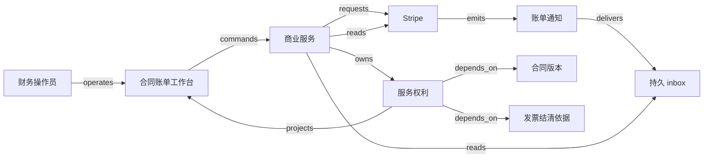

# H01 · 报价、合同、服务、收款与收入

客户买的是一段有边界的服务。销售给出价格，客户接受条款，运营开通使用权，财务核对应收与收款，期间报告再解释已经履行多少承诺。即使这些动作在几秒内完成，也需要分别留下证据：收款可能先于服务，服务变更也可能先于补款。

Salesforce 将 Quote-to-Cash 描述为跨越销售、履约、开票和应收的流程；这里只采用这一范围说明，不把营销页对效率与收入的概括当成财务确认规则。[Salesforce QTC](https://www.salesforce.com/eu/sales/cpq/quote-to-cash/)。本章把这条链落实成一个 synthetic 订阅案例：一个租户购买 10 个席位，服务为等长的 30 天 `[0,30)`；每席全期 3,000 分，原合同享九折，含税问题、汇率、支付手续费与坏账估计暂不进入演算。1 单位 = 100 分。

## 识题：从现象找到方法

| 识别线索 | 可选解法 | 接着查什么、验什么 |
|---|---|---|
| 价格更新后，旧订单也被改价 | 冻结已接受版本，用修订表达新承诺 | 查报价有效期、折扣审批与修订生效规则；对照旧、新合同各自的金额 |
| 钱一次到账，服务跨多个期间 | 按收费行计算区间交集与累计差 | 查invoice line期间和舍入点；把窗口金额加回整段收费 |
| 取消后仍有已履行服务与未退现金 | 把服务调整、贷项与退款分开核对 | 查credit note及payment application；分别验服务余量与现金义务 |

下面沿这些线索建立对象与边界，再手算一组数据、用反例验算，最后改变前提重做判断。

## 解法：价格先冻结，履行再推进

报价为 `10 × 3,000 × 90% = 27,000 分`。目录价回答“现在通常卖多少钱”，已接受报价回答“这位客户按什么版本买了什么”。若直接让订单读取最新价目表，管理员改价就可能改变旧发票的解释。教学设计把数量、价格、折扣、币种、期间和规则版本一起冻结；销售可以改草稿，接受后的变化生成 amendment（修订协议），不能改原记录。

第 12 天，客户再买 5 席位，修订协议约定新增部分不享原折扣，按剩余 18 天收费：`5 × 3,000 × 18 / 30 = 9,000 分`。原 10 席位的 27,000 分保持不变。这不是对产品自动 prorate 行为的推断，而是本例可检查的合同政策。到第 20 天，客户累计支付 36,000 分，已履行的教学收入是原合同 18,000 分加新增部分 4,000 分，共 22,000 分。剩余 14,000 分对应未完成期间；不能凭收款金额宣告服务已经全部完成。

| 参与者与对象 | 权威与动作 | 状态、前提与留下的证据 |
|---|---|---|
| 销售；Quote | 合同服务保存；销售提交报价，超折扣阈值须获批准 | `draft → offered → accepted`；接受绑定版本、客户身份及有效期，已过期重新报价 |
| 客户；Contract / amendment | 客户接受；合同服务保存版本链 | `pending → effective → ended`；修订单独接受，原合同仍解释历史；替代关系不等于删除 |
| 财务；Invoice | 本例由 Stripe 保存发票事实，本地保存映射和副本 | `draft → open → paid` 是主路径；最终金额与合同版本核对，不以提交请求当开票成功 |
| 运营；Entitlement | 自建权利服务决定可用席位 | `pending → active → suspended / ended`；预付条件满足才开通，暂停要保存原因，退款不靠改席位数实现 |
| 账务人员；Revenue schedule | 自建教学期间计算服务保存计划版本 | `proposed → approved → superseded`；金额、期间、来源行和计算规则确定后发布，修正保留原计划 |
| 财务复核人；Credit adjustment | 自建调整记录连接合同修订、贷项与退款尝试 | `requested → authorized → externally-confirmed`；权限、可退余额及分配方式核对，外部未知时留待核对 |

这里的 `paid` 只说明发票余额如何被结清。Stripe 区分 `draft/open/paid/void/uncollectible`，还说明信用余额、免费账单或 out-of-band 标记等情况可产生 `invoice.paid`，无需一次关联 PaymentIntent 成功。因此本例排除这些情况的主路径必须核对支付依据、客户、币种和金额；扩展时要显式接受哪种结清证据。[Invoice lifecycle / Paid invoices](https://docs.stripe.com/invoicing/overview)。

合同工作台也不必把所有对象挤进一个状态。Ironclad 的发布说明把合同状态、未完成任务与协作者责任放在同一工作流页，并提供跨签署前流程和归档记录的统一查找；这支持“在一个入口查看不同责任”的产品例子，不证明其内部账务或授权实现。[New Workflow Page / Unified Dashboard and Repository](https://support.ironcladapp.com/hc/en-us/articles/30977258163607-What-s-New-in-Ironclad-April-2025)。

## 按钮保存意图，回执提供结果

工作台列表展示合同版本、应收余额、席位与服务期间、尚未确认的动作。进入详情可以看到报价计算和修订差异。“接受报价”“开票”“确认修订”“批准退款”是不同角色的动作；接受报价时不能顺便用客户身份批准退款。表单预览由服务端按已冻结的规则计算，提交携带对象版本与 operation ID。若另一人已改草稿，页面显示新旧差异并要求重新确认，不能静默把旧预览套在新版本上。

“开票”的正常链为：服务核验授权与 accepted 版本 → 在本地事务保存 operation 和待发请求 → worker 调用 provider → 记录外部发票身份 → 查询投影显示 `open` → 收到支付相关通知 → 核对 invoice 与支付依据 → 本地事务开通对应席位并登记消费结果。按钮成功首先表示请求已保存；只有最后的权利记录允许服务访问。换页后按 operation ID 取回同一结果，断网重连也不产生新的购买。

每条边的 payload、失败点和作用域见 [H01.json](../../../../vault/distilled/saas-engineering-atlas/packages/commercial-finance/H01.json)。这是信息流：Stripe 发来一个通知并未把现金搬进本地数据库。本地 invoice 映射包含 tenant、provider account 和外部 ID；事件中的账户不能覆盖服务端保存的映射。签名验真以后仍要判断事件属于哪个账户与业务对象。Stripe 文档说明通知可能重复且不保证到达顺序，并要求使用原始请求体验证签名；本例在返回成功接收前将有效通知存入 inbox，复杂处理在后面完成。[Create a handler / Event ordering / Handle duplicate events](https://docs.stripe.com/webhooks)。

本地去重有两层。event ID 避免同一通知重复处理；`tenant + purchase_line_id` 的唯一权利效果避免不同通知对同一次购买开通两次。只做第一层，两个不同事件都能开通；只做第二层而不保存事件，异常来源与重放进度难以解释。PostgreSQL 的组合唯一约束可表达复合身份，且默认允许多个空值，因此本例身份列同时要求非空。数据库约束支持本地效果，不提供跨外部 API 的一次性执行保证。[Unique Constraints / Primary Keys](https://www.postgresql.org/docs/current/ddl-constraints.html)。

## 演算：从时间区间得到可重演的金额

`ALG:windows` 的直觉是把每条收费行摊到它承诺的服务区间，再取观察窗口与该区间的交集。对金额 A、期间 `[s,e)`，截至 t 的累计金额定义为 `C(t)=floor(A × clamp(t−s,0,e−s)/(e−s))`，单位为分；某窗口 `[a,b)` 的金额为 `C(b)−C(a)`。这一取整政策仅适用于本例的非负、线性、等长时间模型。负向修正沿原计划逆转或建立明确贷项，不直接把负数塞入该公式。

| 收费行 | 金额与服务期间 | 截至第 20 天的手算 |
|---|---|---|
| 原 10 席位 | 27,000 分，`[0,30)` | `27,000 × 20/30 = 18,000` 分 |
| 第 12 天新增 5 席位 | 9,000 分，`[12,30)` | `9,000 × 8/18 = 4,000` 分 |
| 合计 | 已付 36,000 分 | 已履行 22,000 分，未来期间 14,000 分 |

为什么先算累计再求差？假设 100 分分到 3 天，逐日各自四舍五入得 `33+33+33=99`，少了一分。累计法得到 `C(0..3)=[0,33,66,100]`，各天为 33、33、34，任意相邻窗口相加仍等于整段。分到哪一天是政策选择，金额守恒是必须检查的结果。月长、时区、夏令时或按秒服务改变后，要重新定义区间单位；“30 天”不能继续冒充真实日历月。

朴素方法为每条合同每天生成一行，n 条收费、d 天需要 O(nd) 空间；上面的交集公式计算一个观察窗口只扫描 n 条，时间 O(n)、额外空间 O(1)。查询很多不同期间时，可以存区间边界或按批准计划预聚合，但修订后只重算受影响窗口，并把投影绑定输入版本。缓存键包含 tenant、计划版本与窗口；旧版本结果可以保留用于复算，不能当新版本的结果。复杂度是算法推理，尚未测得服务延迟。

Stripe Revenue Recognition 的公开说明以 finalized invoice 和 line item 服务期间为基础，取消 subscription 本身不改变已开票计划；没有设置独立发票行期间还会影响确认时点。本章的整数累计算法与 30 天政策是独立教学设计，不能据此声称它复刻 Stripe 或符合某套会计准则。[Licensed subscriptions / Subscription cancellations / Standalone invoices](https://docs.stripe.com/revenue-recognition/methodology/subscriptions-and-invoicing)。

## 变更、迟到与未知结果

第 20 天取消新增 5 席位，假设双方同意退回尚未提供的 10 天，则贷项为 `9,000 × 10/18 = 5,000 分`。原 10 席位继续使用；新增部分已经提供的 8 天仍有 4,000 分。调整后净收费 31,000 分，已履行仍为 22,000 分，未来原席位的 9,000 分保留。若退款还在处理，现金净额仍为 36,000 分，同时存在 5,000 分退款义务；只有退款确认后现金净额才变为 31,000 分。不可把“已批准退费”直接当“已退到账”。

Stripe 的 credit note 可调整最终发票；已付发票的贷项可关联退款、客户余额或外部处理。选择留存余额与实际退现金有不同资金效果，界面必须让财务明确选择并展示结果。[Credit notes for open / paid invoices](https://docs.stripe.com/invoicing/integration/programmatic-credit-notes)。本例只演示退现金路线，未实现 Stripe 退款接口及会计分录。

| 故障时序 | 容易作出的错误 | 合成恢复与用户可见结果 |
|---|---|---|
| provider 接受开票，响应在网络中丢失 | 新建 operation，再开一张票 | 原 operation 进入 `unknown`，先按保存映射或同幂等身份找回；显示“正在核对是否已开票” |
| 事件处理已开通，worker 在标记消费前退出 | 重放再加 10 个席位 | 权利效果与业务键受约束，恢复读取既有效果，再完成消费记录 |
| 支付通知先到、早先 open 通知后到 | 按到达次序回退状态 | 以通知触发核对，读取当前权威对象及依据；不能只按事件秒级时间戳排序 |
| 原来 paid 的发票被合法取消付款分配 | 永久保留本地 paid | 当前依据已改变，更新投影并进入权利复核；不要以“防回退”为由吞掉真实修正 |
| 两位财务同时批准退同一未履行期间 | 各退 5,000 分 | 以调整版本锁定可退剩余额，一次保留授权，另一请求冲突或返回原尝试 |

Stripe API v1 的幂等结果在开始执行后保存，同 key 重试可返回原响应，包括错误；key 被清理后重用会新建请求，参数改变也受检查。因此本地必须长期保留购买与外部操作映射，不能把 provider 幂等窗口当永久防重账本。[Idempotent requests](https://docs.stripe.com/api/idempotent_requests)。未知结果超过安全重试条件时由财务核对，不生成新 key 猜测重试。

“paid 后不能再 open”也不适合作通用 guard。Stripe Payment application 文档说明取消付款分配限于 `send_invoice`，并可能使发票重开；其示例含 preview API 版本，实际接入需核实版本可用性。本章将重开作为显式外部修正分支，不假定所有自动扣款发票都能重开，也不自动推断原服务应追回。[Payment application](https://docs.stripe.com/invoicing/apply-payments)。

## 把教学设计落到技术选择

首个原型可以用 React + TypeScript 或 Vue + TypeScript 建工作台：前者适合团队已有 React 组件，后者适合已有 Vue 表单体系。选择依据是维护熟悉度和复杂表单行为；两者都需呈现版本冲突、异步尝试与金额预览，组件库并不替代领域模型。初期每个操作详情采用轮询，状态变化较频繁时再考虑 SSE，页面恢复始终可按 operation ID 查询。

后端可用 TypeScript + NestJS 统一前后端类型，也可用 Python + FastAPI 配合财务计算团队；边界处均重新校验授权和数字，不信任浏览器计算。小规模选一个模块化服务加 PostgreSQL，在同一事务保存合同、operation、outbox 和本地权利效果，较拆成多个服务容易解释提交边界。队列可先由数据库持久任务承担；独立队列有利于流量削峰，但增加消息与业务状态的对账工作。对象存储只保留合同文档及校验值，数据库保存身份、权限和版本关系。以上为原型选型，不是厂商技术栈事实。

合成容量假设为 100 个租户、10 万份在期合同、每合同平均 3 行；日常 20 次命令/秒，月初 10 分钟出现 300 次通知/秒，一个大租户占通知量的 40%。待测目标为 50 并发下单租户 50 行列表 p95 < 400 ms，本地提交 p95 < 500 ms，provider 健康时核对积压 p99 < 60 s；分别测缓存命中、冷读和月初突发。外部 API 时延另记，不能算入本地目标后又宣称可控。任务按租户配额调度，监控最老未核对 operation 的年龄而不只看队列长度；一个热点租户不应挤走其他租户的到账核对。

## 验算：检查应证明什么

本例价格、开通与收入由确定性规则和人作决定，AI eval 不适用。若未来让模型提取合同期间，应另外冻结合同样本与人工标签，按金额、期间、币种的正确率和错误开通数评估，并要求不确定时拒绝自动批准。

| 输入与动作 | 端到端应观察的结果 | 必须取得的证据 |
|---|---|---|
| 接受 27,000 分原合同、核对付款，随后接受并支付新增 9,000 分 | 10 席位与 5 席位有独立来源，第 20 天累计 22,000 分 | 合同版本、provider 对象、权利效果、UI 与计划版本 |
| 同 event 两次，以及不同 event 指向同购买 | 均只有一份开通效果 | inbox 身份、业务唯一键、最终席位 |
| 当前 paid，迟到旧 open 通知 | 不被旧快照回退；真实 unapply 则进入修正分支 | 权威读取与修正原因 |
| 并发开票、并发退费 | 一个尝试或明确版本冲突；退款不超授权剩余额 | 事务结果与外部尝试映射 |
| 两租户同编号，缓存分别命中与未命中 | 合同、发票、文档和操作均不串租户 | 查询范围与返回对象 |
| 外部已受理，本地超时；或开通后崩溃 | 先 unknown，核对后完成；重放不重复开通 | 外部结果、恢复日志与唯一效果 |
| 只停 subscription，没有批准贷项 | 原计划依据保留，调整仍待审批 | 合同修订、贷项与计划之间的差异 |
| 100 分分三天；空期间或负向输入误入公式 | 33、33、34；无效输入被拒绝 | 固定计算 fixture 与反例输出 |

## 变式：条件变化与迁移

**练习一：把预付改成有 20,000 分信用额度的赊销。** 原订单 27,000 分能否仅凭 accepted 自动开通？简答：本例的新政策若要求应收敞口不超额度，就不能全额开通；需要提高额度、预收至少 7,000 分或缩小合同。守住的是“开通有被授权的依据”，改变的是依据从已付变成信用核准。反例是去掉 paid guard 后不添加额度保留，两个并发订单各自看到相同空余额而超限；检查并发授权后的总保留与敞口不得超过额度。

**练习二：第 20 天只取消新增席位，退款回执迟迟未到。** 能否显示已退 5,000 分并把原合同的 10 席也停掉？简答：两者都没有依据。新增修订的未来部分终止，原 10 席继续；退款处于待确认，现金净额暂为 36,000 分，另列 5,000 分退款义务。检查分行权利、批准贷项与退款尝试相互对应，到账核对后现金净额才为 31,000 分。

**练习三：付过款后发生合法 payment unapply。** 是否为了防止乱序而永久忽略 open？简答：应重新核对付款分配，区分旧通知与新修正；重开不等于历史没有服务。保留已履行区间，权利暂停或催收由明确政策决定，检查所有修正仍能回查原付款。

`TR:H01:H02:evidence-before-effect` 将“有证据才确认本地效果”迁到采购付款，但 H02 需要核对收货、验收和累计已匹配数量，付款本身不能作为验收证据。`TR:H01:H03:versioned-periods` 把期间与输入版本迁到关账，H03 还要解决整批完整性与截止后补录，单合同算对不保证报表完整。`TR:H01:V12:effective-time` 可迁移生效时间与现金确认的区分，贷款本金和计息余额依还款分配变化，不能直接套固定服务额的直线摊分。

**下一步探索。** 面对一种新收费业务，先确认它出售固定期间、实际用量还是验收里程碑，再选择期间分摊、计量聚合或交付确认这一类方案。研究所选账单 provider 的发票行期间、付款分配、贷项和接口版本；这些条件改变时，当前的直线期间模型可能失效。可以先造一份带中途增购与取消的合成合同，让每次状态变化都指出依据，并用“总收费减获批贷项 = 已履行部分 + 剩余履行部分”核验教学计划。真实退款另取资金确认，不能由这个等式推定。

演示可让读者拖动观察日、增加席位、反转事件到达次序、丢弃开票响应，再比较合同、现金、权利和期间金额；动作前显示政策，动作后展示变化的证据。来源定位与未覆盖范围见 [evidence.json](../../../../vault/distilled/saas-engineering-atlas/packages/commercial-finance/evidence.json)，结构见 [H01.json](../../../../vault/distilled/saas-engineering-atlas/packages/commercial-finance/H01.json)。
