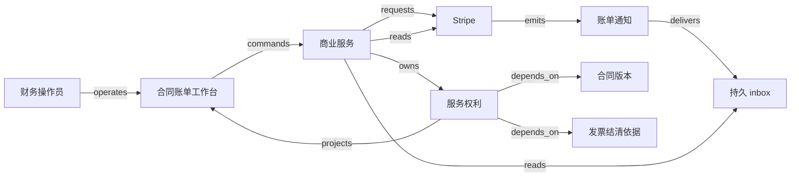

# H01 · 报价、合同、服务、收款与收入

客户买的是一段有边界的服务。销售给出价格，客户接受条款，运营开通使用权，财务核对应收与收款，期间报告再解释已经履行了多少承诺。即使这些动作在几秒内相继完成，每一步也要各有证据，因为先后并不固定：收款可能先于服务，服务变更也可能先于补款。所以已接受的报价冻结价格版本，后续变化另立修订；服务权利凭核对过的发票结清依据开通，按钮返回成功只表示请求已保存；收入按收费行的服务区间取交集，先算累计再求差；取消时贷项、退款义务与现金分开核对。外部结果未知时，按原 operation 找回结果，不换新请求重试。服务履行了多少由服务区间算出，收款金额只说明现金。

Salesforce 把 Quote-to-Cash 描述为跨越销售、履约、开票和应收的流程（[Salesforce QTC](https://www.salesforce.com/eu/sales/cpq/quote-to-cash/)），本章沿用这个范围。例子是一个订阅：一个租户购买 10 个席位，服务期为等长的 30 天 `[0,30)`；目录价每席全期 3,000 分，原合同享九折；税、汇率、支付手续费与坏账估计暂不计入演算。1 单位 = 100 分。

## 识题：从现象到方法

价格改动、跨期收费和取消退款各指向一种方法：冻结版本，按区间累计差计算，把服务调整、贷项与退款分开核对。

| 识题线索 | 可选解法 | 后续查证与检验 |
|---|---|---|
| 价格更新后，旧订单也被改价 | 冻结已接受的版本，新承诺另立修订 | 查报价有效期、折扣审批与修订生效规则；对照旧、新合同各自的金额 |
| 钱一次到账，服务跨多个期间 | 按收费行计算区间交集与累计差 | 查 invoice line 期间和舍入点；把窗口金额加回整段收费 |
| 取消后仍有已履行服务与未退现金 | 把服务调整、贷项与退款分开核对 | 查 credit note 及 payment application；分别检验服务余量与现金义务 |

## 解法：先冻结价格，再推进履行

已接受的报价是开票、开通和收入共同依据的版本，所以先冻结；增购或取消另立修订，原记录不动，履行和收款再各凭证据推进。

报价为 `10 × 3,000 × 90% = 27,000 分`。目录价表示“现在通常卖多少钱”，已接受的报价记下“这位客户按什么版本买了什么”。若让订单直接读最新价目表，管理员一改价，旧发票的含义就可能跟着变；冻结之后，新价目只进入之后的报价。本例把数量、价格、折扣、币种、期间和规则版本一起冻结：草稿阶段销售可以改；报价一经接受，后续变化另立 amendment（修订协议），原记录不再改动。

第 12 天，客户再买 5 个席位。按本例约定的合同政策，新增部分不享原折扣，按剩余 18 天收费：`5 × 3,000 × 18 / 30 = 9,000 分`。这次增购记为修订 A1，引用原合同 v1；原 10 席位的 27,000 分保持不变。

<!-- svg: h01-versions -->

到第 20 天，客户累计支付 36,000 分，已履行的收入是原合同 18,000 分加新增部分 4,000 分，共 22,000 分。剩余 14,000 分对应尚未提供服务的期间：收款 36,000 分里，只有 22,000 分对应已经提供的服务。

| 参与者与对象 | 权威与动作 | 状态、前提与证据 |
|---|---|---|
| 销售；Quote | 合同服务保存报价；销售提交，超出折扣阈值时需经批准 | `draft → offered → accepted`；接受时绑定版本、客户身份及有效期，过期后重新报价 |
| 客户；Contract / amendment | 客户接受；合同服务保存版本链 | `pending → effective → ended`；修订另行接受，历史仍按原合同解释；被替代的合同保留，不删除 |
| 财务；Invoice | 本例由 Stripe 保存发票事实，本地保存映射和副本 | `draft → open → paid` 是主路径；最终金额与合同版本核对；请求提交成功只表示请求已保存，开票以 provider 返回的发票为准 |
| 运营；Entitlement | 自建权利服务决定可用席位 | `pending → active → suspended / ended`；满足预付条件后开通，暂停时保存原因；退款经 Credit adjustment 处理，席位数不随退款改动 |
| 账务人员；Revenue schedule | 自建的期间计算服务保存计划版本 | `proposed → approved → superseded`；金额、期间、来源行和计算规则确定后发布，修正时原计划保留 |
| 财务复核人；Credit adjustment | 自建调整记录连接合同修订、贷项与退款尝试 | `requested → authorized → externally-confirmed`；先核对权限、可退余额与分配方式，外部结果未知时留待复核 |

这里的 `paid` 只表示发票余额已经结清；怎样结清要另查支付依据。Stripe 区分 `draft/open/paid/void/uncollectible`，还说明信用余额、免费账单或 out-of-band 标记等情况都可能产生 `invoice.paid`，不一定对应一次成功的 PaymentIntent。因此，本例的主路径排除这些情况，并且必须核对支付依据、客户、币种和金额；扩展到这些情况时，要明确接受哪一种结清证据。[Invoice lifecycle / Paid invoices](https://docs.stripe.com/invoicing/overview)。

合同工作台可以在一个入口里分别显示各对象的状态。Ironclad 的发布说明里，合同状态、未完成任务与协作者责任放在同一个工作流页上，签署前的流程和已归档的记录也能在一处查找（[New Workflow Page / Unified Dashboard and Repository](https://support.ironcladapp.com/hc/en-us/articles/30977258163607-What-s-New-in-Ironclad-April-2025)）；这是“在一个入口查看不同责任”的一个产品例子。

## 意图与回执

页面上的动作先保存为带对象版本和 operation ID 的意图，外部回执核对后才产生本地效果；通知可能重复、乱序，去重要同时按事件和业务效果做。

工作台列表展示合同版本、应收余额、席位与服务期间、尚未确认的动作。进入详情可以看到报价计算和修订差异。“接受报价”“开票”“确认修订”“批准退款”是不同角色的动作，各自校验角色；客户身份只授权接受报价，批准退款要财务复核人。表单预览由服务端按已冻结的规则计算，提交时带上对象版本与 operation ID。若另一人已经改过草稿，页面显示新旧差异并要求重新确认。

“开票”的正常链为：服务核验授权与 accepted 版本 → 在本地事务保存 operation 和待发请求 → worker 调用 provider → 记录外部发票身份 → 查询投影显示 `open` → 收到支付相关通知 → 核对 invoice 与支付依据 → 本地事务开通对应席位并登记消费结果。按钮返回成功，首先只表示请求已保存；能放行服务访问的，只有链末那条权利记录。换页后按 operation ID 取回同一个结果，断网重连也不会产生新的购买。

<!-- svg: h01-chain -->

每条边的 payload、失败点和作用域见 [H01.json](../../../../vault/distilled/saas-engineering-atlas/packages/commercial-finance/H01.json)。本地 invoice 映射包含 tenant、provider account 和外部 ID；账户以服务端保存的映射为准，事件里的账户不覆盖它；签名验真以后，再按映射判断事件属于哪个账户与业务对象。Stripe 文档说明通知可能重复且不保证到达顺序，并要求用原始请求体验证签名（[Create a handler / Event ordering / Handle duplicate events](https://docs.stripe.com/webhooks)）；本例在向 Stripe 返回接收成功之前，先把有效通知存入 inbox，复杂的处理留到之后。

本地去重有两层。event ID 避免同一通知被重复处理；`tenant + purchase_line_id` 的唯一权利效果避免不同通知对同一次购买开通两次。例如通知 E1 投递了两次，另一条通知 E2 指向同一购买行 L1（原 10 席位）：第一层跳过 E1 的第二次投递，第二层发现 L1 已有权利效果，E2 读取原效果，L1 最终只有一份开通效果。

<!-- svg: h01-dedup -->

只做第一层，两个不同事件都能开通；只做第二层而不保存事件，异常来源与重放进度难以解释。PostgreSQL 的组合唯一约束可以表达复合身份，但默认允许多个空值，所以本例的身份列都设为非空（[Unique Constraints / Primary Keys](https://www.postgresql.org/docs/current/ddl-constraints.html)）。数据库约束管住的是本地效果；跨外部 API 的操作只执行一次，靠保存的 operation 与幂等身份来保证。

## 演算：按时间区间重演金额

`ALG:windows` 的思路是把每条收费行摊到它承诺的服务区间，再取观察窗口与该区间的交集。对金额 A、期间 `[s,e)`，截至 t 的累计金额定义为 `C(t)=floor(A × clamp(t−s,0,e−s)/(e−s))`，单位为分。`clamp(x,0,L)=min(max(x,0),L)` 把经过时间限制在 0 至 L，`floor(x)` 表示向下取整到整数分。因此 t≤s 时累计为 0，t≥e 时累计为 A；中间的窗口用累计差计算，避免每段各自舍入而丢分。某窗口 `[a,b)` 的金额为 `C(b)−C(a)`。这一取整政策只适用于本例的非负、线性、等长时间模型。负向修正要么沿原计划逆转，要么另立明确的贷项，不把负数直接代入这个公式。

<!-- figure: h01-windows -->
| 收费行 | 金额与服务期间 | 截至第 20 天的手算 |
|---|---|---|
| 原 10 席位 | 27,000 分，`[0,30)` | `27,000 × 20/30 = 18,000` 分 |
| 第 12 天新增 5 席位 | 9,000 分，`[12,30)` | `9,000 × 8/18 = 4,000` 分 |
| 合计 | 已付 36,000 分 | 已履行 22,000 分，未来期间 14,000 分 |
<!-- /figure -->

先算累计再求差，是为了守住总额。假设 100 分分到 3 天，逐日各自四舍五入得 `33+33+33=99`，少了一分。累计法得到 `C(0..3)=[0,33,66,100]`，各天为 33、33、34，任意相邻窗口相加仍等于整段。分到哪一天是政策选择，金额守恒是必须检查的结果。月长、时区、夏令时或按秒服务改变后，要重新定义区间单位。

朴素方法为每条合同每天生成一行，n 条收费、d 天需要 O(nd) 空间；上面的交集公式计算一个观察窗口只扫描 n 条，时间 O(n)、额外空间 O(1)。查询很多不同期间时，可以存区间边界或按批准计划预聚合，但修订后只重算受影响的窗口，并把投影绑定输入版本。缓存键包含 tenant、计划版本与窗口；旧版本的结果保留下来，只用于旧版本的复算。服务延迟尚未实测。

Stripe Revenue Recognition 的公开说明以 finalized invoice 和 line item 的服务期间为基础，取消 subscription 本身不改变已开票的计划；发票行没有单独设置期间时，确认时点也会受影响（[Licensed subscriptions / Subscription cancellations / Standalone invoices](https://docs.stripe.com/revenue-recognition/methodology/subscriptions-and-invoicing)）。

## 变更、迟到与未知结果

贷项改变收费，退款确认后才改变现金；迟到或乱序的通知触发对当前权威对象的重新核对，结果未知时按原身份找回，合法的外部修正照常进入。

第 20 天取消新增的 5 席位，假设双方同意退回尚未提供的 10 天，则贷项为 `9,000 × 10/18 = 5,000 分`。原 10 席位继续使用；新增部分已经提供的 8 天仍有 4,000 分。调整后净收费 31,000 分，已履行仍为 22,000 分，原席位未来的 9,000 分保留。若退款还在处理，现金净额仍为 36,000 分，同时存在 5,000 分的退款义务；只有退款确认后，现金净额才变为 31,000 分。

Stripe 的 credit note 可以调整最终发票；已付发票的贷项可以关联退款、客户余额或外部处理（[Credit notes for open / paid invoices](https://docs.stripe.com/invoicing/integration/programmatic-credit-notes)）。留作余额还是实际退现金，对资金的影响不同；界面要让财务明确选定，并展示结果。本例只演示退现金路线，未实现 Stripe 退款接口及会计分录。

| 故障时序 | 常见错误做法 | 恢复方式与用户可见结果 |
|---|---|---|
| provider 接受开票，响应在网络中丢失 | 新建 operation，再开一张票 | 原 operation 进入 `unknown`，先按保存的映射或同一幂等身份找回；显示“正在核对是否已开票” |
| 事件处理已开通，worker 在标记消费前退出 | 重放后再加 10 个席位 | 权利效果与业务键受约束，恢复时读取既有效果，再完成消费记录 |
| 支付通知先到、早先的 open 通知后到 | 按到达次序回退状态 | 以通知触发核对，读取当前权威对象及依据；不能只按事件的秒级时间戳排序 |
| 原来 paid 的发票被合法取消付款分配 | 永久保留本地 paid | 当前依据已改变，更新投影并进入权利复核；不能以“防回退”为由忽略真实修正 |
| 两位财务同时批准退同一段未履行期间 | 各退 5,000 分 | 以调整版本锁定可退剩余额：只有一个请求取得授权，另一个返回冲突或原尝试 |

Stripe API v1 的幂等结果在开始执行后保存，同一 key 重试可返回原响应，包括错误；key 被清理后重用会新建请求，参数改变也受检查（[Idempotent requests](https://docs.stripe.com/api/idempotent_requests)）。因此本地必须长期保留购买与外部操作的映射。结果未知、又超出安全重试条件时，交给财务核对，不换新 key 去猜着重试。

发票从 paid 回到 open 是合法的外部修正，所以“paid 之后不能再 open”只在没有这条分支时成立。Stripe 的 Payment application 文档说明，取消付款分配限于 `send_invoice`，并可能使发票重开（[Payment application](https://docs.stripe.com/invoicing/apply-payments)）；其示例用的是 preview API 版本，接入前要核实可用性。本章把重开作为显式的外部修正分支；自动扣款发票能否重开、原服务是否追回，都不作推断。

## 技术选型

首个原型可以用 React + TypeScript 或 Vue + TypeScript 建工作台：团队已有 React 组件时选前者，已有 Vue 表单体系时选后者。选哪一个，看团队对哪套技术熟悉、复杂表单要怎样表现；两者都要呈现版本冲突、异步尝试与金额预览。初期，操作详情页用轮询取状态；状态变化较频繁时，再考虑服务器发送事件（Server-Sent Events，SSE）。页面恢复始终可以按 operation ID 查询。

后端可用 TypeScript + NestJS 统一前后端类型，也可用 Python + FastAPI 配合财务计算团队；服务端边界重新校验授权和数字。规模小时，选一个模块化服务加 PostgreSQL，在同一事务里保存合同、operation、outbox 和本地权利效果，比拆成多个服务更容易讲清提交边界。队列可以先用数据库里的持久任务代替；独立队列有利于流量削峰，但增加了消息与业务状态的对账工作。对象存储只保留合同文档及校验值，数据库保存身份、权限和版本关系。以上是本例的原型选型建议。

容量假设为 100 个租户、10 万份在期合同、每份合同平均 3 行；日常 20 次命令/秒，月初 10 分钟出现 300 次通知/秒，一个大租户占通知量的 40%。待测目标为 50 并发下单租户 50 行列表 p95 < 400 ms，本地提交 p95 < 500 ms，provider 健康时核对积压 p99 < 60 s；缓存命中、冷读和月初突发分别测。外部 API 时延另外记录，不计入本地目标。任务按租户配额调度，监控最老的未核对 operation 的年龄，与队列长度一起看；按租户配额调度，其他租户的到账核对不被一个热点租户挤占。

## 验算：检查项与所需证据

每项检查都在端到端结果里看三件事：开通效果只有一份，金额按区间累计并与版本对得上，跨租户、迟到和未知结果都不改写已确认的事实。

| 输入与动作 | 端到端应观察的结果 | 必需的证据 |
|---|---|---|
| 接受 27,000 分原合同、核对付款，随后接受并支付新增 9,000 分 | 10 席位与 5 席位有独立来源，第 20 天累计 22,000 分 | 合同版本、provider 对象、权利效果、UI 与计划版本 |
| 同一 event 两次；不同 event 指向同一购买 | 均只有一份开通效果 | inbox 身份、业务唯一键、最终席位 |
| 当前 paid，迟到的旧 open 通知 | 不被旧快照回退；真实 unapply 则进入修正分支 | 权威读取与修正原因 |
| 并发开票、并发退款 | 一个尝试或明确的版本冲突；退款不超授权剩余额 | 事务结果与外部尝试映射 |
| 两租户同编号，缓存分别命中与未命中 | 合同、发票、文档和操作均不串租户 | 查询范围与返回对象 |
| 外部已受理，本地超时；或开通后崩溃 | 先 unknown，核对后完成；重放不重复开通 | 外部结果、恢复日志与唯一效果 |
| 只停 subscription，没有批准贷项 | 原计划依据保留，调整仍待审批 | 合同修订、贷项与计划之间的差异 |
| 100 分分三天；空期间或负向输入误入公式 | 33、33、34；无效输入被拒绝 | 固定计算 fixture 与反例输出 |

本例的价格、开通与收入由确定性规则和人来决定，不适用 AI eval。若以后让模型提取合同期间，应另外冻结合同样本与人工标签，按金额、期间、币种的正确率和错误开通数评估，并要求不确定时拒绝自动批准。

## 变式：条件变化与迁移

条件改变时，“开通有被授权的依据”和已履行的服务区间保持不变；变的是依据和现金：赊销用信用核准代替已付，退款待确认时现金净额不变，合法的付款分配撤销触发重新核对。

**练习一：把预付改成有 20,000 分信用额度的赊销。** 原订单 27,000 分能否仅凭 accepted 自动开通？

简答：不能全额开通。本例的新政策若要求应收敞口不超过额度，就需要提高额度、预收至少 7,000 分或缩小合同。守住的是“开通有被授权的依据”，改变的是依据从已付变成信用核准。反例是去掉 paid guard 后没有加上额度保留，两个并发订单看到同一笔可用额度，各自开通而超限；检查时，并发授权之后的保留总额与敞口都不得超过额度。

**练习二：第 20 天只取消新增席位，退款回执迟迟未到。** 能否显示已退 5,000 分，并把原合同的 10 席也停掉？

简答：两者都没有依据。新增修订的未来部分终止，原 10 席继续；退款处于待确认，现金净额暂为 36,000 分，另列 5,000 分退款义务。检查分行权利、批准的贷项与退款尝试相互对应，到账核对后现金净额才为 31,000 分。

**练习三：付过款后发生合法的 payment unapply。** 是否为了防止乱序而永久忽略 open？

简答：不应忽略。要重新核对付款分配，区分旧通知与新修正；发票重开，已履行的服务区间仍然保留。权利暂停或催收由明确的政策决定，检查所有修正仍能回查原付款。

`TR:H01:H02:evidence-before-effect` 把“有证据才确认本地效果”迁到采购付款，但 H02 还要核对收货、验收和累计已匹配数量，付款本身算不上验收证据。`TR:H01:H03:versioned-periods` 把期间与输入版本迁到关账；H03 另有整批完整性与截止后补录的问题，单份合同算对了，报表未必完整。`TR:H01:V12:effective-time` 能迁移的是生效时间与现金确认的区分；贷款本金和计息余额随还款分配而变，直线摊分固定服务额的办法不能直接套用。

**下一步探索。** 面对一种新的收费业务，先确认它出售固定期间、实际用量还是验收里程碑，再选择期间分摊、计量聚合或交付确认这一类方案。研究所选账单 provider 的发票行期间、付款分配、贷项和接口版本；这些条件改变时，当前的直线期间模型可能失效。可以先造一份带中途增购与取消的合成合同，让每次状态变化都指出依据，并用“总收费减获批贷项 = 已履行部分 + 剩余履行部分”核验收入计划。

来源定位与未覆盖范围见 [evidence.json](../../../../vault/distilled/saas-engineering-atlas/packages/commercial-finance/evidence.json)，结构见 [H01.json](../../../../vault/distilled/saas-engineering-atlas/packages/commercial-finance/H01.json)。
