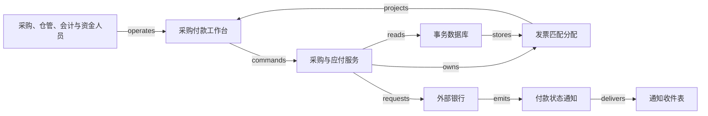

# H02 · 请购、验收、发票匹配与付款

采购付款的核心承诺是：企业为自己授权购买、确实收到并按约接受的东西支付正确金额。请购证明“有人需要”，采购单证明“企业作了承诺”，收货与检验证明“供应商交了什么”，发票表达“供应商要求结算多少”，银行记录证明“资金发生了什么”。这几种证据可能相隔数天到达；采购系统的工作是把它们连到同一批义务上，同时保留分歧。

本章承接 [H01](H01.md) 的承诺与履约模型，从买方一侧建立数量约束。下面的商品、金额、权限、容差、技术方案和恢复策略均为 synthetic 教学设计：一个法人、一个币种，采购 100 件零件，每件 10.00 记账单位；不计税、运费、汇率及预付款。实物流由收货和检验证明，现金流由银行确认。税务处理、付款法律效力、供应商银行账户变更与特殊采购例外，需要企业自己的制度和专业复核。

## 识题：从现象找到方法

| 识别线索 | 可选解法 | 接着查什么、验什么 |
|---|---|---|
| 每张发票单看都够，合起来却超量 | 累计证据占用，检查与分配原子提交 | 查PO行、receipt、accepted与历史allocation的身份和版本 |
| 已经收货，质量还没确认 | 选择与风险相称的两方/三方/四方证据 | 查match approval level和invoice match option；定位哪种证据缺失 |
| 外部超时后仍可能付了钱 | 保留付款尝试身份，先核对结果 | 查银行参考号、查询能力与重试约定；验一笔义务没有两次未知付款 |

下面沿这些线索建立对象与边界，再手算一组数据、用反例验算，最后改变前提重做判断。

## 解法：为什么一次“审批通过”不够

预算负责人可以批准买 100 件，但没有看到仓库后来的短交；仓管可以证明收到 80 件，却未必有资格判定质量；应付会计能检查发票，却不能替银行确认付款。把这些角色都折叠成 invoice.approved，会使某个早期批准在对象已经变化后继续授权付款。

Oracle Procurement 的 **Match Approval Level** 明确区分 Two-Way、Three-Way 和 Four-Way：数量核对逐步加入 receipt，以及 inspection 中的 accepted quantities。文档还说明，这与决定发票匹配到采购单还是收货记录的 **invoice match option** 是独立配置。[Oracle Match Approval Level Options](https://docs.oracle.com/en/cloud/saas/procurement/26b/oapro/match-approval-level-options.html)。这支持一个可迁移的判断：匹配的锚点与放行所需的证据是两个问题。本例选择按采购单行建立关系、使用四方数量证据；选择其他锚点不能自动豁免验收。

| 对象与身份 | 权威与责任 | 保存的约束 |
|---|---|---|
| Requisition 请购 `REQ-1`；Purchase order 采购单 `PO-1/L1` | 申请人提需求；预算负责人审批；采购服务保存获批版本 | 已批准的数量、单位、价格、供应商与法人形成确定版本；改价或增量要重新获批 |
| Receipt 收货 `RCV-1/L1` | 仓管确认实际收货；收货服务保存原记录及更正记录 | 收货量与采购单行有显式分配；退货不能用删除原收货掩盖 |
| Inspection 验收 `INS-1` | 检验员决定 accepted、rejected、pending 数量 | 本例 `accepted + rejected + pending = received`；accepted 不从送货单推测 |
| Supplier invoice 发票 `INV-A`；匹配分配 `ALLOC-A` | 应付会计录入；应付服务保存发票版本、匹配与 hold | 同一验收数量不能被不同发票重复占用；发票金额不凭 光学字符识别（optical character recognition，OCR） 直接确认 |
| Payment order 付款指令 `PAY-A` | 资金人员批准；付款服务持有操作状态；银行持有外部交易事实 | 一次义务只能关联一个仍可能成功的付款尝试；submitted 与 settled 分开 |

本例实行职责分离：申请人不能批准自己的请购，检验员不能发起付款，付款审批人与制单人不同。服务端按租户、法人、角色和对象版本验证，页面隐藏按钮只帮助理解权限。供应商名称相同不构成身份；发票号的防重键为 `(tenant, legal_entity, supplier_id, normalized_invoice_number)`，规范化规则需保留原串并处理冲突。同一文档哈希可以提示重复，无法单独处理重新扫描、合法重开或贷项通知。

生命周期各自推进。请购从 draft 到 submitted，再由负责人批准或驳回；已获批采购单修改时生成新版本，旧版本保留。收货从 recorded 到 inspected，部分检验期间仍能保留 pending 数量；退货作为关联原收货的调整。发票从 captured 到 matched 或 held，解除 hold 必须留下新证据与重新匹配结果；本例整张发票有 hold 就不付款，不擅自支付其可匹配部分。付款从 prepared、authorized 到 submitted，随后可能是 unknown、settled 或 rejected；银行确认退回属于后续 return 事实，不能把 settled 历史擦掉。结构中的 guard 见 [H02.json](../../../../vault/distilled/saas-engineering-atlas/packages/commercial-finance/H02.json)。

## 演算：用累计分配判断还能付多少

假设第一批收到 80 件，其中 75 件验收合格，5 件仍待检验。供应商的发票 A 为 70 件，单价 10.10，总额 707.00。本例数量容差为零，单价允许比采购单高 2%；这是一条显式案例政策，不是 Oracle 的默认值。匹配时先统一单位，再看同一采购单行的累计值：

- 已分配数量为 0，因此可用订单量为 100，可用收货量为 80，可用合格量为 75。A 的 70 件同时不超过三个余额。
- 单价差率为 `(10.10 − 10.00) / 10.00 = 1%`，在 2% 内；`70 × 10.10 = 707.00`。通过时在事务内写入 A 的 70 件分配，剩余合格量为 5 件。
- 发票 B 又申请 10 件、总额 101.00。订单余额为 30，收货余额为 10，合格余额只有 5；B 被 hold。它的价格合格，仍不足以支持付款。
- 供应商经确认把 B 修订为 5 件、50.50，保留旧版本与修订关系。重新匹配后累计结算数量为 75，累计金额为 757.50；其中 A 已付款 707.00，B 尚待支付 50.50。另有 5 件待检、20 件尚未收到，页面应同时保留这两项责任。

这里的“可用”指尚未被有效发票分配占用的证据量。已付款发票仍占用其对应数量；删除支付记录或关闭页面都不会让这 70 件重新可用。若发票作废，只有在确认没有仍可能成功的付款尝试并记录解除分配后，数量才可重新使用。匹配因新证据失效也不自动释放占用；当前验收证据已不足以支持历史分配时保留差异，不能继续授权新付款。若付款后才发现质量问题，形成退货、贷项或追偿链，不靠降低 accepted 数量自动撤销已经转出的现金。

**反例：每张发票各自与总验收量比较。** A 的 70 件不超过 75，B 的 10 件也不超过 75，两张都“通过”，累计却达 80。错误不在除法，而在丢失了已经消费的证据。两个操作员同时匹配 5 件和 5 件也会产生相同问题：各自读到剩余 5，只有将“检查余额与占用余额”作为一个原子动作才能防止超额。

Oracle Financials 的 **Invoice Tolerances** 区分数量、价格和金额容差，并说明超差的匹配发票会被 hold，hold 解除前不能付款；其配置中，百分比零与启用但没有值的容差含义不同。[Invoice Tolerances](https://docs.oracle.com/en/cloud/saas/financials/26b/fappp/invoice-tolerances.html)。由此可推导一个界面要求：必须把“零容差”“未启用”“无上限”显示为不同选择，不能全部渲染为空输入框。本文没有把这些配置推导成某个供应商站点当前采用的政策。

## 匹配算法与人看到的解释

`ALG:lookup` 的输入是发票行、采购单行、收货与验收分配、历史有效发票分配，以及冻结的规则版本；输出是可追溯的匹配结果和具体差异。朴素做法让每条发票行扫描全部 m 条采购和收货记录，n 行需要约 O(nm) 次比较。使用包含租户与法人的采购单行键，树索引先定位候选，再只累计该行的分配；定位成本通常为 O(log m)，还要付出实际候选数量 k 的读取成本。把累计余额放在采购单行上可以减小重复聚合，但每次调整必须同步维护它，并能从分配明细重算校验。

同一发票行可以对应多次收货。这个案例按业务已指定的采购单行匹配，按合格记录的稳定顺序分配，不根据“金额接近”任意凑单。候选关系不清时返回人工待确认。否则，两个不同法人恰好都有 707.00，会被错误连到一起；哈希查找快并不能改善身份错误。规则计算使用整数最小货币单位或明确精度的小数，单价与数量可以保留更高精度，在政策指定的行或单据层舍入，保存尾差去向。

发票详情应在一屏给出“订购 100 / 收货 80 / 合格 75 / 已占用 70 / 本次申请 10”，并定位导致 hold 的 5 件缺口。点击“重新匹配”提交 `invoice_id、expected_version、rule_version、operation_id`；服务端重读权威数量，保存匹配快照和分配。页面的预览可能已旧，提交结果必须返回接受的版本或冲突差异。拒绝时保留原输入、指向待补证据；不建议用户反复点击“审批”解决缺货。

箭头是信息关系。仓库真实接收零件不等于消息送达，银行转账不等于 `requests` 边已经发出。付款按钮只在发票没有有效 hold、银行账户版本已确认、授权有效且没有活跃付款尝试时可提交。服务端先保存指令与 outbox，再由发送任务连接银行。外部请求超时后，页面显示“银行结果待核对”，以原付款引用查询或读取对账单；没有银行幂等保证时绝不以一个新引用盲重发。

## 技术选择跟随责任边界

一个可实现的起点是 React 或 Vue 的发票差异表格，配合 TypeScript/NestJS 或 Java/Spring 的模块化服务和 PostgreSQL。前端适合把行级差异、版本冲突、附件预览和长任务状态留在同一上下文；小团队也可用 Django 服务端页面减少前后端状态同步。选择依据是团队熟悉度与交互复杂度，本例不要求微服务拆分，也不声称 Oracle 使用这些技术。

关系数据库适合把发票版本、数量分配和 operation 唯一约束一起提交。若采用 PostgreSQL，可锁定采购单行的余额记录后重新判断；多行按相同 ID 顺序取锁，避免长期占锁。官方说明 `FOR UPDATE` 会阻挡其他事务对同一行的冲突修改，锁通常保持到事务结束，也说明死锁可能导致事务被中止。[Explicit Locking §13.3.2、§13.3.4](https://www.postgresql.org/docs/current/explicit-locking.html)。这只支持数据库机制，不保证业务代码已正确加锁；网络付款不能放在持锁事务里等待。

发票原件放对象存储，事务库只保存受权限保护的引用、哈希和解析版本；对外公共材料不保存真实票据或访问凭据。队列可先由数据库 outbox 加后台 worker 实现；只有吞吐、消费者独立扩缩容或重放需求确实增加后，再考虑 RabbitMQ/Kafka。引入消息平台会增加运维与去重边界，不使数据库写入与银行转账变成同一事务。工作台读缓存含租户、法人、对象与投影版本；正式匹配和付款授权不读取缓存余额。

## 正常路径与故障接管

正常路径从已获批 PO 开始：仓管登记 80 件；检验员接受 75 件；会计录入 A 并预览 70 件分配；服务端以当前版本提交匹配；资金人员批准 707.00；worker 发出已保存的 PAY-A；银行确认结果后更新付款并投影。会计既能看到 A 的付款证据，也能看到 B 的 hold，业务结束条件没有被一个“订单已付”标签掩盖。

恢复最难的窗口在外部受理与本地收到结果之间。若银行接受 PAY-A 后连接断开，本地仍保留 PAY-A 的身份、707.00、收款人版本与 unknown 状态。核对任务确认同一外部交易后更新 settled；若一直查不到，操作员必须取得“未受理”的充分证据或按银行协议处理，不能把查询暂时无结果当确定失败。旧的 submitted 通知晚于 settled 到达时，接收记录可以保留，但已核对结果不能倒退。银行后来确认退回款项，则新增返回记录并重新形成待处理义务；它与旧消息乱序是不同事件。

数量调整发生在另一条边界。检验记录在发票匹配后由 75 改为 68 件，如果付款尚未发送，就使匹配快照失效、重新置 hold；如果付款处于 submitted 或 unknown，先冻结新的付款及释放动作，保留原尝试与数量占用，再核对银行。只有确定未执行且解除分配获批才释放占用；已成功则转入差异案件。如果已经 settled，就建立差异案件和退货/贷项处理。系统不能承诺靠回滚数据库恢复现实资金。重新匹配完成后才允许解除 hold，手工“强制通过”若业务需要，应成为限权、有原因、有审批证据的例外流程，本例不实现。

假设 100 个租户、100 万张历史发票，每天新入 5 万张，每张平均 5 行；高峰每秒 30 次匹配、100 个并发用户，10% 流量集中在同一大供应商。待测目标为单张 50 行以内预览 p95 500 毫秒、正式匹配 p95 1 秒，均从 API 接收至提交或明确拒绝计时，排除银行等待并另报其延迟。要单独测同一采购单热点、缓存未命中、长队列与锁冲突。收件 2 秒、投影 5 秒内可见只是目标；正确性指标始终要求零重复付款、零跨租户读取、零未经例外授权的超额占用。限制每租户后台并发，避免一个批量导入挤占其他租户。

## 验算：检查与可选 AI 辅助

| 检查情境 | 从 UI 到权威记录应观察什么 |
|---|---|
| 正常路径 | A 70 件、707.00 获批；同一 PAY-A 有银行确认；B 的 10 件因仅剩 5 件合格量被 hold |
| 重复与乱序 | 重传 A 不新建义务；重复回执只产生一个结算效果；晚到 submitted 不覆盖 settled |
| 并发 | 两人各申请最后 5 件，一个成功，另一人冲突或 hold；总分配仍为 75 |
| 租户隔离 | 两租户相同 PO 和发票编号，详情、附件、缓存与后台任务均不交叉 |
| 未知结果 | 银行受理后断线，UI 保留同一 operation，查询确认后只出现一笔资金交易 |
| 崩溃恢复 | 分配已提交但响应丢失，重试返回原结果；发送任务恢复后不制造新付款身份 |
| 领域反例 | 验收量从 75 降至 68：未发款重新 hold；在途保留尝试与占用并核对；已结算产生差异处理 |
| 配置边界 | 数量为零、单位换算缺失、价格基数为零、重复修订、容差为空均有明确拒绝或专门政策 |

这些是端到端验收定义，所需操作记录、数据库状态与外部 stub/银行证据在 JSON 的 checks 中。合成脚本能核验数量与金额守恒，不能替代数据库并发、真实银行、浏览器或性能执行。

确定性匹配不需要 AI。如果加入票据 OCR/模型抽取，模型只生成待确认字段与页码定位，不能自动创造收货、验收或银行账户权威。评估可冻结 200 张未参与提示词调试的合成票据，覆盖多页、重复票号、不同单位、小数点模糊与币种冲突；报告金额/币种/供应商身份的逐字段精确正确数、错误自动接受数/自动接受数、应拒绝却接受数/歧义样本数、人工更正数/全部样本数，以及拒绝率。遇到关键身份或金额不确定就转人工。分母、模型版本、解析版本与实际结果单列记录。

## 变式：改变前提后的迁移练习

**练习一：回到 B 仍为 10 件、处于 held 且尚未修订的分支。5 件待检零件全部合格后，B 是否可以付款？**

简答：保持累计分配不变量，把 accepted 从 75 改为 80；A 仍占用 70，B 可用 10，价格仍在规则内。本题没有先前的 5 件 B 分配；若主线的 B5 已匹配，则剩余额度只有 5，不能复活旧 B10 再占用。系统必须记录新的验收版本、重新运行匹配并获得付款授权，不能仅因列表由红变绿自动发钱。反例是使用验收缓存解除 hold，却仍按旧收款账户支付。可观察检查为分配合计 80、无重复 PAY-B、付款预览引用当前发票与银行账户版本。

**练习二：采购对象改为一个 1,000 单位的咨询里程碑，没有件数，能否原样使用四方匹配？**

简答：承诺、履约证据与结算分配仍保留；“件数”改成具备明确验收标准的里程碑金额或可验证工作量，并建立范围变更版本。不能把任意的“完成 80%”等同于 80 件实体物料。若合同不允许按进度付款，80% 完成不能释放 800。检查里程碑是否达到约定 guard，以及发票累计金额是否占用同一承诺额度；该模型可连接 V20 的工单验收，但工单完成也不自然等于付款已获授权。

**下一步探索。** 进入一种新采购业务，先辨认收货数量、质量验收、服务里程碑与预付款是否分别存在，再决定采用两方、三方、四方匹配或合同专属的里程碑规则。优先查采购单的匹配锚点、容差空值含义、发票版本和付款在途协议。用一张100件采购单、两批验收与两张争抢余额的合成发票建立最小试验；通过标准是累计分配、hold原因和银行未知状态都可解释，不能只看自动匹配率。

`TR:H02:H03:matched-to-posted` 把已确认发票、付款与来源关系交给 [H03](H03.md) 形成子账。迁移时保留身份、金额、币种和修订历史；H03 的会计期间与科目规则仍须另定，匹配通过不能证明费用分类或关账正确。`TR:H02:V12:evidence-before-disbursement` 可迁移到放款前条件校验，但贷款的信用批准与本金偿还不是商品验收与数量消费，不能套用“收到多少就付多少”。演示可让读者拖动验收量、并发分配最后 5 件、切换银行超时，观察数量、应付与现金各自变化。证据及执行边界见 [evidence.json](../../../../vault/distilled/saas-engineering-atlas/packages/commercial-finance/evidence.json) 与 [CHANGELOG.md](../../../../vault/distilled/saas-engineering-atlas/packages/commercial-finance/CHANGELOG.md)。
