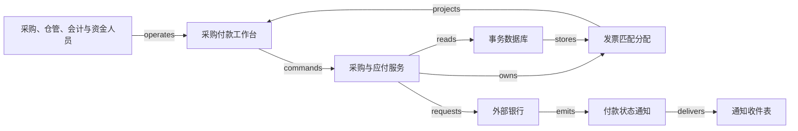

# H02 · 请购、验收、发票匹配与付款

企业付出的每一笔采购款，都应对应自己授权购买、确实收到并按约接受的东西，金额也要正确。请购证明“有人需要”，采购单证明“企业作了承诺”，收货与检验证明“供应商交了什么”，发票表达“供应商要求结算多少”，银行记录证明“资金发生了什么”。这几种证据可能相隔数天才到；采购系统把它们连到同一批义务上，彼此的分歧照样保留。

[H01](H01.md) 的承诺与履约模型换到买方一侧，多出了数量约束。本例设一个法人、一个币种，采购 100 件零件，每件 10.00 记账单位；不计税、运费、汇率及预付款。实物流由收货和检验证明，现金流由银行确认。税务处理、付款法律效力、供应商银行账户变更与特殊采购例外，需要企业自己的制度和专业复核。

## 识题：从现象到方法

| 识题线索 | 可选解法 | 后续查证与检验 |
|---|---|---|
| 每张发票单看都够，合起来却超量 | 按累计量占用证据，余额检查与分配在同一事务提交 | 查 PO 行、receipt、accepted 数量与历史 allocation 的身份和版本 |
| 已经收货，质量尚未确认 | 按风险选择两方、三方或四方证据 | 查 Match Approval Level 与 invoice match option 的配置；找出缺的是哪种证据 |
| 外部超时，付款可能已经执行 | 保留付款尝试的身份，先核对结果 | 查银行参考号、查询能力与重试约定；检验同一笔义务没有两笔结果未知的付款 |

## 解法：分角色的证据与审批

预算负责人可以批准买 100 件，但没有看到仓库后来的短交；仓管可以证明收到 80 件，却未必有资格判定质量；应付会计能检查发票，却不能替银行确认付款。如果系统只用一个 invoice.approved 状态代表这些人的判断，一次早先的批准就会在对象已经变化之后继续放行付款。

Oracle Procurement 的 **Match Approval Level** 区分 Two-Way、Three-Way 和 Four-Way：从两方到四方，数量核对依次加入 receipt 数量和 inspection 中的 accepted quantities。文档还说明，它与 **invoice match option** 是两项独立配置，后者决定发票匹配到采购单还是收货记录。[Oracle Match Approval Level Options](https://docs.oracle.com/en/cloud/saas/procurement/26b/oapro/match-approval-level-options.html)。由此推论：发票匹配锚定在哪一级，与放行付款需要哪些证据，要分开决定。本例把发票匹配到采购单行，放行时要求四方数量证据；改用别的锚点，验收证据照样要有。

| 对象与身份 | 权威与责任 | 约束 |
|---|---|---|
| Requisition 请购 `REQ-1`；Purchase order 采购单 `PO-1/L1` | 申请人提需求；预算负责人审批；采购服务保存获批版本 | 批准时冻结数量、单位、价格、供应商与法人；改价或增量要重新审批 |
| Receipt 收货 `RCV-1/L1` | 仓管确认实际收货；收货服务保存原记录及更正记录 | 收货量逐条分配到采购单行；退货另记调整，不删除原收货 |
| Inspection 验收 `INS-1` | 检验员决定 accepted、rejected、pending 数量 | 本例 `accepted + rejected + pending = received`；accepted 不从送货单推测 |
| Supplier invoice 发票 `INV-A`；匹配分配 `ALLOC-A` | 应付会计录入；应付服务保存发票版本、匹配与 hold | 同一验收数量不能被不同发票重复占用；发票金额不直接采信光学字符识别（optical character recognition，OCR）的结果 |
| Payment order 付款指令 `PAY-A` | 资金人员批准；付款服务持有操作状态；银行持有外部交易事实 | 一笔义务只能关联一个仍可能成功的付款尝试；submitted 与 settled 分开记录 |

本例实行职责分离：申请人不能批准自己的请购，检验员不能发起付款，付款审批人与制单人不是同一人。服务端按租户、法人、角色和对象版本验证权限；页面隐藏按钮只起提示作用。名称相同不说明是同一家供应商；发票号的防重键为 `(tenant, legal_entity, supplier_id, normalized_invoice_number)`，规范化时要保留原串并处理冲突。文档哈希相同可以提示重复，但单凭哈希分辨不了重新扫描、合法重开和贷项通知。

各对象的生命周期各自推进。请购从 draft 到 submitted，再由负责人批准或驳回；已获批的采购单修改时生成新版本，旧版本保留。收货从 recorded 到 inspected，部分检验期间仍可保留 pending 数量；退货作为关联原收货的调整。发票从 captured 到 matched 或 held，解除 hold 时要记录新证据和重新匹配的结果；本例整张发票有 hold 就不付款，不单独支付其中能匹配的部分。付款从 prepared、authorized 到 submitted，之后可能是 unknown、settled 或 rejected；银行后来确认退回，另记一条 return 事实，settled 的历史照旧保留。各状态转换的 guard 见 [H02.json](../../../../vault/distilled/saas-engineering-atlas/packages/commercial-finance/H02.json)。

## 演算：累计分配与可付余额

假设第一批收到 80 件，其中 75 件验收合格，5 件仍待检验。供应商的发票 A 为 70 件，单价 10.10，总额 707.00。本例数量容差为零，单价允许比采购单高 2%；这是一条显式案例政策，不是 Oracle 的默认值。匹配时先统一单位，再看同一采购单行的累计值：

- 已分配数量为 0，因此可用订单量为 100，可用收货量为 80，可用合格量为 75。A 的 70 件不超过其中任何一个余额。
- 单价差率为 `(10.10 − 10.00) / 10.00 = 1%`，在 2% 以内；`70 × 10.10 = 707.00`。通过后，在同一事务里写入 A 占用 70 件的分配，剩余合格量为 5 件。
- 发票 B 又申请 10 件、总额 101.00。订单余额为 30，收货余额为 10，合格余额只有 5。B 的价格合格，合格数量却不够，因此被 hold。
- 供应商确认后把 B 修订为 5 件、50.50，旧版本与修订关系保留。重新匹配后累计结算数量为 75，累计金额为 757.50；其中 A 已付款 707.00，B 尚待支付 50.50。另有 5 件待检、20 件尚未收到，这两项未了的责任页面上都要继续显示。

这里的“可用”指尚未被有效发票分配占用的证据量。已付款发票仍占用对应数量；删除支付记录或关闭页面，都不会让这 70 件重新可用。发票作废时，要先确认没有仍可能成功的付款尝试，并记录解除分配，数量才可重新使用。新证据使匹配失效时，占用也不会自动释放；当前验收证据不足以覆盖历史分配时，差异挂起，不再授权新付款。若付款后才发现质量问题，就走退货、贷项或追偿流程；调低 accepted 数量撤销不了已经转出的现金。

**反例：每张发票各自与总验收量比较。** A 的 70 件不超过 75，B 的 10 件也不超过 75，两张都“通过”，累计却达 80。问题出在比较时没有扣除已被前一张发票占用的证据。两个操作员同时匹配也会出同样的问题：一人申请 5 件，另一人也申请 5 件，两人都读到剩余 5 件。检查余额与占用余额必须是一个原子动作，否则就会超额。

Oracle Financials 的 **Invoice Tolerances** 区分数量、价格和金额容差，并说明超差的匹配发票会被 hold，hold 解除前不能付款；在它的配置里，百分比为零的容差与启用但没有赋值的容差含义不同。[Invoice Tolerances](https://docs.oracle.com/en/cloud/saas/financials/26b/fappp/invoice-tolerances.html)。由此推出一条界面要求：“零容差”“未启用”“无上限”要显示为三种不同的选择，不能都渲染成空输入框。

## 匹配算法与差异解释

`ALG:lookup` 的输入是发票行、采购单行、收货与验收分配、历史有效发票分配，以及冻结的规则版本；输出是可追溯的匹配结果和具体差异。朴素做法让每条发票行扫描全部 m 条采购和收货记录，n 行约需 O(nm) 次比较。若用包含租户与法人的采购单行键建树索引，先定位候选，再只累计该行的分配：定位通常为 O(log m)，另加读取实际 k 条候选的成本。把累计余额放在采购单行上可以减少重复聚合，但每次调整都要同步维护它，并能从分配明细重算校验。

同一发票行可以对应多次收货。本例按业务已指定的采购单行匹配，按合格记录的稳定顺序分配，不按“金额接近”任意凑单；候选关系不清时，返回人工待确认。若按金额凑单，两个不同法人恰好都有 707.00 的单据，就会被错误连到一起；哈希查找再快，也纠正不了身份错误。规则计算使用整数最小货币单位或精度明确的小数；单价与数量可以保留更高精度，在政策指定的行或单据层舍入，并记录尾差落在哪里。

发票详情应在一屏给出“订购 100 / 收货 80 / 合格 75 / 已占用 70 / 本次申请 10”，并定位导致 hold 的 5 件缺口。点击“重新匹配”时提交 `invoice_id、expected_version、rule_version、operation_id`；服务端重读权威数量，保存匹配快照和分配。页面上的预览可能已经过时，所以提交结果要返回被接受的版本或冲突差异。拒绝时保留原输入，指向待补的证据；界面不引导用户靠反复点击“审批”解决缺货。

箭头只表示信息关系，不表示实物或资金的移动：零件进库不是一次消息送达，`requests` 边发出也不代表银行已经转账。付款按钮在以下条件同时满足时才可提交：发票没有有效 hold、银行账户版本已确认、授权有效、没有活跃的付款尝试。服务端先保存指令与 outbox，再由发送任务连接银行。外部请求超时后，页面显示“银行结果待核对”，按原付款引用查询或读取对账单；没有银行幂等保证时，不换新引用盲目重发。

## 技术选型

一个可实现的起点是 React 或 Vue 的发票差异表格，配合 TypeScript/NestJS 或 Java/Spring 的模块化服务和 PostgreSQL。前端适合把行级差异、版本冲突、附件预览和长任务状态放在同一上下文里；小团队也可以用 Django 服务端页面，少做前后端状态同步。选哪一种取决于团队熟悉度与交互复杂度；本例不要求拆分微服务。

关系数据库适合把发票版本、数量分配和 operation 唯一约束放在一个事务里提交。若采用 PostgreSQL，可以先锁定采购单行的余额记录，再重新判断；涉及多行时按同一 ID 顺序取锁，以减少死锁。官方文档说明 `FOR UPDATE` 会阻挡其他事务对同一行的冲突修改，锁通常保持到事务结束，死锁则可能导致事务被中止。[Explicit Locking §13.3.2、§13.3.4](https://www.postgresql.org/docs/current/explicit-locking.html)。文档说明的只是数据库机制，业务代码是否正确加锁要另行检查；等待银行响应的网络付款不能放在持锁事务里。

发票原件放对象存储，事务库只保存受权限保护的引用、哈希和解析版本；对外公开的材料不保存真实票据或访问凭据。队列可以先用数据库 outbox 加后台 worker 实现；吞吐、消费者独立扩缩容或重放的需求确实增加后，再考虑 RabbitMQ/Kafka。引入消息平台会多出运维和去重的工作，数据库写入与银行转账也不会因此变成同一事务。工作台读缓存的键包含租户、法人、对象与投影版本；正式匹配和付款授权不读取缓存余额。

## 正常路径与故障接管

正常路径从已获批的 PO 开始：仓管登记 80 件；检验员接受 75 件；会计录入 A 并预览 70 件分配；服务端按当前版本提交匹配；资金人员批准 707.00；worker 发出已保存的 PAY-A；银行确认结果后，付款状态与投影随之更新。会计既能看到 A 的付款证据，也能看到 B 的 hold；“订单已付”这样的标签遮不住尚未了结的 B。

最难恢复的窗口在外部受理与本地收到结果之间。若银行接受 PAY-A 后连接断开，本地仍保留 PAY-A 的身份、707.00、收款人版本与 unknown 状态。核对任务确认是同一笔外部交易后，更新为 settled；若一直查不到，操作员必须取得“未受理”的充分证据或按银行协议处理，不能把查询暂时无结果当作确定失败。旧的 submitted 通知晚于 settled 到达时，接收记录可以保留，已核对的结果不倒退。银行后来确认款项退回时，新增一条退回记录，义务重新变为待处理；这是新发生的事件，与旧消息乱序到达是两回事。

验收数量也可能在匹配之后改变。检验记录在发票匹配后由 75 改为 68 件：若付款尚未发送，匹配快照失效，发票重新置 hold；若付款处于 submitted 或 unknown，先冻结新的付款与释放动作，保留原尝试与数量占用，再核对银行，确定未执行且解除分配获批后才释放占用，已成功则转入差异案件；若已经 settled，就立差异案件，走退货/贷项处理。回滚数据库追不回已经转出的资金。重新匹配完成后才允许解除 hold。如果业务需要手工“强制通过”，应做成限定权限、写明原因并留存审批证据的例外流程；本例不实现。

假设 100 个租户、100 万张历史发票，每天新入 5 万张，每张平均 5 行；高峰每秒 30 次匹配、100 个并发用户，10% 流量集中在同一大供应商。待测目标为：单张 50 行以内的预览 p95 500 毫秒、正式匹配 p95 1 秒，都从 API 接收计到提交或明确拒绝，不含银行等待，银行延迟另报。同一采购单热点、缓存未命中、长队列与锁冲突要单独测。收件 2 秒、投影 5 秒内可见只是目标；正确性指标始终要求零重复付款、零跨租户读取、零未经例外授权的超额占用。每个租户的后台并发设上限，避免一次批量导入挤占其他租户。

## 验算：检查项与所需证据

| 检查情境 | 端到端应观察的结果 |
|---|---|
| 正常路径 | A 70 件、707.00 获批；同一 PAY-A 有银行确认；B 的 10 件因合格量只剩 5 件被 hold |
| 重复与乱序 | 重传 A 不新建义务；重复回执只产生一个结算效果；晚到的 submitted 不覆盖 settled |
| 并发 | 两人各申请最后 5 件，一个成功，另一人冲突或 hold；总分配仍为 75 |
| 租户隔离 | 两租户相同 PO 和发票编号，详情、附件、缓存与后台任务均不交叉 |
| 未知结果 | 银行受理后断线，UI 保留同一 operation，查询确认后只出现一笔资金交易 |
| 崩溃恢复 | 分配已提交但响应丢失，重试返回原结果；发送任务恢复后不制造新的付款身份 |
| 领域反例 | 验收量从 75 降至 68：未发款的重新 hold；在途的保留尝试与占用并核对；已结算的转入差异处理 |
| 配置边界 | 数量为零、单位换算缺失、价格基数为零、重复修订、容差为空，均有明确拒绝或专门政策 |

以上是端到端验收定义；所需的操作记录、数据库状态与外部 stub/银行证据列在 JSON 的 checks 中。配套脚本核验的是数量与金额守恒；数据库并发、真实银行、浏览器和性能仍要另行实测。

确定性匹配不需要 AI。若加入票据 OCR 或模型抽取，模型只生成待确认的字段和页码位置，不能替代收货、验收或银行账户的权威记录。评估可以冻结 200 张未参与提示词调试的合成票据，覆盖多页、重复票号、不同单位、小数点模糊与币种冲突。报告以下指标：金额、币种、供应商身份逐字段完全正确的数量；错误自动接受数占自动接受数的比例；应拒绝却被接受的数量占歧义样本数的比例；人工更正数占全部样本数的比例；拒绝率。关键身份或金额不确定时转人工。分母、模型版本、解析版本与实际结果单独记录。

## 变式：条件变化与迁移

**练习一：B 仍为 10 件、处于 held 且尚未修订，5 件待检零件全部合格。** B 能否付款？

简答：能，但要重新匹配并取得授权。累计分配不变量照旧，accepted 从 75 改为 80；A 仍占用 70，B 可用 10，价格仍在规则内。本题没有先前那 5 件的 B 分配；若主线的 B5 已经匹配，剩余额度只有 5，不能复活旧的 B10 再占用。系统必须记录新的验收版本、重新运行匹配并取得付款授权，不能因为列表由红变绿就自动付款。反例是用验收缓存解除 hold，却仍按旧收款账户支付。检查分配合计为 80、没有重复的 PAY-B、付款预览引用当前的发票与银行账户版本。

**练习二：采购对象改为一个 1,000 单位的咨询里程碑，没有件数。** 四方匹配能否原样使用？

简答：不能原样使用。承诺、履约证据与结算分配仍然保留；“件数”换成有明确验收标准的里程碑金额或可验证的工作量，范围变更另立版本。任意的“完成 80%”换算不成 80 件实体物料；合同不允许按进度付款时，完成 80% 也不释放 800。检查里程碑是否达到约定的 guard，以及发票累计金额是否占用同一份承诺额度。这个模型可以连接 V20 的工单验收，但工单完成并不意味着付款已获授权。

**下一步探索。** 接触一种新的采购业务，先辨认收货数量、质量验收、服务里程碑与预付款是否分别存在，再决定采用两方、三方、四方匹配，还是合同专属的里程碑规则。优先查采购单的匹配锚点、容差空值的含义、发票版本和付款在途协议。用一张 100 件的采购单、两批验收和两张争抢余额的合成发票搭一个最小试验；通过标准是累计分配、hold 原因和银行未知状态都能解释，不只看自动匹配率。

`TR:H02:H03:matched-to-posted` 把已确认的发票、付款与来源关系交给 [H03](H03.md)，记入子账。迁移时保留身份、金额、币种和修订历史；H03 的会计期间与科目规则另行确定，匹配通过说明不了费用分类和关账是否正确。`TR:H02:V12:evidence-before-disbursement` 可迁移到放款前的条件校验，但贷款的信用批准与本金偿还不是商品验收与数量消费，“收到多少就付多少”套用不上。演示可以让读者拖动验收量、并发分配最后 5 件、切换银行超时，观察数量、应付与现金各自怎样变化。证据及执行边界见 [evidence.json](../../../../vault/distilled/saas-engineering-atlas/packages/commercial-finance/evidence.json) 与 [CHANGELOG.md](../../../../vault/distilled/saas-engineering-atlas/packages/commercial-finance/CHANGELOG.md)。
