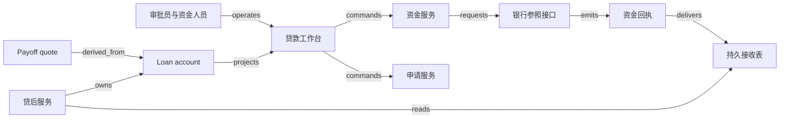

# V12 · 贷款：批准、放款、债权与结清

贷款把今天的一次资金交付，换成未来一段时间内的还款义务。申请通过、放款、债权余额和 payoff（提前结清）各自说明一件不同的事；若都显示成“成功”，页面看起来办完了，资金或利息却可能还没结清。机制是按本金变化的生效日分段计息，同一笔还款的生效日一变，payoff 随之改变，旧报价作废。本章还处理放款结果未知时的核对、结清报价绑定的余额版本，以及迟到还款与退票怎样重演余额。计息本金是资金已确认交付的那部分，批准额度另存。

本例采用一套封闭政策：使用一种记账单位（currency unit，CU；不是标准货币代码），最小金额单位 0.01 CU；一次放款本金 1,000 CU，日单利率 0.1%，按未偿本金计息，不复利；现金只在整数日边界入账，计息区间为 `[起日, 止日)`；每个结算事件汇总利息后四舍五入到分，先冲利息再冲本金。无费用、罚息、抵押、税或信用评分。第 10 日约定还 310 CU，第 15 日请求结清。

## 识题：从现象到方法

金额对不上时，先分清是生效日、资金确认还是报价时点的问题，三者分别用分段重演、分开保存额度与本金、报价绑定余额版本来解。

| 识题线索 | 可选解法 | 后续查证与检验 |
|---|---|---|
| 同笔还款换一个生效日，结清额改变 | 按本金变化的生效时间分段重演 | 查 day-count、舍入、分配顺序和回填规则；把本金与利息分开复算 |
| 已经批准，实际资金还不确定 | 批准额度、放款尝试与已放本金分开 | 查 disbursement 身份与资金确认来源；检验未执行的额度没有计入计息本金 |
| 昨日的结清报价今天已不够 | 报价绑定余额版本与有效时点 | 查 payoff 有效期和迟到付款政策；检验实际来款已保留、差额有处理去向 |

## 解法：批准、放款与债权的分界

批准接受的是条件，放款证明现金付出，债权余额由贷后服务按到账和分配记录维护；四者分开建对象，每个对象的“成功”只证明它自己那一步。

客户提交资料，贷款操作员检查完整性，信贷审批员判断是否接受风险，资金操作员发起放款，贷后人员处理到账和余额差异。分出这些角色，是为了留下记录：谁提出条件，谁批准条件，谁动用了现金。本例设定两条职责分离政策：申请人不能批准自己的申请；审批后改变金额或利率，要重开审批。

Mambu 文档里，`Partial Application` 表示资料不完整，`Pending Approval` 表示正在评估；批准后条款不能直接改，放款后账户变为 `Active`，逾期与结清另有状态。可见 Mambu 也把批准、放款和还款分开处理；某笔银行转账是否到账，另由资金回执证明。[Mambu：Loan Account Life Cycle and States](https://docs.mambu.com/docs/loan-account-life-cycle-and-states/)。另一页规定，贷款要先经具备 `Approve Loan` 权限的用户批准，且只有处于 `Pending Approval` 的贷款可以批准。[Mambu：Approving a Loan](https://docs.mambu.com/docs/approving-a-loan/)。

| 对象与身份 | 权威、状态与约束 |
|---|---|
| Application：`tenant + application ID + version` | 申请服务保管资料清单、条款版本和审批证据。`draft → review → approved / rejected`；缺资料时回 `draft`，批准后若有变更，原版本进入 `superseded`，另产生新版本 |
| Disbursement：`tenant + funding operation ID` | 资金服务保管请求，银行参照系统对执行结果负责。`prepared → submitted → settled / failed / unknown`；处于 `unknown` 时，不能改了金额再当作同一请求重试 |
| Loan account：`tenant + loan ID` | 贷后服务保管本金、应计利息、还款分配和冲正。`pending-funding → active ↔ arrears → paid-off`；有到账证据、放款也已入账，账户才激活 |
| Repayment：`tenant + bank account + bank transaction ID` | 入账服务核对现金并分配到债权。`received → applied`，无法匹配时为 `unmatched`；退回或更正错误时，记为 `reversed` 并补一条更正条目，原记录链保留 |
| Payoff quote：`loan ID + quote version + as-of day` | 贷后服务计算可追溯的金额。`quoted → accepted → settled`，余额变化或过期时进入 `expired`；接受报价本身不消灭债权 |

拒绝申请时资金尚未交付，也就没有本金偿还动作。已放款后的“撤销”是一项资金处理，申请记录照旧保留：现金已经出账的，核对收回或另行处理，原放款证据保留。Mambu 还区分全部义务履行后的关闭与核销关闭，本例只实现前者；免除部分余额要另有授权记录，应收差额凭这条记录才清零。两种关闭方式见同一生命周期页面的 `Closed` 一节；计算与授权政策是本例设定的。

## 界面动作与服务端校验

界面上的每个动作只提交请求，服务端按条款版本和 operation 身份重新校验后才落账。

申请工作台同时展示资料完整性、当前条款版本和待办责任人。点“送审”只是提交评估请求，界面不能因此显示“已获贷款”。审批页固定展示本金、利率、日计息规则、到期安排及证据版本；点击“批准 v3”后，服务端重新检查权限与版本，在一个事务里保存决定与待放款任务。旧标签页仍拿 v2 提交时，服务端返回版本冲突及差异，要求重新审阅，旧批准不会自动套到新金额上。

资金页从已批准版本生成一条 operation，预览收款人指纹、金额、币种和外部账户映射。服务先把操作身份和 payload 摘要写入数据库，再发外部请求；页面立即显示“请求已保存”，之后才显示“银行已确认”或“结果待核对”。刷新页面、重复点击和网络重连都找回同一 operation。银行已受理但 HTTP 响应丢失时，重新创建另一条转账会把一次借款变成两次现金交付。

下图是本例的实现拓扑。若选 Mambu 作核心账务，loan account 以 Mambu 为准，经适配器映射到本地，本地利息表降为核对模型；最终余额只能由一个系统决定。

React + TypeScript 适合把审批表单、还款分配表和操作状态做成同页工作台；简单的内部试验也可以用 Django 模板，减少前后端状态同步。前端只负责格式化金额，收款额不由浏览器的浮点计算决定。后端可选 Java/Kotlin + Spring 的十进制领域服务，或 Python + FastAPI/Decimal，以便与本例演算共用规则；已有 JVM 团队选前者顺手，后者开发较轻，两者都要明确小数精度和舍入点。

PostgreSQL 保存申请版本、贷款分户条目、operation、inbox/outbox 与唯一业务键；资料文件放进对象存储，数据库保存受控引用和摘要，资料原文不复制到事件总线。初期可以用数据库里的任务表跑异步任务，部署组件少，事务边界也清楚；积压变大后可改用 RabbitMQ 分发，但消息确认与数据库提交仍可能各自失败。租户、角色和贷款归属在服务端校验；消息里带着 tenant 和对象身份，消费者也要另行校验权限。

## 演算：按生效日分段计息

利息按本金稳定的区间分段计算，到账按生效日而不是收到日进入重演。

第 0 日放款 1,000 CU。到第 10 日还 310 CU 时，已产生 `1,000 × 0.001 × 10 = 10` CU 利息；310 先冲 10 利息，再冲 300 本金，本金剩 700。第 15 日结清时另计 `[10,15)` 的利息 `700 × 0.001 × 5 = 3.50`，因此 payoff 为 **703.50 CU**。这笔贷款累计收回 `310 + 703.50 = 1,013.50`，其中本金 1,000、利息 13.50。这道核对等式交代了每笔钱的来处，也能查出已还本金仍在计息的错误。

`ALG:windows` 的输入是按生效日排列的本金变化事件，输出是每个本金稳定区间的利息；`ALG:lookup` 负责把到账记录映射到唯一贷款。朴素方法逐日遍历 d 天；按事件分段只处理 m 个边界，已排序时 O(m)，需要排序时 O(m log m)。规模按“每户历史事件数”估计，总贷款数只说明有多少户。舍入之前累加精确小数，到本例指定的结算事件再舍入；改为每日舍入可能得出不同结果，要作为新的规则版本发布。

反例是第 11 日才收到一条**生效日为第 8 日**的 310 CU 还款。按收到日处理，会对客户已经归还的部分多计利息。按本例规则重演：前 8 天利息为 8，冲本金 302，本金剩 698；至第 15 日再计 `698 × 0.001 × 7 = 4.886`，舍入为 4.89，payoff 为 **702.89**。旧报价 703.50 作废，已记的利息用差额调整更正，原记录保留。这里的生效日要来自经过授权和核对的资金证据；普通用户不能任意回填更早的日期来降低利息。

<!-- svg: v12-windows -->

事件会晚到，余额因此要能从更早的点重演，逐日累加当天利息的做法只适用于事件按时到达的情况。可选的做法是保存余额 checkpoint（某一时点的余额快照）及对应的事件水位；补录发生在 checkpoint 之前时，从更早的可靠点重演受影响区间，生成新版本与调整差额。全历史重算最容易解释，但代价高；checkpoint 减少重演量，却要保存规则版本、事件集合和舍入状态。缓存 key 至少包括 tenant、loan、余额版本、规则版本和 as-of day；收款、冲正、回填或规则修订都会使旧 payoff 失效。

## 正常路径与失败恢复

账户只在本金和应计利息归零、没有未决资金操作时转为 paid-off；结果未知的放款保持原 operation 等待核对，不生成新的支付身份。

正常路径从客户补齐申请开始。审批员确认条款 v3，资金员提交 1,000 的 operation D1；银行参照接口确认 D1 已执行，贷后服务在唯一 D1 键下登记本金并激活账户。第 10 日到账 R1 核对后，界面显示“收到 310；利息 10；本金 300；剩余本金 700”。第 15 日客户接受 Q1，703.50 的到账 R2 应用后，本金与应计利息均为零，且没有未分配到账、未解决转账或待冲正操作，账户才转为 `paid-off`。结清证据是一条能回查到 D1、R1、R2 与 Q1 的记录链。

失败路径：银行已接受 D1，客户端却超时了。operation 进入 `unknown`，本地账户仍为 `pending-funding`；资金人员看到的是“等待银行结果”，而不是可以再次点击的“放款失败”。核对任务按原参考号查询。银行确认已出账后，贷后服务登记本金；若此时 worker 在本金提交之后、回执消费标记之前崩溃，重放时读取已存在的 D1 分录并补齐消费标记，本金不会再加 1,000。银行无法按原请求身份查询时，自动恢复到此为止，由资金人员核对流水；未经确认不生成新的支付身份。

<!-- svg: v12-unknown -->

贷后阶段的失败另有几种。重复的 R1 回执只分配一次；金额相同、银行交易 ID 不同的两笔付款是两笔钱，各自分配。退票使既往还款失效时，要反向分配、重演余额并让相关报价失效，原 R1 不删除。两个操作员同时结清同一余额版本，只有一个能消耗该版本；第二笔实际来款照样入账，放进未分配款，留待退款或人工处理。

## 验算：规模目标、检查项与模型评估

验收要同时证明三件事：每笔现金只记一次，本金变化与已确认资金一一对应，过期或失效的报价不会关闭账户。

待测负载为 50 个租户、100 万活跃账户，每户平均 60 个历史事件，最忙租户占写入的 40%；白天 100 笔到账/秒、300 次工作台读取/秒，晚间对全部账户作计息核对。单户 payoff 请求的目标为 p95 小于 300 ms、p99 小于 1 s，覆盖冷缓存与含 1 万条历史事件的长尾账户；外部支付时间不计入该同步计算目标。晚间核对应在 2 小时内完成，并报告分片积压、回填重演量和未解释的差额。以上是假设的负载与验收目标，尚未实测。

同一贷款的余额更新要么串行执行，要么比较版本，否则两笔并发付款会从同一本金开始分配；不同贷款可以分区并行。按 tenant 配额调度回填任务，可以防止一个大客户的历史修正拖住其他客户。缓存用于工作台列表；批准放款、执行分配与关闭账户都重新读取权威版本。最该盯住的运行指标是“资金已确认、尚未入账的操作数，以及其中最久的一笔已等了多久”：它反映银行里的现金与系统记录的债权之间的缺口。

| 输入与操作 | 预期可观察结果 |
|---|---|
| 正常放款、日 10 收 310、日 15 收 703.50 | UI 操作记录、资金回执、贷款条目与关闭投影逐段相连；本金为零、利息累计 13.50 |
| 重投 R1；另投金额同为 310 的独立 R3 | R1 只分配一次，R3 保持独立的现金身份；不能按金额去重 |
| 第 11 日收到生效日 8 的 R1 | 按生效时间重演，日 15 payoff 为 702.89，旧报价失效 |
| 两人按同一余额版本提交结清 | 只有一笔提交生效，另一笔明确报版本冲突；第二笔实际到账仍可核对 |
| 两个租户使用相同 loan ID 与银行参考号 | 列表、详情、缓存命中、导出与恢复查询均按租户隔离 |
| 银行已执行 D1，但请求超时 | 保持 `unknown` 和原 operation；先查询原请求，不再次出账 |
| 本金已登记，worker 在消费标记前退出 | 恢复后本金仍只增加 1,000，操作与消费状态最终一致 |
| 第 16 日才按日 15 报价付款 703.50 | 当日应付 704.20，差额 0.70 进入待处理；账户不被误关 |
| 已应用 R1 后收到确认退票 | 保留原款与反向条目，重演利息，撤销过期的结清依据 |
| 未获批准或已批准 v3 被换成 v4 | 服务端拒绝放款；界面上的按钮不能代替 guard |

每项检查的 check ID 与执行证据记在章末的 V12.json 里。`checks.py` 只跑确定性的算术和反例检查；API 幂等、持久化恢复、实际到账和端到端 UI 都没有经它验证。

授信、拒贷与余额由有权限的人和确定性规则决定，这些决定不做 AI eval。若新增资料提取助手，可先冻结 120 份合成申请，其中 40 份缺金额、日期或币种，80 份完整；按字段标注来源位置，分别测关键字段错误数/已提取关键字段数、缺失资料错误填满数/40、人工修正数/120。存在冲突时显示待核查并引用原页，模型输出无权改变条款版本。留出集还要覆盖实际申请里出现的缺项与冲突。

## 变式：条件变化与迁移

本金变化与已确认资金一一对应、事件可以重演，这两条在条件改变后保留；变的是计息基数：退票让本金回到 1,000，分段放款只按已交付部分计息，迁到 H01 时基数换成服务价款与期间。

**练习 1：日 10 的 310 CU 被确认退回，但页面已经生成日 15 的报价。怎样修正？**

简答：撤销这笔分配的经济效果，保留原款、退回证据和调整链；本金回到 1,000，按本例规则日 15 应付 `1,000 + 1,000×0.001×15 = 1,015`。旧报价失效。不变量是本金变化与已确认资金一一对应；可观察的检查是原 R1 可追溯、净收款为零、新旧报价的差异有原因可查。退票的计息政策不同，金额就要重算。

**练习 2：合同允许分两次各放 500，第二次尚未执行，是否按批准总额 1,000 计息？**

简答：按已确认交付的 500 计息。在本例“按实际未偿本金计息”的前提下，计息基数是已交付的本金；引入 tranche（放款分段）对象，每段各有额度、条件和 operation，第一段成功后，账户显示已交付 500、尚余 500 额度。批准额度与实际本金分开保存，检查两段已执行金额之和及剩余额度。若合同约定了未提款额度费，那是另一条费用规则，与本金利息分开计算。

<!-- svg: v12-tranche -->

**练习 3：把利息窗口计算迁到 H01 的收入期间，哪些部分能保留？**

简答：半开区间、事件修订和可重演版本可以保留。贷款的计息基数随本金变化，H01 的收入基数由服务价款与期间决定，现金早到不会让收入提前完成。反例是借用 payoff 公式，把提前收款当成全部收入。检查时分别固定服务区间和资金日期，确认两个模型不会因同一次操作一起清零。

`TR:V12:H01:effective-time` 对应第三道练习里的时间窗口迁移。资金核对迁到 H02 与 V14 时（`TR:V12:H02:unknown-funding`、`TR:V12:V14:unknown-funding`），“外部资金结果未知先核对”的操作模型可以共用，债权关闭条件却不能共用，因为采购付款还依赖验收，证券结算还依赖成交与资产交割。V12 与 V13 都用审批版本和金额权限，金额的含义却不同：贷款本金是资金交付后应收的债权，保险 reserve 是对潜在赔付的估计。

## 进入新贷款产品的先查项

面对新贷款产品，先确认本金何时产生、利息以什么余额和日历为基数、还款如何分配、资金退回怎样影响历史。一次放款、分段提款与循环额度各需一套对象，差别在本金如何产生，利率字段只是其中一个参数。查清核心账务系统的生效日、舍入、冲正与 payoff 报价有效期，再用一笔迟到还款，把余额引擎的重演结果与逐区间手算对照；每笔现金只记一次、旧报价作废，都应能在系统里看到。

拓扑与检查见 [V12.json](../../../../vault/distilled/saas-engineering-atlas/packages/commercial-finance/V12.json)；来源边界与执行记录见 [evidence.json](../../../../vault/distilled/saas-engineering-atlas/packages/commercial-finance/evidence.json)、[CHANGELOG.md](../../../../vault/distilled/saas-engineering-atlas/packages/commercial-finance/CHANGELOG.md)。
