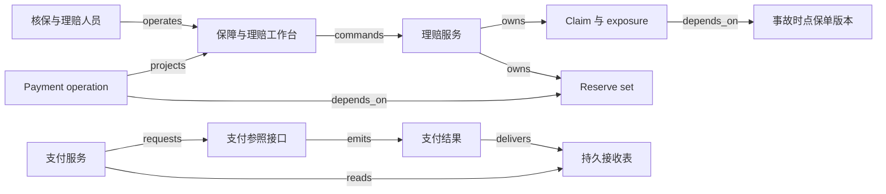

# V13 · 保险：从保障承诺到可核对的赔付

保险公司接受的承诺是：在约定保障范围内，特定事件发生后承担相应责任。投保资料、报价、保单、损失、责任认定、估计赔付和现金支付因此必须各自成对象。保费已收不证明每一次报案都应赔；reserve（赔付准备的业务记录）已批也不证明钱已经到收款人账户。系统要把承诺与证据连起来，让专业人员能说明为什么承保、为什么赔这一项、为什么仍留下一项未决风险。

本例是 synthetic 财产损失教学案例，单币种 CU，只有一个被保险标的与一个事故。保障按事故发生日判断，区间为 `[0,365)`；赔付公式明确规定为 `min(max(核定损失−500, 0), 8,000)`，即先扣 500 免赔额，再受每事故 8,000 限额约束。无共同保险、比例分摊、追偿、再保险、汇率、年度累计限额或诉讼。保费 240 CU 只是给定的报价，不模拟费率精算。本文的时间与金额规则不构成真实保单条款解释。

## 识题：从现象找到方法

| 识别线索 | 可选解法 | 接着查什么、验什么 |
|---|---|---|
| 损失仍在调查，却必须记录可能赔多少 | 按exposure记录估计，再单独作责任决定 | 查reserve line维度和审批限额；验估计不直接授权支付 |
| 全案钱数够，某个责任却不足 | 按责任和费用分类累加，再扣未知付款占用 | 查cost type/category、共享限额和payment状态；验跨责任金额不挪用 |
| 损失变大后，免赔与限额顺序影响答案 | 将条款顺序写成明确函数并用边界值核验 | 查所选条款的触发日、免赔与限额顺序；用高于限额样本验算 |

下面沿这些线索建立对象与边界，再手算一组数据、用反例验算，最后改变前提重做判断。

## 解法：报价版本不能悄悄变成另一份承诺

经纪或投保人员准备 Submission，即用于形成新保单的投保交易；核保人员决定是否接受风险及条款；出单人员交付保单文件。报案后，理赔员收集事故、损失与受益人证据，授权主管审批超限的 reserve 或付款，资金人员跟踪支付，财务核对下游入账。核保的判断针对未来风险，理赔的判断针对已经发生的事故，不能因两者都有“批准”按钮就共用一份没有对象范围的权限。

Guidewire PolicyCenter 的公开流程以 `Draft → Quoted` 表达投保交易的准备与报价；已报价交易要先回到 Draft 才能修改，再重新报价。文档还把 bind 与 issue 区分开：前者确认保障合同，后者交付定义保单的文件，可以同做也可以分开。因此“有 PDF”与“保障已经成立”不是可互换的证据。[Guidewire：Submissions，Overview / Editing a quoted job / Completing the submission](https://docs.guidewire.com/cloud/pc/202507/cloudapibf/cloudAPI/topics/122-PCjobTypes/01-submissions/c_submissions.html)。

本例选择报价 v2 经核保与客户确认后 bind，并完成 issue；保单记录保障期间、条款与文件摘要。若文件生成失败，显示“已承保，文件待补发”，不能把已存在的保障承诺倒退成未报价。若绑定后需要修改保障，另建带生效时间的变更版本；用今天的保单覆盖历史版本，会使昨天的事故被今天的条款错误裁定。这里只建模一条人工审核的变更通路，不推断真实产品的取消、追溯生效或通知制度。

| 对象 | 权威与本例关键状态 |
|---|---|
| Submission / quote | 核保服务保存输入、费率版本引用与选中报价。`draft → quoted → bound`；编辑回 `draft`，拒保或撤回分别保留原因 |
| Policy version / issuance | 保单服务保存保障约定与期间；`bound-unissued → issued`。文件交付状态独立于保障是否已绑定 |
| Claim / exposure | 理赔服务保存报案与潜在责任单元。claim 为 `reported → investigating → resolved → closed`；可为新证据 `reopened`。每个 exposure 关联一个保障与一个 claimant |
| Coverage decision | 获授权理赔人员确认事故时点、适用条款、损失和核定赔付额。`pending → confirmed / denied`；新证据生成替代版本，不覆盖理由 |
| Reserve set / reserve line | 理赔账务服务保存按责任和成本分类的估计交易。set 为 `proposed → awaiting-approval → approved / rejected`；批准交易另有下游 `submitting / submitted` 交接 |
| Payment operation | 支付服务保存金额、收款人和责任分配，外部系统确认现金结果。`prepared → submitted → settled / failed / unknown`，未确认操作持续占用本例付款额度 |

Guidewire ClaimCenter 将 exposure 与 coverage、claimant 关联，用 cost type 和 cost category 组织 reserve line，并把多笔 reserve transaction 组成一组审批。其说明还区分交易已批准后的 `submitting` 与收到下游 acknowledgment 后的 `submitted`。[Overview of reserves in ClaimCenter](https://docs.guidewire.com/cloud/cc/202507/cloudapibf/cloudAPI/topics/112-CCFin/01-reserves/c_overview-of-reserves-in-ClaimCenter.html)。这些是产品概念依据；本例的赔付公式、数据库、额度占用和结案 guard 都是合成设计。

## 理赔工作台要让决定有上下文

投保列表显示缺失的风险资料，详情并排展示报价版本与当前拟承保版本。点击“绑定报价 v2”时，服务端重读对应版本及授权，不把页面当前显示的金额作为权威输入。缺失关键信息时，错误应定位到字段，并保留已填内容；版本冲突应展示变更项，避免用户在不知道条款已变的情况下再次批准。

理赔详情的首屏展示事故日期、报案日期、被保标的、适用保单版本及待补证据。两个日期必须分开：第 370 日报来的第 360 日事故，在本例按事故发生日承保的政策下仍有进入责任审查的资格。是否最终获赔还取决于其他证据，不能从这个时间比较直接跳到支付。核定页展示损失 6,000、免赔 500、限额 8,000 与计算所得 5,500，让理赔员确认采用的是哪个条款版本。

reserve 页面按 exposure 与费用类别展开，不只给一个“总额”输入框。普通理赔员的合成审批权限为全案 reserve 总额 3,000，主管为 6,000；初始赔款 reserve 4,000 加费用 reserve 300 的 set 合计 4,300，普通理赔员提交后必须等主管审批，不能拆成两次 2,000 来绕过全案限额。这一具体额度与反拆分规则是本例政策。Guidewire 文档支持的较窄事实是：创建 reserve set 会检查对应用户权限额度，超限时建立审批活动，尚不把金额加入 reserve line；实际可配置全案或 exposure 限额。[Creating reserves，Approval status](https://docs.guidewire.com/cloud/cc/202507/cloudapibf/cloudAPI/topics/112-CCFin/01-reserves/c_creating-reserves.html)。

支付页同时显示已核定赔付、已批准 reserve、已付金额、尚未确定结果的付款和本次可提交额。“发送付款”绑定核定版本、reserve line、收款人版本、金额与 operation ID；收款账户刚改变时，本例要求重新授权。提交后展示“等待支付结果”，银行结果未知时仍保留占用，不把一张未刷新的余额卡当作可再付款的额度。

## 演算：按责任分组，才能解释剩余风险

第 40 日事故后，初估赔款为 4,000，查勘费用估计 300，主管批准两条 reserve。第 45 日确认损失 6,000，按教学条款核定赔付 `min(6,000−500,8,000)=5,500`，赔款 reserve 追加 1,500；费用仍为 300。已付赔款 2,000 后，未付赔款估计为 `5,500−2,000=3,500`。若随后一笔 1,000 的付款结果未知，本例可再提交的赔款额度为 `5,500−2,000−1,000=2,500`，不是 3,500；该 1,000 仍包含在尚未确认支付的风险中。

这里定义 `R` 为已批准累计估计赔款，`P` 为已确认支付，`U` 为已提交但未确认失败或成功的占用。教学余额为 `R−P`，可新提交额度为 `min(核定赔付−P−U, R−P−U)`，还须满足非负与权限条件。reserve 可以在责任认定前用于估计，因此 `R` 不能自动替代核定赔付。费用 reserve 的 300 也不能补到赔款缺口中：它支持另一类支出和授权用途。这里的公式仅为本例的内存与账务模型，不冒充 ClaimCenter 官方财务表达式。

`ALG:lookup` 与分组累加共同解决这个计算：用 `(tenant, claim, exposure, cost type, cost category, currency)` 找同一 reserve line，再分别累加批准调整、已付和待确认操作。扫描 n 笔交易是 O(n)；按 line 预聚合可降低反复查询成本，但要保留事件水位，并对撤销、晚到批准和冲正重算。小案不值得先引入复杂流处理，数据库事务内更新金额与版本更容易核对。Guidewire 的财务计算文档列出的交易类型包括 `Reserve`、`Payment`、`RecoveryReserve` 和 `Recovery`，并保留费用类别、币种与 exposure 的维度。[Financial calculations](https://docs.guidewire.com/cloud/cc/202507/cloudapibf/cloudAPI/topics/112-CCFin/05-financial-calculations/c_financial_calculations.html)。本例暂不实现后两种类型，不能把所有带金额的交易无符号相加。

反例一是把另一 claimant 的 2,000 reserve 加到本案这位 claimant 的可付余额：全案总数可能合理，付款责任却错误。反例二是把 1,000 CU 与 1,000 个另一币种单位直接相加。反例三是把未知付款 U 归零，随后重发 1,000；两笔后来都成功时，界面无法凭“第一次超时”消除第二笔真实现金。按完整业务维度分组和保留占用，分别解决责任混淆与重复支付问题，二者不可互相替代。

`ALG:graph-paths` 负责解释一笔付款的依据：payment → coverage decision → exposure → policy version，以及 payment → reserve line。沿这些边可以找出“缺了哪个前提”，但能连通不等于满足保障条款。图遍历需检查对象权限、版本及事故时点；本例若读到另租户的保单节点，应整体拒绝路径而非返回隐藏节点的金额摘要。

## 从持久化记录到下游确认

下面是可实现的合成拓扑。PolicyCenter 和 ClaimCenter 在正文中保留独立产品身份；演示也可以用自建服务实现这些对象，但不能据此宣称与厂商 API 兼容。

React + TypeScript 配合普通表格即可实现条款差异、reserve 分组和付款明细；长列表再考虑虚拟滚动，不能让屏外的错误行只存在于不可见位置。若团队以 .NET 为主，可用 ASP.NET Core 与 decimal 建立金额规则；Java/Spring 也是可行方案。规则表适合清楚的免赔额和限额比较，复杂责任仍由理赔人员处理；将一大段合同直接塞给模型并返回 boolean，无法解释授权依据。以上是建议的演示实现选择，不是 Guidewire 内部架构描述。

PostgreSQL 保存对象版本、reserve 调整条目、payment 占用与审计引用。照片、查勘文件进入受控对象存储，查询投影只显示当前角色能看到的元数据。数据库 outbox 可保证业务决定与待发送任务共同落盘；RabbitMQ 或工作流引擎可帮助重试、超时和人工待办，但不能替代资金对账。支付适配器、保单适配器与总账适配器各自映射 provider account 和外部 ID；总账收到 reserve 信息只是会计交接，不代表银行冻结了等额现金，更不代表 claimant 已收款。

正常路径先完成投保、报价与绑定出单，再登记事故、建立 exposure、核定 5,500、批准 reserve 调整、确认首付 2,000 与尾款 3,500。费用 300 若已确认为仍需支付，赔款已付足也不能关闭全案；待费用已付或有授权释放其估计、所有 exposure 已处理且无未知操作时，才结案。结案守卫检查责任与操作是否全部完成，而不是只检查合计余额为零。

失败路径可以从 reserve 审批开始：普通理赔员提交 4,300 后界面应为待批，此时不能安排赔付。主管批准后，下游总账 acknowledgment 暂未到达，reserve 在本例业务账中已批准，但交接栏仍待确认，不能因为 acknowledgment 缺失把同一 reserve 再增加一次。支付 1,000 超时后保留 U；查询原参考号发现已成功，把 U 转为 P，余额只减少一次。若 worker 在记 P 后、更新消费标记前崩溃，恢复凭同一 payment ID 读取已付效果；若确认外部失败，则释放 U 并保留失败证据。新证据导致责任判断改变时先冻结未执行操作，已支付金额进入有授权的差额处理，不能删掉原 decision 让历史付款失去理由。

## 验算：压力来自同案并发，也来自巨灾集中报案

合成待测负载为 20 个租户、100 万保单、20 万开放 claim，每案平均 5 条 reserve line、100 笔财务事件；平时 30 次财务写入/秒，集中事件在 15 分钟内新增 5 万报案。报案接收目标 p95 小于 500 ms，允许异步查验但必须先给持久报案 ID；财务提交目标 p99 小于 1 s，仅覆盖本地验证与持久化，不包含外部支付耗时。应分别报告接收延迟、待核验积压和财务生效延迟，不能用快速返回 202 掩盖数小时无人处理。

同案两人从 2,500 可用额度各提交 2,000，是典型写偏差：分别看都足额，一起执行就越界。本例在 reserve line 与核定赔付版本的同一事务范围内检查并占用，第二个操作被拒绝；跨责任共享限额时，锁定与版本范围必须提升到共享限额对象。按案分区可保护单案顺序，按 tenant 调度可防止集中报案挤占所有资源。保单查阅缓存带版本与事故时间，财务写入不依赖缓存余额；专业人员离线查看的资料也要标明版本，重新联网后必须重新确认已变更的责任决定。

| 检查输入与动作 | 应得到的可观察结果 |
|---|---|
| 损失 6,000，免赔 500，限额 8,000；先付 2,000 再付 3,500 | 核定赔款 5,500；每笔款可追到同一责任与 reserve line；费用未处理时不能全案关闭 |
| 同一支付回执重复送达 | 一次 U→P 转换、一个现金效果；不同 payment ID 不按金额合并 |
| 旧的待审批通知晚于主管批准到达 | 按权威版本核对，不能把已批 reserve 倒退，不能再增加 reserve |
| 可用 2,500，两人各提交 2,000 | 一个占用成功，另一个冲突；占用后可用 500 |
| 相同 claim ID 分属两个租户 | 责任路径、附件、财务列表、缓存与导出均不可跨租户读取 |
| 支付接口已受理 1,000，响应超时 | U 保持 1,000；按原参考号核对后转 P 或确认失败释放 |
| 付款入账后、消费标记前崩溃 | 重放后 P 不再增加；最终能解释事件消费状态 |
| 普通理赔员拆分提交 reserve，试图规避全案 3,000 权限 | 依据变更后全案额度复核并进入审批，不能凭单笔小于阈值通过 |
| 第 370 日报告第 360 日事故 | 读取事故时点保单并进入调查；报案日不直接决定拒赔 |
| 把费用、另一 claimant 或另一币种的余额拿来赔本 exposure | 明确拒绝维度不匹配；没有静默净额抵销 |

本例的承保与理赔决定由有权限的人和确定性规则完成。若加入 AI 查勘摘要助手，评估应冻结 200 份合成材料包：120 份完整，80 份缺事故日期、条款版本或收款人证据。逐项记录编造关键事实数/已输出关键事实数、缺证据却建议放行数/80、正确挂起数/80、人工修正材料包数/200，并单列“混淆事故日与报案日”“把另一人的损失挪入本案”的错误。即使语言评价很好，任一关键事实无出处仍不能进入支付授权。样本还需覆盖实际保单与灾害类型，不能由合成题的成绩推断真实分布上的表现。

## 变式：改变保障条件以后

**练习 1：核定损失变为 10,000，免赔额和限额不变，应赔多少？** 简答：依本例“先扣免赔、后限额”的条款，`min(10,000−500,8,000)=8,000`；若写成 `min(10,000,8,000)−500` 会得到错误的 7,500。保持的是计算必须绑定条款版本，改变的是限额开始生效。验收应包括高于限额的损失，而不只测 6,000 这个两种顺序都给同值的普通样本。

**练习 2：改成按报告时点判断保障的合成政策，第 370 日报告第 360 日事故还能照原答案处理吗？** 简答：不能。日期 guard 已改变，应按新条款评估报告时点及其例外，旧的事故日测试只证明事故发生在期间内。保持事故日、报案日分别保存，改变适用规则与所需证据。用同一材料包分别跑两个明确版本，检查输出原因引用了不同日期；本题不描述任何真实险种的完整法律条件。

**练习 3：reserve 5,500，已付 2,000，另有 1,000 未知付款；理赔员现在降低估计至 2,500。能否直接释放 3,000？** 简答：不能在本例中制造负可用余额。已付加占用为 3,000，低于这个水平的下调先挂起，核对未知付款并由授权人员处理差额；不能改估计来假装付款没发生。测试应观察 U 不被清空、下调请求与理由仍保留，结果未知时不会重新付款。

**下一步探索。** 进入一个陌生险种，先识别保障触发依据、被保对象、claimant、exposure、限额共享范围和费用分类，再选择保单版本管理、理赔案件管理与责任分组账务的组合。优先查适用保单条款及产品版本文档；缺少ACORD原文时，不声称数据模型符合该标准。用同一合成事故改变日期、免赔顺序和未知付款，验证责任判断、估计与可付额度各自变化；一般审批流只有在这些业务前提明确后才有足够信息放行。

`TR:V13:H01:versioned-coverage`、`TR:V13:V14:reserved-capacity` 与 `TR:V13:H03:responsibility-dimensions` 分别标记下述迁移。V13 的版本化承诺可迁到 H01 的合同变更，额度占用可迁到 V14 的订单预留，按责任维度核对可迁到 H03 的分户账。但保单责任不能等同于购买的服务权利，reserve 也不能等同于银行余额或已确定应付款；它允许在事实不全时记录估计，还要持续修订。V12 的 payoff 追求消灭已存在债权，V13 的结案则需检查所有 exposure 和未决责任，因此不能把“余额归零”作为跨行业通用结束条件。演示可调免赔额、限额、事故日、审批权限与未知付款，逐步观察是哪一条前提改变了结论。

拓扑与检查见 [V13.json](../../../../vault/distilled/saas-engineering-atlas/packages/commercial-finance/V13.json)；来源边界与执行记录见 [evidence.json](../../../../vault/distilled/saas-engineering-atlas/packages/commercial-finance/evidence.json)、[CHANGELOG.md](../../../../vault/distilled/saas-engineering-atlas/packages/commercial-finance/CHANGELOG.md)。
