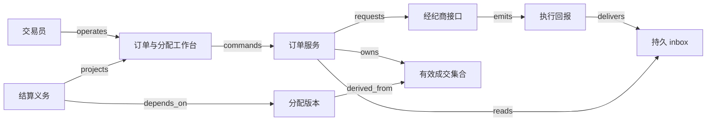

# V14 · 投资订单：成交、撤单、分配与结算

投资订单把一项投资意图写成可执行的数量与价格约束；成交使其中一部分意图成为已发生的交易；分配决定由哪些账户承担这些交易；结算确认证券与资金义务是否已经履行。每一步都有自己的证据。交易员按下“撤单”，只是请求停止后续执行，已经成交的数量不会因此消失。承诺、执行事实、责任归属和资金结果必须分别保存，这一点与本包其他各章相同。

本章的例子是一个合成的买方订单管理系统。基金经理获准买入 100 股证券 S，限价为每股 10.10 记账单位，并预先确定三个账户 A、B、C 的目标权重为 50%、30%、20%。数量只允许整数股，现金精确到分；不含税费、融资、公司行动、卖空或汇率。交易与结算日期作为输入，不预设任何市场的结算周期。账户资格、分配公平性和限额政策，在真实业务中由专业人员确定；本章的规则只用于推演。

## 识题：从现象到方法

| 识题线索 | 可选解法 | 后续查证与检验 |
|---|---|---|
| 发出撤单后又收到成交 | 订单尝试与有效成交簿并行推进 | 查 ExecType、OrdStatus 及对手方恢复协议；检验取消余量时已成交量保持不变 |
| 按比例分配出现多一股或多几分钱 | 整数配额与现金分别按明确的尾差规则分配 | 查账户资格、整手、容量与公平政策；检验数量与金额守恒，且各项约束同时满足 |
| 已报成交后来被撤销或纠正 | 按执行身份替换这笔成交在有效集合里的数量与金额，重建分配版本 | 查 ExecID 的作用域与纠正引用；检验旧分配和已结算义务都有调整路径 |

## 解法：分开保存的订单事实

基金经理决定投资意图和账户范围，交易员向经纪商发单、撤单，运营人员核对成交、分配与结算。三者的权限有意分开：运营人员不能靠改经理的限价来消除超限异常，交易员也不能用一次撤单盖过已经确认的成交。经纪商和托管/结算机构提供外部证据；本地系统保存发出的意图、收到的回报和处理决定。这套权威分工是本例的教学设计。

| 对象 | 身份与权威 | 保留的状态与关系 |
|---|---|---|
| 投资指令 | 本地 `order_id`、经理授权版本 | `draft → authorized → routed`；原始数量、限价、账户集合冻结成版本 |
| 经纪商订单 | 经纪商账户、交易业务日期与外部订单 ID | 外部报告的状态和本地最后一次核对点；页面不能自行标出 `Canceled` |
| 撤单尝试 | 新的请求 ID，关联原始 `ClOrdID` | `prepared → sent → pending → confirmed/rejected`，另设 `unknown`；拒绝撤单不等于拒绝原订单 |
| 成交簿 | 经纪商约定身份范围内的 `ExecID`，纠正指向原执行 | 每笔的数量、价格、方向及有效/被纠正状态；旧记录保留，当前有效集合重建 |
| 分配版本 | 订单、成交集合版本、分配版本号 | `draft → approved → submitted → accepted`，可进入 `rejected/superseded`；总量来自有效成交 |
| 结算义务 | 分配行、账户、证券、币种、约定日期与版本 | `pending → instructed → matched → partial/settled`，异常为 `failed`；接受指令不是履约完成 |

FIX（Financial Information eXchange，金融信息交换协议）的 `ExecType` 说明这条执行回报为什么发出，`OrdStatus` 描述回报时订单所处的状态。官方的状态说明明确区分 `Pending Cancel` 与已取消；B.1.b、B.1.c 展示了撤单等待期间继续成交、撤单太晚被拒绝两种情况，J.1.a、J.1.b 展示了成交被撤销或纠正，因此累计成交量不一定只增不减。本例借用这些消息语义作参照。[FIX Order State Changes，EP284，§1–2、B.1.b–c、J.1.a–b](https://www.fixtrading.org/wp-content/uploads/download-manager-files/FIX-Latest-as-of-EP284-Order-State-Changes.pdf)。

状态因而不能只排成一根进度条。订单已经取消，仍可能有 65 股待分配、待结算；分配已被接受，某账户仍可能缺少交收信息；证券已收到，现金确认仍可能缺失。本例的业务闭环要求：没有可以继续执行的余量，有效成交已全部归属到账户，每项结算义务都取得了相应证据，尚未解决的例外都有负责人。

## 工作台上的撤单与成交

交易员在交易工作台上同时看到“原始意图 100 股”“已成交数量”“仍可执行数量”“撤单尝试状态”“结算进度”。提交限价单前，预览页列出账户权重、授权版本，以及按限价计算的最大资金占用 `100 × 10.10 = 1,010.00`（教学口径）。提交后页面先显示“请求已保存”，收到外部受理证据后才显示可执行状态。HTTP 成功只说明本地服务已经受理；连接断开后，用户凭 operation ID 找回同一次尝试。

正常路径上，先成交 40 股，每股 10.00，交易员随即请求撤销剩余数量；撤单尚未确认时，又成交 25 股，每股 10.04；最后经纪商确认剩余数量不再执行。本地页面此时显示“已取消余量；累计成交 65；待结算 65”，不显示“全部撤销”，35 股未成交数量也不进入成交簿。

收到第二笔成交、撤单仍未确认时，本例保留已成交的资金义务 651.00，并按限价为剩余 35 股保留 353.50，共占用 1,004.50。只有撤单确认、成交缺口也核对完成，这 353.50 才释放；651.00 继续归属未结算义务。常见的界面错误是一点撤单就释放全部额度，另一个订单便可能花掉同一笔预算。这里演示的是一条保守、不计费用的购买预算规则；实际资金、保证金与可交易额度的算法因产品而异。

失败路径上，假设余下 35 股也在撤单确认之前成交，经纪商回报撤单太晚而拒绝，订单就要按 100 股继续分配和结算。撤单按钮这时进入终态并说明原因，不能为了“恢复原意”自动再卖出 35 股：卖出是另一笔市场交易，会带来新的价格与风险，必须另行授权。

运营人员在分配工作台上看到基于已核对成交集合的算法预览、舍入差异和账户资格检查结果。批准请求附带 `execution_set_version`；新成交或纠正改变了这个版本，服务就拒绝旧预览并展示差额。在结算工作台上，运营人员按账户查看数量、金额、指令版本、双方匹配结果与实际交收证据。“发送指令”“对方接受”“已结算”分别用不同的文案，免得一次绿色提示抹掉后续责任。

## 从接口到可核对的成交簿

本例的合成拓扑以订单服务为控制中心，FIX adapter 隔离对手方协议、身份范围和重传约定。adapter 发出请求，收到回报后先持久化，再更新成交簿和投影。消息里的 `CumQty` 是累计值，可以用来核对一致性，服务不能把每条消息的累计值再相加；哪条是新增交易、哪条只是状态回报，要按消息语义区分。

图中箭头表示信息与责任的流向；`delivers` 箭头不代表证券交付或资金交割。完整端点与不变量见 [V14.json](../../../../vault/distilled/saas-engineering-atlas/packages/commercial-finance/V14.json)。本地订单意图由订单服务持有；外部订单状态和回报身份以经纪商为准；结算服务保存义务和确认映射，托管/结算机构仍是本例交收事实的外部来源。

前端可以用 React/TypeScript 或 Vue/TypeScript 实现表格、版本差异与回放界面；频繁更新时只刷新受影响的行，免得整张表格重排打断操作者。服务器发送事件（Server-Sent Events，SSE）足以推送回报进度，双向协商较多时可以选择 WebSocket；两者都要在重连后按游标补读，连接在线不等于事实齐全。后端可用 Java/Kotlin 配合独立的 FIX adapter，把交易协议处理与业务规则分开；Python/FastAPI 适合先做这一本地教学服务，但同样必须使用定点金额和明确的事务边界。以上是本例的实现选项。

PostgreSQL 可以保存投资指令、成交版本、分配与 outbox；`(tenant, broker_account, execution_identity_scope, ExecID)` 约束重复身份。实际 scope 要从对手方约定取得，不能假定 `ExecID` 永久全局唯一。原始入站内容与解析版本一起保存，读取时仍执行账户授权。在一个数据库事务里写入成交、更新集合版本、登记待处理的分配任务；外部发送放在事务之后，免得把网络延迟绑在行锁上。规模不大时，数据库 outbox 就够用；改用 Kafka 等日志系统，要另外解决顺序分区与消费者恢复，也得不到跨机构的事务。

FIX 用 `AllocationInstruction` 把订单分到一个或多个账户，消息带有 `AllocID`、引用旧分配的 `RefAllocID` 以及数量、均价等字段；这些字段能支持分配版本追踪，但不规定本章的配额算法。`SettlementInstructions` 传递结算指示，单凭它证明不了交收已经完成。[FIX 4.4 AllocationInstruction](https://fiximate.fixtrading.org/legacy/en/FIX.4.4/body_495774.html)；[FIX SettlementInstructions](https://fiximate.fixtrading.org/en/FIX.Latest/msg28.html)。

## 演算：整数股分配与现金尾差

有效成交是 `40 × 10.00 + 25 × 10.04 = 651.00`，共 65 股。原始权重 50:30:20 由经理在发单前确定；本例等撤单进入终态、回报缺口补齐之后，做一次最终分配，不逐笔追求“谁先拿到好价格”。账户资格和最大数量已经在输入校验中通过。

按权重得到理论配额 A=32.5、B=19.5、C=13。先取整得到 32、19、13，共 64；还剩 1 股，分给小数余量最大的账户。A、B 同为 0.5，本例按事前固定的账户排序 A、B、C 打破平局，结果是 **33、19、13**。这是本例合成的最大余数分配规则，不能当作经监管批准的公平分配政策。固定次序可以重现，但长期反复出现平局时会偏向同一账户；需要长期公平时，轮换或累计偏差策略必须在发单前批准，并写进状态。

均价是 `651 ÷ 65 = 10.015384…`。若先把均价舍入成 10.02 再乘数量，会得到 651.30，比真实成交多 0.30。本例改为直接分配 **65,100 分**：各账户的理论金额为 `65100 × 数量 / 65`，即 33050.769…、19029.230…、13020 分。取整后还剩 1 分，给余数最大的 A，最终为 **330.51、190.29、130.20**，合计仍为 651.00。均价只用于展示，最终金额来自精确的成交总额与既定的舍入规则。

这段计算用到 `ALG:lookup` 和 `ALG:top-k`。对 m 笔成交，每次从头求和的朴素方案需要 O(m)；按唯一执行身份维护有效集合与汇总后，普通新增可以增量更新，纠正则要先找到被引用的成交，减去它原来的数量与金额，再加入新值。对 a 个账户，完整排序余数需要 O(a log a)；若尾差只涉及 k 个账户，可以用大小为 k 的堆选取候选，代价 O(a log k)。数值守恒来自整数运算与约束，提速方法本身不带来公平性。

这个算法有两处会失效。把 32.5、19.5、13 各自四舍五入，会分出 66 股，超过有效成交。假设 A 最多只能分 30 股，原算法给 A 的 33 股就不可行；不能先塞给 A 再标上“人工关注”，而要带着容量约束重新求可行分配，或者把分不下去的成交留在明确的待处理账户，由专业人员决定。权重和可行性是两个问题；无论优化什么目标，都不能越过账户授权。

## 晚到回报、成交纠正与未知结果

普通重复回报与真正的纠正走不同路径。同一 `ExecID`、内容相同的重传可以返回已有结果；身份相同而内容不同的，进入冲突队列。纠正带有新的执行身份和引用关系，原笔保留，有效集合随之改变。若被引用的旧成交尚未到达，先记下“缺少被引用执行”，补齐后再处理；纠正不能当作又一笔买入。

例如第二笔 25 股后来被正式纠正为 20 股，价格仍为 10.04，有效集合变为 60 股、600.80。新分配应为 30、18、12，金额为 300.40、180.24、120.16。旧的 65 股分配已经发送时，不能只改数据库让页面看起来平衡：要先冻结相关的结算动作，对旧分配发起替换或撤销，确认外部状态后再提交新版本。旧义务已经结算的，进入交收后的调整流程，由运营接管；本章不假定原交易可以回滚。

连接断开造成的未知结果，要和普通失败分开处理。新单发出后超时，adapter 保留原业务身份与发送证据，按双方协议查询或恢复会话；只有确认可以安全重传时，才重用同一身份。创建新的 `ClOrdID` 可能意味着真正的第二张订单。撤单超时同理：先核对原订单和撤单尝试，同时继续处理成交回报。页面可以显示“尚待核对”，但待确认余量占用的额度不能释放。

本例以 50 个机构租户、20 个经纪商连接、每日 100 万条回报、开盘峰值每秒 5,000 条、每个批量订单最多 500 个分配账户作为待测负载。目标是：从回报在持久 inbox 落盘起算，普通回报到达工作台的 p95 不超过 500 毫秒；普通提交的本地持久化响应 p95 不超过 300 毫秒；外部受理耗时单独计量。数据库按机构与账户过滤，回报处理按订单串行化；热点大订单不能靠丢弃中间成交来降低延迟。列表可以缓存，但撤单资格、可用额度和分配批准都读取权威版本。观测指标除吞吐外，还要包括回报缺口数、未知尝试的年龄、未分配数量和未结算金额，“队列已消费完”代替不了这些指标。以上都是待测目标，还没有做过负载测量。

## 验算：业务闭环的证据

本例没有让 AI 下单、分配或确认结算，AI eval 不适用。若以后加入异常摘要助手，它只建议原因与待查证据；模型不能改变数量、批准分配或消除未知状态。评估这个助手，要另建以成交纠正、撤单拒绝和缺失回报为标签的留出集，核算危险的误报与漏报，不能沿用确定性算术检查的通过率。

| 场景 | 输入与动作 | 应观察的结果与证据 |
|---|---|---|
| 正常链 | 100 股指令，两笔成交 40/25，余量撤单确认 | 65 股、651.00；分配 33/19/13；每个账户的结算证据闭合。核对 UI、有效成交簿、分配行、外部映射 |
| 重复 | 第二笔成交回报投递两次 | 总量仍为 65；接收日志与业务唯一键都能解释去重 |
| 乱序 | 撤单确认先到，第二笔成交后到 | 缺口补齐前不做最终分配；补齐后这笔成交仍然有效，取消状态不会把它抹去 |
| 并发 | 两名运营人员批准同一预览，其中一人提交前出现纠正 | 旧版本批准失败；没有第二套有效分配，页面给出差异 |
| 租户隔离 | 两租户存在相同的订单和执行编号 | 列表、详情、缓存命中、导出与事件订阅都只返回授权账户的数据 |
| 未知结果 | 经纪商受理新单后本地超时 | 一次业务意图保持 unknown，查回同一外部订单；不出现第二张单 |
| 恢复 | 成交更新已提交，消费标记前进程崩溃 | 重放后有效数量不变，待分配任务仍在；核对事务与重启记录 |
| 部分结算 | A、C 完成，B 只完成 10/19 股 | 已结算 56 股、未结算 9 股；整批不能标成 settled；现金按确认明细核对 |
| 迟到纠正 | 65 股已分配后，25 股纠正为 20 股 | 旧分配失效，外部调整可追踪；新总量 60，差额不被静默抹掉 |
| 不可行分配 | A 容量为 30，原建议为 33 | 拒绝原建议或进入经授权的再分配；总量与容量约束同时检查 |

## 变式：条件变化与迁移

**练习一：每个账户只允许整手 10 股，仍成交 65 股。** 能否直接使用 33/19/13？

简答：不能。原来只要求整数股，现在每个分配量都必须是 10 的倍数，三者之和也必然是 10 的倍数，65 股无法完全分掉。已成交的 65 股一股都不能丢，变的只是可行域。系统应保留未分配的 5 股，走经授权的例外处理，或在账户规则允许的范围内另定方案，不能把成交改成 60。检查时同时验证 `sum(allocated)+unallocated=65` 与每行的整手约束；“每行合法但漏掉 5 股”是反例。

**练习二：把回报处理改成每分钟批量刷新，撤单按钮仍即时可点。** 能否按页面上 40 股成交释放 60 股额度？

简答：不能。页面改为每分钟刷新后，用户看到的余量不再能作为授权依据；撤单仍要由服务器核对，最终释放多少，按外部确认和完整的成交集合计算。本例最终只释放 35 股的预留额度。检查时，在批次里注入页面尚未显示的 25 股成交，再断连、重连一次，可用资金仍不能超额。UI 可以刷新得慢，交易事实的核对频率不能跟着降低。

**练习三：把固定平局次序改为长期轮换。** 是否只需换一行排序？

简答：不够。还要保存已批准的轮换位置、适用账户集合和策略版本，并让同一分配重放时得到同一结果。若每次重试都推进游标，同一笔成交就会分给不同账户，已经送出的指令也就无法核对。检查重复提交返回原分配；新一批成交才按政策推进轮换。

机制可以迁到 V04 的部分发货（`TR:V14:V04:partial-obligations`）：子项的数量守恒、父对象不能过早完成，这两点仍然成立；差别在于证券成交、订单撤销和交易纠正各有独立的消息语义，不能用仓库退货直接解释。迁到 H03 的对账时（`TR:V14:H03:execution-reconciliation`），成交身份与纠正链可以作为外部明细来源，但关账不能靠累计数量单调增长来判断完整。迁到 H01 时（`TR:V14:H01:cancel-boundary`），“点击取消并不消除已有义务”的思路仍然成立，但订阅退款、证券卖出与成交撤销是不同的补偿。

## 进入新交易业务的先查项

进入一个新的交易业务，先查证券或合约的数量单位、账户资格、交易对手的消息约定、执行身份范围和结算义务，再选择订单状态机、有效成交簿、受约束分配与交收核对方案。FIX 规定的是消息语义，双方实际采用的版本和流程要另行确认。先重放“40 股成交→撤单请求→25 股成交→余量取消→成交纠正”的合成轨迹，逐步核对有效数量、额度占用和分配版本；缺口补齐之前保持未确认，不用一条最终状态盖住明细。

演示可以控制成交到达时机、撤单确认时机、账户权重与整手大小，让数量、预算、分配和结算四列各自变化。读者可以亲手造出“已取消但仍待结算”的状态，并看到只有相应的权威证据才能解除义务。来源与推导边界见 [evidence.json](../../../../vault/distilled/saas-engineering-atlas/packages/commercial-finance/evidence.json)。
