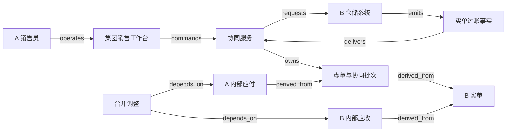

# X02 · Intercompany operations：一次发货，多家公司的责任

集团里的销售公司接单、开票和收款，生产公司把货直接送到客户。客户只收到一次货，两家公司却要各自说明销售、成本和往来款，系统因此要保存几套相互关联的业务对象。单据多了，货物并没有多走一趟；集团合并时消除了内部交易的影响，各公司的交易记录仍然保留。

本章以 **金蝶 EAS** 公开资料中的“集中销售、分开发货、集中结算”作为产品参照。销售公司 A 向外部客户 C 出售生产公司 B 的商品，由 B 直接发货。订单为 100 件，外售价每件 12 记账单位，内部结算价每件 9，B 的成本每件 6；首批实际交付并获客户确认 60 件，另外 40 件尚未发出。金额不含税费，币种、期间、计量单位一致；A、B 都在本例的合并范围内，并假设首批确认交付满足本例的收入记录条件。真实的收入确认、税务、转移定价与合并范围需要专业判断。

## 识题：从现象到方法

| 识题线索 | 可选解法 | 后续查证与检验 |
|---|---|---|
| 只发一次货，却出现多张出入库单 | 区分实物效果与结算用途，按源行追踪 | 查实单/虚单、协同参数与反审核边界；检验库存只发生一次实物变动 |
| 个别公司账对，集团收入仍被放大 | 先明确报告范围，再消除内部重复 | 查合并范围和抵销政策；分别验算内部收入、成本与往来余额 |
| 集团净差为零，双边单据仍对不上 | 按交易身份、币种与期间逐键配对 | 查对手方映射、源批次和过账状态；方向相反的两笔差额各记一项异常 |

## 解法：四条流与单据角色

实物流只有一条：`B 仓库 → C`。对外承诺在 `A → C` 之间，内部供应与结算在 `B → A` 之间。现金可以先从 C 到 A，再从 A 到 B；不论资金是否先到，货物都已经从 B 发出。集团报告把 A、B 放进同一个观察边界，边界内的交易还要做合并核对。

金蝶 EAS 对这项业务的说明是：发货方的销售出库单用于实际发货与内部结算；销售方的采购入库单（虚单）用于内部结算，销售出库单（虚单）用于生成对客应收。内部应付/应收以及付款/收款的协同生成受参数控制。文档还描述了相关反审核会删除所生成的单据。[金蝶 EAS 8.6，业务流程说明及其控制要点，步骤 3–15](https://vip.kingdee.com/eascloud/help/8.6/SCM.web/topics/noname1184.html)。本章沿用“虚单”“上拉”“下推”“审核”“反审核”这些来源术语；金蝶的数据库事务、API 以及已结账后能否回退，本章不从这段说明推断。

虚单记录的是一家公司凭什么对另一方承担结算责任，与仓库是否真的收发了这件货无关。若给所有叫“出库单”的对象都接上同一个库存扣减动作，B 的实单扣 60，A 的虚单再扣 60，集团库存就会错误地减少 120；若把虚拟入库也算作真实收货，又会凭空多出一条 A 仓库的物流轨迹。系统因此把 `physical_effect` 和 `settlement_role` 设为显式属性，不靠单据名称猜该执行什么动作。

| 对象 | 事实确认人 | 系统保存的内容 |
|---|---|---|
| 销售订单 | A 的销售主管确认价格、客户和承诺 | 100 件、外售价、客户、B 发货组织、批准版本；剩余数量与收款情况分开记录 |
| 发货通知与 B 销售出库单（实单） | A 下达授权数量；B 仓库确认实际发出 | 通知只表示发货要求；实单保存批次、数量、仓库和出库证据 |
| A 采购入库单（虚单） | 协同规则产生，A 财务核对 | 与 B 实单行的关联、60 件与内部价；不触发 A 的实物收货 |
| A 销售出库单（虚单） | 协同规则产生，A 财务核对 | 与同一实单关联的对客结算依据；不触发第二次发货 |
| A 对 C 应收 | A 财务经理批准 | 对外金额 720、来源数量与客户确认；收款状态另行核对 |
| B 对 A 应收、A 对 B 应付 | 两家公司的财务各自负责 | 同一内部交易身份、金额 540、对手方公司、币种与期间 |
| 收付款 | 各公司出纳确认各自的现金事实 | C→A 与 A→B 分开；指令、银行结果和核销各有记录 |
| 合并核对与抵销批次 | 集团合并会计批准 | 取数版本、范围、配对差异、调整行；不覆写个别公司账簿 |

集团层面的角色并不能操作所有公司。A 的销售员能查看 B 的可发数量与发货进度，却改不了 B 的成本；集团合并会计能访问经授权的财务映射，也不能替 B 的仓管员补记出库事实。本例以 `(集团租户, 法人公司, 业务对象 ID)` 为最小数据身份，再由角色和业务关系决定跨公司可见的字段。外部客户 C 只看到合同、交付与账单，沿单据关系也读不到内部价格。

## 各对象的状态

销售订单经批准（从 `draft` 到 `approved`）后才能发货，承诺数量按“已交付、待交付、已取消”分别累计。发货通知批准（从 `draft` 到 `approved`），表示允许 B 执行；B 的实单过账（从 `draft` 到 `posted`）后，库存才真正变动。生成了通知不等于已经发货；单据审核过了，也代替不了本例额外要求的客户收货确认。

每笔实单对应一个协同批次，状态为 `pending → partial → complete` 或 `blocked`，记录应生成的两张虚单、内部往来和来源版本。某家公司的服务暂时不可达时，批次停在 partial，已经发出的货不必为此“退回数据库”。系统显示缺了哪一侧的单据，并安排恢复任务；协同批次满足完整性条件之后，下游的合并批次才能把这笔交易算作配对完成。实现不一定要拆成多个服务；无论协同跨服务还是跨数据库，这个批次对象都能说明结果为什么不完整。

应收、应付各自按 `draft → posted → partially-settled → settled` 推进。客户付清了对外应收，内部应付未必已经结清；内部付款指令被银行接受，也说明不了 B 已确认收款。合并批次的状态为 `draft → reconciled → approved → posted`，有差异时进入 `blocked`。本例要求批准抵销时绑定一份确定的取数快照；个别公司补记之后，旧预览必须作废，新账和旧抵销不能混在同一份报告里。

“反审核”的边界要单独说明。金蝶的资料描述了协同单据的删除行为，没有给出下游已入账、已收款、跨期间等情况下的全部限制，本例因此不设计一键递归删除。本章的政策是：下游还是草稿时，可以撤回并保留审计事件；下游已过账或现金已确认时，冻结自动回退，另建可追踪的冲销或更正批次，交给对应的财务角色批准。

## 一次发货经过的工作台

A 的销售员在销售工作台上创建订单时，页面显示外部客户、销售组织、发货组织、内部协议和配置版本。用户下推 60 件发货通知前，服务校验剩余可执行数量，并为订单行预留这 60 件。第二个操作者同时请求 50 件时，服务器端要拒绝超出的部分，或要求调整；页面缓存里显示的 100 件不能当作独立的发货额度。

B 的仓管员在仓库工作台上按通知备货，提交出库时，系统保存批次、仓位、数量与操作员身份。服务端在一个本地事务里记录库存扣减、实单版本和协同 outbox。页面先显示“出库已记录，协同结算单据生成中”，并提供同一批次的状态链接。若 A 侧暂时失败，仓管员看不到会重复扣库存的“重试发货”按钮；重试入口针对的是缺失的协同步骤。

A 的财务人员在财务工作台上从两张虚单进入对外应收和内部应付，预览时同时看到外售价 12、内部价 9，以及这两个价格所来自的订单或内部协议版本。内部价从 9 改成 9.50 时，历史批次不能因为实时读取价格表而自动从 540 变成 570。改价要定新的协议生效边界，并另建修正批次；旧来源仍能回查。

集团的核对人员在核对工作台上按内部交易查看两侧的数量、金额、币种、期间与过账状态。发现 B 应收 540、A 应付 530 时，核对人员要做的是定位差异、指派负责人，页面不提供“自动补差 10”。出纳在收付款工作台上看到外部收款与内部付款两条独立的进度；合并会计在合并工作台上看到抵销预览与取数时间，“报表已抵销”不会显示成“公司已付款”。

图中的 `requests` 是信息请求；实际货物 B→C 与现金 C→A→B 在业务明细中分别记录，不画在图里。图中只有仓储接口，银行与账务接口在完整拓扑里，见 [X02.json](../../../../vault/distilled/saas-engineering-atlas/packages/commercial-finance/X02.json)。

React 或 Vue 可以实现关联单据表格、差异高亮和批次追踪；服务端对每次跳转都重新授权，不能只隐藏内部价格列。Java/Spring 或 C#/.NET 可以实现协同服务及规则版本管理；PostgreSQL 保存源行、关系、状态、inbox/outbox 与配对快照，适合在事务中约束“同一源行同一用途只能生成一次”。各公司已有的企业资源计划（enterprise resource planning，ERP）系统仍可作为账务权威，adapter 通过明确的导入/导出或公开的接口约定核对结果。具体 ERP 的接口格式，本章没有验证。

规模较小时，关系表和递归查询足以追踪来源；只有多层流转、影响分析成为主要负载时，才值得考虑独立的图索引。图数据库也代替不了会计分录的金额和版本约束。Redis 可以缓存列表，key 必须包含集团、公司、权限范围及数据版本；批准出库、付款或抵销仍读取权威记录。以上选型从事务和可追踪性出发。

## 演算：个别报表与集团报表

下表是首批 60 件完成后的账务。这里假设外部客户还没付款，A 也没有向 B 付款，以便单独看清债权债务。

| 观察范围 | 收入 | 成本 | 利润 | 尚未结清的往来 |
|---|---:|---:|---:|---|
| B 个别公司 | `60×9=540` | `60×6=360` | 180 | 对 A 应收 540 |
| A 个别公司 | `60×12=720` | `60×9=540` | 180 | 对 C 应收 720；对 B 应付 540 |
| A、B 直接相加 | 1,260 | 900 | 360 | 应收 1,260；应付 540 |
| 集团合并（本例） | 720 | 360 | 360 | 对外应收 720；本批内部往来净影响为 0 |

直接相加的利润碰巧也是 360，并不说明合并已经正确。收入多算了内部交易 540，成本也多算了 540；应收和应付各多出内部余额 540。合并批次分别做两组调整：内部收入与相应成本各减少 540，内部应收与应付各减少 540。调整只作用于集团报告层，B 仍保留对 A 的结算权利，A 仍要完成内部付款。

Microsoft Dynamics 365 Finance 的公开文档列有合并规则、抵销建议和独立公司记录抵销等选项，说明合并取数与抵销可以作为单独的处理环节。[Consolidation and elimination overview，开头选项与相关 FAQ](https://learn.microsoft.com/en-us/dynamics365/finance/budgeting/consolidation-elimination-overview)。

客户支付 720 后，A 收到现金 720；A 再向 B 支付 540，A 净增现金 180，B 增加现金 540，集团净增仍为 720。内部付款 540 并不是集团从外部又赚到的 540。若付款只在 A 侧成功、B 侧尚未确认，本例保留在途核对项，不能单凭合并报表中净额为零就关闭现金异常。

## 关系遍历与配对键

`ALG:graph-paths` 从一条 B 实单出发，找到它派生的虚单、内部往来、外部应收与合并批次，用来判断一次退货或改价会影响哪些单据。每条关系保存来源行、目标行、用途与版本；关系本身不产生库存或现金动作。对 n 个对象、e 条边，完整遍历通常需要 O(n+e)，局部查询只访问可达子图。旧版本到新版本的派生边保持有向无环；冲销指向原单的引用是另一种关系，混进生成依赖就会造成无限递归。

最简单的做法是重试时把下游单据全部重建，结果同一张实单被重复记账。本例的改进是对 `(group, source_company, source_line, source_version, target_company, role)` 建唯一约束。role 区分“采购入库虚单”“销售出库虚单”等用途；只用源行作唯一键，第二张合法的虚单也会被挡住。恢复时先按这个身份查找，已有则复用；配置版本随源批次冻结，重试时不换成当天的新配置。

`ALG:lookup` 把内部应收和应付按稳定的交易身份配对。键包括集团、公司对、内部协议、源批次行、币种和核对期间，并保留双方的原始方向；应收记为 +540、应付记为 −540，同一键内余额为零且两侧都齐全，才算本例的可抵销候选。哈希分组平均为 O(n)，需要约 O(k) 的键与累计存储；排序归并为 O(n log n)，数据大于内存时可以分批处理。具体延迟还取决于磁盘、分区和宽表，复杂度决定不了全部。

反例是集团总净额看起来为零：交易 T1 中 B 应收 540、A 应付 530，差 10；交易 T2 中 B 应收 360、A 应付 370，差 −10。两者恰好抵消，却留下两条未解释的差异。如果只做 `SUM(amount)` 就亮绿灯，便无从知道是价格错了还是单据串配。正确的输出是两条异常，各自追到来源；金额相等但币种不同、期间不同或一侧未过账，也不能直接认定匹配。

## 部分生成、退货与跨期

第一条失败轨迹从实物已经离开仓库开始。B 实单已提交，A 的采购虚单生成成功，A 的销售虚单接口超时。协同批次保持 partial，并记录超时步骤的业务键与外部尝试。恢复时先查询这个业务键：若已存在，登记映射并继续；若确定未生成，再按原身份重试；若接口没有可靠的查询能力，进入人工核对，“超时”不能当作“未执行”。无论哪一种情况，B 的库存都不会再扣一次。

第二条轨迹是客户退回首批中的 10 件，实物直接退回 B。本例政策先保存退货授权，再由 B 确认实际收货，并关联原 60 件批次；由此库存恢复 10 件，外部金额调整 120，内部金额调整 90，成本恢复 60。若已收到原货款，外部退款仍是独立的资金任务；若只是开了负数应收，现金不能显示为已退。若本例的交付确认和入账条件同样满足，剩余有效销售为 50 件，集团收入 600、成本 300、利润 300。不能对最初 100 件的订单整单冲回，也不能把 10 件退货冲到尚未发出的 40 件上。

第三条轨迹是月底截止不一致。B 在期间 P 已记内部应收，A 的应付仍是 P+1 的草稿，按本章的配对规则就缺了一侧。合并会计先确认经济事实、公司过账状态与适用期间，再决定补记、调整或暂缓。跨期差异不自动算作错误，期间归属由人判断，不交给算法；恢复后的新快照使旧抵销预览失效。所有差异都有负责人和解释；即使批准的会计政策允许带着解释结转，技术层也不能悄悄把差异丢掉。

负载假设为 200 个法人公司、每日 5 万条出库明细、月结核对 1,000 万条内部往来、50 名并发操作员。目标是普通源行查询 p95 小于 400 毫秒、跨公司协同正常完成 p95 小于 5 秒、月结全量配对 20 分钟内产生结果，都待验证。实单行按公司与期间建索引；月结用固定水位的快照批次，免得读到一半时底层变化，结果无法重现。实时协同队列和月结计算分开分配资源，免得批量扫描挤占仓库提交的资源。热点来自集中销售公司的大订单，数量预留按订单行锁定，不锁整个集团。至少跟踪 partial 批次的年龄、两侧数量/金额差、在途现金与待批准的调整数；这些指标比“服务都在线”更能反映还有哪些业务责任没有完成。

## 验算：数量、责任与报告范围

本例不用 AI 批准出库、判断收入或抵销，AI eval 不适用。若以后用模型解释核对差异，解释与过账权限要分开；差异原因按“价格、币种、期间、漏单、未知”分类，要有人工标签、独立留出集和明确的分母。模型说不出原因时必须保留 unknown，不能自动生成一笔补差。

| 场景 | 输入与动作 | 应观察的结果与证据 |
|---|---|---|
| 正常链 | 首批 60 件真实出库，协同与应收应付完成 | B 库存减 60，A 真实库存不动；外部应收 720、内部双边 540；合并收入 720、成本 360 |
| 重复 | 同一实单事实重复送达 | 各用途各生成一份；两张合法虚单都在，库存只减一次；检查业务键与账务行 |
| 乱序 | 内部应付通知先于源实单映射到达 | 暂存为依赖缺失，补齐来源后处理；不凭金额自动挂到别的单据 |
| 并发 | 订单可执行 100，两人同时通知 60 和 50 | 成功总量不超过 100；另一请求明确冲突，不靠前端校验决定 |
| 租户/公司隔离 | 两个集团、两家公司复用订单号 | 键、查询、导出、关联追踪都按授权；客户 C 读不到内部价 |
| 未知结果 | A 虚单已生成，但接口返回前断开 | 以原业务键查询，结果不明就保留 unknown；不新建第二笔 |
| 恢复 | B 实单与 outbox 已提交，发事件前崩溃 | 恢复后继续协同，库存不重复扣减；对账证明下游最终完整 |
| 错配反例 | T1 差 +10，T2 差 −10 | 集团净额为零，仍报两条异常；只有逐键匹配才可抵销 |
| 退货 | 已交付 60 中退 10，货退回 B | 数量剩 50；调整分别为 −120/−90，库存恢复 10；退款另取资金确认 |
| 跨期 | 应收在 P，应付在 P+1 草稿 | 不自动抵销；展示期间和过账差异，专业处理后重建快照 |
| 下游锁定 | 操作者反审核源单，下游已有付款 | 阻止系统的递归删除，创建需批准的更正任务并保留来源链 |

## 变式：条件变化与迁移

**练习一：首批 60 件中，20 件尚未获客户确认；本例政策仍以确认交付作为收入记录条件。** 外部应收和收入能否照 60 件自动完成？

简答：不能。仓库出库不等于满足了本例的收入条件。实物仍是 B 发出 60 件，客户只确认了 40 件，其余 20 件要单独显示为在途或待确认。收入只按已满足条件的 40 件演算，为 480，成本 240；应收是否已经形成，取决于所设的合同与开票政策，本题不能把应收和收入合在一起判断。检查库存、确认数量、应收与收入四项证据，一个“已发货”标签代替不了全部条件。

**练习二：A 和 B 改用不同记账币种；两个账面的内部余额数字都为 540。** 能否直接抵销？

简答：不能。两边的记账单位不同，数字相等不说明能配对。交易身份、原币数量与双方责任不变；需要记录交易币种、汇率类型/日期、换算版本和经专业确认的差异处理。政策选定之前，结果标为不可比较，不输出零差异。反例是把 540 个币种 U 与 540 个币种 V 相减；检查时，混合币种的 fixture 必须被拦下。

**练习三：销售公司先从 B 买入 100 件并真实入 A 仓库，月底只对外卖出 60 件。** 能否沿用“虚拟采购入库、全部内部利润已对外实现”的假设？

简答：不能。物流变成 B→A→C，A 有真实库存 40 件；按题中价格，这批内部库存的账面金额为 360，集团原成本为 240，差额 120 是待调整的内部利润。只抵销内部应收应付还不够，尚未对外出售的库存里这 120 也要处理。这个演算仍以成本口径一致、A 和 B 都完整纳入合并范围为前提；检查 A 的真实库存、集团库存成本和利润，不能只核对往来余额。

迁到 H02 时，可以沿源行追踪验收、发票与付款；但 X02 的“采购入库单”可能是虚单，不能直接拿来证明实物验收，对应 `TR:X02:H02:receipt-evidence-boundary`。迁到 H03 时，配对快照和调整版本可以作为关账输入，但个别账平衡证明不了集团内部交易已经消除，对应 `TR:X02:H03:consolidation-scope`。迁到 V04 时，批次与部分履约的数量关系仍然成立，跨法人权限和内部定价是新增的约束，对应 `TR:X02:V04:direct-shipment-lineage`。

## 进入集团业务的先查项

进入一个集团业务，先画出实际发货方、接单方、开票方、资金收付方与合并范围，再判断需要单公司履约、跨公司协同还是合并抵销这几类方案。研究所用 ERP 的实单/虚单属性、协同参数、反审核条件和可查询的外部业务键，不能只凭单据名称挂接库存动作。用一次 60 件直送模拟一侧单据丢失和两笔方向相反的差额，验证库存只动一次、每项下游责任都可追踪、集团净差为零时仍能暴露未配对的明细。

演示可以切换“直送客户/先入销售公司仓库”，延迟任一侧单据，改动内部价或客户确认数量，同时展示真实库存、两家公司的账与集团报告。变化沿来源关系传播，一个动画箭头不能同时代表货物、现金与信息。来源及政策的边界见 [evidence.json](../../../../vault/distilled/saas-engineering-atlas/packages/commercial-finance/evidence.json)。
