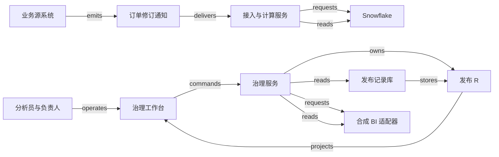

# H07 · 数据变化如何成为可信的 BI 发布

运营负责人需要在晨会上回答：“昨天有多少业务已经完成，数字为何与昨晚不同？”源系统的一次更正可能改变当天总量，也可能推翻已经发布的指标。数据团队承诺交付的因此不只是一个数字，还包括数字采用的口径、截至什么时间收到的证据、谁可以看，以及修订后怎样解释差异。H07 接续企业的承诺与履约链，把交易记录变成可核对的经营观察；报表不能反过来决定订单是否履约。

本例是一家合成服务企业的“每日已完成订单金额”发布系统。所有订单、角色、数字、接口、审批规则与性能目标均为 **synthetic 教学设计**。Snowflake 只作为有公开文档支持的数据平台参照；这里没有声称其内部采用本例的调度、发布协议或图遍历算法。指标用于运营观察，排除税、汇率、收入确认和法定财务报表。金额用整数最小单位保存，例中为便于手算写成元。

## 识题路线：数字变了，先分清哪项输入变了

看到“昨天的数字今天变了”，先检查事实修订、指标口径和发布版本。它们分别决定要改哪条记录、重算哪些结果、通知哪些读者。以下路线对应后面的完整推演。

| 识题线索 | 解法 | 演算 | 验算 | 变式与下一步研究 |
|---|---|---|---|---|
| 同一业务对象多次到达，旧日期的总额变化 | 按业务身份选有效修订，按业务时间归窗，撤掉旧贡献再计新贡献 | 220 + 80 − 100 = 200 | 重投B不变；旧A不复活；00:00归下一日 | 改成首次完成口径得300；查源是否保留首次事件、修订链及金额单位 |
| 改一张源表，不知道哪些报表要复核 | 用依赖图的反向邻接求下游，再补过滤与策略依赖 | orders到两个指标分支，再到仪表板 | 过滤表没有输出列，仍应触发受影响指标复核 | 查真实lineage覆盖范围和构建manifest；先用一条缺边检验影响计算 |
| 预览正确，读者却仍看到旧值或已失效权限 | 固定发布输入，条件切换后读回；访问时检查当前权限 | D1发布220、D2候选200，确认切换后当前值才变 | release ID与受众一致；撤权后的热缓存也拒绝 | 固定历史PDF仍读R1；查商业智能（business intelligence，BI）是否支持按发布身份查询与条件切换 |

## 把数据、口径与发布分开保存

一行订单记录回答发生了什么；一份指标定义回答如何解释这行记录；一个数据版本回答计算读取了哪些证据；一次发布回答哪份结果已送到哪组读者。若把这些事实都塞进一个可覆盖的 `dashboard_total` 字段，数字变化后就无法辨认是业务变了、补录到了、SQL 改了，还是权限变了。

本例把一个可重演结果写成 `R = f(D, M, W, P)`：D 是冻结的数据修订集合，M 是指标口径版本，W 是业务时间窗口，P 是受众权限策略。发布对象另绑定计算代码摘要、质量检查结果、审批证据及 BI 对象版本。四个输入中任意一个变化，都需要新结果身份；旧结果继续解释历史上读者看到过什么。这个模型是本例的设计约束，见 。

| 参与者或对象 | 负责的事实 | 允许的动作与约束 |
|---|---|---|
| 运营分析员 | 解释指标、提出口径修订 | 可预览和提交；不能批准自己的口径变更 |
| 数据工程师 | 导入、转换与异常修复 | 可重跑受影响分区；不能用重跑动作替代业务批准 |
| 指标负责人 | 口径是否符合运营问题 | 批准确定的 M 与适用窗口；修改定义即产生新版本 |
| 数据管理员 | 受众、租户和敏感字段规则 | 批准策略 P；不据此宣布金额正确 |
| 原始修订记录 | 源订单在某次修订中的事实 | 身份为 `(tenant, order_id, revision)`；另保留 event time、接收时间及导入批次 |
| 指标定义 M | 过滤、粒度、金额字段、时间语义 | 本例 M1 取当前有效修订中状态为 completed 的订单，按完成时间分日求和 |
| 数据版本 D | 本次读取的完整输入边界 | 保存每个来源的消费位置、修订集合摘要和转换版本；不能只写“最新” |
| 发布 R | 经过批准的结果与受众绑定 | 保存 D、M、W、P、检查与批准；同一发布 ID 不得换输入 |
| 集成尝试 A | BI 是否接受并启用 R | 独立保存请求、外部身份、核对证据；请求已保存不等于 BI 已生效 |

原始修订的权威仍在业务源系统；仓库保存接收到的证据副本。合成治理服务对指标定义、批准和发布记录负责，BI 对其当前启用的数据集版本负责。Snowflake stream 通过消费位置和表的版本历史给出变化，不是独立保存所有事件正文的日志；单纯查询不会推进消费位置，消费 DML 的成功提交才会推进，回滚不会推进。这个事实使“预览变化”和“确认消费变化”可以区别处理。[Introduction to streams · Offset storage / Table versioning / Repeatable read isolation](https://docs.snowflake.com/en/user-guide/streams-intro#offset-storage)。

源业务若要求保留每次状态修订，接入层还要保存具备业务身份的历史证据。Snowflake standard stream 给出两个位置间的净变化；两次消费间新增又删除的行可能不出现在结果里。用它同步当前状态有用，用它计算“曾经发生过多少次取消”会丢语义。本例采用能保留修订身份的导入协议，不能把 provider 的行标识擅自当成订单的业务事件 ID。[Types of streams](https://docs.snowflake.com/en/user-guide/streams-intro#types-of-streams)。

## 一次发布经过哪些决定

指标定义有 `draft → approved → retired` 的生命周期。负责人批准的是定义内容及摘要；已批准版本不原地修改。待发布结果有 `candidate → validated → approved → publishing → published`，也可能进入 `blocked`、`unknown` 或 `superseded`。`validated` 表示程序检查通过，`approved` 表示指定的人接受这份结果；两者的证据不同。集成尝试则有 `prepared → sent → confirmed`，以及 `unknown / failed`，不与发布状态混成一条轴。

治理工作台的列表展示指标版本、业务窗口、源数据截至位置、发布受众和当前 BI 版本。详情页把旧发布与候选发布并列：总额差多少、哪些订单修订导致差异、哪些下游报表受影响。用户打开“预览”时，只读取候选结果；点击“提交审核”后，服务重新核验租户、权限、对象版本，并固定输入摘要。页面显示“候选已保存，等待负责人审核”，不会提前显示“报表已更新”。

负责人在批准页查看同一组固定输入。若另一人已提交新候选，过期页提交的 `expected_version` 会得到冲突响应，界面展示被改动的口径与差异，再让负责人决定处理哪一版。合成服务把批准记录与待执行任务写进同一数据库事务：批准不会丢给一个尚未持久化的后台任务，任务也不能脱离批准凭证执行。

发布 worker 按已保存的 release ID 生成只读候选数据集，向 BI 适配器提出切换请求，再读回外部启用的版本与受众。教学适配器要求支持按 release ID 查找，且以预期旧版本作条件切换；真实 BI 产品若不支持这两项，就需要按其 API 另设计核对与串行发布机制。只有读回的外部状态与 R 一致，才写 `published`，把页面投影更新为“已发布 R2”。SQL 执行成功、HTTP 202、刷新任务创建成功，都只满足这条链中的局部条件。

图中的 `requests` 是请求交接，`owns` 是权威归属，`stores` 是保存位置；它们都不是数据已经获得业务批准的证明。完整身份、payload、失败处理与生命周期见 [H07.json](../../../../vault/distilled/saas-engineering-atlas/packages/data-ai-control/H07.json)。

## 业务时间窗口与迟到修订

先固定口径再计算。教学业务日采用 UTC 的 `[00:00, 次日 00:00)`，即包含左边界、不包含右边界的半开区间。M1 按订单完成时间归属业务日；每个订单选截至 D 已收到的最高有效 revision，状态为 completed 才累计金额。收到时间只决定某个修订是否已被 D 看见，不能决定订单属于哪一天。真实业务若用营业时区，必须把时区和夏令时规则写入口径；不能用“加 24 小时”代替所有日历日。

设关注窗口 W 为某日 `[00:00, 次日 00:00)`，次日 00:10 生成 D1。下面五条事实属于同一租户，完成时间与接收时间分列，原始重复通知不增加修订数量。

| 订单与修订 | 完成时间 | 收到时间 | 状态与金额 | D1 / D2 中的作用 |
|---|---|---|---|---|
| A:r1 | W 内 23:50 | 23:51 | completed，100 元 | D1 计 100；D2 被 A:r2 替代 |
| B:r1 | W 内 23:55 | 次日 00:20 | completed，80 元 | D1 尚未收到；D2 计 80 |
| C:r1 | 次日 00:00 | 次日 00:01 | completed，50 元 | 两版均属于下一日 |
| D:r1 | W 内 12:00 | 12:01 | completed，120 元 | D1、D2 均计 120 |
| A:r2 | 仍指向 W 内 23:50 | 次日 00:30 | cancelled，100 元 | D2 最新修订排除 A |

D1 已见 A、C、D：先按 revision 选当前状态，再按 W 过滤，结果为 `100 + 120 = 220 元`。次日 00:35 形成 D2，B 补到、A 被撤销，结果为 `80 + 120 = 200 元`。差异桥写成 `220 + 80（迟到完成）− 100（撤销修订）= 200`，读者能同时理解数字和原因。重复收到 B:r1 仍为 200；迟到的 A:r1 不能把 A:r2 覆盖；C 恰在右边界，因此不计入 W。这个演算与修订政策见 。

本例要求每日窗口经过结束后的 48 小时观察期，且所有预期来源已核对、没有待处理修订时，才标成“观察期结束”。这只是 synthetic 的服务承诺，时间经过不证明所有现实事件已经到达。超过观察期的修订仍进入更正队列，由负责人决定发布新修订版及通知范围，保留旧版。若产品需要“当时已知值”与“按最新事实重述值”同时存在，就将两个读取模式明确命名；不要让同一日期的 URL 在无提示下改变解释。

反例很容易手算：按接收时间归日，B 会被错误计入下一日；只在每批金额上做加法，A 的取消也会被当作 +100，既不减原值又误增新值；只取“最新收到”，则乱序的 A:r1 会复活已取消的订单。增量计算之前必须定义如何撤销旧贡献。对每个修订，读取该订单旧有效值，计算 `新贡献 − 旧贡献`，再更新受影响窗口。完成时间改到另一日时，旧日减、新日加；缺失旧值、修订链断裂或金额语义变化时，重新计算受影响分区比猜一个 delta 更可靠。

朴素算法每次扫描 n 条修订，按业务 key 选最新修订，再聚合，工作量至少随 n 增长。保持最新修订索引可把一次批次 b 条修订的主要更新限定在 b 条及受影响分区；平衡树索引的查找可按 O(log n) 推理，具体数据库代价还取决于 I/O、分区和执行计划。索引提速不保证乱序正确，`revision > stored_revision` 的状态条件仍要执行。`ALG:lookup` 和 `ALG:windows` 在此分别回答“找哪个旧状态”和“把差额放到哪个日”。

## 沿 lineage 找到受影响的判断

数据血缘 lineage 描述结果从哪里派生。设源 `orders` 生成 `current_orders`，后者生成 `daily_completed` 与 `refund_monitor`，`daily_completed` 又生成 `operations_dashboard`。如果完成时间字段改变，沿正向影响图访问 `current_orders → daily_completed → operations_dashboard`；若金额字段也变，`refund_monitor` 同样进入候选影响集合。用广度或深度遍历，每个节点和边至多处理一次，复杂度为 O(V+E)。visited 集合防止重复工作；若构建依赖中发现环，则阻断当前构建并报告环路径，不能声称只要图能画出来任务就能运行。

拓扑 JSON 的 `derived_from` 方向是“结果 → 来源”，所以影响分析要读取反向邻接表，不能直接把 JSON 边箭头当作下游传播方向。图遍历输出的是待检查范围；只有列映射、SQL 和指标依赖验证后，才能断言某报表结果会变化。Snowflake 文档区分数据移动与对象依赖，并明确某些仅参与过滤或连接、但没有数据移动到输出的表不会包含在 lineage 中。[Data Lineage · Relationships / Limitations and considerations](https://docs.snowflake.com/en/user-guide/ui-snowsight-lineage#limitations-and-considerations)。

例如完成订单与 `eligible_regions` 表连接，仅用于过滤可计入的区域，最后没有输出区域表字段。改变 `eligible_regions` 也可能改变总额，而图里未必有这条数据移动边。因此本例将过滤表、权限映射和指标定义的依赖显式登记在构建 manifest 中；provider lineage 与 manifest 互相补充，不能用“图中没有边”证明无影响。这个补充是原创分析，见 。同理，有权看到一个下游指标，不意味着有权查看全部上游客户信息；影响计算可由专用服务执行，界面只返回获授权的对象信息与“仍有不可见依赖”的提示。

## 权限贯穿查询与缓存

指标负责人能批准指标、管理员能批准受众、计算服务能读取原始数据，是三种不同权限。本例服务端从已验证身份推导 tenant，拒绝客户端自行指定不属于自己的租户；查询、导出、任务与缓存都携带租户和受众身份。发布时冻结策略版本是为了说明当时依据，实际读取还要检查当前权限。用户已被撤权时，不能因 R 仍指向旧 P 就继续返回缓存。

Snowflake row access policy 在查询时决定返回哪些行；文档同时说明，它本身不阻止插入，也不阻止修改或删除已经可见的行。本例因此仍在写接口检查业务权限与 tenant 归属。该功能要求 Enterprise Edition 或更高版本，选型时应单独核对。[Understanding row access policies · What is Row-level Security?](https://docs.snowflake.com/en/user-guide/security-row-intro#what-is-row-level-security)。

结果缓存的 key 至少包含 tenant、release ID、查询参数、受众身份或等价权限摘要；缓存命中前仍检查当前授权版本。只用“指标名 + 日期”作 key，会把租户乙的 220 元返回给同名报表的租户甲。行过滤也不能自动保护聚合：如果先跨租户汇总再按当前用户过滤，租户身份可能已丢失。因此在允许的租户和粒度内聚合，并专门测试小群体、导出与钻取入口。权限不能在前端隐藏按钮后就结束。

## 技术选择与规模边界

前端可用 React + TypeScript 或 Vue + TypeScript。此处更重要的选择是把“当前发布”和“待批准候选”分开建模，使轮询回来的旧状态不能覆盖用户正在看的新版本。小图可用 SVG 配合文本表格，节点很多时按授权范围分批展开；图不能成为唯一可读入口。页面只请求少量汇总与差异样本，完整变更清单由有权限的导出任务生成。这些是实现候选，不是 provider 技术栈说明。

后端可用 FastAPI 或 TypeScript 服务承接版本校验、审批和发布命令，PostgreSQL 保存控制记录与事务性 outbox，工作进程执行计算和外部核对。低规模原型可以在 PostgreSQL 内重算日分区，减少系统间的核对负担；分析扫描明显挤占在线事务时，再将数据面放到 Snowflake 等独立分析平台。该分离增加成本、数据同步和身份映射的责任，不能仅凭数据平台名称判断有必要。Snowflake 的 stream 是一种增量接入选择，具体任务编排与 BI API 仍需单独验证。

本例待测负载为 100 个租户、每天共 1,000 万条修订、最大租户占 40%、每五分钟导入一次、100 个并发报表读取。平均每批约 `10,000,000 / 288 ≈ 34,722` 条，只是平均值；计划以五倍突发量测试，不能拿均值配置队列。目标是在该负载下，95% 的可处理修订在收到后十分钟内进入候选结果，列表 p95 小于一秒，单个租户不能饿死其他租户的发布任务。这些是测量要求，不是已获得的性能结果。

迟到比例决定增量成本。若大量修订跨越多年历史，五分钟小批仍可能触发巨大重算；按受影响窗口合并任务、限制单租户同时运行的分区数，并观察最老待处理修订年龄。已经发布的不可变结果可复用，正在核对的候选不宜依赖长期缓存。衡量新鲜度至少区分“收到后等待多久”和“业务事件迟到了多久”；只报告作业耗时会掩盖源头已经停更。

## 故障后的责任与证据

正常轨迹从订单修订进入持久接入记录开始。计算服务依据源位置生成 D2，计算 200 元并保存差异桥；质量检查核对去重键、修订有效性、空值、金额范围和租户归属；指标负责人批准 `(D2, M1, W, P1)`；发布 worker 获得外部切换回执并读回 R2；工作台显示 R2、200 元及上一版 220 元的解释。业务完成的证据是受众可读的 BI 结果与批准版本吻合，不仅是后台任务变绿。

有一种故障发生在外部已经切换之后：worker 等回执时超时。此时 R2 进入 `unknown`，R1 仍是本地最后确认版本，页面必须写明“BI 切换待核对”。恢复 worker 用 release ID 查询外部对象；若当前已是 R2，就补写确认；若仍为 R1 且外部明确未受理，则重试同一尝试；若外部无法按身份核对，则转人工，不能另建 R3 假装第一次没有发生。晚到的 R1 回执也不能把 R2 的确认覆盖。只有具备版本条件切换或可靠串行发布的适配器，才能避免旧请求在网络中迟到后把新数据集换回旧版。

另一种故障发生在数据尚未形成可信候选时：源 schema 把金额的单位从分改成元，字段名未变。非空和类型检查都会通过，金额却扩大或缩小百倍。因此数据契约需要单位、范围与分布检查；出现该变化就隔离批次，保留旧发布并展示源新鲜度中断，由数据工程师确认转换版本，再重新计算候选。若 stream 的消费位置越过可保留历史，重新创建只能继续跟踪后续变化，丢失区间必须另行补数与核对。Snowflake 对 stale stream 的此项限制见 [Data retention period and staleness](https://docs.snowflake.com/en/user-guide/streams-intro#data-retention-period-and-staleness)。

计算成功后进程在写任务完成标记之前崩溃，恢复也不应再制造一个结果版本。本例以固定 `(tenant, D, M, W, P, code_digest)` 作计算身份，保存结果摘要；重跑写入同一候选或核对既有候选。批次落库与源位置推进若能置于同一平台事务，可一起提交；跨存储时保存接入收据，允许重复导入并按源修订去重。事务边界必须与实际 connector 能力相符，不能把“最终有一次成功”写成所有系统共同的 exactly-once 保证。

## 可观察的验收

本例使用确定性规则与人工批准，没有模型参与口径判断或授权，AI eval 不适用。以后若增加自然语言生成 SQL，需另建输入、期望口径与权限标签的独立留出集，测量指标选错、时间窗错置、越权引用和拒绝率；当前确定性检查不能替代那组评估。

| 检查 | 固定输入与操作 | 期望结果及必须观察的证据 |
|---|---|---|
| happy_path | 五条修订按表到达，批准 D2 并收到外部确认 | W=200；结果绑定 D2/M1/P1；UI、发布库和 BI 读回身份相同 |
| duplicate | B:r1 再送两次，发布按钮连点 | 有接收记录但只一份业务修订、一个 release 尝试；总额仍为 200 |
| out_of_order | A:r2 先到，再送 A:r1；R2 确认后收到 R1 旧回执 | A 保持 cancelled；当前发布不倒退；保存拒绝或忽略旧消息的理由 |
| concurrency | 两名批准人提交同一候选版本，两个 worker 竞争切换 | 只有一个条件更新成功；另一方读到相同结果或明确冲突；外部不倒退 |
| tenant_isolation | 两租户均有订单 A 和同名指标，逐项读列表、缓存、图与导出 | 只出现授权数据；当前授权变化后旧缓存不可继续放行 |
| unknown_outcome | BI 已切换 R2，但隐藏成功回执 | 本地保留 unknown；按 release ID 读回后确认；不新建第二次发布 |
| recovery | 结果已保存、完成标记未写时终止 worker；另模拟消费历史缺口 | 重放不重复计入；历史缺口触发补数与核对，不能直接宣告发布成功 |
| boundary / quality | C 位于右边界；金额单位突变；修订链缺 r2 却到 r3 | C 属于次日；单位异常和无法解释的链缺口阻断候选，不悄悄以零填充 |
| lineage | 只用于过滤的区域表改变 | manifest 使受影响指标仍被重新检查；不可见依赖不被当作不存在 |

这些定义要求分别取得输入 fixture、状态记录、外部读回、UI 反馈和业务差异证据。纯本地合成演算能确认数值与状态不变量，不能确认 Snowflake 账户配置、BI 集成或真实负载；实际运行范围记录在本包 [CHANGELOG](../../../../vault/distilled/saas-engineering-atlas/packages/data-ai-control/CHANGELOG.md) 与 [handoff](../../../../vault/distilled/saas-engineering-atlas/packages/data-ai-control/handoff.md)。

## 条件变化与迁移

**练习一：把指标改为“每日首次完成订单总额”，后来取消也保留首次完成事实。** A:r2 到达后 W 应是多少？原 M1 能否继续使用？

简答：D2 的首次完成包含 A、B、D，合计 300 元；必须创建 M2，保存首次完成事件及其身份，不能沿用“取最高 revision 的当前状态”再过滤。保持不变的是结果仍绑定数据、口径和窗口；改变的是需要保存历史事件而非仅当前状态。反例是只存 A 的 cancelled 当前行，无法重建首次完成。可观察检查应同时断言 M1=200、M2=300，并检验“新增后又取消”的历史是否保留。

**练习二：原来允许观察期内自动修订，现在晨会 PDF 必须永远复现当时数字。** B 迟到后可以直接把旧 PDF 的查询结果改为 200 吗？

简答：旧 PDF 继续绑定 R1=220，新的重述版 R2=200 单独发布并标出差异；URL 或导出记录要包含 release ID。保持版本可追溯的关系，改变的是读者要求固定快照，而非默认查看最新结果。反例是用同一动态查询重建旧文件，标题日期不变、数字却变。检查以 R1 的固定输入再次计算为 220，同时验证“当前版”明确指向 R2。

**练习三：源数据正确，但某管理员撤销了经理的受众权限。** 已批准的 R2 和有效缓存能否继续供其读取？

简答：保留批准与发布历史，读取按当前授权拒绝，并使旧权限缓存失效。保持发布内容可重演，改变的是谁可以获得内容；不可因策略 P1 被固化在 R2 就固化人的访问权。反例是页面刷新仍从公共缓存返回 200。检查 cache hit、cache miss、导出下载与 lineage 详情都执行同一撤权约束。

H07 的固定版本批准可迁到 [H09](H09.md)：批准应指向不可变的材料与上下文，改了输入就重新评审；但 BI 指标允许以新发布修订历史观察，已签署文档或外部法律承诺的效力不能由重算规则决定。窗口和修订可迁到 [X01](X01.md) 的 metering；用于开票时还要增加计费口径、截止与差额账单规则，不能把运营报表自动重述等同于已开票金额可直接覆盖。lineage 的可达性可帮助 [H08](H08.md) 判断安全事件影响范围；图可达只说明候选关联，不能替代证据相关性或授权响应。

进入陌生行业时，先挑一个真正影响决定的指标，追问它的业务粒度、单位、业务日、撤销和补录规则，再画出一条源记录到已发布结果的证据链。数据变化频繁且需要分区重算时，可研究增量接入与版本化发布；报表很小、来源简单时，定期全量重算可能更容易验证。下一步查来源历史保留能力、指标语义依赖和 BI 条件切换接口，用“迟到一笔、取消一笔、撤销一名读者”的合成输入验收，不能只比较图表外观。

演示可让读者改变 B 的接收时间、A 的修订顺序、窗口时区、指标 M1/M2、权限和 BI 回执，观察总额、差异桥、候选状态与当前发布各自何时变化。HTML 和动效可以自由组织，但应始终看得见“数据已算出”与“受众已得到哪一版”的区别。来源定位与证据边界见 [evidence.json](../../../../vault/distilled/saas-engineering-atlas/packages/data-ai-control/evidence.json)。
