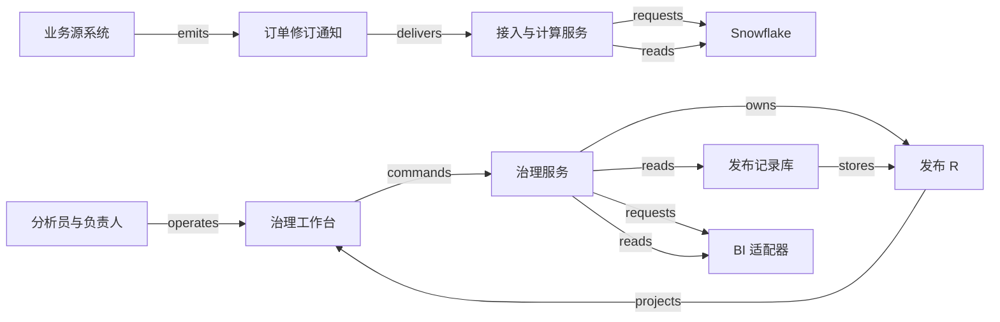

# H07 · 数据修订、指标口径与 BI 发布

运营负责人要在晨会上回答：“昨天完成了多少业务？数字为什么和昨晚不一样？”数据团队交付的除了数字，还有它采用的口径、证据收到的截止时间、能看到它的人，以及修订后怎样解释差异。机制是把结果绑定四个输入：冻结的数据修订集合、指标口径版本、业务时间窗口和受众权限策略，任何一个变化都产生新的发布，旧发布保留。本章覆盖迟到修订、lineage 复核、以 BI 读回为准的发布，以及撤权后的缓存。接收时间只决定修订是否被看见，不决定订单属于哪一天。

本例是一家服务企业的“每日已完成订单金额”商业智能（business intelligence，BI）发布系统。指标只用于运营观察，不涉及税、汇率、收入确认和法定财务报表。金额按整数最小单位保存，例中为便于手算写成元。

## 识题：数字变化的来源

遇到“昨天的数字今天变了”，先查是事实修订了、指标口径改了，还是发布版本换了。三者分别决定要改哪条记录、重算哪些结果、通知哪些读者。

| 识题线索 | 解法 | 演算 | 验算 | 变式与下一步研究 |
|---|---|---|---|---|
| 同一业务对象多次到达，旧日期的总额变化 | 按业务身份选有效修订，按业务时间归入窗口，先撤旧贡献再计新贡献 | 220 + 80 − 100 = 200 | 重投 B 不变；旧 A 不复活；00:00 归下一日 | 改成首次完成口径得 300；查源是否保留首次事件、修订链及金额单位 |
| 改一张源表，不知道哪些报表要复核 | 用依赖图的反向邻接求下游，再补过滤与策略依赖 | orders 到两个指标分支，再到仪表板 | 过滤表没有输出列，受影响指标仍要复核 | 查真实 lineage 的覆盖范围和构建 manifest；先用一条缺边检验影响计算 |
| 预览正确，读者却仍看到旧值或已失效权限 | 固定发布输入，条件切换后读回；访问时检查当前权限 | D1 发布 220、D2 候选 200，确认切换后当前值才变 | release ID 与受众一致；撤权后的热缓存也拒绝 | 固定历史 PDF 仍读 R1；查 BI 是否支持按发布身份查询与条件切换 |

## 解法：数据、口径与发布分开保存

订单记录说明发生了什么，指标定义说明怎样解释这些记录，数据版本记下计算读取了哪些证据，发布记下哪份结果送到了哪组读者。若把这些事实塞进一个可覆盖的 `dashboard_total` 字段，数字一变就分不清是业务变了、数据补录了、SQL 改了，还是权限变了。

本例把一个可重演结果写成 `R = f(D, M, W, P)`：D 是冻结的数据修订集合，M 是指标口径版本，W 是业务时间窗口，P 是受众权限策略。发布对象另外绑定计算代码摘要、质量检查结果、审批证据及 BI 对象版本。四个输入中任何一个变了，结果都要换一个新身份；旧结果保留下来，用来解释读者当时看到了什么。

| 参与者或对象 | 负责的事实 | 允许的动作与约束 |
|---|---|---|
| 运营分析员 | 解释指标、提出口径修订 | 可预览和提交；不能批准自己的口径变更 |
| 数据工程师 | 导入、转换与异常修复 | 可重跑受影响分区；重跑不能代替业务批准 |
| 指标负责人 | 口径是否符合运营问题 | 批准确定的 M 与适用窗口；修改定义即产生新版本 |
| 数据管理员 | 受众、租户和敏感字段规则 | 批准策略 P；这项批准不涉及金额是否正确 |
| 原始修订记录 | 源订单在某次修订中的事实 | 身份为 `(tenant, order_id, revision)`；另保留 event time、接收时间及导入批次 |
| 指标定义 M | 过滤、粒度、金额字段、时间语义 | 本例 M1 取当前有效修订中状态为 completed 的订单，按完成时间分日求和 |
| 数据版本 D | 本次读取的完整输入边界 | 保存每个来源的消费位置、修订集合摘要和转换版本；不只写“最新” |
| 发布 R | 经过批准的结果与受众绑定 | 保存 D、M、W、P、检查与批准；同一发布 ID 不得换输入 |
| 集成尝试 A | BI 是否接受并启用 R | 这里的 A 是尝试的记号，与后文的订单 A 无关；独立保存请求、外部身份与核对证据；请求已保存不等于 BI 已生效 |

原始修订的权威仍在业务源系统；仓库保存的是接收到的证据副本。治理服务对指标定义、批准和发布记录负责，BI 对它当前启用的数据集版本负责。Snowflake stream 依靠消费位置和表的版本历史给出变化，本身并不独立保存每个事件的正文。只查询不会推进消费位置；消费 stream 的数据操作语言（data manipulation language，DML）语句成功提交后才推进，回滚则不推进。所以“预览变化”和“确认消费变化”可以分开处理。[Introduction to streams · Offset storage / Table versioning / Repeatable read isolation](https://docs.snowflake.com/en/user-guide/streams-intro#offset-storage)。

源业务若要求保留每次状态修订，接入层还要保存带业务身份的历史证据。Snowflake standard stream 给出两个位置之间的净变化，两次消费之间新增又删除的行可能不出现在结果里。用它同步当前状态够用；用它统计“一共取消过多少次”，中间增删的记录就会漏掉。本例的导入协议保留修订身份，provider 的行标识不能拿来充当订单的业务事件 ID。[Types of streams](https://docs.snowflake.com/en/user-guide/streams-intro#types-of-streams)。

## 发布状态与审批

发布以读回 BI 的版本与受众为准：程序检查通过、负责人批准和外部启用是三份不同的证据。

指标定义有 `draft → approved → retired` 的生命周期。负责人批准的是定义内容及摘要；已批准的版本不原地修改。待发布结果有 `candidate → validated → approved → publishing → published`，也可能进入 `blocked`、`unknown` 或 `superseded`。`validated` 表示程序检查通过，`approved` 表示指定的人接受这份结果；两者的证据不同。集成尝试另有一条状态线：`prepared → sent → confirmed`，也可能进入 `unknown / failed`，不与发布状态混在一起。

治理工作台的列表展示指标版本、业务窗口、源数据截至位置、发布受众和当前 BI 版本。详情页把旧发布与候选发布并列：总额差多少、哪些订单修订导致差异、哪些下游报表受影响。用户打开“预览”时，页面只读取候选结果；点击“提交审核”后，服务重新核验租户、权限和对象版本，并固定输入摘要。页面显示“候选已保存，等待负责人审核”，不会提前显示“报表已更新”。

负责人在批准页查看同一组固定输入。若另一人已提交新候选，负责人从过期页面提交时带的 `expected_version` 已经过时，服务返回冲突；界面列出被改动的口径与差异，由负责人决定处理哪一版。服务把批准记录与待执行任务写进同一个数据库事务：批准成功就一定有对应的持久任务，任务执行时也一定带着批准凭证。

发布 worker 按已保存的 release ID 生成只读候选数据集，向 BI 适配器提出切换请求，再读回外部启用的版本与受众。本例的适配器假定能按 release ID 查找，并能以预期旧版本为条件切换；真实 BI 产品若不支持这两项，就要按它的 API 另行设计核对与串行发布机制。读回的外部状态与 R 一致后，服务才写 `published`，页面投影随之更新，例如显示“已发布 R2”。SQL 执行成功、HTTP 202、刷新任务创建成功，各自只说明链上的某一步已经完成。

图中 `requests` 表示请求交接，`owns` 表示权威归属，`stores` 表示保存位置。完整身份、payload、失败处理与生命周期见 [H07.json](../../../../vault/distilled/saas-engineering-atlas/packages/data-ai-control/H07.json)。

## 演算：业务时间窗口与迟到修订

迟到修订按业务时间归日，先撤旧贡献再计新贡献；本例 D1 的 220 元在 D2 变为 200 元，差异桥逐项交代原因。

先固定口径再计算。业务日采用 UTC 的 `[00:00, 次日 00:00)`，即包含左边界、不包含右边界的半开区间。M1 按订单完成时间归属业务日；每个订单选截至 D 已收到的最高有效 revision，状态为 completed 才累计金额。接收时间只决定某个修订是否已被 D 看见，不能决定订单属于哪一天。真实业务若用营业时区，就要把时区和夏令时规则写入口径，“加 24 小时”并不等于每个日历日。

设关注窗口 W 为某日 `[00:00, 次日 00:00)`，次日 00:10 生成 D1。五条修订属于同一租户；重复送达的原始通知不算新修订。

| 订单与修订 | 完成时间 | 接收时间 | 状态与金额 | D1 / D2 中的作用 |
|---|---|---|---|---|
| A:r1 | W 内 23:50 | 23:51 | completed，100 元 | D1 计 100；D2 被 A:r2 替代 |
| B:r1 | W 内 23:55 | 次日 00:20 | completed，80 元 | D1 尚未收到；D2 计 80 |
| C:r1 | 次日 00:00 | 次日 00:01 | completed，50 元 | 两版均属于下一日 |
| D:r1 | W 内 12:00 | 12:01 | completed，120 元 | D1、D2 均计 120 |
| A:r2 | 仍指向 W 内 23:50 | 次日 00:30 | cancelled，100 元 | D2 最新修订排除 A |

D1 收到了 A、C、D：先按 revision 选当前状态，再按 W 过滤，结果为 `100 + 120 = 220 元`。次日 00:35 生成 D2，此时 B 已补到、A 已撤销，结果为 `80 + 120 = 200 元`。差异桥写成 `220 + 80（迟到完成）− 100（撤销修订）= 200`，数字和原因一起交代。重复收到 B:r1，结果仍为 200；迟到的 A:r1 不能覆盖 A:r2；C 恰在右边界，不计入 W。

每日窗口结束后，本例要求再过满 48 小时观察期，并且所有预期来源已核对、没有待处理修订，才标为“观察期结束”。时间过去了，现实中的事件也未必都已到达。超过观察期的修订仍进入更正队列，由负责人决定是否发布新修订版、通知哪些人，旧版保留。若产品需要“当时已知值”与“按最新事实重述值”并存，就给两种读取模式分别命名，免得同一日期的 URL 在读者不知情时换了含义。

按接收时间归日，B 会被错误计入下一日；只在每批金额上做加法，A 的取消也会被当作 +100，既不减原值又误增新值；只取“最新收到”，乱序的 A:r1 会复活已取消的订单。所以增量计算之前要先定义怎样撤销旧贡献：对每个修订，读取该订单的旧有效值，计算 `新贡献 − 旧贡献`，再更新受影响窗口。完成时间改到另一日时，旧日减、新日加；缺失旧值、修订链断裂或金额语义变化时，重新计算受影响分区比猜一个 delta 更可靠。

朴素算法每次扫描 n 条修订，按业务 key 选最新修订，再聚合，工作量至少随 n 增长。维护一个最新修订索引，可以把一个 b 条修订的批次的主要更新限定在 b 条及受影响分区；平衡树索引的查找可按 O(log n) 推理，具体数据库代价还取决于 I/O、分区和执行计划。索引提速不保证乱序正确，`revision > stored_revision` 的状态条件仍要执行。`ALG:lookup` 和 `ALG:windows` 在这里分别负责“找哪个旧状态”和“差额记到哪一天”。

## lineage 与影响范围

lineage 给出待检查的范围，不证明影响；只参与过滤的表可能不在图里，要靠构建 manifest 补登。

lineage（数据血缘）描述结果由哪些来源派生。设源 `orders` 生成 `current_orders`，后者生成 `daily_completed` 与 `refund_monitor`，`daily_completed` 又生成 `operations_dashboard`。如果完成时间字段改变，沿正向影响图访问 `current_orders → daily_completed → operations_dashboard`；若金额字段也变，`refund_monitor` 同样进入候选影响集合。用广度优先或深度优先遍历，每个节点和每条边至多处理一次，复杂度为 O(V+E)。visited 集合防止重复处理；若在构建依赖中发现环，就阻断这次构建并报告环路径。

拓扑 JSON 的 `derived_from` 方向是“结果 → 来源”，所以影响分析要读反向邻接表，而不是顺着 JSON 的箭头往下游走。图遍历输出的是待检查范围；只有列映射、SQL 和指标依赖验证之后，才能断言某张报表的结果会变化。Snowflake 文档区分数据移动与对象依赖，并明确说明：某些只参与过滤或连接、没有数据移动到输出的表，不会出现在 lineage 中。[Data Lineage · Relationships / Limitations and considerations](https://docs.snowflake.com/en/user-guide/ui-snowsight-lineage#limitations-and-considerations)。

例如完成订单与 `eligible_regions` 表连接，只用来过滤可计入的区域，输出里没有区域表的字段。改变 `eligible_regions` 也可能改变总额，图里却未必有这条数据移动边。因此本例把过滤表、权限映射和指标定义的依赖显式登记在构建 manifest 中；provider lineage 与 manifest 互相补充，“图中没有边”不能证明没有影响。

影响图本身也受权限约束：有权看到一个下游指标，不等于有权查看全部上游客户信息。影响计算可以交给专用服务执行，界面只返回获授权的对象，并提示“仍有不可见依赖”。

## 查询与缓存的权限检查

指标负责人批准指标、管理员批准受众、计算服务读取原始数据，是三种不同的权限。本例服务端从已验证身份推导 tenant，拒绝客户端自行指定不属于自己的租户；查询、导出、任务与缓存都携带租户和受众身份。发布时冻结策略版本，是为了说明当时的依据，实际读取还要检查当前权限。用户已被撤权时，不能因为 R 仍指向旧 P 就继续返回缓存。

Snowflake row access policy 在查询时决定返回哪些行；文档同时说明，它本身不阻止插入，也不阻止修改或删除已经可见的行。本例因此仍在写接口检查业务权限与 tenant 归属。该功能要求 Enterprise Edition 或更高版本，选型时要单独核对。[Understanding row access policies · What is Row-level Security?](https://docs.snowflake.com/en/user-guide/security-row-intro#what-is-row-level-security)。

结果缓存的 key 至少包含 tenant、release ID、查询参数、受众身份或等价的权限摘要；命中缓存前仍检查当前授权版本。只用“指标名 + 日期”作 key，会把租户乙的 220 元返回给同名报表的租户甲。行过滤也保护不了所有聚合：如果先跨租户汇总，再按当前用户过滤，租户身份可能已经丢失。因此只在允许的租户和粒度内聚合，并专门测试小群体、导出与钻取入口；只在前端隐藏按钮，不算完成权限控制。

## 技术选型与规模

前端可用 React + TypeScript 或 Vue + TypeScript。这里更要紧的是把“当前发布”和“待批准候选”分开建模，轮询回来的旧状态才不会覆盖用户正在看的新版本。小图可用 SVG 配合文本表格，节点很多时按授权范围分批展开，图之外始终有可读的表格入口。页面只请求少量汇总与差异样本，完整变更清单由有权限的导出任务生成。

后端可用 FastAPI 或 TypeScript 服务处理版本校验、审批和发布命令，PostgreSQL 保存控制记录与事务性 outbox，工作进程执行计算和外部核对。低规模原型可以在 PostgreSQL 内重算日分区，减少系统之间的核对；分析扫描明显挤占在线事务时，再把数据面迁到 Snowflake 这类独立分析平台。拆分会增加成本，还多出数据同步和身份映射的工作；拆不拆看负载，不看平台名气。Snowflake 的 stream 是一种增量接入办法，任务编排与 BI API 仍要单独验证。

本例待测负载为 100 个租户、每天共 1,000 万条修订、最大租户占 40%、每五分钟导入一次、100 个并发报表读取。平均每批约 `10,000,000 / 288 ≈ 34,722` 条，这只是平均值；计划以五倍突发量测试，队列不按均值配置。目标是在该负载下，95% 的可处理修订在收到后十分钟内进入候选结果，列表 p95 小于一秒，单个租户不能饿死其他租户的发布任务。

迟到比例决定增量成本。若大量修订跨越多年历史，五分钟一批仍可能触发巨大的重算；要按受影响窗口合并任务、限制单租户同时运行的分区数，并观察最老待处理修订的年龄。已经发布的不可变结果可以复用，正在核对的候选不宜依赖长期缓存。衡量新鲜度至少要区分“收到后等待多久”和“业务事件迟到了多久”；只报告作业耗时，会掩盖源头已经停更。

## 故障与恢复

三种故障都按原身份恢复：发布按 release ID 读回核对，计算按固定的计算身份重跑，源契约异常时隔离批次并保留旧发布。

正常路径从订单修订写入持久接入记录开始。计算服务依据源位置生成 D2，计算出 200 元并保存差异桥；质量检查核对去重键、修订有效性、空值、金额范围和租户归属；指标负责人批准 `(D2, M1, W, P1)`；发布 worker 拿到外部切换回执并读回 R2；工作台显示 R2、200 元及上一版 220 元的解释。业务完成的证据是受众读到的 BI 结果与批准版本吻合，而不只是后台任务变绿。

第一种故障：BI 已经切换，worker 却在等回执时超时。此时 R2 进入 `unknown`，R1 仍是本地最后确认的版本，页面要写明“BI 切换待核对”。恢复 worker 用 release ID 查询外部对象：若当前已是 R2，就补写确认；若仍为 R1 且外部明确未受理，就重试同一尝试；若外部无法按身份核对，就转人工，不能另建 R3 假装第一次没有发生。晚到的 R1 回执也不能把 R2 的确认覆盖。旧请求在网络中迟到后可能把新数据集换回旧版，能避免这一点的只有支持版本条件切换或可靠串行发布的适配器。

第二种故障出现在可信候选生成之前：源 schema 把金额单位从分改成元，字段名没变。非空和类型检查都会通过，金额却扩大或缩小百倍。因此数据契约需要单位、范围与分布检查；出现这种变化就隔离批次，保留旧发布并展示源新鲜度中断，由数据工程师确认转换版本，再重新计算候选。若 stream 的消费位置已落在源表可保留的历史之外，重新创建的 stream 只能跟踪此后的变化，中间缺失的区间要另行补数与核对。stale stream 的这项限制见 [Data retention period and staleness](https://docs.snowflake.com/en/user-guide/streams-intro#data-retention-period-and-staleness)。

若计算已经成功、进程却在写完成标记之前崩溃，恢复时也不应再生成一个结果版本。本例以固定的 `(tenant, D, M, W, P, code_digest)` 作计算身份，保存结果摘要；重跑写入同一候选，或核对已有候选。批次落库与源位置推进若能放进同一平台事务，就一起提交；跨存储时保存接入收据，允许重复导入并按源修订去重。事务边界要与 connector 的实际能力相符，“最终有一次成功”不等于所有系统共同的 exactly-once 保证。

## 验算：检查项与观察证据

验收的共同判据是同一身份贯穿 UI、发布库和 BI 读回；重复、乱序和撤权都不能让当前发布倒退或越权。

本例使用确定性规则与人工批准，口径判断和授权都没有模型参与，AI eval 不适用。以后若增加自然语言生成 SQL，要另建一组带输入、期望口径与权限标签的独立留出集，测量指标选错、时间窗错置、越权引用和拒绝率。

| 检查 | 固定输入与操作 | 期望结果及必须观察的证据 |
|---|---|---|
| happy_path | 五条修订按表到达，批准 D2 并收到外部确认 | W=200；结果绑定 D2/M1/P1；UI、发布库和 BI 读回身份相同 |
| duplicate | B:r1 再送两次，发布按钮连点 | 有接收记录但只有一份业务修订、一个 release 尝试；总额仍为 200 |
| out_of_order | A:r2 先到，再送 A:r1；R2 确认后收到 R1 旧回执 | A 保持 cancelled；当前发布不倒退；保存拒绝或忽略旧消息的理由 |
| concurrency | 两名批准人提交同一候选版本，两个 worker 竞争切换 | 只有一个条件更新成功；另一方读到相同结果或明确冲突；外部不倒退 |
| tenant_isolation | 两租户均有订单 A 和同名指标，逐项读列表、缓存、图与导出 | 只出现授权数据；当前授权变化后旧缓存不再放行 |
| unknown_outcome | BI 已切换 R2，但隐藏成功回执 | 本地保留 unknown；按 release ID 读回后确认；不新建第二次发布 |
| recovery | 结果已保存、完成标记未写时终止 worker；另模拟消费历史缺口 | 重放不重复计入；历史缺口触发补数与核对，不直接宣告发布成功 |
| boundary / quality | C 位于右边界；金额单位突变；修订链缺 r2 却到 r3 | C 属于次日；单位异常和无法解释的链缺口阻断候选，不悄悄以零填充 |
| lineage | 只用于过滤的区域表改变 | manifest 使受影响指标仍被重新检查；不可见依赖不被当作不存在 |

每项检查都要分别取得输入 fixture、状态记录、外部读回、UI 反馈和业务差异证据。本地演算只能确认数值与状态不变量；Snowflake 账户配置、BI 集成和真实负载要在实际环境中验证。

## 变式：条件变化与迁移

结果绑定数据、口径、窗口和权限，这一条在条件改变后不变；变的是口径要保存哪些历史、读者要固定快照还是最新结果、谁能读到它。

**练习一：把指标改为“每日首次完成订单总额”，后来取消也保留首次完成事实。** A:r2 到达后 W 应是多少？原 M1 能否继续使用？

简答：按新口径，D2 的首次完成包含 A、B、D，W 合计 300 元；原 M1 不能继续使用。M1 只看最高 revision 的当前状态，A 的当前行已是 cancelled，首次完成的事实从中找不回来，所以要另建 M2，保存首次完成事件及其身份。结果照旧绑定数据、口径和窗口，多出的要求是保存历史事件，而不只是当前状态。检查时同时断言 M1=200、M2=300，并确认“新增后又取消”的历史仍在。两种口径都先验证修订身份：同一 `(tenant, order_id, revision)` 的状态、完成时间和金额必须一致，只改了接收时间的重投不增加贡献。若 B:r1 同时出现 80 元与 81 元，无论到达次序如何都拒绝计算，M2 也不能靠“先收到的为准”绕过冲突。

**练习二：原来允许观察期内自动修订，现在晨会 PDF 必须永远复现当时数字。** B 迟到后可以直接把旧 PDF 的查询结果改为 200 吗？

简答：不能。旧 PDF 继续绑定 R1=220，重述后的 R2=200 单独发布并标出差异，URL 或导出记录带上 release ID。版本依然可以追溯，变化在于读者要的是固定快照，而不是默认看到的最新结果。若用同一个动态查询重建旧文件，标题日期不变，数字却变了。检查时用 R1 的固定输入重算，应得 220，同时确认“当前版”明确指向 R2。

**练习三：源数据正确，但某管理员撤销了经理的受众权限。** 已批准的 R2 和有效缓存能否继续供其读取？

简答：不能。批准与发布历史保留，读取按当前授权拒绝，旧权限的缓存随之失效。R2 的内容仍可重演，变的是谁能拿到它；策略 P1 固化在 R2 里，经理的访问权并不因此固化。页面刷新若仍从公共缓存返回 200，撤权就没有生效。检查 cache hit、cache miss、导出下载与 lineage 详情是否都执行同一条撤权约束。

固定版本批准可以迁到 [H09](H09.md)：批准指向不可变的材料与上下文，输入一改就重新评审。差别在于 BI 指标可以靠发布新修订来更新观察，已签署文档或外部法律承诺的效力却不由重算规则决定。窗口和修订可以迁到 [X01](X01.md) 的 metering；用于开票时还要补上计费口径、截止时间与差额账单规则，运营报表能自动重述，已开票金额却不能因此直接覆盖。lineage 的可达性可以帮 [H08](H08.md) 判断安全事件的影响范围，但图上可达只说明存在候选关联，代替不了证据相关性判断或授权响应。

进入陌生行业时，先挑一个真正影响决定的指标，追问它的业务粒度、单位、业务日、撤销和补录规则，再画出一条源记录到已发布结果的证据链。数据变化频繁、需要分区重算时，可以研究增量接入与版本化发布；报表很小、来源简单时，定期全量重算可能更容易验证。下一步查来源的历史保留能力、指标语义依赖和 BI 条件切换接口，用“迟到一笔、取消一笔、撤销一名读者”的合成输入验收，而不只是比对图表外观。

演示可以让读者改变 B 的接收时间、A 的修订顺序、窗口时区、指标 M1/M2、权限和 BI 回执，观察总额、差异桥、候选状态与当前发布各自何时变化。“数据已算出”与“受众已得到哪一版”要分别核对。来源定位与证据边界见 [evidence.json](../../../../vault/distilled/saas-engineering-atlas/packages/data-ai-control/evidence.json)。
