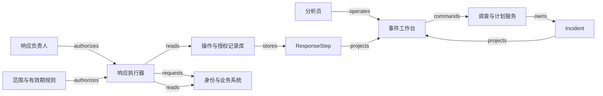

# H08 · 安全信号、授权响应与恢复

安全团队向企业承诺的，是在证据不足时继续调查，在风险明确时按授权限制损害，并在误判或威胁消失后恢复工作。这个承诺同时涉及安全和可用性：漏掉被盗账号会扩大损失，误停财务账号也会中断结算。软件必须保留“为什么怀疑”“谁允许做什么”“外部实际发生什么”这三种不同事实。风险分数能帮助安排调查，不能替人授予权限。

本例接续企业使用报表 SaaS 的场景。租户 T-A 的财务用户 U17 出现异常登录、终端告警和批量导出信号，值班分析员需要判断它们是否属于一次攻击，并决定是否临时限制导出、撤销指定会话及停用一个下游应用账号。所有人物、编号、分数、时限和规则均为 synthetic 教学设计；Microsoft Sentinel 与 Okta 只提供有明确范围的产品参照。这里不实现攻击检测器，不给实际组织作风险裁决，也不把演示规则当作通用安全政策。资产负责人决定停用造成的业务影响，获授权的响应负责人决定干预范围，证据冲突和紧急账号由人工接管。

## 识题路线：风险排序、执行许可、实际效果分别求解

看到“告警很多”先做关联和排序；看到“准备停用”先找有范围的许可；看到“请求成功”再核对访问路径。三个题型连接起来，才能把调查变成可解释的响应。

| 识题线索 | 解法 | 演算 | 验算 | 变式与下一步研究 |
|---|---|---|---|---|
| 同主体出现重复或相近信号，分析员处理不过来 | 去重、主体分桶、锚定时间窗，再取Top-K | 三信号族得100，四个同族信号得70 | 0/9分钟同窗，18另窗；共享IP不合并主体 | 删除弱设备关系后变90；查稳定主体映射、事件时间及来源重复语义 |
| 批准后排队，实际执行时对象或权限已变 | 计划摘要绑定授权，逐步骤检查当前范围与期限 | 五分钟许可等了六分钟，未发步骤拒绝 | 已确认效果保留；unknown先查回；不扩大到新生会话 | 关键账号不可停用时改窄动作；查provider实际撤销范围、可查询证据与紧急策略 |
| 威胁已解除，却不知道应恢复哪些权限 | 读取当前职责，建立新的最小恢复计划 | 旧reader+admin、现reader，只恢复reader | 旧令牌不复活，迟到停用触发核对 | 账号已离职则不恢复；查身份与业务系统各自权威和在途动作 |
| 分诊模型看似准确，但人工队列或漏判太大 | 分开计升级、常规、拒答，并估计复核成本 | 直接召回16/20；送人工覆盖19/20；需192分钟初审 | 三类合计100；覆盖率不能当模型召回 | 改漏判成本会改阈值；研究标签口径、留出划分和审阅者真实吞吐 |

## 一条信号怎样成为一个事件

Signal 是一次被记录的观察，例如某个终端报告可疑行为；它可能重复、迟到或错误。Incident 是需要持续判断的调查事件，收集信号、实体关联、假设和调查结论。Response 是改变外部系统的响应动作。三者不能共用一个状态：事件仍在调查时可以已有一项临时限制；事件被判定为误报时，一项停用请求也可能仍在网络中执行。

Microsoft Sentinel 将 incident 作为调查的证据容器，包含 alerts、entities 和协作资料；automation rule 由触发、条件和动作组成，可以修改事件属性或调用 playbook。这支持对象分离的思路，并不证明下文的聚类与评分就是 Sentinel 的实现。[Automation rules，Incident-based or alert-based automation / Components](https://learn.microsoft.com/en-us/azure/sentinel/automate-incident-handling-with-automation-rules#incident-based-or-alert-based-automation)。

| 对象 | 身份、权威与不能省略的约束 |
|---|---|
| Signal | `(tenant, source connection, source event ID)` 唯一；保留事件发生时间、接收时间、原始摘要引用与规范化版本。来源对“它报告了什么”负责，不因此证明攻击成立 |
| Incident | 本地调查服务保存稳定 ID、版本和负责人；引用信号，不把迟到信号覆盖成新事实。人工拆分或合并保留旧关系和原因 |
| ResponsePlan | 某个事件版本上的动作清单，包含 provider 组织、稳定主体 ID、目标效果和影响预览；“U17”这样的显示名不能独立充当目标 |
| Authorization | 响应负责人授予具体计划的执行许可；绑定租户、计划摘要、目标、权限策略版本、有效期和撤回记录。批准调查不等于批准停用 |
| ResponseStep / ResponseRun | 每个外部效果有独立步骤与尝试记录；run 汇总部分完成。先写入本地操作身份，再交给外部系统；本地库不能替外部宣布成功 |
| RecoveryPlan | 恢复负责人确认需要恢复的最小权限，记录新授权和核验结果；恢复不是删除响应记录，也不是复活旧凭证 |

Signal 走 `received → validated → linked`；连接身份不可信或字段不完整时进入 `quarantined`，更正后由同一处理记录重新验证。Incident 走 `new → investigating → monitoring → closed`；新证据可从 `closed` 回到 `investigating`，原结论保留。`monitoring` 表示已验证预期遏制效果并继续观察，不表示攻击根除。关闭需要调查结论、已执行动作及残余风险都有负责人接收。

计划走 `draft → awaiting_approval → approved`；批准后修改目标或动作会生成新计划，旧计划变为 `superseded`。授权走 `pending → granted → expired/revoked/consumed`。本例一次授权只允许一个 run；`consumed` 表示已绑定该 run、不能再创建另一 run，并非立即失去后续步骤的许可。同一 run 的每一步仍需在发出请求前，以服务端时间检查授权未过期、未撤回且当前执行权限仍有效。过期不自动恢复已经成功的步骤；补做未执行步骤要新授权。步骤分别走 `prepared → dispatching → confirmed`，明确拒绝走 `rejected`，超时走 `unknown`。run 可能处于 `partial`，它不能把已确认的限制和未确认的撤销压成同一个绿色状态。完整 guard 与持久化效果见 [H08.json](../../../../vault/distilled/saas-engineering-atlas/packages/data-ai-control/H08.json)。

## 从事件工作台到外部效果

事件列表显示风险排序、证据更新时间和响应进度。详情页把时间线、主体关系和动作清单并排放置：时间线回答信号在何时发生；主体关系回答凭什么认为是同一账号或设备；动作清单回答哪里已经改变。来源缺失、跨租户实体或弱关联必须显式显示。前端可以用 React 或 Vue 构建状态视图，长列表使用分页或虚拟滚动；重点是让键盘用户也能逐项读出目标、影响和状态，不能只用图上的颜色表示成功。图视图帮助探索，表格仍提供可核对的稳定 ID 和证据链接。

分析员点击“预览响应”，后端读取权威事件版本与目标映射，生成不可变计划。预览列明“限制 T-A 报表导出”“撤销连接 C1 下 U17 的指定会话”“停用应用 A1 的账号”，以及每一步不能覆盖的权限。批准按钮提交计划摘要、期望版本、授权时限和 request ID。服务端检查批准者对该租户和动作的权限，再把授权、run 和待调度任务写在同一个事务里。HTTP 接收成功只表示请求已保存；页面先显示“等待执行”，断网后按 request ID 找回同一个 run。

执行器读取待处理步骤，在真正发出请求前复查授权与当前策略。它使用该租户专属的 provider connection 和稳定目标映射，凭证只留在受控执行边界。审计记录保存连接引用、目标、动作、计划版本、批准人和结果摘要，不保存 bearer token 或原始敏感日志。两个分析员同时批准同一计划时，`(tenant, plan ID, plan version)` 的唯一运行约束阻止第二个 run；修改后的计划通过版本冲突提示重新预览。

图中的 `authorizes` 表示可以执行，`requests` 表示已经发出请求，`reads` 表示核对结果；三条边不能互相代替。JSON 为每条边保留 payload、租户边界、失败方式和事实依据。原始日志到 Signal 的接收路径与业务效果的执行路径分开，使大量遥测流量不会挤掉已经批准的遏制工作。

Microsoft Sentinel 的 playbook 使用 Azure Logic Apps；文档分别列出访问事件、手动运行 playbook 以及 automation rule 运行 playbook 所需的角色，服务账号还需得到相应资源组权限。教学系统中的“读事件”和“执行响应”也应分开授权，但本例的双人职责、计划摘要和五分钟有效期是自定规则。[Playbooks，Prerequisites / Extra permissions](https://learn.microsoft.com/en-us/azure/sentinel/automation/automate-responses-with-playbooks#prerequisites)。

## 限制了哪一种访问

“封禁账号”含义过宽，无法验收。本例把效果分成三层：报表服务中的导出能力、身份系统中的会话或令牌、下游应用中的账号状态。每层有自己的权威系统和残余访问路径，动作需要分别确认。只撤销某个会话不会自动证明所有设备都退出，只把账号状态设为 inactive 也不等于把数据库里的资料删除。

Okta 的 跨域身份管理（System for Cross-domain Identity Management，SCIM） 文档说明，当管理员在 Okta 停用用户时，下游 SCIM 用户可被更新为 `active=false`；删除已停用的 Okta 用户不会再发送删除下游资源的请求。因而本例把应用停用记录为访问状态变更，保留账号对象供核查和恢复。[Understanding SCIM，Delete (Deprovision)](https://developer.okta.com/docs/concepts/scim/#delete-deprovision)。

Okta 面向 **Classic Engine** 的令牌撤销指南区分 access token、refresh token 与 session cookie：撤销 access token 不会撤销对应 refresh token，撤销 refresh token 会同时撤销对应 access token；无效、过期或已撤销令牌的撤销请求也可能返回 `200 OK`。本例用它说明“HTTP 成功”和“所需访问已被阻止”需要分别定义；不据此断言所有 Okta 版本、所有应用本地会话或离线校验令牌具有相同语义。[Revoke Tokens，About the revoke request / Revoke an access token or a refresh token / Remove a user session](https://developer.okta.com/docs/guides/revoke-tokens/main/)。

因此，动作预览必须写出效果范围，核验要从真实应用的授权入口观察合成测试主体是否仍能执行受限动作。控制台读回 `active=false` 是账号状态证据；一次导出被拒绝是某个时间点、某条访问路径的行为证据；两者都不能证明任意路径永远不可用。需要保留可验证的 provider 请求身份、结果时间和核验范围。生产环境不可为了核查而把真实凭证写入日志。

## 手算关联与风险排序

以下是 `ALG:lookup`、`ALG:windows`、`ALG:top-k` 与 `ALG:graph-paths` 的合成组合，不是厂商检测算法。目标是把有限分析员时间分给值得先看的事件；输出只有调查队列和可解释的关联，不输出执行权限。规则版本固定为 R1，时间单位为分钟。

首先在来源连接与租户范围内按事件 ID 去重：同一身份的不可变内容相同才是重投，接收时间可以不同；内容冲突则隔离整组证据，阻止它进入可信评分，交换到达次序也不能改变处理结果。规范化版本属于派生表示，重新规范化要保存新版本与原事件的关系，不能创造新的来源事件来抬高信号数；本例去重与评分读取同一规范化版本。再以 `(tenant, identity connection, immutable principal ID)` 找到主体。本例为同一主体从最早事件开始建立半开窗口 `[t₀, t₀+10)`；下一个未分配事件成为新窗口起点。迟到数据会重算受影响区间并生成新分组版本。相同公网 IP 只作为线索，不能把共享出口的两个主体合成一个人。

| 事件 | 相对时间 | 主体 / 信号族 / 严重度 | 处理结果 |
|---|---:|---|---|
| a1 | 0 | U17 / 身份 / 60 | 进入窗口 W1 |
| a1 的重投 | 0 | 同一个 source event ID | 只增加接收记录，不增加证据 |
| a2 | 3 | U17 / 终端 / 55 | 进入 W1；设备关联已由映射确认 |
| a3 | 4 | U17 / 数据访问 / 35 | 进入 W1；U17 对关键报表有写权限 |
| b1—b4 | 1—4 | U22 / 身份 / 各 70 | 另一事件 W2，共四个不同事件 ID |

R1 的教学优先级为 `P = min(100, max(严重度) + 10 × (信号族数量 − 1) + 20 × 关键资产标志)`。W1 有三个信号族且涉及关键资产，故 `P₁ = min(100, 60 + 20 + 20) = 100`；W2 只有一个信号族且不涉及关键资产，`P₂ = 70`。若直接累加严重度，W2 得 280，W1 得 150，重复且同质的告警会吞掉调查容量；去重后保留多样性，比计数更贴近本例的调查目标。这个分数没有经过概率校准，100 不是“攻击概率为 100%”，20 分资产加权也不是损失金额。

图路径进一步解释关联：`U17 → 已绑定设备 D4 → a2` 与 `U17 → 已授权报表 R8 → a3` 给出可以回查的关系。路径每一段都记录来源、时间和关联置信条件；“同 IP → 同用户”不允许成为授权依据。只有时间先后、没有机制证据，不能把路径命名为已证实攻击链。分析员可以拆掉不可靠的设备映射，查看 W1 从三族降为两族后分数怎样变化；关键资产标志仍为 1 时，分数从 100 变成 90。

两个反例能检验规则有没有被误用。第一，合法演练同时触发三族信号，分数仍为 100；人工应查看演练范围与时间，不能把分数直接接到停用 API。第二，攻击者在第 0、9、18 分钟发出信号：按“相邻两条相隔不足 10 分钟”连通会把 18 分钟的活动塞进一个十分钟窗口。R1 以首条事件锚定，0 和 9 同组，18 进入新组；跨窗口调查可以建立事件关系，但不改写窗口定义。紧贴 10 分钟边界的事件进入下一窗口，避免两边计数。

朴素办法将 n 条信号两两比较，代价为 O(n²)。按主体分桶并按事件时间排序，一次批处理通常为 O(n log n)，每桶扫描为 O(n)；这里的“通常”只针对该明确算法，不涵盖存储与网络成本。给 m 个候选事件取前 k 个可用最小堆，代价 O(m log k)，同分时以最早未处理时间和稳定 ID 排序。受限图遍历为 O(V+E)，但先限租户、允许边类型和最大时间范围，否则“所有账号都访问过某个公共服务”的高连接节点会把调查图膨胀成无意义大团。

## 正常执行、未知结果与误封恢复

正常路径从 a1— a3 三条独立信号形成事件 I17 开始。分析员核对 U17 与 D4 的映射，生成计划 P3；响应负责人批准版本 P3，许可有效期五分钟。执行器持久化三个 prepared 步骤，逐一复查授权，发送请求并核对目标效果。全部预期效果已确认后，run 为 `confirmed`，事件进入 `monitoring`。恢复负责人在调查完成后核对当前职责，生成只恢复应有权限的计划；用户重新认证，导出限制按批准范围解除。事件负责人接收恢复证据和调查结论，才关闭事件。

失败路径更能显示对象分离的价值。假设报表导出已限制，会话撤销请求超时，下游停用尚未发出。run 为 `partial`，会话步骤为 `unknown`，不是 failed。网络可能在请求到达前断，也可能在外部完成后断；仅凭超时无法区分。恢复 worker 先按外部请求身份核查；若 provider 不提供操作查询，读取目标状态和相关审计，再由具有权限的人判断是否足够确认。目标状态可能被别的管理员改过，不能仅因“现在已停用”就证明是本次操作造成。

下一次调度时授权已经过期，尚未发出的步骤必须暂停，当前已生效的限制继续可见。新批准可接续明确缺失的效果，不能把所有步骤重新播放一遍。即使撤销看起来是幂等动作，重试“撤销该用户所有会话”也可能误撤用户刚建立的合法会话；动作目标随时间增长时，重复请求的业务效果并不相同。仅当 provider 的语义、固定目标和授权范围共同支持时，才能按同一操作身份重试。

若人工发现 U17 正在进行批准的演练，要先停止未发送步骤，撤回未消费授权，并查询正在执行或 unknown 的步骤。恢复负责人创建新计划，读取账号此刻的角色与状态，不把两小时前的权限快照整份覆盖回去。误停期间用户可能已转岗，旧权限恢复会制造第二次错误。已撤销令牌不应被“恢复”；应要求重新认证并按当前权限发放新凭证。若迟到的停用结果在恢复后到达，系统依据请求 ID、目标版本和观测时间识别旧尝试，重新核查实际状态；外部系统不支持版本条件时，只能保持冲突待核查，不能假装本地版本号已经阻止外部旧写入。

## 规模决定哪些工作要分开

合成容量假设是 100 个租户、每天共 200 万条规范化信号、每条平均 1,000 字节、30 天热查询。原始量约为每天 2 GB、30 天 60 GB，尚未计索引、复制、原始证据附件和审计记录。平均到达率约 23 条/秒，但十分钟突发可达 2,000 条/秒，即 120 万条、约 1.2 GB。按平均值分配内存会在真正需要安全系统时失去信号。过载时先持久化到可恢复队列；租户配额和轮转消费防止一个噪声来源占满所有分析与执行容量。限流造成的覆盖缺口必须在 UI 显示，不能静默丢弃后仍声称“没有异常”。

PostgreSQL 可承担事件、计划、授权与步骤账本，理由是这些对象需要关联约束、版本竞争和明确事务。日志检索量增加时，可把不可变信号投影到 OpenSearch 一类搜索存储；这是本例的技术候选，搜索副本只供查找，不作为响应授权的权威。队列起步可用数据库任务表减少部署部件；持续高吞吐再选择 Kafka 一类日志队列，代价是分区、重放和消费者运维都要负责。响应执行量远小于遥测量，保持独立队列有助于隔离噪声。外部 playbook 平台减少连接器开发，但其工作流成功状态仍须映射到每项业务效果。

授权查询不能直接使用几分钟前的角色缓存。事件列表可以缓存，key 至少包含 tenant、查询条件、过滤权限版本与投影版本，返回数据附采样时间；信号更正和权限变化会使旧投影失效。列表性能目标可设为在上述数据量、20 个并发分析员、冷缓存与热缓存分别测量 p95 小于 800 毫秒；批准请求持久化 p95 小于 500 毫秒。二者均为待测目标，外部效果完成时间另计，不能用 API 接收延迟冒充遏制延迟。执行器本地锁只能减少并发派发，不能让一个不接受版本条件的外部系统获得跨网络的 exactly-once 保证。

## AI 辅助分诊的测量边界

确定性规则已足够实现本例，AI 可选地整理证据摘要和提出调查队列建议。模型输入是最小化的信号摘要与受限证据引用；信号正文可能含攻击者控制的文本，应作为待分析数据，不能成为工具指令。模型不能改授权对象、读取别租户资料或自行扩大计划。无法定位引用、主体冲突、关键账号、超出样本分布以及“请忽略之前规则”一类日志内容都应转人工。此处没有运行模型，也没有供应商效果结论。

正式评估可由两名领域审阅者独立标注并裁决分歧，再形成留出集；本次没有执行这项工作。以下 **synthetic eval fixture** 仅人工构造 100 个事件的标签与预测计数，用来手算指标：20 个确需升级、80 个无需升级。模型建议升级 24 个，其中 16 真阳性、8 假阳性；建议常规处理 68 个，其中 1 漏判、67 真阴性；拒绝判断 8 个，其中 3 个实际需升级、5 个不需升级。三种输出互斥，合计 100，不把拒答悄悄移出分母。

由此，升级精确率为 `16/24 ≈ 66.7%`，直接升级召回率为 `16/20 = 80%`，正常事件误升级率为 `8/80 = 10%`，拒答率为 `8/100 = 8%`。若升级与拒答全部人工审查，待审为 `24+8=32` 个，真正需升级的 19/20 会进入人工队列，仍有 1/20 留在常规处理。这个 95% 是“送人工覆盖率”，不是模型召回率，也不证明人能全部识别。每个待审事件平均六分钟，则 100 个事件需要至少 192 分钟初审，尚不包括深入调查。

假设漏判成本为每个 100 个损失单位、误升级成本为 3 个、拒答初审成本为 1 个，并额外假设人工审查能识别这 3 个拒答中的危险事件，则本 fixture 的示意成本是 `1×100 + 8×3 + 8×1 = 132`。改变成本或人工能力会改变阈值选择，不能只追求准确率。正式 eval 应冻结脱敏输入、标签规则、模型与提示版本、阈值、连接权限和按时间或租户隔离的留出划分；另做含无效引用、提示注入、同名跨租户主体和关键账号的挑战集。报告分层漏判、误升级、拒答、人工推翻率与完成耗时，不能只汇总平均数。上述数字只是推演，没有声称已完成模型测评。

## 能判错的检查才有用

下面定义的是未来实现的端到端验收，需要 UI、持久记录及 provider stub 或真实沙箱证据互相核对。纯计算检查可以验证分数与窗口，不能替代网络故障、身份权限或真实应用访问测试。

| 给定条件与动作 | 期望观察及不变量 |
|---|---|
| 正常：U17 的三族证据，P3 在许可期内逐步执行 | 只为 P3 建一个 run；各步骤持有独立确认；三个效果都确认才显示总体 confirmed |
| 重复：a1 投递两次、批准请求重复提交 | a1 只计一次；操作身份返回已有 run。事件去重和业务动作唯一性分别验证 |
| 乱序：新状态后收到旧停用回执、迟到的窗口内信号 | 旧回执不覆盖当前恢复结果；重新读权威状态。信号重算产生新分组版本，不无痕修改已批准计划 |
| 并发：两个批准者批准 P3，同时有人把目标改为 U22 | P3 唯一 run；修改产生 P4 并使 P3 不再可新派发。不得把 P3 的许可套给 U22 |
| 租户隔离：T-A 与 T-B 都有显示名 U17 和事件号 17 | 查询、缓存、图遍历、provider connection 均保持租户边界；伪造 tenant 参数不得获得另一租户目标 |
| 未知结果：provider 已执行会话撤销，响应包丢失 | 步骤保持 unknown；先核查，不立即撤销用户后来新建的所有会话；UI 保留已确认的其他步骤 |
| 崩溃恢复：步骤结果已提交，worker 尚未标记任务完成就重启 | 重放读到已确认步骤并跳过执行；有据可查地完成消费，外部动作不会因本地重启扩大范围 |
| 授权过期或撤回：approved 队列阻塞六分钟，或批准者权限被移除 | 派发前拒绝；没有新增外部调用；已发生效果不被伪装成从未执行 |
| 误封：恢复时目标已转岗，随后收到旧停用结果 | 只按当前职责恢复，旧凭证不复活；外部不支持并发条件时进入人工核对，不宣称已完全恢复 |
| 算法与 AI fixture：重复、边界时间、共享 IP、100 个已标记样本 | 重复不涨分，10 分钟边界不重计；共享 IP 不合并；三类预测总分母为 100，人工覆盖率不冒充模型效果 |

验证实际执行范围和未执行项统一记在本包 [CHANGELOG.md](../../../../vault/distilled/saas-engineering-atlas/packages/data-ai-control/CHANGELOG.md)，结构化检查定义见 [H08.json](../../../../vault/distilled/saas-engineering-atlas/packages/data-ai-control/H08.json)。

## 改变条件后重新推理

**练习一：把临时限制改为 X01 的正式退租。** 安全事件已关闭，能否像恢复误封一样把所有账号重新设为 active？

简答：保持不变的是“每个外部效果独立确认”，改变的是权利依据。临时限制的解除依赖当前身份与业务职责；退租后的服务权利已经结束，恢复访问需要新的合同或租户开通授权。不能把“事件关闭”连到“租户重新开通”。反例是离职员工被误报事件关闭后重新获得账号。可观察检查是同一账号仍处于退租或离职状态时，恢复计划必须拒绝，并展示缺少的权利依据。迁移 ID：`TR:H08:X01:containment-vs-offboard`。

**练习二：把响应计划授权迁到 H09 的文档审批。** 文档在批准后只改了一个 URL，能否继续使用旧批准把新版本推送到下游？

简答：保留批准绑定不可变内容版本的机制；修改后的 URL 可能改变履约目标，必须按新版本判断是否重新审批，不能因为页面标题未变就复用旧摘要。反例是旧批准被用于新收件人或新义务。检查向下游写出的内容摘要是否等于获批版本，并验证旧版本重试不会覆盖新版本。但两例的破界也要保留：安全许可通常很短，允许的紧急限制和恢复职责不等于合同文本的签署、撤回或法律效果；后者必须独立查证。迁移 ID：`TR:H08:H09:version-bound-authority`。

**练习三：关键账号不能停用，只有三分钟响应窗口。** 是否把阈值从 90 调到 100 就能满足要求？

简答：阈值只改变排队，不能产生一种安全的可执行动作。把计划拆成窄范围导出限制、会话核对及人工值守，确认哪个动作受预授权覆盖；没有覆盖就升级给有责任的人。时间紧不消除授权边界。反例是高分自动停掉全公司的共享结算账号。检查将“不可停用”与最高风险同时输入，系统仍不得发出停用请求，并应显示仍暴露的路径与接管人。

H07 的版本化 lineage 可迁移为信号到事件、事件到计划的可追溯关系；区别在于数据沿袭说明结果怎样产生，不能自行证明有权改变账号。H01 的 unknown 与对账机制可迁移到响应步骤；区别在于重复撤销可能影响新生会话，不能照搬“同一付款身份只产生一次效果”的业务键。进入陌生行业时，先选一个可解释的访问路径和一个可能误伤业务的响应动作，确认谁判断风险、谁承担停用后果、哪个系统能证明访问已被阻止。已有遥测与响应连接器时，可研究 SIEM/SOAR 和身份生命周期方案；只有少量人工调查时，带授权和步骤账本的工作流可能已经足够。下一步查真实会话范围、撤销传播时间、关键账号例外及恢复证据，以误报、授权过期和超时回执组成演练，不能只验收告警是否出现。

证据定位与适用限制见本包 [evidence.json](../../../../vault/distilled/saas-engineering-atlas/packages/data-ai-control/evidence.json)，整合交接见 [handoff.md](../../../../vault/distilled/saas-engineering-atlas/packages/data-ai-control/handoff.md)。
