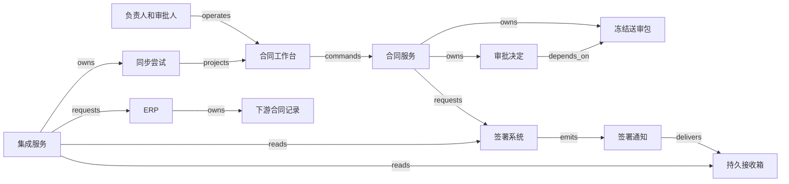

# H09 · 文档版本、审批与下游记录

一份合同经过内部批准后，仍可能停在签署、归档或下游同步中的任一环节。在共同企业图景中，这一环对应“接受承诺”：销售要知道能否继续成交，法务要知道批准了哪些条款，财务要知道订单中的金额从何而来。所以“完成”要同时写明哪一版文件、由谁决定、哪个系统已经接收；单凭一个“已完成”标签，三方都找不到自己的依据。

本例构造一家出售年度服务的企业：一份合同有正文和数据处理附件，两位签署人，内部审批后才发起签署，归档后向企业资源计划（enterprise resource planning，ERP）写入合同记录。合同效力、代理权限与终止条件由具备相应责任的人判断。本例不实现跨企业共同编辑。

## 识题：批准版本、等待前提与接收记录

看到“内容改了一点”，先追问批准绑定了哪些输入；看到“流程太慢”，先分清是在等前提还是在等人；看到“同步过了”，再核对接收方保存的版本。

| 识题线索 | 解法 | 演算 | 验算 | 变式与后续查证 |
|---|---|---|---|---|
| 正文、附件或字段改变，旧批准仍亮绿灯 | 冻结送审包与摘要，批准绑定版本和政策 | v7=80,000 改为 v8=120,000，开启新的审批轮次 | 正文改了但 metadata 未改，也要阻断 | 联系方式不影响签署人时能否沿用旧批准；查字段依赖、审批重置与预览完整性 |
| 多个审批互等，想靠增加 worker 加速 | 对有向无环图（directed acyclic graph，DAG）做拓扑排序求出先后，再查人员时间冲突 | 串行 6.5 小时；并行 3.5 小时；同一审批人兼任 4.5 小时 | 沿独立路径复核演算；有环配置不能发布 | 加上级审批后为 4.5 小时；查资格、日历和实际排队时间 |
| 发送后失联，又收到撤回或已签回执 | 派发前持久认领，按查回的实际状态恢复；取消与发送用条件更新决出先后 | 认领前可取消；认领后记为 unknown 并查回 | 已全部签完又有取消意图时进入争议，不重建请求 | 查签署事件是签名证据还是人工声明，provider 如何查询原尝试 |
| 旧导出迟到，新记录被旧值覆盖 | 稳定业务键加单调导出代次、写前比较并交换（compare-and-swap，CAS）与写后回执 | 写前 0→写后 1；同代重投仍为 1；代次 2 后拒绝代次 1 | 对象、代次、payload 与提交版本逐项一致 | 下游只支持无条件写入时，按合同串行发送，unknown 阻断后续导出；查目标 API 的幂等、版本与外部并发能力 |

## 解法：送审包与批准绑定

“我批准这个合同”至少省略了四个问题：看到的是哪份正文，附件有哪些，金额等业务字段是什么，适用哪版审批政策。编辑器里显示的内容随时会变，批准却要在日后仍能说清批准的是哪一份，所以系统把可编辑的工作稿与送审包分开。工作稿可以保存多次；提交审阅时，系统冻结一个 bundle（送审包），用 `tenant_id、contract_id、bundle_version` 标识，内容包括有序文件清单、每个文件的摘要、结构化字段及其 schema 版本，以及审批政策版本。

文件摘要能发现字节改变，却不能证明合同意思正确，也不能发现漏掉清单的附件。DOCX 重新保存可能只改变内部元数据，所以本例在原始文件摘要之外，还保留供人审阅的差异视图，并采用保守策略：送审包有任何改变都生成新版本，为新版本开启新的审批轮次，不因“语义看起来相同”就自动沿用旧批准。金额按固定整数单位存储，缺值与零值分开；文件名、附件顺序与签署人清单也一并冻结。这样，批准人日后回看的内容与执行时取用的内容指向同一个版本。

Ironclad 的公开配置说明分别列出文档、工作流和字段变化的审批重置条件；其中还说明，上传文档改变了字段含义时，需要同步更新结构化字段，才能触发字段变化条件。可见文档与结构化字段可能脱节，“上传成功”并不说明金额规则已重新计算（[Configure Approval Resets](https://support.ironcladapp.com/hc/en-us/articles/40675997675031-Configure-Approval-Resets-in-Workflow-Designer)）。本例采用更保守的整体版本绑定；接入时具体怎样重置，由使用方自己的规则决定。

| 对象与负责者 | 身份与权威记录 | 状态与转换 |
|---|---|---|
| 送审包；合同负责人提交 | 合同服务保存版本，文件仓保存不可变字节 | `draft → frozen → superseded`；旧包被替代后仍可回查 |
| 审批决定；法务、隐私与财务各自决定 | 每条决定绑定包版本、审批轮次、角色、政策与决定者 | `pending → approved / rejected`；后续变更使该轮 `invalidated`，历史决定仍在 |
| 签署请求；获授权负责人发起，双方签署人决定 | 外部签署系统确认请求及签名，本地只保存映射和证据 | `queued → dispatching → sent → partially_signed → fully_signed`；另有取消中、已取消及结果未知 |
| 签署归档；合同记录服务管理 | 原始签署文件、签署请求映射和复核记录 | `pending → recorded`；争议进入 `disputed`，修订后保存替代关系 |
| 同步尝试；集成 worker 执行 | 本地尝试账本记录每次请求的依据，ERP 保存自己的记录 | `queued → sending → confirmed`；可进入 `unknown`、`blocked` 或补偿中 |

表格和结构 JSON 只列本例用到的状态与转换。

合同负责人可以起草、提交和申请撤回，无权替法务批准；审批人只能处理被指派的角色和当前轮次；签署人只能就自己收到的那一版签署包表态。集成账号只能读取已允许导出的字段并更新映射记录，不能制造审批。管理员修改政策是另一种权限：修改后生成新的政策版本；已在审的包是沿用旧政策还是重新送审，要明确决定，本例选择重新送审。界面上隐藏或禁用按钮，只是向用户说明权限；授权由服务端在每次提交时重新检查。

Ironclad 的 API 文档区分 Workflow 与 Record：前者描述流程，后者包含完成流程产生的签署文件及元数据；各有对象 ID，并用 Ironclad ID 连接同一合同生命周期。[Getting Started — Workflows / Records / Ironclad ID](https://developer.ironcladapp.com/reference/getting-started-api)。接入该产品时要保留这些 ID，本地的 `contract_id` 不能拿来代替 provider 的 Workflow ID 或 Record ID。

## 批准、版本冲突与发签

工作台列表分别显示“当前包 v7”“内部审阅 2/3”“签署未发起”“ERP 未同步”。详情页先展示当前包、相对于上一版的差异、未解决批注和本人的审批责任，再提供“批准此版本”“拒绝并说明原因”。预览页要能查看原始文件和全部附件；有页面无法渲染时，明确提示缺页，不完整的预览不能记为已审阅。

点击批准时，浏览器提交 `operation_id、bundle_version、approval_round、decision、comment`。服务端在同一事务中检查租户、当前指派、政策版本、包版本及尚未决定的状态，写入批准与审计记录。事务提交后，页面可以显示“v7 已由你批准”；其他审批尚未完成时，签署仍为等待。重复点击返回同一次尝试；同一 operation ID 带着不同内容提交时，服务端拒绝。浏览器断网后重开页面，按 operation ID 查询结果；本地弹出过的 toast 不算已保存的证据。

假设法务打开 v7 后，销售先提交了 v8。法务再批准 v7 时，服务端返回版本冲突，展示“当前为 v8；你查看的 v7 已被替代”以及差异入口。把批准自动挪到 v8，会让人承担尚未看过内容的责任。反过来，法务已批准 v7，销售随后提交 v8，则保存 v7 的批准事实，同时使旧轮次不能放行 v8。批准与提交争用同一个“当前版本”标记，数据库用条件更新或行锁为两者定出可解释的先后。

必要的批准都齐备后，负责人点击“发送签署”。服务端再次核对送审包、签署人清单和当前有效批准，冻结签署请求 payload，在事务中写操作记录和 outbox（待发送记录）。worker 先在事务中用条件更新认领任务，把 `queued` 改成 `dispatching`，保存这次固定的尝试，再调用外部签署系统；发送内容按 outbox 中的字节引用读取，不从编辑器重新生成最新稿。外部系统受理后，UI 才显示具体的签署请求。HTTP 超时，或 worker 认领后崩溃，任务都进入 `unknown`，界面显示“发送结果待核对”，这次尝试保留不动。租约到期只能说明执行者失联，不能证明网络请求没有发出。签署页面的原始请求 ID 与本地 bundle 版本必须始终能互查。

图中关系类型与 [拓扑 JSON](../../../../vault/distilled/saas-engineering-atlas/packages/data-ai-control/H09.json)一一对应；`depends_on` 指向前提，不代表文件已经传过去。若实际选用 Ironclad 作为合同生命周期管理（contract lifecycle management，CLM）的权威系统，适配层应读取它的工作流、记录与权限结果，不再用本地的绿色状态覆盖它的决定。

## 演算：审批依赖与等待时间

审批能否并行，取决于信息依赖。本例的隐私审阅 P 用 2 小时判断附件要求及额外实施成本；财务 F 需要 P 的成本结论，再用 1 小时审阅预算；法务 L 可以独立用 3 小时审阅正文；负责人 R 在 L、F 都完成后用 0.5 小时核对发签条件。这里的时长是假设的连续处理时间，先忽略排队、工作日历和返工。

对应的算法家族是 `ALG:scheduling`。为了安排先后，把边写成“前提 → 后继”：`P → F`、`F → R`、`L → R`。这与对象图中 `F depends_on P` 的箭头方向相反，转换时要写明方向。朴素做法按固定顺序串行执行，耗时 `2 + 1 + 3 + 0.5 = 6.5` 小时。拓扑排序先取入度为零的 P、L，完成 P 后才让 F 就绪，L、F 都完成才释放 R。对每个任务计算 `最早完成 = max(所有前提最早完成) + 本任务时长`，无前提时取零。

| 任务 | 前提 | 最早开始 | 最早完成 |
|---|---|---:|---:|
| P 隐私 | 无 | 0 小时 | 2 小时 |
| L 法务 | 无 | 0 小时 | 3 小时 |
| F 财务 | P | 2 小时 | 3 小时 |
| R 发签复核 | F、L | 3 小时 | 3.5 小时 |

并行的价值在于：最长前提链只有 3 小时，最后复核再用 0.5 小时。加速也有边界：即使把 F 从 1 小时缩到 0.2 小时，L 仍需 3 小时，整体还是 3.5 小时。把任务分给更多 worker，也不会加快正由人审阅的法务节点。

Kahn 拓扑排序维护每个节点的剩余前提数，出队一个节点就减少它的后继计数，时间和空间量级均为 `O(V+E)`；V 是任务数，E 是依赖数。工作台可在配置发布时检查有无环：若处理完的节点少于 V 个，剩下的节点之间存在循环依赖。反例是配置者又要求“P 等 R 发签复核后开始”，形成 `P → F → R → P`，所有涉及节点互等；重试提醒和增加机器都无法解除这个政策错误。

拓扑排序给出合法的先后次序，人员是否有空是另一回事。若 P 和 L 必须由同一位有双重资格的人处理，就不能在第 0 小时并行开始，3.5 小时只是忽略资源竞争的下界。实际调度还需工作日历、资格、优先级和不可拆分时段。本例不做资源优化；最早完成时间也不是合同处理的服务级别协议（service-level agreement，SLA）承诺。

版本变化也会改变图。v7 金额为 80,000 记账单位，v8 为 120,000；本例政策规定高于 100,000 需增加负责人上级 E，在 L、F 后用 1 小时批准，R 改为等待 E。重新计算得到 4.5 小时。若正文已经改成 120,000，metadata 仍写 80,000，拓扑算法会正确执行错误的图，漏掉 E。问题出在输入不一致：提交前要核对正文与结构化字段；自动抽取只能提示冲突，替代不了负责人确认。

## 签署回执、归档与映射

签署回调说明的是一次外部事件。Ironclad 文档区分签名收集事件和全部签署事件；手动上传路径中，“全部签署”还可能来自用户声明，产品不校验上传文件包含的签名是否正确。完成工作流通知则另外携带 Record IDs。[Webhooks — signatures collected / fully signed / workflow completed](https://developer.ironcladapp.com/reference/webhooks)。因此，本例的归档 guard 检查全部所需签署人、请求版本和证据路径；手动上传增加人工复核，不把收到带有 `signed` 字样的事件当成自动放行依据。

正常路径是：v7 的必要审批有效，签署请求 S7 被受理，两位签署人各完成签署，服务核对 S7 的最终状态，保存签署文件和证据，建立归档记录 A7。集成服务根据固定映射版本 M3 从 A7 提取金额、币种或记账单位、对方实体 ID 和生效区间，生成 ERP 命令。日期类型、枚举、缺失值和单位在映射前验证；验证不通过的记录进入 `blocked`，操作员能看到具体字段和原始出处，不会出现字段半空却标为成功的记录。

映射键至少包含 `(tenant, provider_account, contract_id, destination, destination_record_id)`；某一次写入另有 `(source_record_version, mapping_version, operation_id)`。合同号是给人看的编号，不能代替跨租户身份。同一合同的新修订通常更新同一下游业务记录并保留版本史；不同目的地各有同步尝试，CRM 成功不意味着 ERP 已成功，所以 UI 上可能同时出现“已归档；ERP 待核对”。每个 `(tenant, contract_id, destination)` 还由本地事务分配单调递增的 `export_generation`，每次尝试冻结写前条件 `expected_destination_version`。成功回执保存写后 `committed_destination_version`；本例协议每次新写入将版本加一，因此写前为 0 时写后应为 1。外部返回记录 ID 后，还要核对保存结果、导出代次、目标字段与写后版本，都无误才把本次尝试标为 `confirmed`；读回的版本应等于写后版本，不应再等于写前条件。

最危险的故障发生在 ERP 已创建记录、worker 尚未保存响应时。若下游支持按外部键原子 upsert，并能按该键查询，重试可查询并确认原记录；若支持幂等请求键，保留同一键并遵守其有效期。这两项能力都要按实际下游的接口契约核实。本例假定 ERP 提供按外部键定位的条件写入：在同一原子操作中检查导出代次不落后、目标当前版本等于请求的 `expected_destination_version`，再递增目标版本并保存 payload；相同代次和相同 payload 只返回原提交结果及其写后版本，不再次递增；相同代次但内容不同则拒绝。这样旧导出迟到时无法把新金额覆盖回去。只有 upsert，能防止重复建记录，却防不住错误覆盖。若查回时目标已是更高代次，旧尝试标为 `superseded`，保留被替代的证据，旧 payload 不再算作当前值。

真实下游没有条件写入时，本地应按合同和目的地串行发送，并让 unknown 阻断后续导出。这只管得住自己的发送顺序，外部人工操作或另一个集成账号仍可能并发覆盖。若下游还不能幂等写入或可靠查回，超时必须停在 unknown，由人工对账；换一个新 operation ID 继续创建会制造第二份承诺。

接收边界先按实际 provider 的认证契约验证来源，并由已验证的账户映射确定租户，不能任由 payload 选择租户；具体认证协议需在接入时继续核查。签署通知可能迟到，也可能被重复处理，所以接收箱先保存原始事件摘要、来源账户、接收序号与映射身份，处理时再核对对应的请求。本例不假定通知提供全局唯一事件 ID；订阅的 webhook ID 也不能直接用来去重每个事件。业务效果仍由“某租户、某签署请求、某归档版本只能对应一个结果”的唯一约束保护。旧 S7 通知抵达时，当前签署请求已是 S8，通知仍写入 S7 的历史，不将 S8 标为签完。

## 撤回、取消与补偿

内部审阅期间撤回 v7，可以使当前审批轮次失效。只有仍为 `queued`、尚未被 worker 认领的 S7，才允许用条件更新在本地取消，并抑制发送；认领与取消只能有一方成功。处于 `dispatching` 的尝试可能已经发出请求，即使尚未保存外部 ID，也不能直接写成已取消。此时先保存取消意图并进入核对路径。已确认发出的请求改为 `cancel_pending`，再向外部请求取消，得到确认才显示 `cancelled`。Ironclad 文档提供签署期间取消请求并返回 Review 的操作；具体审批重置仍应按配置核查。[Cancel Signatures and Return a Workflow to Review](https://support.ironcladapp.com/hc/en-us/articles/12274796145303-Cancel-Signatures-and-Return-a-Workflow-to-Review)。

`unknown` 查回后，请求可能已在待签、部分签署、全部签署或已取消，恢复按查到的实际结果走，不一律退回“待签”。带有取消意图且查到仍待签或部分签署时进入取消中；查到全部签署时进入争议。查不到请求时，只有 provider 能可靠证明它未被受理，才允许重新发送；否则保持 unknown。

取消与最后一名签署人提交可能竞争。本例在取消结果未明时停止新的下游同步；若核对发现请求已完整签署，保留签名及时间，标记争议并由合同负责人处理。已签状态不能为了让“撤回成功”的提示成立而在数据库里改回未签。已经进入 ERP 的记录也需要独立的修订或作废命令；该命令自身有申请人、理由、权限、外部回执和失败状态。下游已开票、交付或支付时，合同字段被删除不等于那些义务随之消失。

恢复分成三种动作：未认领的 queued outbox 可以在事务内阻止发送；已经发送但结果未知的请求先查回；已确认的外部效果用新操作补偿。补偿确认后仍保留原记录和修订关系，不用硬删除伪造“从未发生”。如果要求某字段不再向下游传播，本例把它交给后续的映射政策和撤回任务处理；历史保留到什么范围由组织决定，不由一条通用同步脚本决定。

## 技术选型与规模边界

一个可验证的第一版可以采用 React 或 Vue 做审批工作台，服务端用 TypeScript 的 NestJS 或 Python 的 FastAPI，PostgreSQL 保存版本元数据、决定、操作记录和 outbox，对象存储保存原始 DOCX/PDF。共用 TypeScript 可减少前后端数据类型分叉；Python 便于连接文本分析工具。无论选哪一种，都要在服务端验证输入，编译期类型代替不了权限检查。

文档审阅若以 PDF 为主，可以用 [PDF.js](https://mozilla.github.io/pdf.js/) 显示已冻结 PDF 并把批注单独保存；这种方案便于明确审阅版本，却不保证能还原 DOCX 的可编辑布局。确需在线编辑时，可以评估 ONLYOFFICE 或 Collabora，但需另外验证修订标记、字体、转换一致性、授权与部署成本。富文本组件适合快速做演示；复杂法律文档导入导出后会不会丢失格式或批注，要先试验再下结论。预览输出要能追溯到原始文件，渲染失败时不能用空白页掩盖。

PostgreSQL 适合把“确认批准有效、写入决定、安排后续任务”放进同一个事务，并用组合唯一约束防止重复记录。身份列应设为非空：按默认语义，唯一约束不把两个空值视为相等，约束列中至少有一列为空的行可以重复存在。[PostgreSQL — Unique Constraints](https://www.postgresql.org/docs/current/ddl-constraints.html#DDL-CONSTRAINTS-UNIQUE-CONSTRAINTS)。文件先上传到临时位置，校验大小和摘要后登记引用；崩溃后残留的无引用文件由独立清理任务处理。对象存储保存副本，数据库保存权威记录：文件存在不代表批准已经成立，数据库有引用也不保证文件还能读取。备份恢复检查要实际取回被批准的旧版本，不能只数数据库行。

工作流规模小时，数据库 outbox 加 worker 已足够解释重试；长时间等待、多个取消分支与跨服务恢复越来越多时，可评估 Temporal 一类持久工作流工具。引入它是为了保存执行进度，审批权限、历史版本和外部请求是否成功，它不会自动解决。Temporal 自己也建议 Activity 幂等，以避免重试造成重复副作用。[Temporal Activities](https://docs.temporal.io/activities)。全文检索也应排在基础权限与映射之后：索引只是供查询的副本，文档出现在搜索结果里，不等于有下载权限。

容量规划假设 300 个租户、总计 200,000 份合同、每份 4 个版本、每版平均 2 MB，原始文件约 `200,000 × 4 × 2 = 1,600,000 MB`，即十进制 1.6 TB；未计预览、附件额外副本与备份。每秒 40 次列表读取和 5 次批准写入下，可把列表 p95 小于 500 毫秒、批准持久化 p95 小于 1 秒作为待测目标，外部签署与人工处理时间单独报告。

真正可能占用资源的是文件上传、预览转换与批量同步，不是十几个审批节点的拓扑排序。预览任务应按租户限制并发；同一合同的批准与替代需要串行化，避免热点争用扩散到其他租户。只缓存不可变版本的预览，缓存失效更好管理；缓存 key 包含租户、内容摘要和渲染器版本，当前包指针与权限仍在读取时校验。对签署、ERP 的积压分别测队列年龄和 unknown 数量，避免“平均处理快”掩盖少量长期无法确认的合同。

## AI 字段建议的评估

Ironclad 的 April 2025 更新介绍 Custom AI Properties，用示例改进合同字段抽取；这份公开介绍里没有本例所需的准确率数据。[What's New — Custom AI Properties](https://support.ironcladapp.com/hc/en-us/articles/30977258163607-What-s-New-in-Ironclad-April-2025)。本例可让模型建议金额、期限和需要复核的条款，并附原文位置；AI 输出是候选字段，确认后才进入送审包。模型没有“批准”“发送签署”或更改已批准包的权限。

留出集包含 40 份合同，按人工标签，其中 10 份需要额外升级审阅，30 份不需要。假设冻结配置的模型提示升级 12 份，其中 8 份命中，4 份误报；另漏掉 2 份。精确率为 `8/12 = 66.7%`，召回率为 `8/10 = 80%`，漏报率为 `2/10 = 20%`。只报总体正确率 `(8+26)/40 = 85%`，会淡化两份漏报的后果，所以本例不允许这组结果自动放行。

对同一留出集的金额抽取，另列 40 个有标签字段：34 个完全正确、2 个错误、4 个拒答；自动覆盖率为 `36/40 = 90%`，覆盖样本正确率为 `34/36 = 94.4%`。若人工逐项复核，至少 6 个字段需要补充或修正，比例 `6/40 = 15%`；被人工确认过的结果不能反过来算成模型正确。缺页、扫描质量差、币种冲突或跨文档矛盾都要求明确拒答或转复核，不能自动填零。

真实评估需冻结原始文档、标签口径、模型与提示配置，按合同而非页面拆分训练集与留出集，避免同一合同版本泄漏。分别测试改数字、否定词、附件覆盖正文、扫描件以及把“忽略审批”藏进文本的样本；这些文本是待分析内容，无权改变工具权限。自动草稿只写入新的 draft，抽取变化必须重新走提交检查。AI eval 评的是候选输出，业务检查看的是人和系统有没有守住授权边界，两者分别留存证据。

## 验算：从界面到下游的检查

每项检查都记录实际观察到的结果，预期答案不能当作执行结果填入。固定输入、对应 ID 和详细证据要求见 [H09.json](../../../../vault/distilled/saas-engineering-atlas/packages/data-ai-control/H09.json)。本地纯计算检查可以验证依赖关系和版本规则，替代不了浏览器、数据库或 provider sandbox 的端到端试验。

| 类型与触发 | 应观察的结果及检查位置 |
|---|---|
| 正常路径：v7 审批齐备，两人签完，ERP 接受 | UI 分别显示批准、归档和 ERP 确认；从 bundle、签署请求、归档到下游记录能逐项核对摘要与金额 |
| 重复：批准按钮和完成通知各执行两次 | 同一批准尝试返回同一决定；只有一份对应归档和一个下游业务效果；检查唯一键及尝试日志 |
| 乱序：S7 已取消、S8 等待签署，旧 S7 完成通知迟到 | 核对 S7 的实际结果，必要时转争议；S8 不变，不按收到顺序改写当前版本 |
| 并发：v7 的批准与 v8 提交同时发生 | 旧批准只绑定 v7；v8 不能据此发签；查事务结果、版本冲突和 UI 差异提示 |
| 租户隔离：两个租户均有合同 C100 | 列表、预览缓存、文件下载和 ERP 映射均不串租户；预览链接绕不过访问权限 |
| 结果未知：ERP 已创建，响应丢失 | 保留 unknown；按外部键查回同一记录后确认；不因重开页面再创建一次 |
| 发签认领后崩溃：已处于 dispatching，尚未保存外部 ID | 本地取消被拒绝；保留取消意图并查回；全部签完时转为相应终态或争议，不重发 |
| 恢复：归档事务提交后 worker 崩溃，outbox 未标记完成 | 重放能找到原归档与尝试；未处理项继续，已确认效果不重复，业务与通知进度均可解释 |
| 拒绝和撤回：一人拒绝，或签署取消与完成竞争 | 拒绝阻止发签；取消未确认期间不发布新下游效果；已签事实进入争议和人工处理 |
| 算法及输入反例：图有环、金额正文与字段冲突 | 有环配置不能发布；金额冲突时不冻结送审包；算法正确不掩盖输入错误 |
| 旧导出迟到：ERP 已保存代次 2 的新金额，代次 1 又到达 | 原子拒绝旧代次或报目标版本冲突；新金额不回退，旧尝试标为被替代；检查外部代次、目标版本和 payload |
| 部分同步：CRM 确认、ERP 字段校验失败 | 详情保留每个目的地的状态；只修复 ERP，不重放所有目的地制造重复更新 |

## 变式：条件变化与迁移

**练习一：只改了联系方式，能否复用旧批准？** 假设联系人字段不出现在签署文件、金额或审批路由中。简答：按本例的整体版本绑定，不能直接复用，仍要开启新的审批轮次，这是保守策略的审阅成本。若要省掉这一轮，先要登记每项审批依赖哪些输入，证明联系人字段不在其中，再生成一条可审计的“沿用决定”，同时指向旧决定与新包；原批准本身不能改写成批准了新版本。这样做要守住的是：每次放行都能证明当前执行的输入有有效的决定覆盖。联系人若同时决定通知对象或签署人，这种优化就失效；检查时把联系人改成签署人，看旧批准是否仍会错误放行。`TR:H09:H07:versioned-approval-inputs` 可迁移到商业智能（business intelligence，BI）发布；区别在于，报表的受影响范围可以沿 lineage 计算，合同条款的语义依赖未必能由结构化字段穷尽。

**练习二：财务和法务由同一个人承担，时间还会是 3.5 小时吗？** 简答：不会。前提图仍然合法，变的是资源假设。若同一人负责 L 的 3 小时和 F 的 1 小时，P 由他人负责且需 2 小时，可以先在 `[0,3)` 做 L，再于 `[3,4)` 做 F，R 于 `[4,4.5)` 完成，总计 4.5 小时；另一合法安排未必更快。依赖约束不变，另加一条：同一个人的处理时段不能重叠，给同一人同时排上 L 与 F 的安排不成立。检查时看甘特图上的时间段是否重叠，并分开队列时间与处理时间。`TR:H09:H03:dependency-versus-capacity` 只迁移“先后与资源分开”的机制，不继承本例时长或审批规则。

**练习三：合同已归档并开通服务，后来审批人撤回了批准，能否直接停服并删合同？** 简答：不能。先记录撤回和争议，后续效果按各对象的权限与政策处理。撤回审批既不确认对方终止合同，也不能充当 H01 的退款证明；暂停服务、退款、ERP 作废各需独立的命令和回执。已经发生的事实及其因果关系都要保留，把审批当成能无条件撤销全部下游效果的开关，就守不住这一点；检查时看已有的付款、交付和签署记录有没有被误删。`TR:H09:H01:commitment-evidence` 保留版本化承诺与独立履约状态，不能把内部审阅等同于客户接受；`TR:H09:H08:bounded-authorization` 可复用绑定对象、权限和期限的授权，但安全响应允许的紧急动作与合同撤回，责任边界要分别定义。

**下一步探索。** 进入陌生行业时，先用一份合成文档走完修改、审阅、签署和下游使用，确认正文、附件与业务字段由谁负责，哪些改变必须重新决定。材料少且路由固定时，可先用版本库与审批工作流；跨组织签署、归档和字段同步成为主要责任时，再研究 CLM、电子签署及集成适配器。随后核查签署证据类型、审批重置条件和目标系统条件写入能力，用“正文改金额、字段未改”“旧回执迟到”“同步已成功但响应丢失”验证边界。

[来源与模型说明](../../../../vault/distilled/saas-engineering-atlas/packages/data-ai-control/evidence.json) · [对象与检查结构](../../../../vault/distilled/saas-engineering-atlas/packages/data-ai-control/H09.json)
