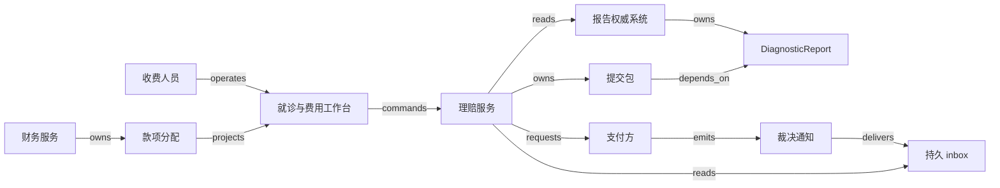

# V01 · 从检查请求到一笔可核销的收款

返回[共同模型](README.md)。诊疗机构承诺完成适当的诊疗工作、保存可解释的结果，再向正确的付款方提出费用请求。临床人员关心结果能否用于后续判断，收费人员关心谁承担多少费用，财务人员关心款项是否收到。把三者塞进“已完成”的单一状态，会让软件在业务尚未结束时停止提醒责任人。

本例采用一位虚构病人的一次就诊：检验收费 120、影像检查收费 180，单位均为合成记账单位；无税、退款、外币、预授权、追偿和多保险协调。两份报告由专业人员复核后，收费人员提交一份两行 claim。支付方认可金额为 100 与 150，其中承担 80 与 120，病人承担 20 与 30；支付方暂时只汇入 180。这个故事用来解释对象与对账，不表示任何真实保险合同、临床检查要求或收费政策。检查必要性、身份纠错、医学解释与真实费用责任均由相应专业人员决定。

## 识题：请求、证据、裁决与资金分别回答问题

识题口诀是“**同额不一定同款，获赔不等于收款**”。看到跨系统金额需要相认，先找身份映射与对账方法；看到旧报告变化影响后续决定，先找版本依赖图。两类题可以按下面的路线解。

| 识题线索 | 已知解法 | 验算抓手与下一步研究 |
|---|---|---|
| 多个付款项要对应多条费用责任，局部金额相同 | 完整身份的 lookup，加两侧余额约束 | 逐行核对责任、付款预算与未分配额；查支付方行号、币种、重放和更正规则 |
| 报告更正后，不知道哪些费用决定需重审 | 版本化证据加反向依赖遍历 | 明确相关集合与不相关反例；查源报告替代语义与机构补件流程 |

FHIR（Fast Healthcare Interoperability Resources，医疗信息交换标准；中文译名不统一，后文保留 FHIR） 是交换医疗信息的一组标准资源定义。本例采用 R5 的语义参照：ServiceRequest 表达请求或计划，Observation 表达单项测量，DiagnosticReport 汇集结果及解释；报告可以引用它所响应的请求。资源存在，只说明有一份这样的记录。它不证明每项检查都已经做完，也不说明结果正确。[ServiceRequest](https://hl7.org/fhir/R5/servicerequest.html)、[Observation](https://hl7.org/fhir/R5/observation.html)、[DiagnosticReport](https://hl7.org/fhir/R5/diagnosticreport.html)。

影像还多一层。ImagingStudy 保存 study、series、instance 等检查组织信息和检索线索，不把全部 医学数字成像和通信（Digital Imaging and Communications in Medicine，DICOM） 图像放进 FHIR 资源。DICOMweb 提供影像对象的查询、存储与检索事务；接口返回图像不能代替专业人员解释图像。合成系统把影像像素留在 影像归档与通信系统（picture archiving and communication system，PACS），工作台只取经授权的引用和按需加载的影像。[FHIR ImagingStudy](https://hl7.org/fhir/R5/imagingstudy.html)、[DICOM PS3.18 §10.1](https://dicom.nema.org/medical/dicom/current/output/html/part18.html)。

Claim 面向付款方提出费用请求，ClaimResponse 表达处理和裁决，PaymentReconciliation 描述付款及其分配。FHIR 明确区分裁决响应和支付；即使有付款分配记录，本例仍要求财务凭证核对，才能关闭相应应收。这是三种信息的职责分离，并非所有机构都必须以 FHIR 传输账务。[Claim](https://hl7.org/fhir/R5/claim.html)、[ClaimResponse](https://hl7.org/fhir/R5/claimresponse.html)、[PaymentReconciliation](https://hl7.org/fhir/R5/paymentreconciliation.html)。

| 角色与对象 | 权威与动作 | 本例保留的边界 |
|---|---|---|
| 临床人员、ServiceRequest | 请求服务保存就诊关联、请求内容与版本；临床人员提出或撤销请求 | 收费人员不能代签请求；同名病人不能用姓名自动合并 |
| 检验或影像专业人员、DiagnosticReport | 检查机构对报告内容及修订负责；本地保存带来源的副本 | 前台投影不成为报告权威；原子结果、报告和影像不互相替代 |
| 收费人员、claim submission | 收费服务对提交包及行映射负责；收费人员核对项目、责任方和证据版本 | 不凭报告完成自动收费；本例要求两份最终报告是合成策略 |
| 支付方、adjudication | 支付方对裁决内容负责；本地只保存收到的响应及其关联 | 拒赔原因待处理，不能自动转成病人应收 |
| 财务人员、allocation | 财务服务保存款项与应收行的核销关系，财务人员处理不匹配项 | 一笔到账可覆盖多项工作；金额相同不是身份相同 |
| 病人、病人账单 | 病人可查看属于自己的结果与费用；付款工具处理指定账单 | 看结果和付费分别授权，不用付费状态判断是否允许临床处置 |

病人标识使用 `(机构, identifier system, identifier value)` 等明确命名空间，由真实部署选择身份规则；姓名和日期仅供人工核对。资源引用在本例保存 `(tenant, authority endpoint, resource type, resource id, version)`。版本属于源系统，不能把 FHIR 的不透明版本标识当整数比较。下面为便于演示使用的 `r1/r2` 是本地合成修订顺序。跨机构会诊涉及新的披露与访问决定，不能把多租户数据库的 tenant key 当成完整医疗访问政策。

## 解法：保留并行生命周期与明确的关联

请求在本例走 `draft → active → completed`，未执行时可 `revoked`；完成需要执行证据，不由账单成功触发。报告从 `preliminary → final`，随后可能 `amended` 或 `entered-in-error`。报告更正必须保留替代关系和通知责任；旧 `final` 通知迟到不能覆盖较新修订。FHIR DiagnosticReport 也专门讨论修订与撤回，接收方必须处理这些变化；具体历史存储和提醒实现仍由应用设计。[DiagnosticReport §10.3.6.5](https://hl7.org/fhir/R5/diagnosticreport.html)。

理赔提交有自己的 `draft → ready → submitted → adjudicated` 路径，外部请求超时进入 `unknown`；其中 `adjudicated` 只说明响应已核对，可能部分获准或全部拒绝。报告被更正后，已提交 claim 进入 `review-required`，收费人员判断是否需要补件或更正提交。软件不会删除旧 claim，也不会替支付方撤销旧裁决。表中的这些提交状态是合成应用状态，不是 FHIR Claim.status 的照抄。

就诊应收核销聚合走 `unmatched → partly-allocated → reconciled`，记录这个就诊还有多少责任金额未结清；聚合内每一条 allocation 是有独立身份的分配项。付款侧另有 payment budget，记录一笔已确认收款还有多少可分配金额。180 全部分配完时，付款侧为 `fully-allocated`，就诊应收仍为 `partly-allocated`，因为尚欠 20。发现错配时进入 `disputed`，以冲销记录恢复，不直接改写已有资金流水。机构可以完成检查、收到裁决而仍有未收款，也可以先收病人预付款而尚无报告。正因状态彼此独立，工作台需要并排显示“报告 2/2、裁决已收到、支付方待收 20”，而不是计算一个总进度百分比。

## 一次点击如何跨过系统边界

收费列表按就诊显示请求、报告修订、claim 版本和待处理原因。点进详情，用户先看两项服务的费用依据、所引用的报告版本和合成分担规则，再点击“提交理赔”。服务端重查角色、就诊权限和版本；两位收费人员同时打开旧页面时，第二个提交返回已有操作或版本冲突，并标出变更的项目。浏览器按钮禁用只能改善体验，防重责任在服务端。

成功提交本地事务时，服务保存 operation ID、claim 快照、两条行映射及待发送的 outbox 记录，界面先显示“已保存，等待支付方确认”。worker 发送外部请求，保存外部受理号。断网后再次进入详情，浏览器用 operation ID 找到原尝试；“重试查询”读取进展，不产生新 claim。若外部未支持可核对的客户业务号或幂等语义，超时后的自动重新提交就没有充分依据，应转人工核对。这条限制不能由自建队列消除。

图中对象和边可在 [V01.json](../../../../vault/distilled/saas-engineering-atlas/packages/health-science/V01.json) 逐一定位。`depends_on` 指明提交依据，不表示报告已经传送；实际读取由 `reads` 表达。`delivers` 仅表示事件交接。样本运输和款项转账不是图中的消息箭头；本例只模拟它们的证据。所有拓扑边都是教学设计，不声称某家医院或支付方采用了它。

通知接收端先验证来源与授权范围，再把原始事件身份、对象引用和接收时间写入 inbox。worker 核对当前外部对象，结合已接受的修订关系更新本地投影。收到先前版本的回执时记录接收事实，但不回退报告或覆盖新裁决。对同一业务决定可能有多个 event ID，仅按事件去重不足：还要用外部裁决身份和本地 claim 版本约束业务效果。错误来源、错误 tenant、缺失行号的通知进入隔离区，不以“尽量匹配”方式自动入账。

### 技术选项与取舍

一个小团队可以选择 React + TypeScript 构建分栏工作台，用 TanStack Query 管理查询和提交后的失效重取；其文档明确区分标记陈旧与后台重新获取。界面必须保留上次核对时间，不把客户端的乐观更新显示成“已获赔”。查询 key 带 tenant、访问范围、就诊和修订；退出账号清理缓存，敏感详情不持久存入浏览器离线缓存。组件化方便对比版本，代价是要明确客户端缓存和服务端权限各自职责。[Query Invalidation](https://tanstack.com/query/latest/docs/framework/react/guides/query-invalidation)。

业务后端可选 Python + FastAPI 或 Java + Spring Boot。前者适合团队快速编写费用映射与独立计算模块；后者适合已有 Java 团队将接口、事务和 FHIR 工具集成在一起。两者只是本例候选，框架本身不提供临床身份、收费合法性或对账语义。若需要实现 FHIR 资源服务器，可评估 HAPI FHIR JPA Server；其 starter 提供标准资源操作并可配置数据库。沿用专门服务器可以减少重复实现接口的工作，代价是还要验证 profile、术语、授权、升级和业务库之间的映射，不能把通用资源 CRUD 当成本例的完整流程。[HAPI FHIR JPA starter](https://hapifhir.io/hapi-fhir/docs/server_jpa/get_started.html)。

关系数据库可保存提交快照、行映射、核销账和操作记录；报告附件、原始接口文件保存在受控对象存储，影像留在 PACS，库内保存可授权解析的引用而非长期签名 URL。PostgreSQL 的复合唯一约束适合 `(tenant, payer account, operation key)`，相关列必须非空；引用 tenant 的外键避免跨租户行关联。跨行金额总和不能靠普通 `CHECK` 自动保障，须在同一事务中锁定付款预算行与所有涉及的应收行，再重查两边余额。行锁只协调库内竞争，不会把支付方网络请求包进分布式原子事务。[Constraints §5.5.1/3/5](https://www.postgresql.org/docs/current/ddl-constraints.html)、[Row-Level Locks §13.3.2](https://www.postgresql.org/docs/current/explicit-locking.html)。

起步可由数据库 outbox 加单独 worker 驱动重试；需要多订阅者或较大突发量时再评估 RabbitMQ 等独立消息系统。后者增加隔离和调度空间，也增加积压、顺序、重放与运维责任。选择依据应是实测吞吐、恢复时间和团队能力，不能从“医疗”两字直接推出微服务。

## 演算：费用责任与款项匹配

先冻结裁决版本，再按行分配。将“收费额”“认可额”“支付方责任”“病人责任”“合同调整”分成列，本例由明确的合成合同规则确定，不能从一个总数反推所有权利。

| 合成服务行 | 收费额 C | 认可额 A | 支付方责任 P | 病人责任 U | 合同调整 J=C−A |
|---|---:|---:|---:|---:|---:|
| L1 检验 | 120 | 100 | 80 | 20 | 20 |
| L2 影像 | 180 | 150 | 120 | 30 | 30 |
| 合计 | 300 | 250 | 200 | 50 | 50 |

逐行先验算 `A=P+U` 和 `C=P+U+J`。此处没有扣款追偿、二次保险或拒赔争议，所以能用简单等式；真实场景需要把新增责任类别显式列出。未经判断的拒赔款不能被这条等式强制塞入 U。金额以整数最小记账单位存储，实际币种与舍入规则另定。

支付方提供一笔金额 180 的付款分配记录，引用 L1 的 80 和 L2 的 100；银行或财务导入也确认实际收到 180。本例先把两条裁决行放入字典：key 为 `(tenant, payer account, claim ID, claim revision, line sequence, currency)`。依次查找付款分配项，核对金额非负、币种相同、身份唯一；L1 待收变为 `80−80=0`，L2 为 `120−100=20`。病人另付 50 并完成独立核销后，全案满足：

`收费 300 = 合同调整 50 + 已收 230 + 未收 20`。

若 180 的银行凭证只到达一份、分配记录被投递两遍，累计已收仍是 180。幂等 key 应绑定付款身份与分配项身份；改变相同 key 的内容必须报冲突。若有两笔各 100 的付款却没有可信项目引用，它们应留在未分配现金，金额相同不足以决定归属。这个反例说明“求和相等”和“对应正确”是两种检查。

这属于 `ALG:lookup`。朴素办法对 m 个付款项逐一扫描 n 条裁决行，代价 O(mn)；构建字典耗 O(n) 时间和空间，理想散列条件下处理项为平均 O(m)，整体平均 O(n+m)。数据库复合树索引更适合不把全部历史载入内存的场景，单项查找通常 O(log n)。算法降低匹配成本，不能验证输入来自真实银行，也不能解决错误的病人身份；模糊匹配只能形成供人复核的候选。

第二种计算用于报告更正。保存“提交包依赖报告 r1、裁决依赖提交包”的有向关系，以反向邻接表从 r1 找受影响的提交与裁决，访问集合防重复，遍历代价 O(V+E)。结果只是重审清单，不是自动退款清单：依赖旧报告的某个项目可能不受本次文本更正影响，须由收费人员判断；不能沿病人关联边把所有历史账单都作废。`ALG:graph-paths`。

## 正常轨迹、失败轨迹与恢复责任

正常轨迹中，临床人员确认请求，两处检查机构返回复核后的报告；收费人员选择相应版本形成 claim v1；支付方受理并返回按行裁决；财务人员核对 180 的付款与两条分配项，再核对病人的 50。屏幕最后显示“诊疗证据齐备，仍有支付方应收 20”。这一结果虽然没有全绿，却准确说明谁还欠什么。

较容易被演示隐藏的失败发生在提交后的断网：支付方已接受 claim，客户端没有受理号。此时 `unknown` 的内容是“外部是否受理未确认”，不是“失败”。worker 使用已持久化的业务引用向支付方查找；找到相同内容后补记受理号，找不到且查询完整性不确定时继续待核对。只有明确未受理或对方保证相同操作 key 可安全重放时才重送。工作人员离开页面不改变这项责任。

另一条失败轨迹发生在钱已部分到账之后：报告 r1 被宣布错误，r2 到达，随后迟到的 r1 通知又出现。本例保留 r1，切换当前报告指针到 r2，标出依赖旧版的 claim；不会删除已收 180 的流水，也不会因为报告新旧变化而自动退款。收费人员确认是否需调整理赔，财务人员依据正式更正结果建立冲销或差额记录。恢复目标是得到有解释的历史与当前余额，不是把所有对象回滚到同一时刻。

## 规模假设决定先优化哪里

合成容量预算为 20 个机构、每日共 10,000 次就诊、每次平均 4 份报告、保留一年约 1,460 万份报告元数据；影像像素不计入这份元数据预算。假设业务高峰 100 个并发工作台、每秒 50 条通知、付款文件一次含 50,000 个分配项。拟验收目标是：50 行已授权列表读取 p95 小于 500 ms，本地提交持久化 p95 小于 300 ms，正常负载下 99% 已接收事件在 30 s 内形成投影；支付方响应时间单独计量，不能算作本地成功延迟。以上均未压测。

列表采用 tenant 与时间范围分页，详情按需加载，影像独立限流；先按付款文件分块验证再提交核销，错误行隔离并保留文件级合计。若一次文件涵盖同一应收的许多项目，应合并该应收的增量后再锁定，避免重复争锁。所有核销入口按统一顺序锁定付款预算，再按稳定 ID 锁应收，重查双方余额后提交。只锁应收会漏掉一种竞争：同一到账 180 被同时分给不同的 80 与 120 应收，两人各看到可用 180，合计却写入 200。共享付款预算也参加事务后，先成功的一笔会减少后续可用额，第二笔必须拒绝或调整。事务保持短小，死锁中止后从同一操作身份重试。跨 tenant 设队列配额，不能让一个机构的大影像批量导入阻塞其他机构的裁决处理。

缓存的 key 含访问 scope 和对象版本，报告更正触发相关查询失效；读模型的陈旧时间必须可见。发送理赔和核销时从权威状态核验，不能让缓存中的旧“已复核”标签授权新动作。恢复演练应测量积压最长年龄、未确认操作数量、无法匹配金额和修订未通知数量；只看请求成功率会漏掉这几类未完成责任。

## 验算：从界面结果回查权威证据

[V01.json](../../../../vault/distilled/saas-engineering-atlas/packages/health-science/V01.json) 保存给实现者的完整 given/when/then 和所需证据。下表是关键观察，不是执行通过清单。

| 场景 | 必须观察的结果 | 所需证据 |
|---|---|---|
| 两份报告、裁决与部分到账正常到达 | 分别显示报告版本、200 的支付方责任、180 已收与 20 未收 | UI、提交快照、支付方响应、核销明细 |
| 相同分配项重复，或相同 key 改金额 | 完全相同的内容只记一次；内容变化被拒绝 | 唯一键、冲突日志、前后余额 |
| r2 之后收到 r1 通知 | 当前指针不倒退，旧版接收事实仍可查 | 当前源核对记录、历史与投影 |
| 两人同时提交；同一收款并发分给不同应收；或同时分配剩余 20 | 一个有效尝试；付款预算与应收余额均不能透支 | 事务冲突、操作 ID、两端 UI |
| 不同 tenant 使用相同就诊号/claim 号 | 查询、导出、缓存、后台 worker 都只处理授权范围 | 拒绝响应、隔离 fixture、审计 |
| 外部受理后超时，worker 随后重启 | 恢复同一次尝试，核对前不新建 claim | outbox、操作日志、外部受理号 |
| 收款文件部分缺行号，或金额相同但身份不明 | 未分配部分留下清晰队列，合计可解释 | 文件级金额、隔离项、人工处理记录 |
| 已收款后报告撤回 | 费用审核重新打开，资金历史保持；补正由责任人决定 | 修订关系、重审任务、冲销依据 |

[synthetic-v01.py](../../../../vault/distilled/saas-engineering-atlas/packages/health-science/synthetic-v01.py) 只执行本地费用恒等式、复合键匹配、拒绝错误映射、幂等冲突、版本前提、未知结果恢复和图影响范围模型；还用故意错误的“裁决即收款”及“忽略 tenant”实现展示会被检查发现的失败。真实 UI、数据库事务隔离、PACS、支付方、银行连接、临床验收和负载均需后续实现，不能从这个脚本的结果推断。

核心流程没有让 AI 决定临床结论或费用责任。若以后用模型从报告建议收费项目，先冻结合成或合法去标识的留出集，例如 200 份报告：100 份可明确映射、40 份修订、40 份缺单位或缺请求关联、20 份跨对象冲突。由专业人员独立标注可建议的项目与必须拒绝的理由；按分层分别统计“错误建议数/全部建议数”“遗漏可映射项目数/全部应映射项目数”“正确拒绝数/全部应拒绝输入数”，另记人工修正时间。已知严重错配或越权输入的演示门槛为零容忍，并由人逐项确认后再提交；小样本中观察到零错误也不证明真实环境无风险。该方案未调用模型、未形成 eval 结果。

## 变式：改变条件后的判断与迁移

**练习一：支付方仍承诺 200，但银行只收到 170，分配记录仍写 180。** 原先的等式应怎样变化？

短答：责任总额不变，实际可核销上限的证据改变。先把分配记录与到账差异 10 留在争议队列，不直接按 180 核销；确认的 170 如何分到 L1/L2 还需要可靠引用或财务决定。保持“已收、未收和调整能解释收费”的不变量；失败做法是把差额自动减为合同调整。检查一笔付款的已分配额不超过经确认的可用额，记录未分配与待核对差额。若真实政策涉及手续费或净额结算，新增显式费用对象后重算，不能沿用本例无手续费前提。

**练习二：影像报告尚未 final，机构允许先提交检验费用。** 是否必须等待两份报告？

短答：本例“报告齐全再提交”的 guard 可以变，临床证据与费用身份分离的机制不变。将提交包拆成只包含 L1 的 v1 和后续 L2 的独立请求或明确更正关系，并保留按服务行唯一的收费义务；预览显示部分提交。反例是为了赶进度把 preliminary 报告显示成 final。检查重复提交不会对同一服务行产生未经说明的双重请求；修改提交策略仍需机构和支付方规则复核。

**练习三：从病人的检查转到 V03 批次检验。** 能否用同样的报告更正传播机制？

短答：可以保留“决定绑定证据版本，变更生成重审清单”的关系（`TR:V01:V03:evidence-revision`）。V03 还必须追溯 sample 与 lot 的代表性、方法、校准和 质量控制（quality control，QC）；一个 sample 的结果不能代表任意批次。检查受影响证书是否都能追到失效输入，同时未关联的 lot 不被误停。医疗报告的更正并不自动具有批次召回或证书撤销的法律效力。

向 H01 可迁移“请求、外部确认、权利或余额分别保存”（`TR:V01:H01:adjudication-payment-separation`），但订阅付费后开通的策略不能套到诊疗处置。Stripe 发票文档也提醒 `paid` 可来自余额抵扣或线下标记等情况；它只能支持“状态须读清证据来源”的产品例子，不能用 Stripe 代替医疗支付方裁决。[Invoice lifecycle / Paid invoices](https://docs.stripe.com/invoicing/overview)。

进入一个陌生诊疗机构时，可以先跟随一笔脱敏的部分拒赔或部分到账案例，把请求号、报告版本、费用行、支付方引用和收款凭证画在一起，询问每次人工补录究竟在弥补哪个身份或责任缺口。优先辨认现有的 EHR/HIS、LIS、PACS、理赔清算接口和应收核销系统各自拥有的事实，再决定新增工作台应做查询聚合、适配器还是独立业务服务。下一步索取实际采用的 FHIR profile 与 CapabilityStatement、DICOM Conformance Statement、支付方重放/查询规则和更正文件样例；只有读到适用版本，才评估接口库或成熟产品能否承担这一段。首个验证切片应让同一就诊经历一次报告更正、一次外部超时和一次部分付款，并由临床、收费与财务人员分别确认自己的对象没有被另一方状态覆盖。它比先实现完整菜单更能暴露方案的适用前提。

[来源与模型说明](../../../../vault/distilled/saas-engineering-atlas/packages/health-science/evidence.json) · [对象与检查结构](../../../../vault/distilled/saas-engineering-atlas/packages/health-science/V01.json)
