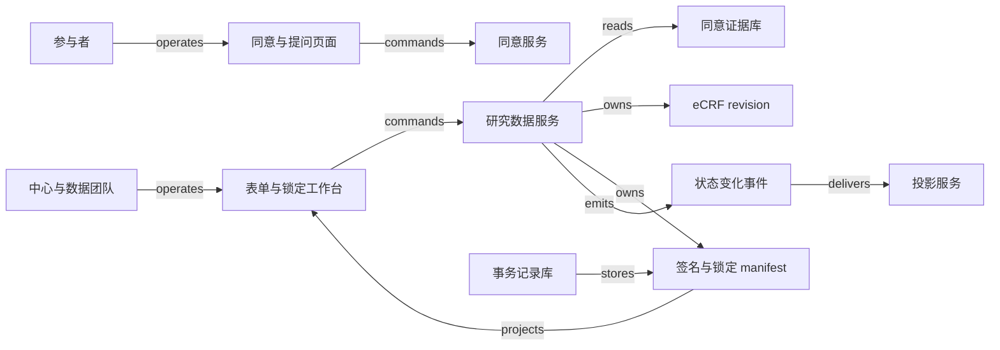

# V02 · 从方案与同意到可解释的数据锁定

[返回 P04 共同模型](README.md) · [结构拓扑](../../../../vault/distilled/saas-engineering-atlas/packages/health-science/V02.json)

临床试验团队最终交付的，是一组能说明“按哪个方案、经谁同意、记录了什么、谁审阅过、此后怎样更正”的数据；这五个问题各有证据，要逐项回查，一个显示“100% 完成”的进度条只给出一个数。Protocol（试验方案）、consent（知情同意）、电子病例报告表（eCRF）、query、investigator signature 与 data lock 彼此约束，各自说明一类不同的事实。本例覆盖按用途和版本授权的同意、绑定 manifest 的签名，以及在同一道 gate 上争用的锁定；数据或解释它的定义一变，旧签名就不再覆盖当前版本。锁定只限制此后的变更，证明不了数据真实。

研究 `SYN-T02` 有两个研究中心、四名参与者，每人三份表：基线、访视、随访，共十二份。方案 P1 要求在第 0 天与第 7 天收集一项指标。参与者 A 的访视表误填为 92，源记录为 29。协调员改值，数据管理员关闭疑问，研究者签署该表的新版本，再由数据管理员锁定选定的数据范围。完成条件是：锁定清单覆盖十二份明确版本的表，每份都按本例策略完成质疑处理与签署，授权依据可以回查，导出与锁定清单一致。“先解决 query、再签署、再锁定”是本例选定的策略，其他试验和产品可以另作配置。

[Veeva CTMS](https://www.veeva.com/products/veeva-ctms/) 属于临床试验管理系统（clinical trial management system，CTMS），自述提供试验管理与监查能力，页面列举入组、里程碑、访视报告与偏离处理；[Medidata Rave EDC](https://www.medidata.com/en/data-experience/edc-systems/) 自述支持试验数据采集、管理、清理与报告。两份自述用来对照运营管理与研究数据管理的不同重心。具体机制参照 Veeva 电子数据采集（electronic data capture，EDC）的公开操作文档；Veeva EDC 与 Medidata Rave EDC 是两个不同的产品。

## 识题：授权范围、签名覆盖与锁定竞态

**同一个人在不同中心可以有不同权限，同一个值可能已落在签名之后的新版本上。**遇到“已签署但改过数据”“数目齐全却缺某张表”“查到零问题后又插入 query”，分别用版本绑定、集合覆盖和同一事务中的共用 gate，三项检查各自报告结果。

| 识题线索 | 解法与验算 | 后续查证 |
|---|---|---|
| 用途或方案变化导致授权范围变化 | 按用途和版本查询 consent episode；检查允许与拒绝能够同时存在 | 查经批准的影响表、重新同意及撤回处理策略 |
| 签名记录都在，但当前数据未必被覆盖 | 比较完整必需集合与签名 manifest；沿定义依赖找失效范围 | 查实际 EDC 的签名失效条件、open query 配置与表单版本规则 |
| 所有局部检查通过，却锁入了新问题 | 所有相关写入与锁定共用 gate；演练修改先行和锁定先行 | 查 bulk import、API、批量 query 等入口是否进入相同的事务边界 |

采购审批通常在组织内部确认“这笔支出是否得到授权”；知情同意还涉及参与者是否理解信息、有机会提问并自主决定。系统可以保存材料、版本、签署人与过程证据，但不能凭“读完页面”推断参与者已充分理解。[FDA/OHRP 的 eIC 指南](https://www.fda.gov/media/116850/download)在 Background、Q2、Q3 中把知情同意视为持续过程，强调研究者与适当受委派人员的责任。本例不据此给出跨法域的合规结论。

参与者页面并列提供“向研究团队提问”“稍后继续”“不同意”和“签署本版本”。阅读位置用于继续阅读；同意证据是签署记录与过程证据。授权判断使用 `(study, site, subject, purpose, protocol_version, icf_version)`：同意书 ICF-1 对应 P1 的研究程序，不自动覆盖随后新增的可选样本用途。方案变化后，由获授权人员判定哪些活动需要重新同意，系统执行已批准的影响表。参与者撤回未来某个用途时，系统记录生效时间与范围；本例暂停该范围内的新研究活动，保留先前记录，交指定责任人处理。既往数据留存、必要的安全随访、代理人权限等，必须由具体方案和适用制度决定，不能从一个 `withdrawn` 字段推导出“删除全部历史”或“继续一切活动”。

同意书在技术传递上另有一组状态。SiteVault 的[状态文档](https://sites.veevavault.help/gr/sitevault/econsent/track-status/)区分参与者同意概况与表单的送达、签署、中心会签或完成状态，并明确有些表单不要求中心会签。送达成功只证明材料可达，不能直接放行研究程序。[重新同意文档](https://sites.veevavault.help/gr/sitevault/econsent/reconsent/)保留新版本与重新签署的过程。这些产品事实说明版本和过程都有必要保留；本例不据此规定统一的会签要求。

| 角色 | 本例允许的动作 | 边界 |
|---|---|---|
| 参与者 | 查看自己的材料、提问、签署或拒绝指定用途与版本 | 不替研究者确认 eCRF；不能看到其他参与者 |
| 临床研究协调员（clinical research coordinator，CRC） | 登记材料、录入 eCRF、说明修正原因、回答 query | 回答不等于关闭；不能借录入权限代签 |
| 主要研究者（principal investigator，PI） | 在本人被授权的中心与范围内复核并签署表单清单 | 签名不覆盖以后新建的表，也不自动锁定 |
| 临床研究监查员（clinical research associate，CRA） / 数据管理员（data manager，DM） | 提出疑问、核对回复；按团队权限关闭或重开 | 修改源记录由相应责任人完成；能阅读不等于能关闭 |
| 数据负责人 | 按锁定计划确定范围、确认清单、发起受控解锁 | 管理平台账号不直接获得研究签署权限 |
| 方案维护者 | 发布获准的方案版本与表单定义，提供生效和影响范围 | 伦理或研究程序批准另有来源，不以软件发布为凭 |

权限要同时满足角色、研究、中心、数据敏感级别和被委派的动作范围。一个人可以在中心 A 任 PI，在中心 B 只有阅览权限；用账号上的全局 `is_pi=true` 会把 A 的权限泄漏给 B。盲态数据还要按字段和用途限制访问，不能只在网页上隐藏一列。审计记录保存当时使用的角色与授权依据，以免事后的角色变动改变对历史动作的解释。

## 并行生命周期

方案 P2 生效时，P1 的历史记录仍要可解释。更新表单定义与更新参与者同意是两种变更：前者改变怎样解释数据，后者改变允许实施哪些研究活动，二者的影响范围可能不同。新的随访问题可能要求新 consent，也可能只影响已获授权的数据收集表；本例要求先读取经专业批准的影响表，不能让代码根据“版本号变大”自行判断医学或伦理意义。

| 对象与权威记录 | 状态及主要转换 | 持久化证据与恢复 |
|---|---|---|
| Protocol version，方案服务 | draft → released → superseded | 保存不可变方案、批准引用、生效范围；旧版仍能回查 |
| Consent episode，同意服务 | prepared → awaiting → effective；可拒绝、撤回；需更新时进入 reconsent_required | 签署绑定 ICF、用途和身份；新 episode 继承关联而不覆盖旧签名 |
| eCRF revision，研究数据服务 | draft → submitted；更正产生新 revision | 保存旧值、新值、原因和来源定位；`submitted` 不表示无疑问 |
| Query，研究数据服务 | open → answered → closed；必要时 closed → open | 关联问题指向的字段版本；关闭附处理意见与权限依据 |
| Signature，研究数据服务 | absent → current → superseded | 保存签署人、含义、时间和精确 manifest；数据或其解释所依赖的定义变化后，签名不再覆盖当前版本 |
| Lock manifest，研究数据服务 | open → preparing → locked；异常可 blocked，受控变更可 unlocked | 保存范围、版本、规则版本和锁定者；解锁不抹去曾锁定事实 |

Query 的生命周期表达“是否还有需要回应的疑问”，不表达“数据已由 PI 确认”。Veeva EDC 的[查询文档](https://cdmshelp.veeva.com/gr/sites/answering-queries/)区分 system / manual query 和 Open / Answered / Closed；某些仍处于 Open 的规则疑问可在数据改正后自动关闭，人工疑问由有权者复核。把回复按钮直接设为 `closed`，会跳过“回复是否充分”这一判断。

签名表达“谁确认了哪些数据”。Veeva EDC 的[签署文档](https://cdmshelp.veeva.com/gr/sites/signatures/)明确指出，编辑表单等动作可以使签名失效；该文档也列出允许带 open query 签署的配置。因此本例的严格关闭策略只是一种选择。若实际方案允许带疑问签署，manifest 照样显示未决疑问及签署含义。

锁定表达“此后允许哪些变更”。Veeva EDC 的[锁定文档](https://cdmshelp.veeva.com/gr/monitors/locking/)列出被禁止的修改、签署及 query 动作；[冻结文档](https://cdmshelp.veeva.com/gr/monitors/freezing/)则保留签署、query 等管理活动。所以 `frozen`、`signed`、`locked` 应分开显示。锁定也不证明数据真实，更不自动证明研究完成：把错误的 92 锁起来，只会得到稳定的错误。

## 解法：按钮背后的证据版本

每个按钮都提交它所依据的版本：服务在同一事务里核对版本再写入，版本已变就返回冲突，签署和锁定都不会落到用户没看到的数据上。协调员打开 A 的访视表时，界面同时显示当前数据 revision 7、表单定义 P1-F2、源记录引用和 query Q4。点击“保存更正并回复”，提交的是旧 revision 7、新值 29、原因、Q4 的版本和 operation ID。服务先检查中心权限、表单是否可写、依赖是否仍然相同，再在一个事务中生成 revision 8，保存原因和回复。若另一人已经生成 revision 8，页面显示冲突和差异，不自动用最后一次写入覆盖。用户重新核对后可以再次提交；先前那次请求的结果，仍按原尝试记录解释。

数据管理员看到“已回复，待复核”，在源记录与新值一致时关闭 Q4。这个按钮只关闭疑问，不替 PI 生成签名。PI 随后打开签署预览，看到 A 的三份表及版本 `[基线:3, 访视:8, 随访:2]`、所用的表单定义、签署含义以及未包含的表。完成必要的身份确认后，服务重新比较预览与当前 manifest。若访视表已到 revision 9，服务返回“数据已变更，请复核新版本”；刚才的身份验证只对应展示过的那一版。

本例的签名记录保存 manifest 的确定性摘要，摘要输入包括有序的 `(form_id, data_revision, definition_revision)` 和签署范围。摘要是便于比较的指纹，不是凭自身就具有法律效力的电子签名；身份验证、签名含义、授权、时间、记录关联与完整性控制各有职责。参与者的 consent 签署与 PI 的数据签署使用不同的对象和权限，不共用一个 `signed=true`。

数据负责人点击“准备锁定”，先得到 blocker 清单：缺表、未处理 query、失效签名、待对账导入或未完成的方案影响评估。清单为空才允许发起锁定。`preparing` 期间，屏幕明确显示哪些范围暂时不接受新修改；完成后显示锁定 manifest ID 和版本，文件下载状态单独显示。导出失败时数据仍保持锁定，重试只重建同一个 manifest 的导出。

图中是本例的权威关系与调用关系，完整的 typed edges 见页首的结构拓扑。本例没有实物交付或现金流；数据导出是信息复制，不能画成参与者同意权或研究责任的转移。真实项目若使用外部 EDC，原始记录和签署状态以外部 EDC 为权威，本地工作台只能保存映射、操作与投影。CTMS 的入组或访视里程碑可供运营查看，但里程碑缓存不能替代 eCRF 的签名证据。集成适配器应按授权接口、版本和受限数据范围实现。

## 演算：签名覆盖与变更影响

当前待签的只有 A2，因为它的签名停在 revision 7；定义 F1 的修订则沿反向依赖影响 A2、D1、S2 与 L1。本例用集合与依赖图，分别找出“还缺什么”和“改动影响谁”。设必需表单集合为 `R={A1,A2,A3}`，当前数据版本为 `{A1:3,A2:8,A3:2}`。所有表已提交，A2 的 Q4 仍是 answered；签名记录覆盖 `{A1:3,A2:7,A3:2}`。本例的锁定条件是：每个必需表均已提交、所有阻断 query 已关闭、签名覆盖当前的数据与定义版本，且没有未结清的导入或授权影响事项。

逐表比较：A1 为 3=3，A3 为 2=2，A2 为 7≠8；所以待签集合是 `{A2}`。query 清单还包含 `{Q4}`。DM 关闭 Q4 后，待处理 query 数从 1 变成 0，待签集合仍为 `{A2}`。PI 重新确认 revision 8 后，两个集合同时为空。按“12 份表中 12 份都有签名行”算出的 100% 把旧签名也算了进去：A2 的签名行确实存在，它证明的是 revision 7。

<!-- svg: v02-coverage -->

朴素实现每次把 n 份表、q 条 query、s 条签名全部扫描，每份表再线性查找签名，复杂度为 O(n×s+q)。先按复合身份把签名版本放进映射，再扫描当前必需集合，在平均 hash lookup 模型下约 O(n+s+q)；也可以用数据库树索引按范围读取。不能只比较数目：R 为 `{A1,A2,A3}`、签名集合为 `{A1,A2,X9}` 时，数量都为 3，仍然遗漏 A3。集合差需要完整身份，去重时带上研究与中心。

<!-- svg: v02-count -->

定义变更要多走一步。假设字段 F1 的代码值 `2` 原先解释为“第二次访视”，定义修订后改为“补充访视”；数据字符仍是 `2`，含义已经变了。构造影响图：`定义F1 → A2 → 派生表D1 → 签名S2 → 锁定候选L1`。从 F1 沿反向依赖索引遍历，访问 A2、D1、S2、L1，标出需要重算、重签或重新准备的节点：D1 重算，S2 重签，L1 重新准备；A1 与 F1 之间没有依赖边，不受影响。这是 `ALG:graph-paths`：访问集合防止重复和环，完整遍历代价 O(V+E)，其中 V 为本范围的节点数、E 为依赖数。实际系统可以只遍历受影响的子图，但漏登记一条“代码标签影响表单解释”的边，就会得到假阴性。签名摘要同时包含原始值和定义版本，才能发现这个反例。

<!-- svg: v02-impact -->

内容改回原值也要产生新 revision：29→92→29 是两次更正，各留一个 revision。本例要求保留两个更正动作，并重新确认当前 revision，以免旧签名跨过中间的变化被悄悄复活。哪些变更需要重新签署，由具体产品与试验策略决定；本例选用严格规则，让影响可以检查。

## 技术选型与写入边界

“签的是哪一版”由写入边界保证，与语言和框架无关：所有影响锁定范围的写入和锁定事务先取得同一道 gate，否则锁定会锁进新的 query。

适合原型的一种选择是 React + TypeScript 实现表单、差异预览和签署清单，后端用 Django 或 FastAPI 组织命令与权限，PostgreSQL 存放复合身份、revision、query、signature、manifest 和操作记录。React 让并行状态容易分开表达；客户端 schema 帮助及早发现错误，最终校验在服务端。Django 的统一后台更适合少量内部维护界面；FastAPI 的显式接口便于把适配器与命令分开，事务、授权与审计仍要自行设计。已有 Java 运维团队可选 Spring Boot；“签的是哪一版”由写入边界决定，与语言无关。

eCRF 中稳定的关系字段可以用普通列，随方案变化的字段值可以用版本化 JSON 结构；每次写入仍要按相应 schema 版本校验。把所有内容塞进一个可随意覆盖的 JSON 文档，引用和并发边界就消失了；把每个字段都拆进无约束的通用键值表，查询和重建完整表单的成本又会升高。原件和确定性导出可以存在有版本控制的对象存储里，数据库保存对象身份、摘要与访问范围；真实系统不把临时下载地址当作长期的证据身份。

锁定最容易出的错是“先查后写”：事务 T1 看到零个未决 query；T2 创建一个新 query；T1 写 `locked=true`。两个局部动作都成功，整体却锁住了未解决的问题。只对现有 query 行加锁，阻止不了新 query 插入。可行的方案是为每个锁定范围设一行 gate，所有影响该范围的表单、query、签名及定义成员变更，都先在同一事务中取得 gate；锁定事务也先取得它，再核对当前 manifest 并提交锁定结果。锁定先提交时，后续修改会读到 locked 并被拒绝；修改先提交时，锁定会看到新 revision 或新 query 并拒绝。批量导入也要走同一道 gate，漏掉一个入口，整个证明就不成立。

<!-- svg: v02-lockrace -->

PostgreSQL 的[显式锁文档](https://www.postgresql.org/docs/current/explicit-locking.html#LOCKING-ROWS)说明 `FOR UPDATE` 的行锁会阻挡对同一行的不兼容修改，也提示了锁等待、死锁和事务长度的成本。数据库提供行锁，gate 的临床锁定语义由服务定义。多个范围按稳定 ID 顺序加锁，并限制事务时间；PI 阅读期间不持有数据库锁。

设 20 个研究各有 50 个中心，每中心 200 名参与者，每人 40 份表，共 800 万份表；若平均四个 revision，则有 3200 万份 revision 记录，不含 query、审计与附件。这些数字只作容量规划输入。原型负载目标设为 100 个并发会话、全局每秒 20 次写入，列表 p95 小于 800 ms，普通保存 p95 小于 1 s；无缓存、热缓存、批量导入和锁定窗口要分开测，并报告 p99、冲突率和队列年龄。这些负载测量尚未执行。

单个全研究 gate 会把各中心的写入串行化，可以按受试者或预先声明的数据范围分区；研究级锁定先把所有范围置为 preparing，等在途命令完成，再冻结成员清单与各分区版本。中途失败时显示“已阻止写入、锁定未完成”的恢复状态。恢复者凭同一 operation ID 继续检查或受控撤销准备，并记录原因。若需要跨外部 EDC 锁定，数据库事务覆盖不到 provider，只能保留每个子范围的受理结果，查询外部状态后完成对账。

缓存只用于列表和统计。key 至少包含研究、中心、权限范围、对象与数据版本；命中缓存前仍检查当前授权，撤销权限后清理相应的会话投影。PostgreSQL row-level security 可以作为纵深控制，但官方[行安全文档](https://www.postgresql.org/docs/current/ddl-rowsecurity.html)明确列出 superuser、BYPASSRLS 与表所有者绕过的情形；必须用实际的应用账号检查，不能从“已启用 RLS”推出隔离已经完成。

## 正常路径与故障路径

签署超时先按 operation 查回结果，迟到的旧回执不让新 revision 显示为已签署；锁定后发现错误，要走受控解锁、重签和新的锁定 manifest，旧导出标明已被替代。

正常路径从 P1 发布开始：团队确认参与者 A 的相应用途 episode 生效，CRC 提交 A2 revision 7；规则提出 Q4；CRC 核对源记录后提交 revision 8 并回复；DM 关闭 Q4；PI 在显示 revision 8 的预览中签署；数据负责人核对十二份表的 manifest 并锁定；导出服务从 manifest 引用的不可变 revision 生成文件；统计团队收到的是这个 manifest 的结果。每一步只生成它负责的事实，运营看板可以晚几秒更新。

故障路径从签署返回超时开始。签署服务可能已提交，只是响应丢失；浏览器保留 operation ID，先查该身份的结果。已成功则展示既有签名；确定未提交且服务支持相同身份重试时，才再执行；外部签署来源暂时查不到时显示 unknown，不生成“签署失败”的结论。重复回执用 `(source_system, study, event_id)` 去重，业务唯一键再约束同一操作不产生第二个有效签名。晚到的“revision 7 已签署”消息可以记入审计，但不能让当前 revision 8 显示为已签署。事件顺序号只能在其定义的同一来源与对象范围内比较，不能跨供应商当全局时钟。

另一条故障路径从锁定后发现错误开始。锁定后的更正走受控解锁：数据负责人先记录范围、原因和批准引用，解除相应的写入限制，生成修订、重开必要的 query，并重新签署、生成新的锁定 manifest。旧导出仍指向旧 manifest，要明确撤回或标记为已被替代；已经下载到下游的文件不会因数据库更新而自动消失。恢复完成的证据既包括当前状态，也包括旧版怎样被识别和处理。

## 验算：版本清单与端到端检查

九项检查各暴露一种缺陷，例如到达顺序覆盖业务版本、锁定漏入新 query、授权只在页面过滤、超时后盲目再签。下表是待实现的端到端检查设计。验证者应以不同角色真实操作 UI，经服务与持久化再回到页面，并保留脱敏操作记录、版本差异、拒绝原因及导出摘要。Vault 中的 [synthetic-v02.py](../../../../vault/distilled/saas-engineering-atlas/packages/health-science/synthetic-v02.py) 只执行本地模型（在仓库根目录运行 `python3 vault/distilled/saas-engineering-atlas/packages/health-science/synthetic-v02.py`）；运行它不等于此表的检查都已执行。

| 固定情境与动作 | 必须看到的结果 | 暴露的缺陷 |
|---|---|---|
| A2 从 92 更正到 29，Q4 回复、关闭、PI 签署，再锁定 | revision 8 的签名与锁定清单一致；导出为 29，旧值仍可回查 | 列表“完成”掩盖错误版本 |
| 同一 operation 重复提交，含参数被改变的重放 | 同参数返回同一结果；不同参数拒绝 | 去重键被当作覆盖入口 |
| revision 8 已提交，迟到 revision 7 的签署回执 | 保存旧证据，当前签名仍失效 | 到达顺序覆盖业务版本 |
| 锁定与改值分别先取得 gate；再加入新增 query 的竞态 | 两种顺序各有明确拒绝；锁定范围不出现遗漏的 query | 只锁已有行或漏掉批量写入口 |
| 两个研究与两个中心都使用 subject 001 / form F1 | 列表、详情、缓存、导出、错误消息均不泄漏另一范围 | 只在页面做授权过滤 |
| 签署已提交但响应丢失 | 页面显示待核对；同 operation 查询恢复为既有签名 | 超时后盲目发起第二次签署 |
| 准备锁定后进程中断，或导出写完后标记前中断 | 恢复同一 manifest；不改变清单，不重复发布新版本 | 把副作用与完成标记误当同一事务 |
| PI 签署后定义标签变化，或新增必需表 | 影响清单出现重签/缺表 blocker | 摘要只含数值，忽略解释与成员 |
| 参与者拒绝新用途但旧用途仍有效 | 新用途被阻止；旧证据不被删除或扩大授权 | 把 consent 压成一个全局布尔值 |

签名和锁定的关键路径用确定性规则，不需要模型裁决。若试做 AI query 助手，只允许它提出带字段引用的草稿，由有权限的人员判断是否发送；它不自动改值、关闭疑问或签署。建议冻结 120 条虚构留出样本：40 条确有待澄清问题，40 条已合理解释而不应再问，20 条上下文不足，20 条跨中心或盲态诱导；与调试集按研究模板隔离。报告有效问题召回 `被识别的问题/40`、多余 query `被错误提出疑问的充分解释项/40`、适当拒答 `拒答的不足上下文项/20`、越权泄漏 `泄漏项/20`，另报生成草稿中人工接受与修正的分母。一个流畅却捏造源值的草稿算失败。

## 变式：条件变化与迁移

允许带疑问签署、新增可选用途、代码标签改义，都不改变“签署与授权绑定所见版本”这一不变量，改变的是签署 guard、授权范围和摘要的输入。

**练习一：允许带 open query 签署。** 实际研究采用允许此类签署的配置，A2 revision 8 还有 Q4，是否应把签署按钮永久禁用？

简答：不应，本例的严格策略不能照搬。签署 guard 应改按实际配置和签署含义判断，预览保留 Q4 的未决状态；签名仍绑定 revision 8，锁定是否允许未决的 Q4，另由锁定计划决定。不变量是签署范围与所见证据一致；错误做法是把“零 query”误当作电子签名的普遍定义。检查签署成功后 query 仍为 open，锁定检查也不因签名存在而自动通过。

**练习二：方案 P2 新增一个可选样本用途。** A 同意 P1 的既有研究，但拒绝新增用途；旧 eCRF 是否全部失效并删除？

简答：不能这样处理。先按批准的影响表分出用途与时间。新增用途不能由旧同意自动授权；历史数据的有效性、留存和继续使用分别处理，不能由“未签 P2”直接推出删除。本例的策略保留 P1 的历史证据，阻止新增用途，把受影响的后续活动交给研究责任人。检查同一人的两个用途得到不同结果，拒绝不会被“已有一次有效签名”覆盖。

**练习三：数据不变、代码标签改义。** PI 签过的表中值仍为 `2`，字典将含义由“第二次访视”改为“补充访视”，摘要能否只比较数值？

简答：不能。签名依赖数据值和解释它的定义版本；影响图要把字典修订连到该表及派生结果。保留原签署历史，当前覆盖标记失效；重新复核后生成新签名。检查新旧值相同而 definition revision 不同时，系统仍报告变化。纯 UI 字体改动是否需要重签，应另定策略，不能把所有前端变化都视为临床语义变化。

版本化证据可以迁到 V03 的结果复核与 lot certificate：`TR:V02:V03:versioned-release` 保留“确认绑定输入版本、变更后重查依赖”的关系；批次证书的放行责任、抽样与检验方法则要另找依据，不能从 consent 或 PI 权限继承。迁到 V01 的报告修订时，`TR:V02:V01:amended-evidence` 保留原记录及替代关系；临床报告更正后的通知责任和紧急处理需要自己的证据。迁到 H08 的安全响应授权时，`TR:V02:H08:scoped-authorization` 保留动作作用域、有效依据与拒绝原因；隔离账号或设备依赖的是响应权限和影响范围，参与者同意模型推不出这些。紧急处置的先执行后复核规则也要单独确认，知情同意的自主性和持续沟通不能直接换成组织内部审批。迁移时先保留不变量，再重查专业权威。

## 进入临床试验的先查项

进入一个陌生的试验时，先向研究者与数据管理负责人确认：谁可以签哪些中心和表单，是否允许带 query 签署，freeze 与 lock 各禁用哪些动作，方案修订怎样触发重新同意，解锁后由谁处理旧导出。比较成熟的产品族时，把 CTMS 的运营里程碑、EDC 的数据采集与清理、eConsent/eISF 的参与者同意与文档证据分开列出，再核对它们是否覆盖实际交接；不能用“统一平台”替代权威记录的归属。上述 Veeva CTMS、Medidata Rave EDC 与 SiteVault 文档可作研究入口。

下一步索取对应的研究配置、角色权限矩阵、版本/签名/锁定说明、接口与导出规范、脱敏审计样例，并在获准的沙箱中搭一个“三表、一条 query、两个角色范围”的最小试验。先验证改值后旧签名是否失效、锁定时新 query 能否漏入、越中心请求是否被拒绝、超时后能否查回同一次操作；这些边界成立后，再扩展方案修订、部分锁定与跨系统对账。文档没有说明某项语义时，把它列为验证问题，不让演示补成产品事实。

[来源与模型说明](../../../../vault/distilled/saas-engineering-atlas/packages/health-science/evidence.json) · [对象与检查结构](../../../../vault/distilled/saas-engineering-atlas/packages/health-science/V02.json)
