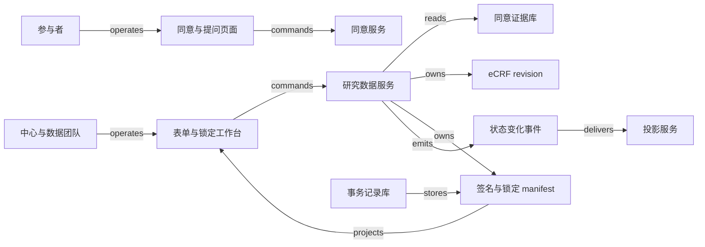

# V02 · 从方案与同意到可解释的数据锁定

[返回 P04 共同模型](README.md) · [结构拓扑](../../../../vault/distilled/saas-engineering-atlas/packages/health-science/V02.json)

临床试验团队最终交付的，是一组能说明“按哪个方案、经谁同意、记录了什么、谁审阅过、此后怎样更正”的数据。一个显示“100% 完成”的进度条无法回答这些问题。Protocol（试验方案）规定研究的设计与执行安排；consent（知情同意）涉及参与者在获知信息后的自主决定；电子病例报告表（electronic case report form，eCRF）承载按研究设计采集的记录；query 是针对记录的疑问；investigator signature 是研究者对明确范围数据的确认；data lock 限制之后允许发生的动作。它们相互约束，却分别回答不同的问题。

本例沿教材主线的“专业判断与责任”展开。合成研究 `SYN-T02` 有两个研究中心、四名虚构参与者，每人三份表：基线、访视、随访，共十二份。方案 P1 要求在第 0 天与第 7 天收集教学指标，单位均为虚构单位，不给出诊疗阈值。参与者 A 的访视表误填为 92，源记录为 29。协调员改值，数据管理员关闭疑问，研究者签署该表的新版本，再由数据管理员把选定数据范围锁定。完成条件是：锁定清单覆盖十二份明确版本的表，每份按本例策略完成质疑处理与签署，授权依据可以回查，导出与锁定清单一致。这里的“先解决 query、再签署、再锁定”是 **synthetic 案例策略**，不是所有试验或产品的统一流程。

[Veeva CTMS](https://www.veeva.com/products/veeva-ctms/) 自述提供试验管理与监查能力，页面列举入组、里程碑、访视报告与偏离处理；[Medidata Rave EDC](https://www.medidata.com/en/data-experience/edc-systems/) 自述支持试验数据采集、管理、清理与报告。这为理解运营管理和研究数据管理的不同重心提供参照，不能证明两个产品在本例已经集成，也不能据此推断其数据库、规则引擎或签名实现。下文是原创教学设计；Veeva 电子数据采集（electronic data capture，EDC） 的公开操作文档另作具体机制参照，不将它与 Medidata Rave EDC 混为同一产品。

## 识题：授权对象决定可以做什么

识题线索是“**同一个人不一定有同一权限，同一个值不一定仍是签过的版本**”。遇到“已签署但改过数据”“数目齐全却缺某张表”“查到零问题后又插入 query”，分别选择版本绑定、集合覆盖和事务共同 gate，不要都化成一个完成率。

| 主要机制 | 解法与验算 | 下一步研究方向 |
|---|---|---|
| 用途或方案变化导致授权范围变化 | 按用途和版本查询 consent episode，检查允许与拒绝可同时存在 | 查经批准的影响表、重新同意及撤回处理策略 |
| 签名记录都在，但当前数据未必被覆盖 | 比较完整必需集合与签名 manifest；沿定义依赖找失效范围 | 查实际 EDC 的签名失效条件、open query 配置与表单版本规则 |
| 所有局部检查通过，却锁入了新问题 | 所有相关写入与锁定共用 gate；演练修改先行和锁定先行 | 查 bulk import、API、批量 query 等入口是否参加相同事务边界 |

采购审批常在组织内部回答“这笔支出是否得到授权”；知情同意还涉及参与者是否理解信息、有机会提问并自主决定。系统可以保存材料、版本、签署人与过程证据，无法由“读完页面”推断理解充分。[FDA/OHRP 的 eIC 指南](https://www.fda.gov/media/116850/download)在 Background、Q2、Q3 中把知情同意视为持续过程，强调研究者与适当受委派人员的责任。该指南适用范围与其引用法规需分别理解，本例不据此给出跨法域的合规结论。

在合成设计中，参与者页面并列提供“向研究团队提问”“稍后继续”“不同意”和“签署本版本”。阅读位置只帮助继续阅读，不充当同意证据。授权判断使用 `(study, site, subject, purpose, protocol_version, icf_version)`：同意书 ICF-1 对应 P1 的研究程序，不自动覆盖随后新增的可选样本用途。协议变化由获授权人员判定哪些活动需要重新同意，系统执行已经批准的影响表。参与者撤回未来某用途时，记录生效时间与范围；本例暂停该范围的新研究活动，保留先前记录供指定责任人处理。既往数据留存、必要安全随访、代理人权限等必须由具体方案和适用制度决定，不能从一个 `withdrawn` 字段推导出“删除全部历史”或“继续一切活动”。这组处理规则是合成策略。

同意书还有自己的技术传递状态。SiteVault 的[状态文档](https://sites.veevavault.help/gr/sitevault/econsent/track-status/)区分参与者同意概况与表单的送达、签署、中心会签或完成状态；并明确有些表单不要求中心会签。送达成功仅证明材料可达，不能直接放行研究程序。[重新同意文档](https://sites.veevavault.help/gr/sitevault/econsent/reconsent/)保留新版本与重新签署的过程。这些产品事实支持保留版本和过程的必要性，不为本例规定统一的会签要求。

| 角色 | 本例允许的动作 | 有意保留的边界 |
|---|---|---|
| 参与者 | 查看自己的材料、提问、签署或拒绝指定用途与版本 | 不替研究者确认 eCRF；不能看到其他参与者 |
| 研究协调员 临床研究协调员（clinical research coordinator，CRC） | 登记材料、录入 eCRF、说明修正原因、回答 query | 回答不等于关闭；不能借录入权限代签 |
| 研究者 主要研究者（principal investigator，PI） | 在本人被授权的中心与范围内复核并签署表单清单 | 签名不覆盖以后新建的表，也不自动锁定 |
| 临床研究监查员（clinical research associate，CRA） / 数据管理员（data manager，DM） | 提出疑问、核对回复；按团队权限关闭或重开 | 修改源记录由相应责任人完成；阅读权限不等于关闭权限 |
| 数据负责人 | 按锁定计划确定范围、确认清单、发起受控解锁 | 管理平台账号不直接获得研究签署权限 |
| 方案维护者 | 发布获准的方案版本与表单定义，提供生效和影响范围 | 软件发布成功不证明伦理或研究程序批准已取得 |

权限要同时满足角色、研究、中心、数据敏感级别和被委派的动作范围。一个人可在中心 A 任 PI、在中心 B 仅有阅览权限；用账号上的全局 `is_pi=true` 会把 A 的权限泄漏给 B。对盲态数据还需按字段和用途限制访问，不能只隐藏网页中的一列。审计记录保存当时使用的角色与授权依据，避免事后角色变动改变历史动作的解释。

## 并行生命周期不能压成一条进度轴

方案 P2 生效时，P1 的历史记录仍要可解释。更新表单定义与更新参与者同意是两种变更：前者改变怎样解释数据，后者改变允许实施的研究活动，二者的影响范围可能不同。新的随访问题可能要求新 consent，也可能只影响已获授权的数据收集表；本例要求先读取经专业批准的影响表，不能让代码根据“版本号变大”自行判断医学或伦理意义。

| 对象与权威记录 | 合成状态及主要转换 | 持久化证据与恢复 |
|---|---|---|
| Protocol version，方案服务 | draft → released → superseded | 保存不可变方案、批准引用、生效范围；旧版仍能回查 |
| Consent episode，同意服务 | prepared → awaiting → effective；可拒绝、撤回；需更新时进入 reconsent_required | 签署绑定 ICF、用途和身份；新 episode 继承关联而不覆盖旧签名 |
| eCRF revision，研究数据服务 | draft → submitted；更正产生新 revision | 保存旧值、新值、原因和来源定位；`submitted` 不表示无疑问 |
| Query，研究数据服务 | open → answered → closed；必要时 closed → open | 关联问题指向的字段版本；关闭附处理意见与权限依据 |
| Signature，研究数据服务 | absent → current → superseded | 保存签署人、含义、时间和精确 manifest；数据或解释依赖变化使其不再覆盖当前版 |
| Lock manifest，研究数据服务 | open → preparing → locked；异常可 blocked，受控变更可 unlocked | 保存范围、版本、规则版本和锁定者；解锁不抹去曾锁定事实 |

Query 的生命周期表达“还有没有需要回应的疑问”，不表达“数据已由 PI 确认”。Veeva EDC 的[查询文档](https://cdmshelp.veeva.com/gr/sites/answering-queries/)区分 system / manual query 和 Open / Answered / Closed；某些仍处于 Open 的规则疑问可在数据改正后自动关闭，人工疑问由有权者复核。这里有一个实用反例：把回复按钮直接设为 `closed`，会跳过“回复是否充分”的决定。

签名表达“谁确认了哪些数据”。Veeva EDC 的[签署文档](https://cdmshelp.veeva.com/gr/sites/signatures/)明确指出编辑表单等动作可以使签名失效；该文档也列出允许带 open query 签署的配置。因此本例的严格关闭策略只是一种选择。若实际方案允许带疑问签署，manifest 仍须显示未决疑问及签署含义，不能因为实现更灵活便隐藏它们。

锁定表达“此后允许哪些变更”。Veeva EDC 的[锁定文档](https://cdmshelp.veeva.com/gr/monitors/locking/)列出被禁止的修改、签署及 query 动作；[冻结文档](https://cdmshelp.veeva.com/gr/monitors/freezing/)则保留签署、query 等管理活动。这说明 `frozen`、`signed`、`locked` 应分开显示。锁定也不证明数据真实，更不自动证明研究完成：把错误的 92 锁起来，只会得到稳定的错误。

## 解法：一个按钮绑定一份明确的证据

协调员打开 A 的访视表时，界面同时显示当前数据 revision 7、表单定义 P1-F2、源记录引用和 query Q4。点击“保存更正并回复”提交的是旧 revision 7、新值 29、原因、Q4 的版本和 operation ID。服务先检查中心权限、表单是否可写、依赖是否仍然相同，再在一个事务中建立 revision 8、保存原因及回复。若另一人已经产生 revision 8，页面显示冲突和差异，不自动用最后一次写入覆盖。用户重新核对后可以产生下一次动作，但应沿用原尝试记录解释先前请求的结果。

数据管理员看到“已回复，待复核”，在源记录和新值一致时关闭 Q4。这个按钮只关闭疑问，不为 PI 生成签名。PI 随后打开签署预览，看见 A 的三份表及版本 `[基线:3, 访视:8, 随访:2]`、使用的表单定义、签署含义以及未包含的表。完成必要身份确认后，服务重新比较预览与当前 manifest。若访视表已到 revision 9，返回“数据已变更，请复核新版本”，而不是把刚才的身份验证移用到从未展示过的数据。

签名记录在本例保存 manifest 的确定性摘要，摘要输入包括有序的 `(form_id, data_revision, definition_revision)` 和签署范围。摘要是便于比较的指纹，不是凭自身具有法律效力的电子签名；身份验证、签名含义、授权、时间、记录关联与完整性控制各有职责。参与者 consent 签署与 PI 数据签署使用不同对象和权限，不共用一个 `signed=true`。

数据负责人点击“准备锁定”，先得到 blocker 清单：缺表、未处理 query、失效签名、待对账导入或未完成的协议影响评估。清单为空才允许发起锁定。`preparing` 期间屏幕明确显示哪些范围暂时不接受新修改，完成后显示锁定 manifest ID 和版本；文件下载状态单独显示。导出失败不使已经锁定的数据重新可编辑，重试只重建同一个 manifest 的导出。合成设计的权威关系与调用关系如下，完整 typed edges 见 JSON。

本例没有实物交付或现金流；数据导出是信息复制，不能画成参与者同意权或研究责任的转移。真实项目若使用外部 EDC，其原始记录和签署状态以外部 EDC 为权威，本地工作台只能保存映射、操作与投影。临床试验管理系统（clinical trial management system，CTMS） 的入组或访视里程碑可供运营查看，但里程碑缓存不能替代 eCRF 的签名证据。集成适配器应按授权接口、版本和受限数据范围实现；本例没有验证 Veeva CTMS 与 Medidata Rave EDC 之间的具体 API。

## 演算：签名覆盖与变更影响

本例采用集合与依赖图，分别回答“还缺什么”和“改动影响谁”。设必需表单集合为 `R={A1,A2,A3}`，当前数据版本为 `{A1:3,A2:8,A3:2}`。所有表已提交，A2 的 Q4 仍是 answered；签名记录覆盖 `{A1:3,A2:7,A3:2}`。本例锁定条件是每个必需表均已提交、所有阻断 query 已关闭、签名覆盖当前的数据与定义版本，且没有未结清的导入或授权影响事项。

逐表比较：A1 为 3=3，A3 为 2=2，A2 为 7≠8；所以待签集合是 `{A2}`。query 清单还包含 `{Q4}`。DM 关闭 Q4 后，待处理 query 数从 1 变成 0，待签集合仍为 `{A2}`。只有 PI 对 revision 8 作出新确认后，两个集合才同时为空。不能计算“12 份表中 12 份都有签名行，所以完成率 100%”：旧签名行确实存在，但它只证明以前的版本。

朴素实现每次把 n 份表、q 条 query、s 条签名全部扫描，对一份表再线性寻找签名，会做到 O(n×s+q)。先按复合身份建立签名版本映射，再扫描当前必需集合，平均 hash lookup 模型下约 O(n+s+q)，或采用数据库树索引按范围读取。不能只比较数目：R 为 `{A1,A2,A3}`，签名集合为 `{A1,A2,X9}` 时，数量都为 3，仍然遗漏 A3。集合差需要完整身份，不能先脱离研究与中心去重。

定义变更需要多走一步。假设字段 F1 的代码值 `2` 原先解释为“第二次访视”，定义修订后改为“补充访视”；数据字符仍是 `2`，含义已经改变。构造影响图：`定义F1 → A2 → 派生表D1 → 签名S2 → 锁定候选L1`。从 F1 沿反向依赖索引遍历，访问 A2、D1、S2、L1，标记需要重算、重签或重新准备的节点；无依赖的 A1 不受影响。这是 `ALG:graph-paths`，访问集合防止重复和环，完整遍历代价 O(V+E)，其中 V 为本范围节点数、E 为依赖数。实际系统可只遍历受影响子图，但漏登记一条“代码标签影响表单解释”的边，会得到假阴性。签名摘要只含原始值、没有定义版本，便发现不了这个反例。

内容改回原值也要产生新 revision：29→92→29 不等于“什么也没发生”。本例要求保留两个更正动作并重新确认当前 revision，避免旧签名跨越中间变化被悄悄复活。哪些变更需要重新签署由具体产品与试验策略决定；本例选择严格规则来让影响可检查。它不是任何 provider 的算法描述。

## 写入边界比缓存刷新更重要

一个适合原型的选择是 React + TypeScript 实现表单、差异预览和签署清单，后端用 Django 或 FastAPI 组织命令与权限，PostgreSQL 存放复合身份、revision、query、signature、manifest 和操作记录。React 让并行状态容易分别表达，但客户端 schema 只能帮助及时发现错误，不能替代服务校验。Django 的统一后台更适合少量内部维护界面；FastAPI 的显式接口便于把适配器与命令分开，仍需自行完成事务、授权与审计设计。已有 Java 运维团队可选择 Spring Boot；语言选择不会自动解决“签的是哪一版”。这些是候选设计，不是厂商栈调查。

eCRF 的稳定关系字段可以用普通列，随方案变化的字段值可用版本化 JSON 结构；每次写入仍须对相应 schema 版本校验。把所有内容塞进一个可随意覆盖的 JSON 文档会让引用和并发边界消失；把每个字段都拆成无约束的通用键值表，则会提高查询和重建完整表单的成本。原件和确定性导出可保存在有版本控制的对象存储，数据库保存对象身份、摘要与访问范围；对象存储的链接不写入公开教材，真实系统也不把临时下载地址当长期证据身份。

锁定最容易出现的错误是“先查后写”：事务 T1 看到零个未决 query；T2 创建一个新 query；T1 写 `locked=true`。两个局部动作都成功，整体却锁住了未解决的问题。只对现有 query 行加锁无法阻止新 query 插入。可行的合成方案是为每个锁定范围建立一行 gate，所有影响该范围的表单、query、签名及定义成员变更都先在同一事务中取得 gate；锁定事务也先取得它，再核对当前 manifest 并提交锁定结果。锁定先提交时，后续修改会读到 locked 并拒绝；修改先提交时，锁定会看到新 revision 或新 query 并拒绝。忘记让批量导入走同一道 gate，就破坏了整个证明。

PostgreSQL 的[显式锁文档](https://www.postgresql.org/docs/current/explicit-locking.html#LOCKING-ROWS)说明 `FOR UPDATE` 的行锁会阻挡对同一行的不兼容修改，也提示锁等待、死锁和事务长度的成本。用它实现上述 gate 是本例的设计推论，不是数据库替你理解临床锁定。多个范围按稳定 ID 顺序加锁，并限制事务时间；等待 PI 阅读时不能长期持有数据库锁。

在合成负载中，20 个研究各有 50 个中心，每中心 200 名参与者，每人 40 份表，得到 800 万份表；若平均四个 revision，则有 3200 万份 revision 记录，未含 query、审计与附件。这只是容量规划输入。原型负载目标设为 100 个并发会话、全局每秒 20 次写入，列表 p95 小于 800 ms，普通保存 p95 小于 1 s；需分开测无缓存、热缓存、批量导入以及锁定窗口，并报告 p99、冲突率和队列年龄。没有执行这些负载测量。

单个全研究 gate 会把各中心的写入串行化，可按受试者或预先声明的数据范围分区；研究级锁定先把所有范围置为 preparing，等待在途命令完成，再冻结成员清单与各分区版本。中途失败应显示“已阻止写入、锁定未完成”的恢复状态，不能宣告整体成功。恢复者凭同一 operation ID 继续检查或受控撤销准备，并记录原因。若需要跨外部 EDC 锁定，数据库事务覆盖不到 provider，只能保留每个子范围受理结果，查询外部状态后完成对账。

缓存只用于列表和统计。key 至少包含研究、中心、权限范围、对象与数据版本；缓存命中前仍检查当前授权，撤销权限后清理相应会话投影。可以把 PostgreSQL row-level security 作为纵深控制，但官方[行安全文档](https://www.postgresql.org/docs/current/ddl-rowsecurity.html)明确存在 superuser、BYPASSRLS 与表所有者绕过情形；必须用实际应用账号检查，不能由“已启用 RLS”推出隔离已完成。

## 正常路径与恢复路径都保留责任人

正常路径从 P1 发布开始：团队确认参与者 A 的相应用途 episode 生效，CRC 提交 A2 revision 7；规则提出 Q4；CRC 核对源记录后提交 revision 8 并回复；DM 关闭 Q4；PI 在显示 revision 8 的预览中签署；数据负责人核对十二份表的 manifest 并锁定；导出服务从 manifest 引用的不可变 revision 生成文件；统计团队收到的是这个 manifest 的结果。每一步只生成它负责的事实，运营看板可以晚几秒更新。

故障路径从签署返回超时开始。签署服务可能已提交，只是响应丢失；浏览器保留 operation ID，先查该身份的结果。已成功则展示既有签名；确定未提交且服务支持相同身份重试时再执行；外部签署来源暂不可查则显示 unknown，不生成“签署失败”结论。重复回执用 `(source_system, study, event_id)` 去重，业务唯一键再约束同一操作不产生第二个有效签名。晚到的“revision 7 已签署”消息可以入审计记录，却不能让当前 revision 8 变绿。事件顺序号只能在其定义的同一来源与对象范围内比较，不能跨供应商当全局时钟。

另一个故障从已锁定后的错误发现开始。DM 不能直接把值改掉再把锁图标画回去。数据负责人先记录范围、原因和批准引用，解除相应写入限制，产生修订、重开必要 query，并重新签署与建立新的锁定 manifest。旧导出仍指向旧 manifest，须明确撤回或标记已被替代；已经下载到下游的文件不会因数据库更新而自动消失。恢复完成的证据既包括当前状态，也包括旧版怎样被识别和处理。

## 验算：从版本清单检查整体结果

下表是待实现的端到端检查设计。验证者应以不同角色真实操作 UI，经服务与持久化再回到页面，并保留脱敏操作记录、版本差异、拒绝原因及导出摘要。Vault 中的 [synthetic-v02.py](../../../../vault/distilled/saas-engineering-atlas/packages/health-science/synthetic-v02.py)只执行本地合成模型；从仓库根目录运行 `python3 vault/distilled/saas-engineering-atlas/packages/health-science/synthetic-v02.py`，不等价于此表全部已运行。

| 固定情境与动作 | 必须看到的结果 | 失败能暴露什么 |
|---|---|---|
| A2 从 92 更正到 29，Q4 回复、关闭、PI 签署，再锁定 | revision 8 的签名与锁定清单一致；导出为 29，旧值仍可回查 | 列表“完成”掩盖错误版本 |
| 同一 operation 重复提交，含参数被改变的重放 | 同参数返回同一结果；不同参数拒绝 | 去重键被当作覆盖入口 |
| revision 8 已提交，迟到 revision 7 的签署回执 | 保存旧证据，当前签名仍失效 | 到达顺序覆盖业务版本 |
| 锁定与改值分别先取得 gate；再加入新增 query 的竞态 | 两种顺序各有明确拒绝；锁定范围不出现遗漏的 query | 只锁已有行或漏掉批量写入口 |
| 两个研究与两个中心都使用 subject 001 / form F1 | 列表、详情、缓存、导出、错误消息均不泄漏另一范围 | 只在页面做授权过滤 |
| 签署已提交但响应丢失 | 页面显示待核对；同 operation 查询恢复为既有签名 | 超时后盲目发起第二次签署 |
| 准备锁定后进程中断，或导出写完后标记前中断 | 恢复同一 manifest；不改变清单，不重复发布新版本 | 把副作用与完成标记误当同一事务 |
| PI 签署后定义标签变化，或新增必需表 | 影响清单出现重签/缺表 blocker | 摘要只含数值，忽略解释与成员 |
| 参与者拒绝新用途但旧用途仍有效 | 新用途被阻止；旧证据不被删除或扩大授权 | 把 consent 压成一个全局布尔值 |

签名和锁定的关键路径采用确定性规则，无须模型裁决。若试做 AI query 助手，只允许它提出带字段引用的草稿，由有权限的人员判断是否发送，不自动改值、关闭疑问或签署。建议冻结 120 条虚构留出样本：40 条确有待澄清问题，40 条已合理解释而不应再问，20 条上下文不足，20 条跨中心或盲态诱导；与调试集按研究模板隔离。报告有效问题召回 `被识别的问题/40`、多余 query `被错误提出疑问的充分解释项/40`、适当拒答 `拒答的不足上下文项/20`、越权泄漏 `泄漏项/20`，另报生成草稿中人工接受与修正的分母。一个流畅但捏造源值的草稿算失败。

## 变式：改变条件后的判断

**练习一：允许带 open query 签署。** 实际研究采用允许此类签署的配置，A2 revision 8 还有 Q4，是否应把签署按钮永久禁用？

短答：不能照搬本例的严格策略。签署 guard 应改用实际配置和签署含义，预览保留 Q4 的未决状态；签名仍绑定 revision 8，锁定是否允许未决 Q4 另由锁定计划决定。不变量是签署范围和所见证据一致。失效前提是把“零 query”误认为电子签名的普遍定义。检查签署成功后 query 仍为 open，锁定检查也不因签名存在而自动通过。

**练习二：方案 P2 新增一个可选样本用途。** A 同意 P1 的既有研究，但拒绝新增用途；旧 eCRF 是否全部失效并删除？

短答：先按批准的影响表分出用途与时间。新增用途不得由旧同意自动授权；历史数据的有效性、留存和继续使用分别处理，不能由“未签 P2”直接推导删除。合成策略保留 P1 的历史证据，阻止新增用途，把受影响的后续活动交给研究责任人。检查同一人两个用途产生不同结果，拒绝不能被“已有一次有效签名”覆盖。

**练习三：数据没变，代码标签改了。** PI 签过的表中值仍为 `2`，字典将含义由“第二次访视”改为“补充访视”，摘要能否只比较数值？

短答：不能。签名依赖数据值和解释它的定义版本；影响图要把字典修订连到该表及派生结果。保留原签署历史，当前覆盖标记失效；重新复核后生成新签名。检查新旧值相同而 definition revision 不同，系统仍报告变化。纯 UI 字体改动是否重签则应另定策略，不能把所有前端变化视为临床语义变化。

版本化证据可迁到 V03 的结果复核与 lot certificate：`TR:V02:V03:versioned-release` 保留“确认绑定输入版本、变更后重查依赖”的关系；但批次证书的放行责任、抽样与检验方法不能从 consent 或 PI 权限继承。可迁到 V01 的报告修订：`TR:V02:V01:amended-evidence` 保留原记录及替代关系；临床报告更正后的通知责任和紧急处理需要自己的证据。可迁到 H08 的安全响应授权：`TR:V02:H08:scoped-authorization` 保留动作作用域、有效依据与拒绝原因；隔离账号或设备依赖响应权限和影响范围，不能由参与者同意模型推出。紧急处置的先执行后复核规则也必须单独确认，知情同意的自主性和持续沟通不能直接替换为组织内部审批。迁移时先保留不变量，再重查专业权威。

进入一个陌生试验时，先向研究者与数据管理负责人确认：谁可签哪些中心和表单，是否允许带 query 签署，freeze 与 lock 各禁用哪些动作，方案修订怎样触发重新同意，以及解锁后由谁处理旧导出。比较成熟方案族时，把 CTMS 的运营里程碑、EDC 的数据采集与清理、eConsent/eISF 的参与者同意与文档证据分开列出，再核对它们是否覆盖实际交接；不能用“统一平台”替代权威记录归属。上述 Veeva CTMS、Medidata Rave EDC 与 SiteVault 文档提供研究入口，不构成采购排名。

下一步索取对应研究配置、角色权限矩阵、版本/签名/锁定说明、接口与导出规范、脱敏审计样例，并在获准沙箱中建立“三表、一条 query、两个角色范围”的最小试验。先验证改值后旧签名是否失效、锁定时新 query 能否漏入、越中心请求是否被拒绝、超时后能否查回同一次操作；这些边界成立后，再扩展协议修订、部分锁定与跨系统对账。发现文档没有说明某项语义时，把它列为验证问题，不让演示补成产品事实。

[来源与模型说明](../../../../vault/distilled/saas-engineering-atlas/packages/health-science/evidence.json) · [对象与检查结构](../../../../vault/distilled/saas-engineering-atlas/packages/health-science/V02.json)
