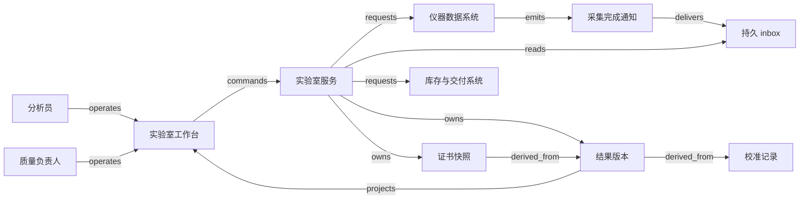

# V03 · 样品怎样成为一份可信的批次证书

[返回 P04 共同模型](README.md) · [结构拓扑](../../../../vault/distilled/saas-engineering-atlas/packages/health-science/V03.json)

识题时可以先记住“**数值不变，证据资格也会变；一个样品的结果，不能省略批次推断的前提**”。

实验室向委托方承诺的，是说明某个样品在确定方法和条件下得到什么结果，以及这些证据能支持什么判断。生产部门还要决定某个 lot（生产批次）是否可以交付。两者通过取样计划、规格和复核相连：测量值属于样品；批次结论还依赖样品代表性及其他必需检验；Certificate of Analysis（CoA，分析证书）记录已经批准的结论与依据。下载到一份 PDF，不能单独证明批次已获放行。

本例构造一个检测液体材料中杂质的实验室。批次 L1 取样 40 mL，登记为 S1，分出 10 mL 分样 A1 做分析、10 mL 分样 A2 留存，剩余 20 mL 仍在原容器。教学范围只设一项必需测定，省去真实产品可能需要的鉴别、微生物、稳定性等检验。L1 的合成合同规格是杂质浓度不超过 9.0 mg/L；这不是药品、饮用水或任何实际材料的安全限值。取样计划已由专业人员批准，软件检查记录是否齐备，不证明取样具有统计代表性。下文的对象模型、权限、公式、数值、状态和技术栈均为原创 synthetic 设计。

LabWare QAQC SaaS 实验室信息管理系统（laboratory information management system，LIMS） 是本例的公开产品参照。其页面自述支持样品状态和位置保管链、批次检验与复核、放行功能及 CoA 生成和审批。该页也介绍仪器性能检查和结果文件导入；这些内容支持功能范围，未公开本例的算法、API、存储设计或事务边界。、[LabWare QAQC](https://www.labware.com/lims/saas/qaqc)。

## 识题：身份先于数值

一个结果可以是 8.5 mg/L，但只有知道它属于谁、采用什么方法、从哪次原始观测得到，才有可能复核。样品标签、仪器序列位置和业务编号都是查找线索；它们不能互相顶替。尤其不要把生产批次和仪器运行中的 test batch 都叫作“批次”后共用一张表：同一次仪器运行可以装入来自多个 lot 的分样，同一 lot 也可以经过多次运行。

| 对象与稳定身份 | 本例的权威记录与联系 | 不能合并的事实 |
|---|---|---|
| Lot `L1` | 批次服务保存取样计划、必需检验清单、规格引用与质量处置；企业资源计划（enterprise resource planning，ERP） 保存生产与库存事实 | 实验室允许放行与 ERP 已解除库存冻结分别确认 |
| Sample `S1` | 样品服务保存来源 lot、取样位置、接收条件、容器及每次交接；身份是 tenant + sample ID | 扫码证明读到了标签，不证明容器内容正确 |
| Aliquot `A1/A2` | 分样对象引用 S1；保存量、单位、容器、制备和使用记录 | 分样不是新取样；重测原分样与重新从 lot 取样不同 |
| Method `M1@3` | 方法管理服务保存已批准版本、适用基质、范围、制备步骤、质量控制（quality control，QC） 与报告规则 | 发布 M1@4 不重写旧运行使用的 M1@3 |
| Instrument qualification `I1@2` | 仪器档案保存允许使用的状态、适用功能和有效区间 | 仪器资质/计量校准与本次分析曲线各有身份 |
| Calibration `C1@1` | 校准记录保存标准物质批号、浓度、响应、拟合版本、范围和本次使用区间 | 曲线拟合良好不证明仪器、样品制备和基质均合格 |
| Run `R1` 与原始文件 `F1` | 仪器数据系统记录采集事实，接入服务核对 run、位置、分样和文件摘要后登记 | 原始信号、重新处理结果和最终报告值分开保留 |
| QC `Q1` | 独立质控检查绑定 R1、预定接受规则和已知浓度 | 用来拟合曲线的标准点不能在本例中兼作独立 QC |
| Result `T1@1` | 结果服务保存原始文件、A1、M1@3、C1@1、Q1、单位、稀释因子、计算与复核版本 | 数值在规格内、分析有效、复核批准是三个判断 |
| Specification `SP1@2` | 质量负责人批准限值、单位、适用材料、判定规则和生效范围 | 事后放宽限值不得静默改变原报告的依据 |
| Investigation `OOS1` | 质量调查记录异常、假设、验证、批准的重测计划及处置 | 结果不理想不能成为删除结果的理由 |
| CoA `COA1@1` | 证书服务保存签署的内容快照、结果版本清单、规格版本、签署人和摘要 | 报告内容批准、文件生成、传送、ERP 接收各有状态 |

接样员可以接收或隔离容器、打印标签和登记交接，不能修改规格。分析员可制备、执行获授权的方法并提交结果，不能批准自己的最终批次放行。复核员检查原始数据、计算、偏差及审计轨迹；质量负责人决定 OOS 处置、批次放行和证书修订。集成账号只能接收特定仪器数据或传送指定证书，不能借接口取得签署权。系统管理员负责可用性；本例不赋予其业务签署权限。角色分离是教学政策，具体岗位组合需由实施实验室裁定。

这种拆分还有记录层面的依据：FDA 数据完整性指南要求即使结果被有依据地作废，也保留原数据和调查理由，并讨论变更轨迹及复核；这里取用的是记录可重建原则，没有据此宣称系统符合 CGMP。[Data Integrity，Q1b–c、Q2、Q7–8、Q12](https://www.fda.gov/media/119267/download)。

## 生命周期相交，责任不相互覆盖

样品的 `expected → received → prepared → retained → disposed` 说明实物在哪里、是否仍可使用。接收发现破损、温度偏差或身份冲突时进入 `quarantined`，由指定人员调查后接收或拒收。每次分样要核对母样与空容器；上述 40 mL 必须解释为 10 + 10 + 20 mL。实际制备损耗要单列量和理由，不能为了凑守恒式伪造剩余量。本例只接受同单位的简单分样，混合、浓缩和挥发需要另外的物料转换模型。

运行的 `planned → acquiring → acquired → evaluated` 说明采集与评价进度，另有 `aborted`。中断运行保留已采集记录；重新采集产生新 run ID。方法和规格分别经历 `draft → approved → retired`；旧版退出新任务选择，不抹去历史引用。C1 从 `draft → approved` 后可到期，或因发现问题进入 `revoked`。到期阻止未来使用；追溯性撤销则必须给出影响起点和原因，才知道哪些旧测量需要复查。

结果从 `captured → calculated → submitted → reviewed` 走到数值评价和专业复核。校准失效、QC 不合格或单位错误进入 `blocked`，不是自动记为产品不合格。测量有效且超过 SP1 的 9.0 mg/L 才记为本例的 `oos`；数值未超限但不满足合成不确定度规则时为 `review_required`。复核不改原数值，修正计算会建立 `T1@2` 并保留替代关系。批次在 `on_hold → review_ready → released` 之外可 `rejected`；已放行后发现依据异常进入 `reassessment_hold`，由质量负责人决定进一步处置。旧证书仍可审计，但暂停继续分发。

OOS 是 Out-of-Specification，即超出预定规格的结果。FDA 的 OOS 指南要求有科学依据的调查与预定重测安排，反对反复测试直到出现合格结果再忽略先前失败。[OOS 指南 IV.B.1，印刷页 7–8](https://www.fda.gov/media/158416/download)。本例把该原则落实为：未关闭的 OOS 会阻止正常放行；重测必须先引用已批准的调查计划，得到新结果后仍展示全部历史。一次 9.2 mg/L 和后来的 8.5 mg/L 不能用“取最后一个”自动变成合格，也不能临时取平均值 8.85 mg/L 规避原始 OOS。是否证明实验室错误、是否需要扩大调查，仍由合格人员决定。

异常结果没有一个可以直接变成“通过”的管理员开关。`blocked` 保留阻断原因；单位修正或重新处理建立新 result version，重新采集还要建立新 run。`review_required` 只有具名调查或补充证据得到处置后，才可能产生新的可复核版本；复核员不能绕过当前批准的判定规则。`oos` 保留原始数值与评价，即使调查证明其无效，也在独立调查决定中标明理由和被采用的新结果，不把旧数值改为合格。恢复的是后续决定所依赖的证据条件，历史事实仍然可见。

CoA 自己经过 `draft → approved → issued`。批准后尚未生成、分发的证书，以及已经发出的证书，都可能进入 `distribution_hold`；专业处置后可 `withdrawn` 或 `superseded`。WHO 指南要求修订分析报告具有新身份并引用被替代报告，也区分分析记录、报告与证书。[WHO TRS 1052 Annex 4，6.84–6.90](https://cdn.who.int/media/docs/default-source/medicines/norms-and-standards/guidelines/quality-control/trs1052_annex4.pdf)。本例的“合格 CoA”是已批准放行快照的一种输出；真实 CoA 也可以报告不符合规格，不应把 CoA 的存在普遍当作合格标志。

## 解法：工作台把证据交到正确的人手里

接样列表同时显示身份状态、容器位置和待处理原因。接样员点击“接收样品”时，表单要求扫码标签、填写实际接收量并确认异常项；服务端核对 tenant、角色与对象版本，在一个事务中保存接收和交接记录。标签不匹配时保持原样品记录，显示“容器与任务不符，已暂停分样”，提供重新扫描和隔离登记入口。自动把扫描到的新编号写回当前任务，会把一次现场错误变成一条貌似完整的错误保管链。

分析员在 R1 详情页查看位置表：第几个瓶位、哪个 A1、哪个 S1、哪个 lot。点击“开始采集”提交 `operation ID + R1 version + frozen manifest`。API 接受请求后只显示“采集请求已登记”；仪器返回采集身份才显示“仪器已受理”。关闭页面不取消仪器动作。若超时，显示待核对及最近一次检查时间，由 run ID 到仪器或数据系统查询；没有可查询身份时转人工核对，禁止新建身份重发。由于物理样品可能已经消耗，网络重试不能等同于重新做一次实验。

结果页并排显示原始响应、换算浓度、单位、方法/曲线/QC 版本和判定原因。显示小数位与判定精度分开：界面可显示 9.0，服务端仍用未舍入的值评价，按批准的报告规则输出。页面应在“数值合格”旁明确显示“等待复核”或具体阻断项，键盘可到达这些说明，不能只用红绿颜色表达。

复核员点击“提交复核”保存所检查的证据清单与意见；质量负责人点击“批准放行”针对明确的 `lot version + evidence epoch + certificate snapshot hash` 签署。签署前的预览展示将写入证书的样品、方法、单位、规格、结论和例外。若另一人刚修改调查或撤销校准，提交返回冲突及变更摘要，要求重新阅读；不能后台替换内容后沿用旧签名。按钮返回成功只意味着本地决定落库，后续文件生成和 ERP 接收分别显示进度。

## 演算：从信号到结论

| 识题线索 | 要选择的解法与验算 | 下一步研究入口 |
|---|---|---|
| 已知标准浓度与响应，要换算未知样品 | 先查方法允许的曲线，演算拟合与逆算；用未参与拟合的 QC 验算运行 | 实验室已批准方法、仪器处理说明；本例 LabWare Instruments 仅帮助确认产品功能范围 |
| 浓度接近限值，人员争论能否放行 | 先找规格绑定的 decision rule，再代入数值和适用不确定度；检查恰好在边界的输入 | 已批准规格及合同；WHO 6.65–6.67 用于识别药典迁移边界 |
| 一条曲线或原始记录后来失效，要知道谁受影响 | 建反向依赖图并按版本、时间筛选；用一个受影响和一个无关结果验算 | 本实验室结果/证书版本关系、异常影响调查记录；FDA OOS IV.A 的影响范围讨论 |

### 曲线回答浓度，QC 检查这次运行

合成方法 M1@3 允许在 0–10 mg/L 范围内用直线 `y = a + b x` 描述浓度 x 与响应 y 的关系。输入是三个标准点 `(0 mg/L, 1 AU)`、`(5 mg/L, 11 AU)`、`(10 mg/L, 21 AU)`；AU 是本例的任意响应单位。样品响应为 18.0 AU，稀释因子为 1。输出必须同时带浓度、单位、曲线版本与适用范围。

最小二乘计算先求均值 `x̄=5`、`ȳ=11`，再求 `b = Σ(x−x̄)(y−ȳ) / Σ(x−x̄)² = 100/50 = 2 AU/(mg/L)`，`a = ȳ−b x̄ = 1 AU`。样品浓度为 `(18−1)/2 × 1 = 8.5 mg/L`。n 个点只需累计求和，时间 O(n)，批处理读取 n 点时可用 O(1) 累加空间；稳定数值计算宜中心化或采用经过验证的数值库，直接相减大数会损失精度。本例的精确小数可用 Python `Decimal` 手算验证，生产环境要验证拟合、舍入和方法特定的加权规则。

独立 QC 用已知 5.0 mg/L 的检查溶液得到 11.2 AU，反算为 5.1 mg/L，偏差 0.1 mg/L，在预定的 ±0.25 mg/L 范围内。它未进入拟合输入，才能对本次运行提供独立信息。若 QC 为 12.0 AU，反算为 5.5 mg/L，即使样品仍是 8.5 mg/L，也应先阻断分析结果并调查。三个校准点恰好共线并不意味着不确定度为零；标准值、制备、重复性、漂移和基质都可能带来贡献。

三个标准浓度全相同会使分母为零，必须拒绝；负斜率或方法不允许的斜率也应拒绝；响应 25 AU 反算 12 mg/L，已在校准范围外，不能靠画长直线报告合格或不合格。方法可以预先允许稀释后重测，但必须记录制备、稀释因子与新采集，而不能直接把 12 截断成 10。这是 `ALG:approximate` 的一个具体边界：拟合是对响应关系的模型，模型适用范围和误差决定结果可用于什么判断。

### 接近限值时，先确定判定规则

为暴露“数值在规格内”与“证据足以放行”的差别，合成合同另规定：报告浓度 `c > 9.0 mg/L` 进入 OOS；`c ≤ 9.0` 且 `c + U ≤ 9.0` 才满足数值放行条件，其余进入人工复核。U 是已由专业方法评价提供的扩展不确定度，本例假设合成标准不确定度 `u_c=0.15 mg/L`，覆盖因子 `k=2`，故 `U=0.30 mg/L`。本例不从三个完美点估计 u，也不把 k=2 无条件解释成精确的 95% 覆盖率。

18.0 AU 得 `c=8.5`，上端 `8.5+0.3=8.8 mg/L`，通过这项数值条件；18.6 AU 得 8.8 mg/L，上端 9.1 mg/L，进入 `review_required`；19.4 AU 得 9.2 mg/L，进入 `oos`。这三种结果仍都需校准、QC、身份和复核条件成立。反例是把 8.8 显示为绿色后跳过人工复核，或把 9.2 的区间与限值有重叠解释为“可能合格”。

上述附加判定规则只属于这个非药典教学合同。WHO 指南对药典与上市许可文件的规格判定说明，限值已经考虑常规分析变化，不应任意再添加容差，并讨论估计不确定度超过目标时的调查。[WHO 6.65–6.67](https://cdn.who.int/media/docs/default-source/medicines/norms-and-standards/guidelines/quality-control/trs1052_annex4.pdf)。迁移到真实药品检测，必须先找到适用的批准方法和判定规则，不能把这里的 `c + U` 公式当作通用监管要求。

### 失效沿证据图传播，不能沿到达顺序猜测

`T1@1 derived_from C1@1` 表示 T1 的计算依赖这条曲线；`COA1@1 derived_from T1@1` 表示证书引用了这个结果版本。影响查询要反向查找“谁依赖了 C1”，不是顺着 `derived_from` 从 C1 往上找。朴素做法扫描所有 N 个结果；建立 `(tenant, dependency ID, dependency version)` 反向索引后，从 C1 广度优先遍历受影响子图，工作量为 O(Va + Ea)，Va、Ea 是实际访问的节点和边。visited 集合防止错误的循环关系使任务不结束；业务层还要拒绝不合法的自我派生。`ALG:graph-paths`、`ALG:lookup`。

C1 在本例的相对分钟 `[0,60)` 可用于采集；T1 在第 50 分钟采集，第 90 分钟才导入。按采集时间，T1 没有因为网络迟到而“用了过期曲线”。第 60 分钟采集则已不在半开区间内。若第 100 分钟发现第 40 分钟以后存在漂移，记录“影响起点 40”并查出 T1；第 20 分钟的另一个结果是否受影响，按调查结论及适用时间范围评估。仅凭“今天 C1 已过期”废除全部历史结果，和“采集时显示有效所以永远没问题”，都会丢失时间语义。仪器本身的资格状态还必须独立核对；WHO 提供了设备识别、校准/资格状态和记录的专业参照。[WHO 5.33–5.44](https://cdn.who.int/media/docs/default-source/medicines/norms-and-standards/guidelines/quality-control/trs1052_annex4.pdf)。

影响查询输出的是“必须复查的候选集合”，不替质量负责人断言整批产品已经不合格。先暂停相关新放行和证书分发，再调查，最后撤销、修订或恢复。把受影响图的可达性当成实际伤害的证明，超出了算法能回答的问题。

## 把证据关系实现成可恢复的数据流

本例的拓扑将实物交接留在 sample/aliquot 记录中，箭头只表示人的操作、信息请求、持久化和派生关系。每条边的 payload、失败与核对点见 JSON；下图保留其中一条闭环。

可选实现从 React + TypeScript 工作台配合 Python/FastAPI 或 Java/Spring Boot 服务开始。前者便于把已验证的数值库放在计算 worker，后者适合已有 Java 团队和事务服务；不要为了让代码全用一种语言而在浏览器内作最终放行判断。表单和图可以由前端构建，服务端必须重做权限、单位、版本和证据 guard 检查。列表可用查询缓存，提交成功后重新读取受影响对象；旧缓存只用于展示，不授权签署。

关系数据库适合保存稳定 ID、版本关系、职责和事务决定。PostgreSQL 是一个候选：约束组合键包含 tenant，原始结果版本追加保存，签署与 outbox 在同一事务内提交。行级安全可作为隔离的第二道控制，但 PostgreSQL 官方文档明确指出超级用户、`BYPASSRLS` 角色以及通常情况下的表所有者会绕过策略；应用运行账号与测试不能使用这些权限来证明隔离。[Row Security Policies](https://www.postgresql.org/docs/current/ddl-rowsecurity.html)。单租户独立数据库更容易缩小错误影响范围，却增加迁移和运维数量；共享数据库更易统一查询，但每个连接、后台任务和对象文件请求都须验证授权 scope。

大体积仪器原文件放版本化对象存储，数据库保存对象 key、大小、校验摘要与可读格式版本。导入时先写入暂存区并验证完整性，再在事务中挂接 run 和结果；重启后可以清理未挂接的暂存文件，不能删除已引用原始证据。摘要能检测字节变化，不能证明仪器输出真实或采集合法；仅存 PDF 也可能丢掉原始可重处理数据。可以选兼容 S3 的托管对象存储或机构管理的存储服务，选择依据是恢复、读取格式与保留要求，而非假设某种存储自动满足记录法规。

仪器适配器把不同导出格式转成版本化内部 schema；原文件必须保留。幂等 key 使用 `(tenant, instrument, run ID, acquisition ID)`，另存 payload digest。同 key 同摘要返回原导入结果；同 key 不同摘要进入冲突隔离，不能用 upsert 覆盖。对于 CSV，要验证列名、编码、十进制符号、单位、瓶位和 manifest；无法确定分样身份时停在 `unmatched`，不能按最相近的样品名猜测。方法允许再处理时产生新 result version，引用同一原文件和新的处理参数。消息队列负责延后工作，数据库里的 operation/inbox/outbox 保持重启后的事实依据；小实验室可以先用数据库 worker，多个服务或高吞吐时再评估独立消息系统。

## 三条轨迹说明哪里会失败

**正常采集到发证。** 接样员接收 S1 并建立 A1/A2；分析员在 M1@3、I1@2 与 C1@1 允许的条件下采集 R1。适配器登记文件 F1，计算 8.5 mg/L，独立 Q1 通过。复核员检查身份、原数据、计算和全部异常记录，质量负责人批准 L1。事务保存放行决定与 COA1@1 的内容快照，随后生成文件并发往 ERP。ERP 用证书 ID 和版本返回受理身份；工作台分别显示“已批准”“文件已生成”“ERP 已确认”。最后对账确认实验室批准和库存处置相符；本例不把传送通知当作库存已解冻的证明。

**已采集但断网。** 仪器完成了 A1 的一次消耗性测定，客户端超时。operation 留为 `unknown`，后续查询按 R1 找到原采集记录；若只收到完成通知但文件还未同步，仍显示“等待原始文件”，不能根据一个 `completed` 字符串造出结果。旧的 `acquiring` 通知晚到时，接入服务核对当前采集记录，不回退已核对的状态。原文件落库而 worker 在确认消费前崩溃，恢复按 acquisition key 取回同一导入，补写消费标记；这一步不会重新启动仪器。

**已批准后发现校准异常。** C1 的追溯撤销与放行可能同时发生。若只依赖异步图传播，传播尚未到达 L1 的间隙仍可能签出证书。本例在每个 tenant 的证据状态中维护一个 `evidence epoch`：撤销先锁定并更新 epoch、保存失效依据和影响任务；放行在同一锁保护下核对当前 epoch、读取依赖状态并保存签署。如果签署先提交，后来的撤销仍触发 `reassessment_hold` 与通知；如果撤销先提交，旧预览的签署立即冲突。它保证决定有一个可解释的先后，不能预知尚未发现的实验错误。全租户 epoch 会让无关批次也重读证据，是便于审计的初始取舍；规模扩大后可按仪器或依赖集合细化锁，但要证明每一项依赖都参加检查。

文件分发和外部库存动作不在数据库事务内。签署成功并不永久授权稍后的发送：文件生成和 worker 实际发送前，都要核对当前分发资格、证据 epoch 与证书状态；变化时先重新评价依赖，不能拿旧预览的批准直接继续。撤销要覆盖 `approved` 与 `issued`，并取消尚未开始的分发任务。outbox 记录证书 ID、版本和传送身份，接收方若支持相同身份查询，超时后先查询；不支持时保留未知并人工核对。若请求已发出或正处于网络中，随后撤销不能保证对方未收到，此时进入分发结果核对与撤销通知。证书已撤销但对方早已下载的文件无法远程擦除，要保留分发清单、撤销通知与确认记录。撤销、重新签发和库存冻结是有责任人的新动作，不用一次“回滚”掩盖已经发生的外部事实。

## 规模改变时，先保护审核边界

合成容量假设为 20 个 tenant，每 tenant 每工作日 2,000 个样品、每样品 5 项测定，共 200,000 项/日；10% 在 10 分钟内导入，即约 33 项/秒峰值。每项另存平均 1 MB 原文件时约 200 GB/日，实际仪器格式和运行共享文件会改变这一估算。索引与分页优化列表，异步 worker 处理文件校验和报告生成；把 200 GB 文件搬运到 Web 请求里会比曲线的 O(n) 计算更早成为瓶颈。

待测目标是在上述分布、每 tenant 5 位并发操作员下，列表 p95 小于 500 ms、放行事务 p95 小于 1 s；文件处理单独测等待时间、吞吐与积压年龄，不计入按钮“已登记”的延迟。分别测缓存命中/未命中、大 lot 依赖数量、一个仪器批量撤销影响 50,000 个结果的场景。关键读模型 key 包含 tenant、对象版本、权限 scope 与证据 epoch；撤销在权威层即时阻断动作，界面投影允许延后但必须显示新鲜度和重读入口。公平 worker 配额防止一个 tenant 的历史重算阻塞其他人的新样品接收。上述数字是容量模型与验收目标，未作负载实测。

## 验算：抓住一个具体错误

本例不让 AI 拟合曲线、判断 OOS、作废记录或签署证书，因此没有 AI 决策 eval。若以后加入异常摘要或调查建议，应另建有专业标签的留出集，检查是否漏报原始 OOS、是否无依据归因及是否暴露跨租户内容；本交付没有实现或执行这样的功能。

| Given / when | 必须观察的结果与证据 |
|---|---|
| 标准点与正常样品响应 18.0 AU，QC 为 11.2 AU | 计算 8.5 mg/L；数值 guard 通过，仍等待专业复核；核对公式、单位和版本清单 |
| 相同 acquisition ID 重复送达；随后同 ID 发送不同内容 | 前两次仅一个结果；内容冲突被隔离，原始版本不变；检查 inbox 与 digest |
| 已核对 acquired 后收到旧 acquiring 通知 | 状态不倒退；核对权威记录及事件接收日志，而非假设所有状态只会递增 |
| 两位授权人按同一 lot version 同时签署 | 一个决定成功，另一个得到同一操作或版本冲突；不生成第二份不同内容的同版本证书 |
| 校准撤销提交后，旧预览请求签署 | epoch 冲突且无新证书；反向顺序则保留旧签署并产生重新评估任务 |
| 证书内容已批准，文件尚未发出时撤销校准 | `approved` 进入 `distribution_hold`，分发 gate 拒绝创建新发送意图；已在网络中的请求另行核对 |
| 两个 tenant 都使用 S1、R1、COA1；尝试交叉分样 | 查询、缓存、文件、后台任务均隔离；母样不匹配或跨 tenant 关系不得写入 |
| 仪器已受理但调用超时；文件稍后到达 | 保留 unknown 并按原身份核对；不重复采集或消耗第二份样品 |
| 导入已提交，worker 尚未确认就停止 | 重启重放仍只有一个结果和同一原文件引用；补齐消费状态 |
| 9.2 mg/L 后重测得 8.5 mg/L，调查尚未关闭 | 保留两次测量，批次仍被阻断；“最后一次通过”这一错误实现必须被反例击穿 |
| 8.5 mg/L 但 QC 失败，或采集正好在校准区间终点 | 分别返回 QC 阻断或校准无效，不进入产品数值放行 |
| C1 撤销，图中只有 T1、COA1 依赖 C1，另有独立 C2 | 仅相关依赖进入影响集合；保留时间范围与原签署，不能全库宣布不合格 |

## 变式：改变条件后重做判断

**练习一：把非药典材料换成药典检验。** 响应仍是 18.6 AU，计算值 8.8 mg/L、U 为 0.3 mg/L。能直接沿用本例的 `c + U ≤ 9.0` 放行规则吗？

简答：不能。保留单位、方法版本、原始记录与专业批准这些不变量；先查适用药典、许可文件和已批准判定规则。WHO 的对应规则不支持任意添加容差，本例也无权改写。最容易犯的错误是程序员为“更安全”自行收紧或放宽限值，却让证书声称按原规格判定。检查以两个不同 `decision_rule_id` 固定 fixture，确保计算值相同仍按各自已批准规则展示理由；需要专业人员确定规则，不能从本题推出具体药品能否放行。

**练习二：撤销只影响第 40 分钟后的采集。** C1 被第 20 分钟的 T0 和第 50 分钟的 T1 引用，两份 CoA 已签；通知在第 100 分钟到达。哪些对象先暂停？

简答：从 C1 的精确版本反向遍历，再用经批准的影响区间筛选。T1 及引用它的证书和相关 lot 进入复查与暂停分发；T0 保留在调查可见范围内，不能仅因通知晚到就宣布无效。若影响起点尚不清楚，应先扩大临时暂停范围并标明依据不足，不能擅自选 40。检查两份结果相同数值、不同采集时间和不同证书引用，验证后到事件仍改变需要复核的对象。

**练习三：同一仪器文件中混入另一个 tenant 的 A1。** 两边样品名都是“S1”，导入模板也相同，可以按名字匹配吗？

简答：不可以。保留采集身份和 manifest；tenant、容器与分样身份共同决定关联，不能靠近似名称补全。反例是 A 租户的运行把 B 租户的正常结果贴到本租户 OOS 样品上。检查同名异租户、错瓶位及同 acquisition ID 不同摘要，全部进入隔离并保留原文件；授权转交给外包实验室须另建有来源和接收确认的交接对象。

`TR:V03:V02:version-bound-review` 把“签署绑定证据版本，修订保留旧依据”迁到 电子病例报告表（electronic case report form，eCRF） 数据锁；类比止于证据与签署，受试者同意的范围和撤回不能用实验室校准有效期代替。`TR:V03:V09:dependency-invalidation` 把依赖版本及失效影响查询迁到设计 signoff；制造样品的代表性和测量不确定度不能由软件构建可重现性替代。`TR:V03:V10:equipment-eligibility` 把设备状态限制未来任务、异常追溯既往工作迁到维护；检修完成不自动证明用该设备生产的批次有效。`TR:V03:X01:scoped-evidence` 把 tenant 范围贯穿业务 ID、文件、缓存和后台任务；合法跨机构送样需要显式授权交接，不能用“共享一条租户记录”省略责任边界。以上均为机制迁移分析，不继承其他案例的 provider 事实。

继续探索这一行业，先向实验室确认样品来自哪里、谁对取样代表性负责、哪些方法与规格版本真正约束放行、OOS 如何调查，以及一份证书的修订必须通知谁。再查成熟 LIMS 的样品与批次功能、目标仪器的公开导出/接口契约和适用的质量管理文件，选择与实际工作相符的证据。验证时挑一个可以手工追到原始记录的完整批次，注入错瓶位、QC 失败和批准后撤销，观察系统是否保存完整依据并阻止未经授权的分发；这些答案会决定应做什么工具，而不是先决定页面长什么样。

[来源与模型说明](../../../../vault/distilled/saas-engineering-atlas/packages/health-science/evidence.json) · [对象与检查结构](../../../../vault/distilled/saas-engineering-atlas/packages/health-science/V03.json)
