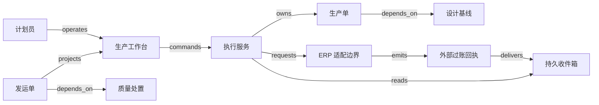

# V07 · 一件产品怎样带着设计依据走到收款

客户订购的是符合约定的产品，不是一条已经跑完的生产进度条。工厂必须回答：照哪版设计制造，哪些材料实际投入，哪几件通过检验，哪几件交给客户，交付对应多少应收款。P06 的共同模型在这里落为一组可以互相核对的证据；设计发布、生产结束、质量放行、发货和收款分别关闭不同责任。

本例是一家加工厂生产 12 件支架的 **synthetic 教学设计**。每件售价 50 记账单位，允许分批交付、确认发运后开票，不含税、运费和收入确认。每件使用 1 个毛坯、2 个紧固件，产成品有序列号；数量与计算规则是构造输入，不是 Autodesk 或 SAP 的产品配置。设计工程师对设计适用性负责，质量人员决定合格范围，财务确认收款；软件不代替这些判断。

## 识题：版本、配套与余额

先辨认眼前卡住的关系，再选择解法。以下线索对应后文的演算与变式。

| 识别线索 | 先选的方法 | 接着查什么 |
|---|---|---|
| 同一产品有多个图纸版本，旧品仍在生产 | 固定生效基线，再算变更影响范围 | 产品生命周期管理（product lifecycle management，PLM）/企业资源计划（enterprise resource planning，ERP） 的版本生效、替代料和返工规则 |
| 材料总数很多，却无法完成订单 | 按 物料清单（bill of materials，BOM） 单位需求求最小齐套数量，再事务预留 | 可用量口径、并发预留与缺料处理 |
| 生产结束，却仍欠客户货或欠款 | 分别建立履约数量账与应收核销账 | 部分交付约定、检验处置与收款分配 |

## 解法：用基线与独立对象保存依据

计算机辅助设计（computer-aided design，CAD） 保存几何与设计信息，计算机辅助制造（computer-aided manufacturing，CAM） 用设计模型生成加工刀具路径；Autodesk 的公开说明支持这种职责区分。计算机辅助工程（computer-aided engineering，CAE） 则通过计算模型分析设计在给定条件下的行为。仿真报告能支持设计判断，却不能证明现场某件产品已经制造合格。[Autodesk CAD/CAM](https://www.autodesk.com/ca-en/solutions/cad-cam)、[Autodesk CAE](https://www.autodesk.com/in/solutions/computer-aided-engineering-cae)。

合成系统把图纸、物料清单 BOM、工艺路线、检验要求及各自版本组成 design baseline（设计基线）D3。一次发布固定这些引用与内容摘要，不仅记录一个会变动的文件夹地址。BOM 说明计划用什么；实际耗料记录说明用了什么。两者不同，才能发现替代材料、返工增耗或录入遗漏。

| 对象与权威 | 独立状态与关键限制 |
|---|---|
| 设计基线；工程服务 | `draft → released → superseded`。工程授权人发布；旧版被替代后仍能解释历史产品。更改生成 D4，不把 D3 的内容原地换掉 |
| 生产单；执行服务 | `planned → released → running → completed → closed`，另有 `held`。放行绑定基线、材料可用量与设备许可；完成表示本单工序结束，关闭还要求数量、耗料与异常核对 |
| 单件与检验处置；质量服务 | `pending → accepted / rework / scrap`；返工后形成新检验记录，可再次 accepted 或 scrap。新异常可使 accepted 进入 `blocked`，再由质量复核解除或转返工。生产操作员录结果，质量人员批准处置，旧失败记录保留 |
| 发运单；仓储服务 | `draft → reserved → dispatched → received`，预留可取消。只预留已接受且未被占用的单件；出库事实与客户接收分别确认 |
| 应收项；财务系统 | `open → partially_settled → settled`，争议另记。发货不自动表示收到钱，到账必须匹配银行或财务确认与具体应收项 |

SAP 的课程将 production order 的创建、放行、goods issue（耗料出库过账）、confirmation（生产确认）及 goods receipt（成品收货过账）分别解释：放行后才允许相应过账，生产确认记录进度，成品收货更新库存。本例借此辨清工作边界，不声称上表是 SAP 的完整状态机。[Processing Production Orders](https://learning.sap.com/courses/executing-basic-erp-processes-with-sap-s-4hana/processing-production-orders)。

SAP 销售课程将单据分为 header、item 与 schedule line；后者记录已确认的交付日期和数量，支持同一行项目分期交付。这支持把商业承诺与多次实物交付分开建模，并不规定本例客户必须接受部分交付。[Structure of Sales Documents](https://learning.sap.com/courses/discovering-the-basics-of-sap-s-4hana-sales/executing-sales-order-management_cad9dfbe-bafc-4ed9-ac2e-6fd8422430e4)。

计划员追求按期完成，仓库要防止一份库存承诺给两张生产单，质量人员必须能拒绝赶工要求。服务端把工程发布权、生产操作权、质量处置权、出库权和收款核销权分开。租户与工厂是身份范围；同一工厂内看得见生产单，并不自动有权解除质量冻结。生产单的 `completed` 也不能成为绕过质量检查的授权。

## 发布生产单时，页面确认了什么

列表同时显示计划数量、工序进度、质量分布和待交付数量。详情页显示 D3、材料版本、机台、检验要求与异常；“按 D3 放行”按钮先预览缺料与冲突。浏览器提交 `tenant + plant + order_id + expected_version + baseline_id + operation_id`，执行服务重新检查权限和最新库存，而非相信预览时的绿色标记。

事务保存生产单新版本、材料预留和待发送记录。UI 首先显示“放行请求已保存”；连接 ERP 的适配器再提交外部操作，并保存外部单据号。只有权威系统确认后才显示“材料过账已确认”。`POST /production-orders/{id}/release` 和 `GET /operations/{id}` 是本例拟定接口，不是 SAP API 名称。operation ID 在刷新、重试和换页后继续使用；同 ID 不同请求内容必须拒绝。

SAP 的耗料课程还明确区分系统记录的库位转移与实物移动，并展示缺库存时的后处理情形。因此，“已过账”与“材料已送到机台”应有不同观察点；本例禁止负库存作为合成策略，并把实物到位扫描作为开工前提。[Posting Goods Issues](https://learning.sap.com/courses/manage-production-orders-in-sap-s-4hana-manufacturing/posting-goods-issues-for-production-orders)。

图中消息没有搬运实物，也没有转移现金。执行库保存请求、事实引用与回执，文件存储保存设计包、量测附件及其摘要，查询投影连接这些对象。ERP 对其库存和会计单据负责，现场系统对机器与人员采集记录负责；投影缓存不成为任何一方的替代权威。ISA-95 的公开简介讨论企业业务与制造控制之间的信息接口；这里只借用其边界意识，不声明本例达到标准符合性。[ISA-95 简介](https://www.isa.org/standards-and-publications/isa-standards/isa-95-standard)。

React + TypeScript 适合把表格、版本差异和扫描反馈组合为单页工作台；Vue + TypeScript 也可用，团队已有表单组件时迁移框架价值不大。后端可用 ASP.NET Core 或 Spring Boot 承担命令校验与事务，PostgreSQL 保存对象、数量分录与唯一操作键。大图纸放对象存储，数据库只保留摘要和版本引用，避免大文件拉长业务事务。先用数据库 outbox 与后台任务处理有限外部连接；事件量与独立消费者增加后可引入消息代理，但仍须对账。以上都是可选实现，不是厂商技术栈调查。

## 演算：数量配套与依赖排程

第一步不是排一个好看的甘特图，而是确定生产是否可行。现有毛坯 14 个、紧固件 22 个，无其他预留。12 件需求为毛坯 `12×1=12`、紧固件 `12×2=24`。可完整配套数量是 `min(floor(14/1), floor(22/2))=11`，缺 2 个紧固件。把库存件数 `14+22=36` 与需求产品数 12 比较毫无意义，计量单位与配套约束丢失了。

对 n 种材料逐项扫描计算需求是 O(n)；索引 lookup 以 `(tenant, plant, material, lot)` 查可用库存，避免扫描全厂分录。常用的可用量是已确认在库减有效预留，本例不计尚未确认到货。计算出 11 并不预留 11，后续事务必须再次检查并占用；否则两个浏览器各看到 11，都能承诺全部库存。BOM 有多层装配时，沿有向依赖图展开，复用子件乘上对应数量；先检测环，不能对 A 需要 B、B 又需要 A 的错误定义无限递归。

补齐 2 个紧固件后，12 件开工。第一次检验为 9 件 accepted、2 件 rework、1 件 scrap；返工的 2 件最终 1 件 accepted、1 件 scrap。本例返工只重做工序，不追加上述两类材料。最终合格 `9+1=10`、报废 `1+1=2`，合计 12。返工记录是同一单件的新尝试，不能把两次检验的 14 条结果误当 14 件产品。履约上仍欠 2 件，须补做或获客户同意取消；生产单可以结束这批加工，销售承诺仍未结清。10 件发出并开票 `10×50=500`，收到 300 后应收余额 200。实物平衡 `10+2=12` 与资金平衡 `300+200=500` 是两套检查。

依赖排程也有可手算的边界。假设钻孔 A 用机台 2 小时，表面处理 B 在 A 后用 3 小时，检验 C 在 B 后用 1 小时，最早完工为 6 小时。另一张单的独立钻孔 D 也需同一台机器 2 小时；D 不能因图上无前驱就在第 0 小时与 A 并行。拓扑排序 O(V+E) 可找到先后关系，资源容量还需单独安排。给 A 优先，则 D 为 `[2,4)`，A 的后续 B、C 不占该机台；若改用维护窗口 `[0,1)`，A 推迟，预计交付随之改变。这个贪心次序是可行方案，未证明全局最优。

## 异常应回到具体单件和具体操作

正常轨迹是 D3 发布、补料与预留、生产单放行、12 件录入加工事实、逐件处置、10 件出库、财务开票并登记部分收款。每一步都保留前一步的身份，最终能从应收项回到发运单与合格单件，再回到 D3。

若生产中发布 D4，工作台显示“存在新版本，当前按 D3 执行”。工程负责人作影响评估：未开工的单件可在批准后切换；已加工单件若必须改造，形成返工单和新检验要求。把外键批量改为 D4 会使历史看似按新图生产，却没有实际改造证据。若需要停产，单独记录 hold 的范围和原因，不能删除旧工序记录。

ERP 已扣料但连接超时，是未知结果而不是扣料失败。操作进入 `unknown`，按外部关联号或受支持的查询能力核对；无法唯一匹配就转人工。确认已过账后补写映射；确定未发生且允许安全重试才重发。返库或冲销是新的业务记录，不能借恢复流程假装实物未被使用。若业务事务提交后 worker 崩溃，outbox 重放同一操作；外部请求与本地事务不能原子提交，唯一键和回查必须同时存在。

合成负载目标是 20 个租户、每租户 5 个工厂，累计 100 万件序列号、每日 5 万条工序或质量记录，50 个并发工作台。待测目标为列表 p95 小于 500 ms、单件谱系查询 p95 小于 1 s；不把 ERP 响应时间包含在本地事务延迟里。大订单分批录入，不能锁整厂库存。缓存 key 带租户、工厂和查询过滤条件；质量冻结立即使相关投影失效，出库仍直接检查权威处置版本。限流以工厂队列隔离，避免一个批量导入拖住其他工厂的扫描确认。这些是待验证目标，不是已有性能成绩。

## 验算：数量、版本和副作用

| 固定前提与操作 | 可观察答案 |
|---|---|
| 正常路径：补料后按上例加工、检验、发运和部分收款 | 12 个唯一序列号；10 合格、2 报废；发出 10；开票 500、实收 300、未收 200；UI 分别显示欠交与欠款 |
| duplicate：同一扫描提交两次，再换一个事件 ID 重发同一工序尝试 | 接收可重复，耗料或完工效果只一次；同时检查 event 去重和业务尝试唯一键 |
| out_of_order：返工复检 accepted 先到，旧 rework 后到 | 保留两条带尝试号的证据；先等待缺失依赖或核对，不能用到达顺序回退处置 |
| concurrency：只余 2 个紧固件，两单各要 2 个同时预留 | 只有一单成功；另一单明确缺料，不出现可用量 -2 |
| tenant_isolation：两个租户都有序列号 S001 | 扫描、附件下载、缓存与谱系查询都只返回授权范围，不能借关系图泄露另一厂图纸 |
| unknown_outcome：外部扣料成功后断开连接 | 显示待核对，找到同一外部单据后只记一次消耗；若查询无定论，保留未解决状态 |
| recovery：出库记录提交后、事件消费标记前崩溃 | 重放后仍只发出该 10 件；实际交接记录与系统出库逐件对上 |
| 非正常放行：质量 blocked 后仍使用旧列表点击出库 | 服务端拒绝并说明被冻结的序列号，列表刷新不能替代拒绝记录 |

这些是端到端验收定义，不是已经运行的 UI 或外部集成。核心规则不使用 AI。若以后加入图纸问答，模型只能引用当前授权基线并给出建议；发布、放行与收款不接受模型输出充当证据。其版本错引率与越权引用率须另用冻结留出集评估，不能用此处的数量检查替代。

## 变式：改变交付约定与 BOM

**练习一：客户只接受一次性交付，10 件已经合格，能否先发？** 简答：生产与质量事实不变，发运 guard 增加“本行未取消需求全部齐套”。12 件订单要等补做的 2 件或客户批准改约。保持的不变量是发运范围必须符合合同与质量证据；失效条件是沿用本例允许部分交付的假设。反例为 10 件发出后才发现客户现场必须同时安装 12 件。检查以 `partial_delivery_allowed=false` 重跑，出库应拒绝且仍保留 10 件可用库存。

**练习二：D4 把每件紧固件从 2 个改为 3 个，库存仍为 22，全部尚未开工。** 简答：新基线可配套 `floor(22/3)=7` 件，12 件需 36 个，缺 14 个；不能沿用 D3 的缺 2。保持的不变量是需求数量绑定同一生效基线；失效条件是缓存 key 只含物料号、不含 BOM 版本。检查变更预览列出增耗 12 个，旧预留在批准切换事务内释放并重新计算，失败时保留原计划和未切换状态。

迁到 V09 的 `TR:V07:V09:baseline-evidence` 保留“固定基线与验证证据绑定”，但芯片 signoff 不能证明某批实物制造良率，发布条件要重新定义。迁到 V08 的 `TR:V07:V08:actual-genealogy` 保留计划与实际投入分离；离散件常能逐件识别，混合后却通常无法把某一原料公斤直接对应到某一产出公斤，不能照搬单件追溯。迁到 H01 的 `TR:V07:H01:fulfilment-settlement` 保留履约与收款独立，但本例允许赊销，不能沿用预付开通 guard。

**实践探索方向。** 面对一家陌生工厂，先拿一张订单沿图纸、BOM、生产单、检验与发运追到实物，找出各自的权威系统。若主要断点是版本发布与适用范围，考察 PLM 类方案；若是库存与财务核对，考察 ERP；若是工序执行与现场采集，考察 制造执行系统（manufacturing execution system，MES）。是否需要独立系统取决于现有产品能否覆盖这些职责。下一步查基线生效、替代料、返工与出库冲销的具体文档，用一次 D3→D4 变更和两单争抢最后一份材料验证接口边界，不能只看产品演示流程。

配套：[拓扑与 checks](../../../../vault/distilled/saas-engineering-atlas/packages/industry-networks/V07.json) · [证据](../../../../vault/distilled/saas-engineering-atlas/packages/industry-networks/evidence.json) · [执行记录](../../../../vault/distilled/saas-engineering-atlas/packages/industry-networks/CHANGELOG.md)。
