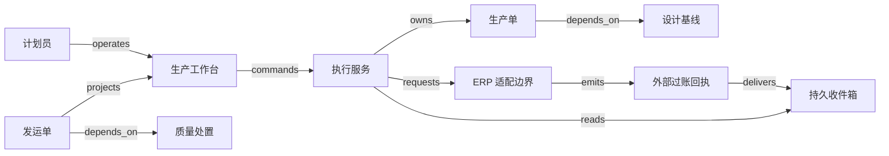

# V07 · 设计基线、单件检验与分批收款

客户订购的是符合约定的产品；生产进度条跑完，只说明工序做完了。工厂要能说清：照哪版设计制造，实际投入了哪些材料，哪几件通过检验，哪几件交给了客户，交付对应多少应收款。这些答案沿用 P06 的共同模型，各有证据，可以互相核对；设计发布、生产结束、质量放行、发货和收款各自了结一段不同的责任。齐套数量按 BOM 的单位需求取各材料可做件数的最小值，算出之后还要在事务里预留；返工是同一单件的新检验尝试，合格与报废合计仍等于投产数；部分交付时，实物欠交和应收余额是两套账。改变判断的是生效基线：生产中发布新版本，已加工的单件只能另开返工单改造，不能把旧单件的基线引用批量改掉。

一家加工厂生产 12 件支架。每件售价 50 记账单位，允许分批交付、确认发运后开票，不含税、运费和收入确认。每件使用 1 个毛坯、2 个紧固件，产成品有序列号。设计工程师对设计适用性负责，质量人员决定合格范围，财务确认收款；软件不代替这些判断。

## 识题：版本、齐套与余额

订单做不完，或者做完了仍欠货欠款，先分清卡在设计版本、材料齐套，还是交付与收款的余额上。

| 识题线索 | 首选解法 | 后续查证 |
|---|---|---|
| 同一产品有多个图纸版本，旧品仍在生产 | 固定生效基线，再算变更影响范围 | 产品生命周期管理（product lifecycle management，PLM）/企业资源计划（enterprise resource planning，ERP）的版本生效、替代料和返工规则 |
| 材料总数很多，却无法完成订单 | 按物料清单（bill of materials，BOM）的单位需求求最小齐套数量，再在事务中预留 | 可用量口径、并发预留与缺料处理 |
| 生产结束，却仍欠客户货或欠款 | 分开记履约数量账与应收核销账 | 部分交付约定、检验处置与收款分配 |

## 解法：设计基线与分立对象

设计基线固定图纸、BOM、工艺路线和检验要求的版本与内容摘要；设计、生产、质量处置、发运和应收是分立的对象，各由自己的权威推进。

计算机辅助设计（computer-aided design，CAD）保存几何与设计信息，计算机辅助制造（computer-aided manufacturing，CAM）用设计模型生成加工刀具路径；Autodesk 的公开说明支持这种职责区分。计算机辅助工程（computer-aided engineering，CAE）用计算模型分析设计在给定条件下的行为；仿真报告能支持设计判断，却证明不了现场某件产品已经制造合格。参见 [Autodesk CAD/CAM](https://www.autodesk.com/ca-en/solutions/cad-cam)、[Autodesk CAE](https://www.autodesk.com/in/solutions/computer-aided-engineering-cae)。

系统把图纸、BOM、工艺路线、检验要求及各自的版本组成 design baseline（设计基线）D3。发布时固定的是这些引用及其内容摘要；只记一个文件夹地址不够，文件夹里的内容会变。BOM 说明计划用什么，实际耗料记录说明用了什么；两份记录分开保存，对照之下才看得出替代材料、返工增耗或录入遗漏。

| 对象与负责方（权威） | 状态流转与关键限制 |
|---|---|
| 设计基线；工程服务 | `draft → released → superseded`。工程授权人发布；旧版被替代后仍能解释历史产品。更改生成 D4，D3 的内容不被原地替换 |
| 生产单；执行服务 | `planned → released → running → completed → closed`，另有 `held`。放行绑定基线、材料可用量与设备许可；完成表示本单工序结束，关闭还要求数量、耗料与异常核对 |
| 单件与检验处置；质量服务 | `pending → accepted / rework / scrap`；返工后另有一条检验记录，可再次 accepted 或 scrap。出现新异常时，已 accepted 的单件可转为 `blocked`，再由质量复核解除或转返工。生产操作员录结果，质量人员批准处置，旧失败记录保留 |
| 发运单；仓储服务 | `draft → reserved → dispatched → received`，预留可取消。只预留已接受且未被占用的单件；出库事实与客户接收分别确认 |
| 应收项；财务系统 | `open → partially_settled → settled`，争议另记。发货不等于收到钱；到账要有银行或财务确认，并核销到具体应收项 |

SAP 的课程分别讲解了 production order 的创建、放行、goods issue（耗料出库过账）、confirmation（生产确认）及 goods receipt（成品收货过账）：放行后才允许相应过账，生产确认记录进度，成品收货更新库存。上表借这些概念划分工作边界。参见 [Processing Production Orders](https://learning.sap.com/courses/executing-basic-erp-processes-with-sap-s-4hana/processing-production-orders)。

SAP 销售课程把单据分为 header、item 与 schedule line；schedule line 记录已确认的交付日期和数量，同一行项目因此可以分期交付。这支持把商业承诺与多次实物交付分开建模。参见 [Structure of Sales Documents](https://learning.sap.com/courses/discovering-the-basics-of-sap-s-4hana-sales/executing-sales-order-management_cad9dfbe-bafc-4ed9-ac2e-6fd8422430e4)。

计划员追求按期完成，仓库要防止一份库存承诺给两张生产单，质量人员要能拒绝赶工要求。服务端把工程发布权、生产操作权、质量处置权、出库权和收款核销权分开。租户与工厂是身份范围；在同一工厂内看得见生产单，并不意味着有权解除质量冻结。生产单进入 `completed`，也不授权任何人绕过质量检查。

## 放行操作与页面确认

放行由执行服务按最新的权限和库存重新检查后在事务里保存；页面先显示请求已保存，权威系统确认过账之后才显示已确认。

列表同时显示计划数量、工序进度、质量分布和待交付数量。详情页显示 D3、材料版本、机台、检验要求与异常；“按 D3 放行”按钮先预览缺料与冲突。浏览器提交 `tenant + plant + order_id + expected_version + baseline_id + operation_id`，执行服务重新检查权限和最新库存，不沿用预览时的绿色标记。

执行服务在一个事务里保存生产单新版本、材料预留和待发送记录。UI 先显示“放行请求已保存”；连接 ERP 的适配器随后提交外部操作，并保存外部单据号；权威系统确认后，页面才显示“材料过账已确认”。`POST /production-orders/{id}/release` 和 `GET /operations/{id}` 是本例的接口。operation ID 在刷新、重试和换页后继续使用；同一 ID 带着不同的请求内容时，服务端拒绝。

SAP 的耗料课程还明确区分系统记录的库位转移与实物移动，并展示缺库存时的后处理情形。因此，“已过账”与“材料已送到机台”应有不同的观察点；本例的策略禁止负库存，并把实物到位扫描作为开工前提。参见 [Posting Goods Issues](https://learning.sap.com/courses/manage-production-orders-in-sap-s-4hana-manufacturing/posting-goods-issues-for-production-orders)。

图中的消息只传递记录，实物和现金不随之移动。执行库保存请求、事实引用与回执，文件存储保存设计包、量测附件及其摘要，查询投影把这些对象连起来。ERP 对自己的库存和会计单据负责，现场系统对机器与人员采集的记录负责；投影缓存替代不了任何一方的权威记录。ISA-95 的公开简介讨论企业业务与制造控制之间的信息接口；本例借用的是它划分边界的思路。参见 [ISA-95 简介](https://www.isa.org/standards-and-publications/isa-standards/isa-95-standard)。

React + TypeScript 适合把表格、版本差异和扫描反馈组合成单页工作台；Vue + TypeScript 也可用，团队已有表单组件时，迁移框架的价值不大。后端可用 ASP.NET Core 或 Spring Boot 负责命令校验与事务，PostgreSQL 保存对象、数量分录与唯一操作键。大图纸放对象存储，数据库只保留摘要和版本引用，以免大文件拉长业务事务。外部连接不多时，先用数据库 outbox 与后台任务处理；事件量与独立消费者增加后可引入消息代理，但仍要对账。

## 演算：数量齐套与依赖排程

演算先确定生产是否可行，甘特图排在后面。现有毛坯 14 个、紧固件 22 个，无其他预留。12 件的需求为毛坯 `12×1=12`、紧固件 `12×2=24`。可完整齐套的数量是 `min(floor(14/1), floor(22/2))=11`，缺 2 个紧固件。拿库存件数 `14+22=36` 与需求产品数 12 比较没有意义：这样比，计量单位与齐套约束都丢了。

对 n 种材料逐项扫描计算需求是 O(n)；按 `(tenant, plant, material, lot)` 索引查可用库存，避免扫描全厂分录。常用的可用量是已确认在库减去有效预留，本例不计尚未确认的到货。算出 11 并不等于预留了 11，后续事务要再次检查并占用；否则两个浏览器各看到 11，都能承诺全部库存。BOM 有多层装配时，沿有向依赖图展开，复用的子件乘上对应数量；展开前先检测环，A 需要 B、B 又需要 A 这种错误定义会让递归停不下来。

补齐 2 个紧固件后，12 件开工。第一次检验为 9 件 accepted、2 件 rework、1 件 scrap；返工的 2 件最终 1 件 accepted、1 件 scrap。本例返工只重做工序，不追加上述两类材料。最终合格 `9+1=10`、报废 `1+1=2`，合计 12。返工记录是同一单件的新尝试，两次检验的 14 条结果不能误当成 14 件产品。履约上仍欠 2 件，要补做，或经客户同意取消；生产单可以结束这批加工，销售承诺仍未结清。10 件发出并开票 `10×50=500`，收到 300 后应收余额为 200。实物平衡 `10+2=12` 与资金平衡 `300+200=500` 是两套检查。

依赖排程同样可以手算。假设钻孔 A 用机台 2 小时，表面处理 B 在 A 之后用 3 小时，检验 C 在 B 之后用 1 小时，最早完工为 6 小时。另一张单的独立钻孔 D 也要用同一台机器 2 小时；图上 D 没有前驱，但它不能因此在第 0 小时与 A 并行。拓扑排序 O(V+E) 能找出先后关系，资源容量要另行安排。让 A 优先，D 就排在 `[2,4)`，A 的后续 B、C 不占这台机器；若改用维护窗口 `[0,1)`，A 推迟，预计交付随之改变。这个贪心次序是可行方案，未证明全局最优。

## 正常轨迹与异常恢复

恢复靠追加记录，不靠改写历史：新版本另开返工单，外部结果未知时按关联号核对，返库或冲销是新的业务记录。

正常轨迹是 D3 发布、补料与预留、生产单放行、12 件录入加工事实、逐件处置、10 件出库、财务开票并登记部分收款。每一步都保留前一步的身份，最终能从应收项回到发运单与合格单件，再回到 D3。

若生产中发布了 D4，工作台显示“存在新版本，当前按 D3 执行”。工程负责人评估影响：未开工的单件可在批准后切换；已加工的单件若必须改造，另开返工单并附新的检验要求。把旧单件的基线引用批量改成 D4，历史记录会显得按新图生产，实际却没有改造证据。需要停产时，单独记录 hold 的范围和原因，旧工序记录照样保留。

ERP 已扣料但连接超时，是未知结果而不是扣料失败。操作进入 `unknown`，按外部关联号或受支持的查询能力核对；无法唯一匹配就转人工。确认已过账后补写映射；确定未发生且允许安全重试，才重发。返库或冲销是新的业务记录，恢复流程不能借机假装实物没被用过。若业务事务提交后 worker 崩溃，outbox 重放同一操作；外部请求与本地事务无法原子提交，所以唯一键和回查两样都要有。

负载目标是 20 个租户、每租户 5 个工厂，累计 100 万件序列号、每日 5 万条工序或质量记录，50 个并发工作台。待测目标为列表 p95 小于 500 ms、单件谱系查询 p95 小于 1 s；ERP 的响应时间不计入本地事务延迟。大订单分批录入，避免锁住整厂库存。缓存 key 带租户、工厂和查询过滤条件；质量冻结立即让相关投影失效，出库仍直接检查权威处置版本。限流按工厂队列隔离，一个批量导入不会拖住其他工厂的扫描确认。

## 验算：数量、版本与副作用

重复、乱序、并发、跨租户和结果未知时，耗料、完工和出库都只生效一次，质量冻结要能挡住出库。

| 前提与操作 | 可观察结果与证据 |
|---|---|
| happy_path：补料后按上例加工、检验、发运和部分收款 | 12 个唯一序列号；10 合格、2 报废；发出 10；开票 500、实收 300、未收 200；UI 分别显示欠交与欠款 |
| duplicate：同一扫描提交两次，再换一个事件 ID 重发同一工序尝试 | 接收可以重复，耗料或完工只生效一次；同时检查 event 去重和业务尝试唯一键 |
| out_of_order：返工复检 accepted 先到，旧 rework 后到 | 保留两条带尝试号的证据；先等待缺失的依赖或核对，处置不按到达顺序回退 |
| concurrency：只余 2 个紧固件，两单各要 2 个同时预留 | 只有一单成功；另一单明确缺料，不出现可用量 -2 |
| tenant_isolation：两个租户都有序列号 S001 | 扫描、附件下载、缓存与谱系查询都只返回授权范围，关系图不泄露另一厂的图纸 |
| unknown_outcome：外部扣料成功后断开连接 | 显示待核对，找到同一外部单据后只记一次消耗；查询无定论时，保留未解决状态 |
| recovery：出库记录提交后、事件消费标记前崩溃 | 重放后仍只发出这 10 件；实际交接记录与系统出库逐件对上 |
| release_guard：质量 blocked 后仍从旧列表点击出库 | 服务端拒绝并说明被冻结的序列号；列表刷新替代不了拒绝记录 |

上表是端到端验收定义，尚未在 UI 或外部集成上运行。核心规则不使用 AI。若以后加入图纸问答，模型只能引用当前授权的基线并给出建议；发布、放行与收款不接受模型输出充当证据。它的版本错引率与越权引用率要另用冻结的留出集评估，此处的数量检查替代不了。

## 变式：改变交付约定与 BOM

交付约定或 BOM 一变，判断要回到合同和生效基线重算：发运范围受交付约定约束，需求数量绑定同一个生效基线。

**练习一：客户只接受一次性交付，10 件已经合格。** 这批合格品能否先发？

简答：不能先发。生产与质量事实不变，发运 guard 增加一条“本行未取消的需求全部齐套”，12 件的订单要等补做的 2 件，或由客户批准改约。发运范围始终要符合合同与质量证据；若沿用本例允许部分交付的假设，这条规则就落空，可能 10 件发出后才发现客户现场必须同时安装 12 件。验证时以 `partial_delivery_allowed=false` 重跑，出库应被拒绝，10 件仍留在可用库存。

**练习二：D4 把每件的紧固件从 2 个改为 3 个，库存仍为 22，全部尚未开工。** 缺口是多少？

简答：按新基线只能齐套 `floor(22/3)=7` 件；12 件需要 36 个紧固件，缺 14 个，D3 下缺 2 个的结论不能沿用。需求数量始终绑定同一个生效基线；缓存 key 只含物料号、不含 BOM 版本时，旧结论就会被错误复用。验证时，变更预览应列出增耗 12 个；旧预留在批准切换的事务内释放并重新计算，事务失败则保留原计划和未切换状态。

`TR:V07:V09:baseline-evidence` 迁到 V09，“固定基线与验证证据绑定”仍然适用；芯片 signoff 却说明不了某批实物的制造良率，发布条件要重新定义。`TR:V07:V08:actual-genealogy` 迁到 V08，计划投入与实际投入照样分开记录。离散件常能逐件识别，原料混合以后，通常无法把某一公斤原料对应到某一公斤产出，单件追溯照搬不过去。回到 H01 时（`TR:V07:H01:fulfilment-settlement`），履约与收款依旧各自独立，只是本例允许赊销，预付开通的 guard 不再适用。

## 进入离散制造的先查项

面对一家陌生工厂，先拿一张订单，沿图纸、BOM、生产单、检验与发运一路追到实物，找出每一环的权威系统。主要断点在版本发布与适用范围上，考察 PLM 类方案；在库存与财务核对上，考察 ERP；在工序执行与现场采集上，考察制造执行系统（manufacturing execution system，MES）。要不要另设系统，看现有产品能否覆盖这些职责。接下来查基线生效、替代料、返工与出库冲销的具体文档，再用一次 D3→D4 变更和两单争抢最后一份材料检验接口边界；产品演示流程看不出这些边界。

[来源与模型说明](../../../../vault/distilled/saas-engineering-atlas/packages/industry-networks/evidence.json) · [对象与检查结构](../../../../vault/distilled/saas-engineering-atlas/packages/industry-networks/V07.json) · [执行记录](../../../../vault/distilled/saas-engineering-atlas/packages/industry-networks/CHANGELOG.md)
