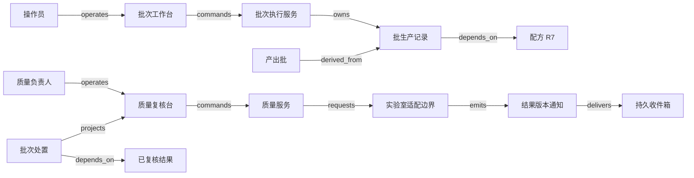

# V08 · 混合以后，批次为什么仍要能解释来路

配方说明打算怎样生产，batch record（批生产记录）说明实际发生了什么，质量处置决定这些证据是否足以允许某批产品使用或交付。三者分开，才能回答“按配方完成了，为什么还不能发货”。P06 的共同模型在这里增加一个难点：投入物被混合、转换和拆分后，原有身份不能简单随实物一起保留，软件必须记录谱系关系。

本章用一批合成的非医药工业涂层混合料说明机制。配方 R7 规定 A 与 B 按质量比 2∶1 投入，本次计划 150 kg；具体工艺参数、检验限值、损耗和权限都是 **synthetic 教学策略**，不是化学操作指导或任何厂商的默认规则。例子不涉及危险反应、药品放行或法规符合性。负责工艺的人批准配方，操作员记录执行，实验室提供检验结果，质量负责人作批次处置；供应商通知异常后，由质量与业务人员决定实际追踪、隔离及客户处置范围。

## 识题：混合、守恒与放行

先辨认眼前卡住的关系，再选择解法。以下线索对应后文的演算与变式。

| 识别线索 | 先选的方法 | 接着查什么 |
|---|---|---|
| 多个原料混合，随后拆批或继续混合 | 记录多入多出转换，沿图找后代和当前去向 | EPCIS 转换语义、批号与数量接口 |
| 得率下降或账面出现不明差额 | 统一计量边界，把产品、损耗与留样逐项平衡 | 工艺损耗、单位换算与测量不确定度 |
| 一项样品合格，但全批仍不具备交付依据 | 核对必检集合、证据有效性和质量授权 | LIMS 样品代表范围、复检与仓储放行契约 |

## 解法：配方、批记录与处置各负其责

R7 固定原料规格、目标比例、允许的批量范围、所需设备能力、步骤顺序和检验方案版本。本例只是一个可执行的生产定义，不能把一张成分百分比表当成完整工艺。投料前的原料批 A1、B1 有供应商身份、在库量和质量状态；实际记录必须指向具体批号，写“用了 A”无法追到同种原料中的异常批。

| 对象与权威 | 独立生命周期与决定依据 |
|---|---|
| Recipe R7；工艺服务 | `draft → approved → superseded`。批准绑定完整版本；修改不能追溯改变已执行记录 |
| Production batch PB1；执行服务 | `planned → executing → completed`，异常进入 `held`。completed 只说明执行结束；actual input、设备、时间、人员及偏差记录仍需审核 |
| Material lot；库存服务与质量服务分别负责数量、处置 | 数量随投入、产出、拆分与损耗分录变化；质量为 `quarantine → released / rejected`，已放行可被 `blocked`。库存存在不等于可分配 |
| Sample / result；实验室系统 | `registered → received → tested → reviewed`，结果可有带原因的更正版本。样品与被代表的批次、抽样方案及试验方法分别绑定 |
| Disposition；质量服务 | `pending → approved / rejected`，新信息可触发新一轮复核。签署者、输入证据版本与决定范围一起保存 |

LabWare QAQC 的公开产品说明列出 sample chain of custody、结果录入、批次状态跟踪、数据复核、lot release 与 COA 报告功能，也明确其 Batch Manager 可把样品组成 test batch。因此“实验室测试批”不自动等于“生产批”：一次仪器运行可测多批产品，一批产品也可分多次测试。这里只引用产品自述的能力范围，不据此断言任何企业采用了本例的放行规则。[LabWare QAQC](https://www.labware.com/lims/saas/qaqc)。

一个结果在区间内，只回答某样品某方法的数值判断。质量人员还要看到样品身份、代表范围、试验是否有效、必需项目是否齐全以及偏差是否关闭。本例的 guard 是“执行记录完整、物料谱系闭合、所有必需检验已复核、未解决偏差为零，并由授权质量人员批准”。不允许操作员以“再测一次通过”覆盖首次失败；重测是否有效由另行记录的调查决定，不能自动挑最好的一次。

## 记录转换，不能靠修改批号模拟

GS1 的 EPCIS/CBV 实施指南将 TransformationEvent 用来表达输入被全部或部分消耗、输出被生成的关系；其语义允许任一输入影响各输出，并解释前向与反向追踪。长时间转换还可用同一个 transformation identifier 连接多次事件。这个公共模型支持“混合需要记录关系”的判断，不提供本例的配方、质量判据或召回政策。[GS1 指南 §5.5](https://ref.gs1.org/guidelines/epcis-cbv/2.0.0/)。

合成实现用“物料批 → 转换执行 → 产出批”的二部图表达多入多出。转换执行保存投入与产出各行的数量和单位、发生时间、设备与执行记录引用。把所有关系直接压成“产出批父批号”会丢掉两个事实：同一原料可只消耗一部分，一次转换也可能产生主产品、留样和废料。JSON 的 `derived_from` 记录依赖，实际流向与数量仍要从转换记录读取，不能把一条图边当成一次物理搬运。

现场操作员扫原料批码、确认设备与计量单位，表单显示计划量、已投量与本次增量。提交 `batch_id + step_id + input_lot_id + quantity + unit + expected_version + operation_id` 后，服务端检查该批余量与质量状态，把消耗分录、执行事实和 outbox 放在同一事务。离线平板可保存未提交草稿并明确标注“未确认投入”；断网不能让本地缓存自行批准新增投料。恢复联网后原操作身份继续使用，现场若已经投入却无法确认电子记录，转为待核对偏差，不让操作员重复称料来“重试”。

质量工作台把原始数值、方法与规格版本、样品链、异常和审批意见放在同一审阅路径。点击“批准本批”提交证据集合的摘要与版本；任何关键结果更新都会使旧预览失效。`POST /batches/{id}/dispositions` 是本例接口设计，写入决定与预计库存效果，再与仓储系统核对生效。页面可以显示“质量决定已签署，仓储解锁待确认”，避免把两个系统的完成时间揉成一个勾。

前端可选 React + TypeScript，配合键盘与扫描枪输入及可回查的数值表格；若平板离线是核心需求，可选基于同一 Web 表单的 PWA，但须明确草稿与权威记录。后端可用 FastAPI + Python 处理验证与追溯查询，也可用 Kotlin/Spring 复用企业集成经验；选择取决于团队维护能力。PostgreSQL 的外键、decimal 数量、唯一尝试键与事务适合中等规模账本；原始仪器文件放对象存储，记录校验摘要和来源。邻接表加递归查询足以起步；深层跨厂查询频繁时再考虑图数据库，其代价是与事务数量账保持同步。仪器数据通过文件导入或有文档支持的接口适配，不能猜测 LabWare 的接口、内部数据库或算法。

## 演算：质量平衡与谱系影响范围

R7 的目标投入 150 kg，A 为 `150×2/3=100 kg`，B 为 `150×1/3=50 kg`。本例在同一称量边界内得到主产品 145 kg、废料 3 kg、留样 2 kg，故 `100+50=145+3+2`。主产品得率 `145/150≈96.67%`，质量平衡差为 0。得率低不等于账不平；若把留样漏记，差额会变成 2 kg。假设无气体逸散或外部加料，差值超过本例 0.1 kg 容差就阻断记录关闭。真实工艺若存在蒸发，必须把适当的测量边界、损耗记录和不确定度纳入模型，不能要求所有物理过程都精确等式。

145 kg 主产品 M1 拆成 P1=80 kg 和 P2=65 kg。随后从 P2 取 20 kg，与另一原料 C1 的 30 kg 合成 M2，产出 49 kg、废料 1 kg；P2 剩 45 kg。假设 A1 后来收到质量异常通知，需要找可能受影响且仍可处置的产品。前向图遍历为 `A1 → PB1 → M1 → P1/P2 → PB2 → M2`，当前产品边界是 `80+45+49=174 kg`。174 大于最初 A1 的 100，并不违反守恒：其他原料进入了受影响的后代产品。它也不是“174 kg 都由 A1 构成”，更不证明每公斤实际有害。

逐次查询整个历史记录再找关联，可能为每个扩展节点重复扫描 E 条边；给 `(tenant, input_lot_id)` 建邻接索引后，带 visited 集合的 BFS/DFS 对命中的子图为 O(V+E)，并保留完整解释路径。影响数量不能把 M1 的 145、P2 原始 65 和后代 M2 的 49 直接相加，那会同时计算中间物与末端物。先确定当前余额、已经交付、留样、废弃分别属于什么处置边界，再分项计数；本例 174 只包含当前可售产品，3+2+1 kg 的废料与留样另列。

反例是只追踪第一条父边，认为 P2 仅受 B1 影响，于是漏掉混有 A1 的 M2。另一个反例是用配方比例估算 M2 只有一小部分 A1，就只冻结相同比例的包装；本例没有“哪一包装不受影响”的分离证据，因此整批 49 kg 均进入待调查范围。图算法给的是可能影响集合，质量风险与处置仍由专业人员判断。跨租户边不能为查询方便直接公开；对方只共享经授权的批次关联证明，未知下游要显示覆盖缺口。

## 一次放行与一次撤回怎样留下不同证据

正常轨迹是 R7 获批、A1/B1 可用、投料与产出记账、样品接收与检验、结果复核、偏差关闭、质量处置批准、仓储解锁。本例规定 release 一次绑定一份证据快照；快照含配方、执行记录、结果版本及当前冻结版本。签署后的原证据不会因后续编辑悄悄改变。

如果结果 v2 显示超限，旧 v1 的通过通知随后才到，系统不把 v1 当新事实。质量服务读取当前版本，启动 `blocked` 及影响调查，保留之前何时、凭什么放行的记录。已出货部分没有办法在数据库中“取消发货”就回到仓库：另外建立处置任务、关联客户和回收或使用限制证据。发现错误投入记录时，同样追加纠正关系与原因；旧版图与新版图都要可重演，不能删除一条边后让历史决定失去依据。

仓储解锁 API 已成功而响应丢失时，处置对象为 approved、同步操作为 unknown，页面展示两者。适配器先查外部该批次的当前状态和操作引用；若质量随后冻结，当前意图变为禁止分配。只在本地忽略迟到的 release 回执还不够：旧 release 命令也可能晚于 block 到达仓库，把实物重新变成可分配。外部接口若支持条件版本，应让仓储只接受高于已应用版本的状态命令；同版本重放保持原效果。这是集成所需能力，不声称任何指定产品已经支持。

外部没有版本条件时，适配器按批次串行，只允许一个状态变更处于在途或未知，不在旧 release 未决时并发发送一个自以为能“覆盖”的 block。出现新冻结立即关闭本地分配入口并告警现场，核对旧命令终态后再发送 block，随后读取仓储当前状态。若不能证明旧请求已结束、或外部还可能延迟执行，就不能仅凭一次读到 blocked 宣告恢复；保持电子禁分配，并由获授权现场人员隔离或停止拣货，直到外部处理与实物范围均可核对。外部系统若允许绕过本地直接分配，必须把这条接管路径纳入集成验收，否则自动放行不能上线。恢复 worker 仍需按当前版本重建待执行意图，不能机械重放全部历史动作。质量决定与仓储效果分离，使调查可以定位危险窗口出现在批准、消息传送还是库存执行处。

合成规模假设为 10 个租户、累计 200 万条转换关系、单批最多 50 个投入行、每日 2 万份样品结果，30 个并发复核者。待测目标为单批详情 p95 小于 800 ms，命中 1 万节点以内的追溯 p95 小于 2 s。超过查询预算时创建持久追踪任务，结果标记 incomplete，并保留已访问节点、输入图版本与续查位置；不能以截断图作“已查全”的证明。谱系缓存 key 带租户、根批次、图版本和授权范围；新转换或更正使下游缓存失效。放行读取当前权威冻结与结果版本，不依赖追溯缓存。

## 验算：完整谱系与放行效果

| 固定前提与操作 | 可观察答案 |
|---|---|
| happy_path：R7、150 kg 投入、145/3/2 kg 产出，各项复核通过 | 质量平衡差 0；主产品得率 96.67%；批准记录绑定输入版本；仓储确认后才能分配 |
| duplicate：称量同一操作提交两次，结果文件也重复导入 | 投料仍是 100 kg 与 50 kg；原始文件可识别重复，样品方法与结果版本不重复生效 |
| out_of_order：超限 v2 先到，旧通过 v1 后到 | v2 仍是当前事实，旧通知留档；质量冻结不因到达次序解除 |
| concurrency：质量人员批准时另一人登记关键偏差 | 两动作按版本仲裁；批准若先完成，随后偏差触发 block；不得得到“无偏差且已放行”的过期结论 |
| tenant_isolation：两个租户都有 A1/PB1 | 批次图、搜索、附件和导出均隔离；授权不足处不泄露对方节点数量或标签 |
| unknown_outcome：仓储解锁成功但回执丢失 | 同一同步操作待核对，查到外部状态后补确认；不得产生另一份质量批准 |
| 外部副作用乱序：release v7 延迟，block v8 已应用后 v7 才抵达 | 有版本条件的仓储拒绝 v7；无条件版本路径应保持串行及本地禁分配，不能提前宣称恢复，且有现场隔离证据。检查外部最终状态与实际可拣货范围，不能只看本地投影 |
| recovery：数量分录提交后服务崩溃 | 重放仍满足 150=145+3+2；缺失投影可重建，不能再次扣减原料 |
| failure：缺少 2 kg 留样记录或仍有必需检验未完成 | 关闭或放行明确拒绝，分别显示差额与缺失项目；“已生产”不会使拒绝消失 |
| genealogy：A1 异常，遍历含 P2 的二次混合 | 80、45、49 kg 分项显示，当前产品范围合计 174 kg；中间物不重复计数；未知下游另报缺口 |

放行 guard 不使用 AI。可选 AI 仅帮助把自由文本偏差分类并建议复核队列：另建 120 条合成标注记录，40 条开发、80 条留出，其中 20 条关键偏差；报告关键漏判数/20、错误升级数/60、无引用结论数/80、拒答数/80和人工改判数/80，并固定标签口径与模型配置。留出关键漏判目标为 0，仍不证明真实场景零风险；任何建议都不得直接改批次状态。

## 变式：改变去向与计量单位

**练习一：P1 的 80 kg 中已有 30 kg 交给客户，A1 此时异常，影响集合是否变成 144 kg？** 简答：在库可售产品确实是 `50+45+49=144 kg`，已交付 30 kg 另列，需处理的产品范围仍为 174 kg。保持的不变量是每个末端数量有且只有一个当前去向；失效条件是把库存查询当完整影响查询。反例为出库后从图上删除那 30 kg，系统宣称无需客户处置。检查分别输出在库 144、已交付 30，二者相加 174，且交付对象可追到客户处置任务。

**练习二：A 的称量单位由 kg 改为 g，界面仍提交数值 100，怎么办？** 简答：100 g 只等于 0.1 kg，和 B 的 50 kg 合计 50.1 kg，不能按 150 kg 放行。保持的不变量是数量与单位共同构成值；失效条件是只校验数字而依赖界面标签。检查服务端按受控换算统一单位、发现配方比例不符并拒绝执行确认；如现场已经误投，保存真实投入与偏差，不能把记录改成 100 kg 来补齐账。

`TR:V08:V21:traceability-boundary` 可把转换与流转证据接到供应运输，但运输拆箱通常不改变物料本质，不能都记成不可逆转换。`TR:V08:V10:evidence-based-release` 保留证据与专业授权分离；资产复机许可还受现场隔离和设备状态约束，合格样品不能替代检修许可。`TR:V08:V07:baseline-versus-actual` 保留版本与实际记录的分离；混合物的可能影响集合不能缩成离散零件的一对一序列号路径。

**实践探索方向。** 进入流程制造企业，先区分生产批、物料批、样品和实验室测试批，再追一笔真实的混合与拆分。MES 或电子批记录类方案适合追执行步骤，LIMS 类方案适合管理样品和试验依据，二者是否分设取决于责任边界与已有能力。下一步查批号映射、单位换算、结果更正、放行到仓储的接口语义；用少记留样、必检缺项和冻结后旧解锁命令晚到的合成输入验收，再决定需要补采哪些现场证据。

配套：[拓扑与 checks](../../../../vault/distilled/saas-engineering-atlas/packages/industry-networks/V08.json) · [证据](../../../../vault/distilled/saas-engineering-atlas/packages/industry-networks/evidence.json) · [执行记录](../../../../vault/distilled/saas-engineering-atlas/packages/industry-networks/CHANGELOG.md)。
