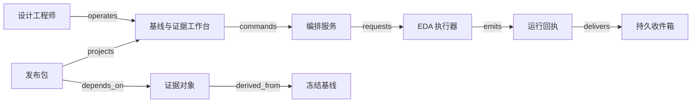

# V09 · 芯片设计的证据依赖与发布

芯片设计团队向交付负责人承诺的是一份能追溯设计依据、并完成约定检查的发布包。RTL（寄存器传输级描述）表达逻辑，综合生成门级实现，布局布线产生物理结果，检查报告支持签核。工作台若只显示“任务全部成功”，可能把来自不同约束版本的绿色报告拼成一次从未真正验证过的发布。这个案例要解决的是证据能否共同支持同一个设计版本，而不是在网页里重做电子设计自动化工具。

Cadence 的 [RTL-to-GDSII 培训说明](https://www.cadence.com/en_US/home/company/events/webinars/navigating-from-synthesis-to-timing-signoff.html)明确列出综合、可测试性逻辑、逻辑等价检查、实现和时序签核这些主题。这只支持流程范围，不揭示其调度算法、SaaS 架构或签核政策。以下设计是 **synthetic 教学系统**：一个数字模块、一个组织内项目、两种时序条件、一套自定发布门槛；不涵盖完整晶圆厂验收、模拟电路、封装、量产良率或商业 IP 授权。真实 tapeout 的检查矩阵须由设计与工艺负责人决定。

## 识题：依赖下界与证据覆盖

先辨认眼前卡住的关系，再选择解法。以下线索对应后文的演算与变式。

| 识别线索 | 先选的方法 | 接着查什么 |
|---|---|---|
| 很多任务可以并行，完成时间却难预计 | 用 DAG 求关键路径，再加入许可证与机器容量 | 执行器资源语义、实际耗时与依赖清单 |
| 报告全部绿色，但输入版本或检查条件改变了 | 按完整输入摘要复用证据，检查必需集合覆盖 | EDA 输入文件、条件矩阵与报告输出定义 |
| 平均指标合格，某个条件仍然失败 | 按逐条件硬约束判定，Top-K 只帮助定位 | setup/hold、路径例外与真实签核门槛 |

## 解法：把版本、运行、证据和发布分开

设计工程师希望尽快试验参数，验证工程师希望报告可复现，发布负责人需要知道究竟批准了什么，算力管理员则控制机器和许可证。几种诉求会发生冲突：重跑所有任务代价高，只复用“文件名相同”的报告又可能漏掉依赖变化。本例把复用资格和运行成功分开保存。

| 对象 | 权威与身份 | 状态和决定 |
|---|---|---|
| Baseline 基线 | 基线服务；设计 commit、约束摘要、库摘要、工具与脚本版本共同标识 | `draft → frozen → superseded`；冻结后不能就地换文件，变更形成新基线 |
| Run 运行 | 编排服务记录业务尝试；执行器记录对应 job 的实际状态 | `queued → running → succeeded/failed`；受理回执不明进入 `unknown`，取消需确认后进入 `cancelled` |
| Evidence 证据 | 证据服务登记报告及其输入清单，附件存对象库 | `candidate → valid/invalid`；输入变更让旧证据对新候选成为 `stale`，并不改写历史运行结果 |
| Release 发布包 | 发布服务；不可变 manifest 摘要与审批记录 | `draft → approved → dispatched → acknowledged`；接收未知保持 `unknown`，已发出后发现问题追加 `withdrawn` 和通知记录 |

冻结基线需要设计工程师的权限、输入齐全且摘要已校验；运行成功需要工具退出、产物登记和校验相容；证据有效还需要预期检查真的执行、报告可解析且输入匹配。仅有退出码 0，无法排除检查被关闭或报告为空。发布负责人在最新候选版本上批准 manifest，审批不得自动追随分支最新提交。这里的状态名和 guard 都是案例政策，不声称来自 Cadence。

[OpenSTA 官方说明](https://github.com/parallaxsw/OpenSTA)把它描述为门级静态时序校验器，列出网表、Liberty、SDC、SPEF 等输入，并支持时钟不确定性和路径例外。据此可以理解为什么“RTL 没变”不足以复用报告：时序约束、单元库或寄生参数变化，也可能改变结论。这一失效策略是本例的分析与设计，不是对 OpenSTA 内部缓存行为的断言。

## 工作台、执行器与证据库

工程师先在基线差异页查看变动输入及受影响任务，再点击“冻结并运行”。命令携带项目身份、基线版本和 operation ID。服务端在一个事务内保存运行记录与待发送项，返回可重新打开的 operation 地址。编排器分配算力后才显示 running；页面同时展示排队原因、执行器 job ID、输出最后更新时间。任务列表中的绿色仅指该任务成功，右侧发布矩阵仍逐项展示条件、报告依据和有效性。

图中的派生与依赖不意味着传输了版图文件；完整 typed edges 在 [V09.json](../../../../vault/distilled/saas-engineering-atlas/packages/industry-networks/V09.json)。连接器只向执行器发送登记过的 manifest 和允许的任务配置，避免把 UI 任意文本变成 shell 命令。回执包含租户、项目、run、attempt、job、输入摘要和产物摘要，收件箱持久化后再核对。对象下载也检查项目授权；不能因为知道摘要就读取另一个项目的 IP。

前端可用 React 加 TanStack Table 展示可排序报告矩阵；小型 DAG 用 SVG 即可，大图再按任务展开邻接关系，避免先把数万条边绘入浏览器。后端可选 Python/FastAPI 便于连接分析工具，或 TypeScript/NestJS 便于同一团队维护接口类型；都将长时运行交给独立 worker。PostgreSQL 保存版本、审批和依赖边，S3 兼容对象存储保存大型报告与版图，内容摘要负责校验，访问权限另行负责隔离。小规模可用数据库任务队列；已有集群可接 Slurm，已有容器环境可接 Kubernetes Jobs，但都需保留本例 run 与外部 job 的映射。许可证池和大内存任务会限制并行度，增加容器数量未必缩短排队。

OpenROAD 的 [项目说明](https://openroad.readthedocs.io/en/latest/main/README.html)公开了布局、时钟树、布线、寄生提取及最终验证等阶段。其 [流程教程](https://openroad-flow-scripts.readthedocs.io/en/latest/tutorials/FlowTutorial.html)分别展示 logs、results 和 reports 目录，以及时序和 DRC 检查。这为“产物与报告分别登记”提供可观察的参照；流程完成消息不能作为制造合格证明。

## 演算：依赖、时序和失效范围

先把业务等待时间算清楚。合成任务耗时以分钟计：综合 S 为 4；S 后并行做等价检查 E（3）与布局布线 P（6）；P 后并行做时序 T（2）与物理检查 D（5）；发布打包 R（1）依赖 E、T、D。忽略排队和传输时，S 在 4 完成，E 在 7 完成，P 在 10 完成，T 在 12 完成，D 在 15 完成，R 在 16 完成。关键路径是 S→P→D→R，长度 16。把 T 从 2 优化到 1，不会改变总完成时间；把 D 从 5 优化到 3，才把总时间降到 14。

`ALG:scheduling` 的直接做法枚举所有路径，再选最长；有大量分叉时路径数量可能指数增长。DAG 拓扑排序后，对每个任务计算 `finish = duration + max(predecessor.finish)`，代价为 O(V+E)，V 为任务数、E 为依赖数。若出现环，就没有合法的这个任务顺序，应报告配置错误而不是无限等待。它给出无资源竞争的下界：若 T 与 D 争用唯一检查槽，P 后需要串行 2+5 分钟，R 最早在 18 完成。DAG 算对不等于资源计划可行，这正是向 V21 迁移时必须补的约束。

接着看报告为何不能平均。合成 setup 检查忽略时钟偏斜与抖动，时钟周期 1.00 ns、setup 要求 0.10 ns，因此数据最晚应在 0.90 ns 到达。条件 A 的数据延迟 0.82 ns，slack 为 `0.90−0.82=+0.08 ns`；条件 B 的延迟 0.95 ns，slack 为 `−0.05 ns`。平均 slack 为 +0.015 ns 仍必须拒绝，因为 B 没满足要求。若 hold 最早允许到达为 0.07 ns、最短路径为 0.04 ns，则 hold slack 为 `0.04−0.07=−0.03 ns`；单纯把时钟周期放宽到 1.10 ns 可以使上述 setup 达标，却不会修好这个同沿的 hold 例子。真实时序分析还涉及路径例外、时钟传播等条件，不能将这些玩具公式当作签核工具。教程的 setup 与 hold 修复小节提供二者分开检查的公开实例。

发布门槛在本例取“所有必需条件有匹配输入的报告，setup 和 hold 均非负，物理检查和等价检查按政策通过”。最小 slack 可线性扫描 O(n) 个结果；展示最差 k 项可用大小 k 的堆，O(n log k)。Top-K 只改善定位问题的界面，授权仍检查完整必需集合；只拿最差十条报告可能漏掉一个根本没有产出的条件。

最后计算变更影响。依赖图为 S→E、S→P、P→T、P→D、E/T/D→R。若 P 的输入参数变更，则失效集合是 P、T、D、R，E 可复用，前提是 E 自身完整输入摘要未变。沿反向依赖遍历需 O(V+E)，比无差别重跑便宜。反例是缓存键只含 RTL commit：SDC 变严后仍命中旧 T，界面全部绿色却批准了旧条件。缓存键应含 tenant、project、输入 manifest、工具与规则版本；各阶段可使用自己的依赖子集，但必须先证明依赖完整。未知依赖时保守重跑，不能把“未登记”解释成“不影响”。

## 正常发布与不能回滚的失败

正常路径中，工程师冻结 B1，编排器持久化 run-1，执行器以既有尝试身份接收任务，各任务按依赖产生附件。worker 校验摘要和报告覆盖，发布负责人预览 manifest M1 中的基线、报告和检查政策，审批服务原子检查候选版本后保存签核。连接器把 M1 发送给接收系统，接收方核对摘要并确认，页面才显示 acknowledged。收到 acknowledgement 仅证明对方接收了约定包，后续制造与收费各有独立对象，本例不替它们宣告完成。

一种重要失败发生在执行器已启动、网络回执丢失之后。run-1 进入 unknown，调度器用已有 job 标签和 operation ID 查询执行器，找到同一任务后接回运行；只有确认未受理或执行器提供受约束的幂等提交语义，才重新发送。另一种发生在工程师冻结 B2 的同时，审批者仍打开 B1 页面：提交必须返回版本冲突及差异，不能让一次旧签名批准 B2。来自 B1 的迟到成功回执仍可保存为 B1 的历史证据，但不会让 B2 的矩阵变绿。

若附件只上传一半，记录保持 candidate，不能通过一个提前到达的“完成”事件变成 valid。若审批事务已提交而通知 worker 崩溃，重放读取同一 manifest 和已有发送尝试；不生成第二个不同内容的包。若接收方已拿到包，后来发现漏查条件，本地删除文件不能撤回其现实影响。发布负责人追加 withdrawal，记录接收方是否确认停止处理；结果未明时仍保留责任与升级入口。这种恢复与 V08 的隔离通知相似，但数字包可以按摘要重传，物料不能靠下载重做。

规模假设为 20 个项目、每项目 500 个候选基线、每基线 200 个任务，约 200 万任务记录；每天 100 次运行、每次报告与产物共 10 GB，仅按此保留量级就是约 1 TB/日。列表只读元数据与摘要，大文件按需授权获取。待测目标是在 50 个并发读者、冷热缓存分别记录的条件下，元数据列表 p95 小于 500 ms；计算作业单独记录排队、许可证等待、运行与上传时间，不把网页响应快当成设计完成快。按项目配额与等待时长安排公平性，取消申请也必须占据待核对状态直到外部确认释放资源。性能数字是待测目标，未在本轮测量。

## 验算：覆盖、版本与可恢复发布

| Given / when | Then 与必须留下的证据 |
|---|---|
| B1 所有必需报告匹配，审批并发送 | 只有一个 M1；输入摘要、规则版本、审批人、接收摘要相互一致 |
| 相同 run 完成事件重复两次 | 一个有效证据引用；收件记录可重复，产物归属和发布数量不重复 |
| B2 已成为候选，B1 成功事件迟到 | B1 历史更新，B2 的报告覆盖不增加；查看两个 manifest 验证 |
| 两人同时批准或一人改候选 | 唯一签核或明确版本冲突；审批记录不混合输入 |
| 两个租户有相同 project/run 编号 | 列表、缓存命中、对象下载和 job 查询均不能跨租户；拒绝事件可追踪 |
| 提交 job 或发送 M1 后超时 | unknown 保留既有 operation；查询到同一外部身份后恢复，未产生第二次执行或另一个包 |
| worker 在审批后崩溃，附件存在损坏 | 重放不重复审批；损坏附件保持 invalid，禁止发送，补传后重新验证 |
| 平均 slack 为正但一个条件负值，或必需报告缺失 | 发布被拒，显示具体条件/缺项；不把平均数或空集合视作通过 |

本例发布权由确定性规则和人掌握，无需 AI。若加入报告摘要助手，它只能建议定位，不能签核。可另建 120 份留出报告：40 份含违例、40 份缺条件或输入不匹配、40 份完整合格；同一设计的相近运行不能跨训练和留出集合。记录危险建议率（错误建议放行/80 份不安全样本）、违例漏报率（漏报/40）、引用定位错误率（错误定位/全部引用）及人工修正次数；损坏或缺失的输入应拒答。阈值和专家标注先冻结，再谈效果。本轮未运行模型或采集这些 eval 数据。

## 变式：增加条件与减少资源

**练习一：新增低电压条件，已有十份报告全部通过，能否发布？** 简答：不能沿用旧的完整性结论。为候选登记新的必需条件集合，原报告保持历史身份，新条件没有证据时状态为 incomplete。不变量是批准覆盖当前候选的完整要求；失效条件是把“已有报告全部通过”误写为“所需报告全部存在且通过”。可观察检查是增加一个 required corner 而不新增报告，发布必须被拒。这个机制可迁往 V08 的必检项目覆盖，但检验取样、复检和质量责任不能照搬芯片条件。

**练习二：只有一个检查许可证，还能把 16 分钟当交付承诺？** 简答：不能。本例 T、D 必须串行，最快 18 分钟；若再有别的项目争用，还要计排队。保留依赖顺序不变量，新增资源容量和预约对象；失效条件是把无资源约束关键路径当可执行排程。检查在任意时间片最多一个任务占许可证，再核对最早完成时间。向 V21 迁移可复用约束检查，运输还必须考虑行驶时间、装卸和不可拆分货物。

`TR:V09:V07:baseline-evidence` 保留版本、证据、批准的绑定，但已经制造的在制品需要逐件或逐批处置，不能仅失效数字缓存。`TR:V09:V21:dependency-capacity` 保留依赖与容量的分离，但长任务取消与实体运输改道有不同成本。演示可拖动任务耗时、减少许可证、替换约束摘要和延迟旧回执，同时观察结束时间与发布资格分别变化；HTML 和动效不限定。

**实践探索方向。** 进入芯片或复杂工程设计团队，先索取一次发布的输入清单、工具日志与签核矩阵，确认每份报告究竟针对哪个版本。版本管理和工作流编排解决可追溯运行，EDA 工具解决设计与分析，证据管理连接结果与发布责任。下一步查实际工艺库允许的条件、工具输入依赖、报告解析和执行器查询能力；以只改约束文件、缺一个必需条件、作业受理后断网三组输入检查复用、覆盖和恢复，不能用工具进程成功代替签核。

[结构数据](../../../../vault/distilled/saas-engineering-atlas/packages/industry-networks/V09.json) · [来源与主张](../../../../vault/distilled/saas-engineering-atlas/packages/industry-networks/evidence.json) · [实际执行记录](../../../../vault/distilled/saas-engineering-atlas/packages/industry-networks/CHANGELOG.md)
