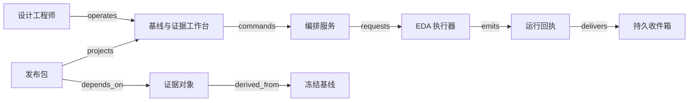

# V09 · 芯片设计的证据依赖与发布

芯片设计团队向交付负责人承诺的是一份发布包：设计依据可以追溯，约定的检查已经完成。寄存器传输级（register-transfer level，RTL）描述表达逻辑，综合生成门级实现，布局布线产生物理结果，检查报告支持签核。工作台若只显示“任务全部成功”，可能把来自不同约束版本的绿色报告拼成一次从未真正验证过的发布。本例关心的是这些证据能否共同支持同一个设计版本；电子设计自动化（EDA）工具做的设计与分析计算，不在网页里重做。

Cadence 的 [RTL-to-GDSII 培训说明](https://www.cadence.com/en_US/home/company/events/webinars/navigating-from-synthesis-to-timing-signoff.html)明确列出综合、可测试性逻辑、逻辑等价检查、实现和时序签核这些主题，可作流程范围的参照；它的调度算法、SaaS 架构和签核政策不在其中。以下是一套合成的教学系统：一个数字模块、一个组织内项目、两种时序条件、一套自定的发布门槛；不涵盖完整的晶圆厂验收、模拟电路、封装、量产良率或商业 IP 授权。状态名和 guard 都是本例的政策。真实 tapeout（流片，即把最终设计交给晶圆厂制造）的检查矩阵，由设计与工艺负责人决定。

## 识题：依赖下界与证据覆盖

完成时间难估、绿色报告不可信，或个别条件失败时，先分清卡在依赖下界还是证据覆盖上。

| 识题线索 | 首选解法 | 后续查证 |
|---|---|---|
| 很多任务可以并行，完成时间却难预计 | 用有向无环图（directed acyclic graph，DAG）求关键路径，再加入许可证与机器容量 | 执行器资源语义、实际耗时与依赖清单 |
| 报告全部绿色，但输入版本或检查条件改变了 | 按完整输入摘要复用证据，检查必需集合覆盖 | EDA 输入文件、条件矩阵与报告输出定义 |
| 平均指标合格，某个条件仍然失败 | 按逐条件硬约束判定，Top-K 只帮助定位 | setup/hold、路径例外与真实签核门槛 |

## 解法：基线、运行、证据与发布

设计工程师希望尽快试验参数，验证工程师希望报告可复现，发布负责人需要知道究竟批准了什么，算力管理员则控制机器和许可证。这些诉求会互相冲突：重跑所有任务代价高，只复用“文件名相同”的报告，又可能漏掉依赖变化。本例把复用资格和运行成功分开保存。

| 对象 | 负责方（权威）与身份 | 状态流转与决定 |
|---|---|---|
| Baseline 基线 | 基线服务；设计 commit、约束摘要、库摘要、工具与脚本版本共同标识 | `draft → frozen → superseded`；冻结后不能就地换文件，变更另立新基线 |
| Run 运行 | 编排服务记录业务尝试；执行器记录对应 job 的实际状态 | `queued → running → succeeded/failed`；受理回执不明时进入 `unknown`，取消要经确认才进入 `cancelled` |
| Evidence 证据 | 证据服务登记报告及其输入清单，附件存对象库 | `candidate → valid/invalid`；输入一变，旧证据对新候选即为 `stale`，历史运行结果不被改写 |
| Release 发布包 | 发布服务；不可变的 manifest 摘要与审批记录 | `draft → approved → dispatched → acknowledged`；接收未知时保持 `unknown`，发出后发现问题，追加 `withdrawn` 和通知记录 |

冻结基线需要设计工程师的权限、输入齐全且摘要已校验；运行成功需要工具退出、产物登记和校验相容；证据有效，还需要预期的检查真的执行过、报告可解析且输入匹配。只有退出码 0，无法排除检查被关闭或报告为空。发布负责人在最新的候选版本上批准 manifest，审批不自动追随分支的最新提交。

[OpenSTA 官方说明](https://github.com/parallaxsw/OpenSTA)把它描述为门级静态时序校验器，列出网表、Liberty、Synopsys 设计约束格式（Synopsys Design Constraints，SDC）、标准寄生参数交换格式（Standard Parasitic Exchange Format，SPEF）等输入，并支持时钟不确定性和路径例外。两种格式的名称分别见 [Synopsys SDC](https://www.synopsys.com/community/interoperability-programs/tap-in.html) 与 [SPEF 说明](https://news.synopsys.com/home?item=122632)。由此可见，“RTL 没变”不足以复用报告：时序约束、单元库或寄生参数变化，也可能改变结论。这条失效规则是本例自己的设计，并非 OpenSTA 内部的缓存行为。

## 工作台、执行器与证据库

工程师先在基线差异页查看变动的输入及受影响的任务，再点击“冻结并运行”。命令携带项目身份、基线版本和 operation ID。服务端在一个事务内保存运行记录与待发送项，返回可重新打开的 operation 地址。编排器分配到算力后才显示 running；页面同时展示排队原因、执行器 job ID 和输出的最后更新时间。任务列表中的绿色只表示该任务成功，右侧的发布矩阵仍逐项展示条件、报告依据和有效性。

图中的派生与依赖不代表传输了版图文件；完整的 typed edges 在 [V09.json](../../../../vault/distilled/saas-engineering-atlas/packages/industry-networks/V09.json)。连接器只向执行器发送登记过的 manifest 和允许的任务配置，UI 里的任意文本不会变成 shell 命令。回执包含租户、项目、run、attempt、job、输入摘要和产物摘要，收件箱持久化之后再核对。对象下载也检查项目授权；知道摘要的人，不能因此读取另一个项目的 IP。

前端可用 React 加 TanStack Table 展示可排序的报告矩阵；小型 DAG 用 SVG 即可，大图再按任务展开邻接关系，避免一开始就把数万条边绘入浏览器。后端可选 Python/FastAPI，便于连接分析工具，或 TypeScript/NestJS，便于同一团队维护接口类型；两者都把长时运行交给独立的 worker。PostgreSQL 保存版本、审批和依赖边，S3 兼容的对象存储保存大型报告与版图，内容摘要用于校验，隔离另靠访问权限。小规模可用数据库任务队列；已有集群可接 Slurm，已有容器环境可接 Kubernetes Jobs，但都要保留本例 run 与外部 job 的映射。许可证池和大内存任务会限制并行度，增加容器数量未必能缩短排队。

OpenROAD 的 [项目说明](https://openroad.readthedocs.io/en/latest/main/README.html)公开了布局、时钟树、布线、寄生提取及最终验证等阶段。其 [流程教程](https://openroad-flow-scripts.readthedocs.io/en/latest/tutorials/FlowTutorial.html)分别展示 logs、results 和 reports 目录，以及时序和 DRC 检查。这为“产物与报告分别登记”提供了可观察的参照；同样，流程跑完的消息也不能拿来证明制造合格。

## 演算：依赖、时序和失效范围

合成任务的耗时以分钟计：综合 S 为 4；S 之后并行做等价检查 E（3）与布局布线 P（6）；P 之后并行做时序 T（2）与物理检查 D（5）；发布打包 R（1）依赖 E、T、D。忽略排队和传输时，S 在 4 完成，E 在 7 完成，P 在 10 完成，T 在 12 完成，D 在 15 完成，R 在 16 完成。关键路径是 S→P→D→R，长度 16。把 T 从 2 优化到 1，不会改变总完成时间；把 D 从 5 优化到 3，才把总时间降到 14。

`ALG:scheduling` 的直接做法是枚举所有路径，再选最长的一条；分叉多时，路径数量可能指数增长。DAG 拓扑排序后，对每个任务计算 `finish = duration + max(predecessor.finish)`，代价为 O(V+E)，V 为任务数、E 为依赖数。若出现环，就不存在合法的任务顺序，应报告配置错误，而不是无限等待。这样算出的是无资源竞争时的下界：若 T 与 D 争用唯一的检查槽，P 之后要串行 2+5 分钟，R 最早在 18 完成。DAG 算对了，资源计划未必可行；迁到 V21 时要补上的就是容量约束。

时序报告也不能取平均。合成 setup 检查忽略时钟偏斜与抖动，时钟周期 1.00 ns、setup 要求 0.10 ns，因此数据最晚应在 0.90 ns 到达。条件 A 的数据延迟 0.82 ns，slack 为 `0.90−0.82=+0.08 ns`；条件 B 的延迟 0.95 ns，slack 为 `−0.05 ns`。平均 slack 为 +0.015 ns，仍然必须拒绝，因为 B 没满足要求。若 hold 最早允许的到达时间为 0.07 ns、最短路径为 0.04 ns，则 hold slack 为 `0.04−0.07=−0.03 ns`；单纯把时钟周期放宽到 1.10 ns，可以让上述 setup 达标，却修不好这个同沿的 hold 例子。真实的时序分析还涉及路径例外、时钟传播等条件，这些简化公式不能当作签核工具。OpenROAD 流程教程的 setup 与 hold 修复小节，提供了二者分开检查的公开实例。

发布门槛在本例取“所有必需条件都有匹配输入的报告，setup 和 hold 均非负，物理检查和等价检查按政策通过”。最小 slack 可以线性扫描 O(n) 个结果；展示最差的 k 项可用大小为 k 的堆，O(n log k)。Top-K 只改善定位问题的界面，批准时仍检查完整的必需集合；只拿最差的十条报告，可能漏掉一个根本没有产出的条件。

变更影响也可以手算。依赖图为 S→E、S→P、P→T、P→D、E/T/D→R。若 P 的输入参数变更，失效集合就是 P、T、D、R；E 可以复用，前提是 E 自身的完整输入摘要未变。沿反向依赖遍历需要 O(V+E)，比无差别重跑便宜。反例是缓存键只含 RTL commit：SDC 变严后仍命中旧的 T，界面全部绿色，批准的却是旧条件。缓存键应含 tenant、project、输入 manifest、工具与规则版本；各阶段可以使用自己的依赖子集，但要先证明依赖完整。依赖不明时保守重跑，不能把“未登记”解释成“不影响”。

## 正常发布与不可撤回的失败

正常路径中，工程师冻结 B1，编排器持久化 run-1，执行器以既有的尝试身份接收任务，各任务按依赖产生附件。worker 校验摘要和报告覆盖，发布负责人预览 manifest M1 中的基线、报告和检查政策，审批服务原子地检查候选版本后保存签核。连接器把 M1 发送给接收系统，接收方核对摘要并确认后，页面才显示 acknowledged。收到 acknowledgement 只证明对方收到了约定的包；后续的制造与收费各有独立的对象记录完成与否。

一种失败发生在执行器已启动、网络回执丢失之后。run-1 进入 unknown，调度器用已有的 job 标签和 operation ID 查询执行器，找到同一任务后接回运行；只有确认对方未受理，或执行器提供受约束的幂等提交语义，才重新发送。另一种发生在工程师冻结 B2 的同时，审批者仍打开着 B1 的页面：提交要返回版本冲突及差异，一次旧签名不能批准 B2。来自 B1 的迟到成功回执仍可保存为 B1 的历史证据，但不会让 B2 的矩阵变绿。

若附件只上传了一半，记录保持 candidate，一个提前到达的“完成”事件不能把它变成 valid。若审批事务已提交而通知 worker 崩溃，重放读取同一个 manifest 和已有的发送尝试，不生成第二个内容不同的包。若接收方已拿到包，后来才发现漏查了条件，本地删除文件撤回不了它的现实影响。发布负责人追加 withdrawal，记录接收方是否确认停止处理；结果未明时，责任与升级入口仍然保留。这种恢复与 V08 的隔离通知相似，但数字包可以按摘要重传，物料不能靠下载重做。

规模假设为 20 个项目、每项目 500 个候选基线、每基线 200 个任务，约 200 万条任务记录；每天 100 次运行，每次报告与产物共 10 GB，仅按此估算，保留量级就是约 1 TB/日。列表只读元数据与摘要，大文件按需授权获取。待测目标是在 50 个并发读者、冷热缓存分别记录的条件下，元数据列表 p95 小于 500 ms；计算作业单独记录排队、许可证等待、运行与上传时间，网页响应快不等于设计完成快。按项目配额与等待时长安排公平性；取消申请也要停在待核对状态，直到外部确认资源已释放。本轮未测量这些性能数字。

## 验算：覆盖、版本与可恢复发布

| 前提与操作 | 可观察结果与证据 |
|---|---|
| happy_path：B1 所有必需报告匹配，审批并发送 | 只有一个 M1；输入摘要、规则版本、审批人、接收摘要相互一致 |
| duplicate：相同 run 的完成事件重复两次 | 一个有效证据引用；收件记录可重复，产物归属和发布数量不重复 |
| out_of_order：B2 已成为候选，B1 的成功事件迟到 | B1 历史更新，B2 的报告覆盖不增加；查看两个 manifest 验证 |
| concurrency：两人同时批准，或一人改候选 | 唯一签核或明确的版本冲突；审批记录不混合输入 |
| tenant_isolation：两个租户有相同的 project/run 编号 | 列表、缓存命中、对象下载和 job 查询都不跨租户；拒绝事件可追踪 |
| unknown_outcome：提交 job 或发送 M1 后超时 | unknown 保留既有 operation；查询到同一外部身份后恢复，不产生第二次执行或另一个包 |
| recovery：worker 在审批后崩溃，附件存在损坏 | 重放不重复审批；损坏附件保持 invalid，禁止发送，补传后重新验证 |
| policy_rejection／coverage：平均 slack 为正但一个条件为负，或必需报告缺失 | 发布被拒，显示具体条件或缺项；平均数或空集合不算通过 |

本例的发布权由确定性规则和人掌握，不需要 AI。若加入报告摘要助手，它只能建议定位，不能签核。可另建 120 份留出报告：40 份含违例、40 份缺条件或输入不匹配、40 份完整合格；同一设计的相近运行不能分落在训练和留出两个集合。记录危险建议率（错误建议放行/80 份不安全样本）、违例漏报率（漏报/40）、引用定位错误率（错误定位/全部引用）及人工修正次数；遇到损坏或缺失的输入应拒答。阈值和专家标注先冻结，再评估效果。本轮未运行模型，也未采集这些 eval 数据。

## 变式：增加条件与减少资源

**练习一：新增低电压条件，已有的十份报告全部通过。** 能否发布？

简答：不能，旧的完整性结论不能沿用。为候选登记新的必需条件集合，原报告保留历史身份，新条件还没有证据时，状态为 incomplete。批准要覆盖当前候选的全部要求；把“已有报告全部通过”误写成“所需报告全部存在且通过”，就会在这里放过缺项。验证时增加一个 required corner 而不新增报告，发布必须被拒。这套机制可以迁到 V08 的必检项目覆盖，但检验取样、复检和质量责任不能照搬芯片条件。

**练习二：只有一个检查许可证。** 16 分钟还能作为交付承诺吗？

简答：不能。本例的 T、D 必须串行，最快 18 分钟；若还有别的项目争用，还要算上排队。依赖顺序照旧，另增资源容量和预约对象；把无资源约束的关键路径当成可执行排程，承诺就会落空。验证时确认任意时间片最多一个任务占用许可证，再核对最早完成时间。迁到 V21 时，约束检查可以复用，但运输还要考虑行驶时间、装卸和不可拆分的货物。

`TR:V09:V07:baseline-evidence` 迁到 V07，版本、证据与批准仍然绑在一起；已经制造的在制品却要逐件或逐批处置，只让数字缓存失效不够。迁到 V21 时（`TR:V09:V21:dependency-capacity`），依赖与容量照样分开，只是长任务取消和实体运输改道的成本不同。演示中可以拖动任务耗时、减少许可证、替换约束摘要、延迟旧回执，观察结束时间与发布资格各自怎样变化。

## 进入芯片设计团队的先查项

进入芯片或复杂工程设计团队，先索取一次发布的输入清单、工具日志与签核矩阵，确认每份报告针对的是哪个版本。版本管理和工作流编排让运行可以追溯，EDA 工具负责设计与分析，证据管理把结果和发布责任连起来。接下来查实际工艺库允许的条件、工具的输入依赖、报告解析和执行器的查询能力；用只改约束文件、缺一个必需条件、作业受理后断网三组输入，检查复用、覆盖和恢复。工具进程成功代替不了签核。

[来源与模型说明](../../../../vault/distilled/saas-engineering-atlas/packages/industry-networks/evidence.json) · [对象与检查结构](../../../../vault/distilled/saas-engineering-atlas/packages/industry-networks/V09.json) · [执行记录](../../../../vault/distilled/saas-engineering-atlas/packages/industry-networks/CHANGELOG.md)
