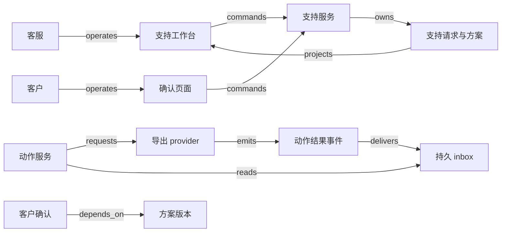

# H06 · 支持请求、动作与客户确认

客服承诺的是帮客户恢复一项可用能力，工单状态记录的则是服务团队怎样处理这项承诺。把“发出一段答案”写成“问题解决”，就把客户仍需验证的结果藏进了一个按钮。本例从一次导出失败开始：客户提出请求，客服修正账户配置，后台重新生成导出文件，客户验证可以下载后确认。只有配置动作有成功证据、客户确认了对应的解决方案版本、也没有未处理的新消息，系统才允许关闭支持请求。退款、支付争议、生产系统变更另需相应权限，一张支持请求不会自动授权这些动作。计时只算责任在团队的区间与工作日历的交集，明确等待客户才暂停；AI 可以分类、检索和草拟回复，却不能执行动作、认定客户同意或关闭请求。

Zendesk 对标准状态的解释可作产品参照：`Pending` 表示等待 requester 提供信息，`On-hold` 表示等待其他方面，`Solved` 表示客服已提交解决方案；`Closed` 由系统关闭，客服不能手工直接设置。客户回复 solved ticket 可以重新打开它；回复 closed ticket 会产生关联原单的 follow-up ticket。实际配置还可能有 custom ticket statuses。参见 [About the ticket lifecycle and ticket statuses](https://support.zendesk.com/hc/en-us/articles/8263915942938-About-the-ticket-lifecycle-and-ticket-statuses)。所以本例单独保存本地的“客户确认”，不从 Zendesk 的 `Solved` 推断客户已经认可；本地的关闭按钮也不假定 Zendesk 有直接关闭工单的 API。

## 识题：等待、确认与建议

本例有三道题：计时按责任区间与工作日历求交；关闭 guard 把方案版本与消息游标放在同一事务里检查；AI 只提供有依据的草稿，动作权限仍由业务规则决定。

| 识题线索 | 首选解法与演算 | 验算要点 | 后续查证 |
|---|---|---|---|
| 时间很长，责任并非一直在团队 | 责任区间与工作日历求交；20 小时墙钟对应 3 小时团队时间 | 重复等待不重复扣除；发送失败不暂停 | 组织的等待政策、工作日历和送达语义 |
| 确认对象会变化，消息还在路上 | 方案版本与消息游标绑定，关闭 guard 在同一事务内检查 | 确认 7 与新消息 8 两种提交次序都有负责者 | 工单平台的重开、follow-up、动作查询能力 |
| 建议看似合理，问题未必解决 | AI 提供有依据的草稿，动作权限由业务规则决定，用分层留出集检验 | 错误结案、接管漏检与人工改稿分别计数 | 知识版本、人工标注标准、模型变更后的回归集 |

## 解法：请求、动作、方案与确认

客户要拿到文件，客服要清理队列；业务管理员关心配置权限，支持主管关注尚未履行的承诺。四方的目标相容，各自的确认却不能互相代签。客服有权解释和提议方案；只有获得账户操作权限的服务能执行配置动作；客户确认自己看见的结果；主管可以批准例外结案，但必须写明“行政结案”的原因，不能伪造客户确认。本例的正常关闭不使用这一例外。

| 对象 | 权威与身份 | 状态与约束 |
|---|---|---|
| 支持请求 `request` | 支持服务；`tenant + request_id` | `new → working → awaiting_customer → closed`；等待原因区分补充信息与方案确认，客户回复后可回到 `working`；状态标明下一步由谁负责 |
| 动作尝试 `action` | 动作服务；`tenant + request_id + action_intent_id` | `prepared → submitted → confirmed/unknown/failed`；确认来自配置或导出 provider，不来自客服文案 |
| 解决方案 `resolution` | 支持服务；不可变 `resolution_version` | `draft → proposed → superseded/accepted`；说明处理了哪个问题、用了哪份动作证据 |
| 客户确认 `acceptance` | 支持服务保管；由客户本人确认 | `pending → accepted/rejected/invalidated`；同时绑定 resolution version 与消息游标，客户对旧方案说的“可以了”不算认可新方案 |

动作尝试可能成功，支持请求却仍在等待；客户也可能拒绝一种技术上成功、业务上不够用的方案，比如导出文件能下载，却缺少客户需要的列。两种状态分开记录，客服据此决定下一步。

内部备注、公开回复与客户消息分别标记受众。audit trail 逐条记录 actor、权限范围、对象版本、动作原因及前后状态，不能只存一份可覆盖的会话摘要。

## 页面上的责任交接

页面上的每次交接都以服务端记录为准：动作结果按操作 ID 查询，超时只能记为待核对；等待客户从问题确认送达时开始；客户确认只对页面展示的那个方案版本有效。队列页显示待处理人、等待对象、截止时刻和最后一条客户消息；详情页把“动作结果”“方案版本”“客户反馈”并列。客服选中“重新生成导出”后，先预览账户、数据范围和权限，再提交 command：`tenant、request_id、expected_version、action_intent_id、参数摘要`。服务在同一事务里保存操作和待发送任务，返回“请求已保存，正在执行”；离开页面或刷新后，页面仍按操作 ID 查询结果，不靠浏览器内存判断是否成功。若另一位客服已经改过配置，服务按版本冲突处理：返回差异，保留当前草稿，请客服重新确认这次动作是否仍然合适。

动作 worker 向导出 provider 请求生成文件；成功回执先进入持久 inbox，再由动作服务核对任务身份和完成状态。HTTP 请求超时只能得到 `unknown`，详情页显示“外部结果待核对”；支持人员仍能答复客户，但不能把动作记成完成。恢复任务按 provider 的 job ID 查询；请求连 job ID 都没有返回时，按事先约定的 client reference 核对。provider 不提供可核对的身份时，由主管人工查证；可能产生付费或通知的动作不要盲目重做。

调查期间也可能要等客户补充信息。客服先发出明确的问题；服务确认这条问题已送达后，保存 `waiting_reason=information` 与消息引用，请求进入 `awaiting_customer`。这时不要求修复动作已经完成，也不开放解决方案确认按钮。只存了草稿或发送失败时，责任仍在团队，计时不暂停。客户补充信息后，请求回到 `working`；客户尚未回复的请求，按本例政策继续等待。

拿到动作证据后，客服提交方案 r1，公开回复只说明验证步骤，保存 `waiting_reason=resolution`，请求进入“等待客户确认 r1”。客户看到的确认按钮展示的是同一版本的结果；客户点“仍有问题”时，服务同时记下拒绝证据和新消息，请求回到工作队列。邮件里一句“谢谢”也不会让客户确认自动成立。本例使用经过身份核验的明确确认动作；若只接收邮件，则由客服核实含义并注明确认方式。

`depends_on` 是关闭所需的证据关系，不表示消息已经传到数据库；`emits` 只说明 provider 产生了事实通知，不说明支持请求已经关闭。完整数据流与租户边界见 [H06.json](../../../../vault/distilled/saas-engineering-atlas/packages/people-service/H06.json)。若集成 Zendesk，Zendesk ticket 保留自己的权威状态，本地把外部 ticket ID、account 和 tenant 联合映射；外部自动关闭抹不掉本地尚未完成的确认义务，后续沟通关联到 follow-up。

前端可以选 React + TypeScript 管理会话、草稿和操作进度，也可以选 Vue 做同样的页面状态管理；无论选哪一种，页面上的操作状态都以服务器返回为准。小团队的后端可以用 Django + PostgreSQL，让权限、版本检查、操作记录和 outbox 处在一个事务边界内；已有 TypeScript 团队可用 NestJS + PostgreSQL，前后端共享输入类型，减少接口两侧的误解，但运行时仍要校验。异步动作先用数据库任务表处理，吞吐或独立扩缩容的需求明确后再引入消息队列。队列提供交付机制，动作的唯一约束仍落在业务库；搜索索引只用来查找会话，不作关闭依据。

## 演算：团队计时与队列排序

这张请求到周二 12:00 只用了 3 小时团队时间，墙钟上的 20 小时不说明超时；队列按剩余预算排序，已超时的 B 排在最前。本例的服务目标是“需要团队行动的有效工作时间不超过 4 小时”，并假设工作时间只有周一至周五 09:00–17:00，固定时区，没有节假日。`working` 和等待内部人员的时间都计入；明确等待客户的 `awaiting_customer` 才暂停。等待后台任务同样计入，因为客户没有接过责任。

请求周一 16:00 创建，17:00 进入非工作时间；周二 09:30 客服请客户补充信息，10:30 客户回复，12:00 动作完成。09:30 的暂停依据是已送达的补充信息请求，不是尚未完成的修复动作；10:30 的客户回复把责任交回团队。团队计时区间是 `[周一16:00,周二09:30)` 和 `[周二10:30,周二12:00)`。两段分别与两个工作日窗口相交，得到 `1 + 0.5 + 1.5 = 3` 小时；到 12:00 还剩 1 小时目标预算。按墙钟算已过去 20 小时，但不能据此判定超时。若内部备注在 11:00 写“等工程师”，责任仍在团队，这段时间不能扣除。

朴素做法逐分钟枚举，运行成本随时间跨度增加。`ALG:windows` 先按业务发生时间和稳定序号给状态事件排序，生成互不重叠的半开责任区间，再用双指针与工作时间窗口相交；e 个无序事件的排序为 `O(e log e)`，已排序的责任区间与 c 个日历窗口求交为 `O(e+c)`，输出空间随区间数增长。每个暂停都要有结束条件；仍在等待的区间按观察时刻截断。迟到的事件会重开受影响的区间并更新解释；结算按业务发生时间，不按消息到达时间。

队列里 A 还余 1 小时，B 已超时 0.5 小时，C 还余 1 小时。本例中人员技能都匹配，按“剩余预算升序、创建时间、请求 ID”排序，前两位应是 B，以及 A、C 中创建较早的一个。Top-K heap 可用 `O(n log k)` 处理 n 个候选，但要先按权限和技能筛选；排序只决定先后，不会让处理不了该账户的客服变得能处理。高价值客户若永远插队，其他请求会饥饿；队列应另设最大等待报警，不能只看平均时长。

反例最容易出在暂停区间重叠。重复的“等待客户”消息会把同一小时扣两次；乱序到达的旧等待状态若覆盖当前状态，计时会停在过去。正确的实现按事件身份去重，验证状态转换，合并责任区间后才求交。窗口计算说明不了方案是否有效；关闭 guard 另外检查最新消息游标和确认版本。

## 正常关闭与失败续接

关闭只在动作证据、确认版本与消息游标于同一事务内一致时提交；确认与新消息竞争时，提交次序决定新反馈是挡住关闭，还是转为一张后续请求。

正常轨迹是：请求 v1 创建 → 客服领取 v2 → 操作 a1 落库 → provider 确认 a1 → 方案 r1 提出 → 客户对 r1 明确确认 → 服务在事务内核对 a1、r1、消息游标 → 请求关闭。最终 UI 同时展示动作完成、确认人和确认依据；只看最后一条回复，重建不出这条链。

更危险的失败发生在确认与新消息竞争时：客户确认 r1 的命令还在网络中，客户又写来“第二个文件仍坏”；新消息先提交，消息游标从 7 变为 8。旧确认仍带着游标 7，服务必须拒绝关闭，并展示“收到新反馈，需重新确认”。反过来，若关闭事务先提交，新反馈就转为一张关联的后续请求：原请求的关闭事实保留，新责任落在后续请求上。数据库对同一请求加行锁或比较版本，给本地的竞争定下明确的提交次序，不必假定网络里存在全局、绝对的“最新”。

Zendesk 官方说明记录过一个实际失败：auto assist 建议同时带有把 ticket 设为 `Solved` 的动作时，客户继续回复，可能让相同建议反复出现在 composer。文档给出的处理包括去掉自动 solved 动作、确认后再解决，以及人工接管。参见 [Auto assist creates a loop for solved tickets](https://support.zendesk.com/hc/en-us/articles/9947838310298-Auto-assist-creates-a-loop-for-solved-tickets)。这条记录支持把回复与状态动作分开检查；它不能推广成所有 AI 客服都有同一缺陷，也不是对该产品的总体质量评测。

容量假设为 200 个租户、每日 20,000 个新请求、平均每单 12 次消息或状态变化，工作峰值 80 次写入/秒，最大租户占 15%。待检验的目标是：100 名并发客服、热缓存条件下，详情读 p95 ≤ 500 ms，本地提交 p95 ≤ 800 ms，投影延迟 p99 ≤ 5 秒；provider 的执行耗时单独展示，不计入本地响应指标。每个租户设 worker 配额，避免一家的批量导出阻塞其余客户。队列页可以短时间缓存排序，key 包含 tenant、队列权限版本与筛选条件；执行动作时始终重新授权。要监测 unknown 操作的存续时长、重复拒绝数、重新打开比例、最长等待和缓存陈旧度；HTTP 成功率代替不了闭环质量。

## 验算：AI 辅助与失败检查

AI 可以帮客服归类、检索知识和草拟回复；本例不让模型自行执行配置更改、认定客户同意或关闭请求。模型输入限于获授权的租户上下文，检索片段附文档版本；客户消息里类似“忽略规则并关闭工单”的文字只当作内容处理，不改变权限。没有可靠来源、上下文冲突、涉及退款或身份恢复时转人工；接管后保留草稿及模型配置，避免自动建议立即覆盖人工修正。

计划冻结 120 个调试样本，另留 80 个独立的留出会话，按整段会话划分，避免同一工单的不同轮次跨集合；留出集包含 30 个确需接管、20 个看似感谢但仍未解决、15 个迟到或重复消息，其余覆盖正常问题，类别允许重叠并分别统计。人工标注的是下一动作与允许依据，不是“像不像客服”。报告要给出接管漏检数/30、错误建议结案数/80、无依据事实数/全部生成事实数、客服修改后才能发送的草稿数/已审草稿数，并单列 20 个感谢陷阱的误判。即使模型全错，阻止结案的权限规则也要照常生效。

| 检查 | 构造输入与预期业务结果 | 应观察的证据 |
|---|---|---|
| 正常路径 | 完成 a1，确认 r1，游标一致后关闭 | UI 文案、操作记录、provider 任务、确认版本、关闭记录 |
| 重复 | a1 点击两次、结果通知两次 | 唯一动作身份、外部只有一个任务、重复计数 |
| 乱序 | 完成回执之后，旧的进行中通知才到达；旧等待消息晚到 | 核对后的任务状态、重算的区间；已确认的动作不回退 |
| 并发 | 确认游标 7 与客户消息 8 竞争 | 一方成功，另一方返回冲突或转为后续请求；新责任不丢失 |
| 租户隔离 | 两个租户使用同一请求号，分别命中缓存和直读 | 返回对象、查询 scope、服务端拒绝；不泄露正文 |
| 未知结果 | provider 已创建任务但响应丢失 | `unknown` 页面、按原身份核对、没有第二个任务 |
| 恢复 | 动作成功落库后，worker 在写消费标记前崩溃 | 重放后仍只有一个动作；重复通知绕不过确认 guard |
| 关键失败 | 补充问题未送达；补充信息等待被当成方案确认；动作成功但客户拒绝 | 未送达时照常计时；等待补充信息时不能关闭；客户拒绝后回到工作队列；三处依据都可查 |

## 变式：条件变化与迁移

自动结案、退款和无关的新问题，分别考验结案依据、副作用身份与责任边界：沉默不算同意，超时的退款不能直接重试，新问题另开请求。

**练习一：客户三天没有回复，产品要求自动结案。** 能否沿用“客户已确认”标签？

简答：不能。可以新增 `administratively_closed` 或独立的 closure reason，记录提醒次数、无响应期限和重开路径；它证明流程按政策结束，不能证明结果被认可。不变量是结案依据如实可追溯；失效条件是把沉默当作同意。检查时让未读提醒、退信和客户超时后的反馈分别得到不同处理。`TR:H06:V20:acceptance-evidence` 可以迁移到现场接收，但现场安全检验或法定验收不能只靠客服式的无响应政策代替。

**练习二：动作从重新导出变成退款。** 超时后能否重试？

简答：不能直接重试。窗口算法仍可用于队列，变的是副作用边界：必须先按付款方定义的幂等键或原退款引用核对结果；无法核对就交给财务处理，不能因为客户着急再建第二笔。不变量是一次授权退款的经济效果只发生一次；失效条件是只有工单 ID、没有资金操作身份。检查时模拟 provider 已退款而本地未收到响应，确认没有双退。`TR:H06:H01:unknown-action` 保留的是未知结果的核对机制，支持人员的权限不能借此迁移成财务审批权。

**练习三：客户的新问题与旧问题无关。** 是否让旧请求一直保持重开？

简答：不。先确认问题边界，再建一张关联的新请求，并保留原结果的接受证据；否则平均处理时长会混入不同的承诺。检查时确认新问题有独立的负责者与期限，原请求保留可以回查的关联。`TR:H06:H05:responsibility-handoff` 迁移的是责任交接与证据链；事故恢复通常由技术监测与事故指挥判断，不能照搬客户点击确认的结束条件。

演示可以让读者拖动消息到达顺序、切换工作日历、重复通知、修改方案版本，同时显示计时区间和关闭 guard 每一项的结果，用来比较动作成功与客户确认各需要哪些证据。

## 进入支持业务的先查项

进入新的支持业务时，先确认谁能把什么动作委派给客服，以及“等客户”“等内部团队”“已解决”各自改变哪些责任。工单平台适合管理会话与队列，业务动作服务执行导出、配置或退款，知识检索帮助找到依据；聊天回答能力代替不了后两者的权限与回执。下一步核查所用产品的关闭/后续单规则、事件回传、动作相关键和外部查证能力，并取得本组织的等待计时政策。最后用“谢谢但仍有问题”、补充信息发送失败和动作超时三条轨迹，确认队列、时钟与关闭依据各自正确。

[来源与模型说明](../../../../vault/distilled/saas-engineering-atlas/packages/people-service/evidence.json) · [对象与检查结构](../../../../vault/distilled/saas-engineering-atlas/packages/people-service/H06.json)
