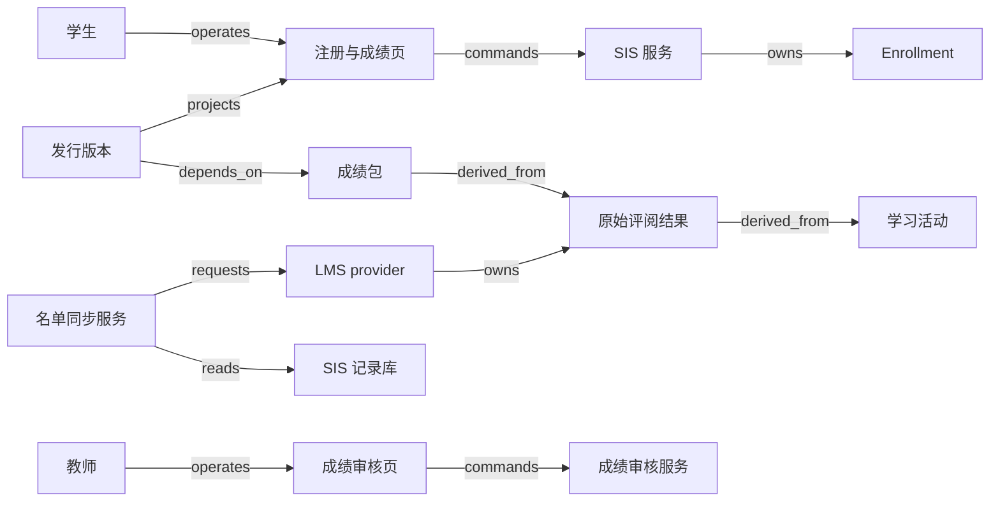

# V17 · 从注册到获批准的学习记录

学生能进入课程，证明系统给了访问资格；学生获得一个分数，证明一次评估有了结果；学校签发 transcript，证明学校愿意对一份确定的学习记录负责。三件事各有各的证据，系统分别记录。本例以一所中学的一门选修课为范围，覆盖 enrollment 批准、名单同步、评阅、成绩审批和 transcript 发行：SIS 保存学校认可的记录，LMS 是活动与原始评阅的权威。批准之后的改分另建修订包、发行新的 transcript 版本，已签发的旧版原样保留。

OneRoster 是数据交换标准，规定数据在系统之间怎样传递；学校的管理制度由学校自己决定。1EdTech 的说明把用途分为班级名单、学习资源使用名单和 gradebook 信息交换；CSV 与 REST（representational state transfer）都是可用的交换方式；两个产品具体相通哪些能力，要看双方各自支持的 profile。参见 [Rostering, Resources, and Gradebook Standards](https://www.1edtech.org/blog/rostering-resources-and-gradebook-standards)。标准门户把 OneRoster 放在 K–12 roster、gradebook 与 class 数据交换范围，Edu-API 面向高等教育数据交换，CLR（Comprehensive Learner Record）则放在学习成果记录类别。参见 [1EdTech Standards](https://standards.1edtech.org/)。本例选中学课程，正落在上述 OneRoster 的适用范围内；大学学位审核属于高等教育的交换范围，要按那里的规范另行设计，改个名称套用本例会出错。真实集成由学校和供应商明确约定。

## 识题：名单、分数与批准

本例有三道题：名单先认清 bulk 还是 delta，再按来源范围应用差异；期末分先按各自满分归一化，再加权；批准冻结输入包，之后的更正发行新版本。

| 识题线索 | 首选解法与演算 | 验算要点 | 后续查证 |
|---|---|---|---|
| 名单中缺席，未变与移除难分 | 先识别 bulk/delta，再按来源 scope 应用差异 | 新增 S3 的 delta 保留 S1/S2；坏引用批次不破坏旧名单 | 交换规范版本、manifest 和供应商支持 profile |
| 各项满分不同，贡献权重也不同 | 先归一化，再加权；18/20 与 70/100 得到 78 | 缺交、免交和零分分别处理；全免交时拒绝零分母 | 学校的评分、舍入、免交和 attempt 选择政策 |
| 批准之后事实仍在变化 | 冻结输入包，按提交次序裁定批准；更正时发行新版本 | T1 保留 78，G2 批准后 T2 为 84 | 成绩审核权、正式发行与更正通知机制 |

## 解法：名单、教学事实与学校决定的权威

学生负责提交与查看，教务负责注册与学籍关系，教师负责课程评价，成绩审核人负责批准，集成管理员负责同步。某人兼任两种角色时，系统记录本次使用的是哪种权限；导入 CSV 与批准成绩是两种权限，分别授予。学习管理系统（learning management system，LMS）是活动、提交和原始评阅的权威；学生信息系统（student information system，SIS）保存学校认可的注册关系、获批成绩与发行记录。

| 对象 | 权威与身份 | 状态与不能推出的结论 |
|---|---|---|
| 注册申请 `registration` | SIS；申请 ID、学生、课班和学期 | `requested → approved/rejected`；注册获批不等于 LMS 已有访问权 |
| 课程参与 `enrollment` | SIS；稳定 enrollment ID，关联 user、class、term | `active → withdrawn/completed`；退出访问不应抹去过去已评价的学习事实 |
| 名单同步批次 `roster-batch` | 集成服务；provider、tenant、batch ID、manifest hash | `received → validated → applied/quarantined`；批次成功只证明本批映射已处理 |
| 学习活动与结果 `assessment-result` | LMS；学生、lineItem、attempt、评分版本 | `assigned → submitted → graded/revised`，并保留 missing/incomplete 的明确语义 |
| 期末成绩包 `grade-package` | SIS 审核服务；结果版本集合、规则版本 | `draft → submitted → approved/rejected → superseded`；教师上传成绩不等于学校批准 |
| 成绩记录 `transcript` | SIS 发行服务；学生、发行 ID、不可变版本 | `prepared → issued → superseded`；修订产生新的发行依据，不悄悄改变已签发内容 |

OneRoster Enrollment 模型把 user、class、school、role 联系起来，并规定可选的 beginDate 包含起始日、endDate 不包含结束日；Base 定义 `sourcedId` 及修改时间等交换身份。参见 [Rostering Service，§6.1.4、§6.1.14](https://www.imsglobal.org/spec/oneroster/v1p2/rostering/info)。交换身份用 `sourcedId`，学生姓名和邮箱只供显示；本例另外以 tenant、source system、object type 组成映射 scope，两个来源碰巧使用相同的局部号时仍能区分。换学期、学生改名或课程分班之后，是否同一对象仍按 `sourcedId` 与映射 scope 判断。

Gradebook 的 Result 模型把 score 与 student、lineItem 等上下文联系起来，保存 scoreStatus，另有 inProgress、incomplete、late、missing 等属性。参见 [Gradebook Service，§6.1.24](https://www.imsglobal.org/spec/oneroster/v1p2/gradebook/info)。这些字段表达状态；本校的总分权重、缺交惩罚、教师裁量和 transcript 批准规则由学校决定。本例把它们当作待解释的输入；名为“final”的标准字段同样只是输入，学校记录经成绩审批后才发行。

## 注册与名单同步

注册由 SIS 批准，名单同步失败不撤销已批准的注册；名单只在整批验证通过后发布新的 roster revision，坏批次不破坏原有效名单。学生在注册页选择具体课班与学期，页面显示名额、时间和注册条件；提交时绑定当前规则版本。SIS 在服务端核验资格和容量，原子地占一个名额并保存批准记录。课程已满时给出拒绝或候补结果，不能先让 UI 显示“已加入”，再由夜间批处理悄悄删掉。教务批准后，页面显示“注册已批准，学习平台名单待同步”；同步失败时注册保持已批准，访问异常转给集成管理员处理。

名单 worker 先读取 SIS 的确定快照，把数据放入 staging，验证 manifest、身份唯一性和外键，再计算差异；只有整批满足本例的接收规则，才发布新的 roster revision。OneRoster CSV Binding 要求交换包含 manifest，bulk 文件中的对象引用保持语义完整。参见 [CSV Binding 1.2.1，§2.1、§3.1](https://www.imsglobal.org/spec/oneroster/v1p2/bind/csv/)。拒绝整个坏批次是本例的工程选择，比局部导入容易解释；标准本身没有规定这种原子事务。

例如班级 C 有 S1、S2、S3；新批次新增 S4，却漏掉了教师 T1 的 user 行。预览列出“将新增 S4”和“教师引用不存在”，确认键不可用，原有效名单继续服务。缺少记录与明确的撤销记录含义不同：把只含变化行的 delta 当完整名单覆盖，会把未出现的 S1、S2、S3 全部移出课程。管理员页面显示数据模式、来源范围、总行数、增删改差异和 quarantined 原因，一个“上传成功”提示交代不了这些。

撤销注册时，权威边界看得更清楚。教务把 enrollment 设为 withdrawn，安排停止 LMS 访问，页面显示停止访问的任务尚未确认；LMS 的历史提交和评阅保留原学期上下文。标准里的 `tobedeleted` 描述的是交换对象的状态；删除 transcript 或历史成绩以学校的保留政策为依据。若撤销是误操作，恢复时同样记录新决定与有效期，已经发生的退出留在历史里。

图中的 `derived_from` 表示计算来源，成绩传输本身由 integration request 和 result event 边表达，见 [V17.json](../../../../vault/distilled/saas-engineering-atlas/packages/people-service/V17.json)。集成管理员经手传输链，成绩权限仍只按其角色授予。学生页按本人、授权监护人关系及允许公布的时间裁剪内容；教师只能查看所授课班，学校租户隔离之上还要叠加这些课班和个人权限。

## 演算：成绩包的计算与批准

S1 的期末分为 78，S2 为 86，S3 缺交项目时记为未完成，而不是 40。批准绑定冻结快照的 hash，签发后的改分另建 G2、发行 T2，T1 原样保留。教师工作台同时显示分数、分母、状态、版本和最后同步时间；没收到数据、未提交、免交与零分各有明确的状态，不共用一个空白。教师把课程结果提交审核时，系统冻结输入版本集合及 grading policy hash，先展示逐个学生的差异和例外。审核人看到的是同一快照，批准 command 也携带快照 hash；修订先提交时，原包被标为过时，旧批准命令发生 hash/版本冲突，必须重新生成成绩包；批准先提交时，旧包仍是有效的既定决定，随后的改分另建修订包。服务按事务提交次序区分这两种情况；审核人已知有新输入时，等新的成绩包生成后再批准。

本例的评分规则为两项必需活动：测验占 40%，项目占 60%，每项先除以自身满分；缺交时成绩包停在提交之前，已批准的免交才从分母中移除并重新归一化。S1 测验 18/20、项目 70/100，期末分为 `18 ÷ 20 × 40 + 70 ÷ 100 × 60 = 36 + 42 = 78`。S2 测验 16/20、项目 90/100，得到 `32 + 54 = 86`。S3 测验 20/20、项目尚未提交，结果是 `incomplete`，不是 40，也不是把测验扩成 100。

<!-- svg: v17-weights -->

若 S3 的项目获正式免交，只用有效权重 40 重新归一化：`(20/20 × 40) ÷ 40 × 100 = 100`，同时在成绩包里记录免交依据；这个分数与两项都满分的 100 证据路径不同。如果没有任何有效的评分项目，分母为零，返回“无可计入评估”，成绩包里不出现零分或 100。门槛、舍入方式和免交权由学校规定，本例使用 Decimal，只在最终显示时保留一位小数。

计算先把 `(tenant, source, student_id, lineItem_id, result_version)` 建成索引，校验每个必需项目都有当前获准的结果，再做归一化加权。朴素方法对每位学生、每项活动都扫描全部 r 条结果，约 `O(s × a × r)`；把 r 条结果建成 hash 索引约 `O(r)`，遍历 s 名学生和 a 项活动约 `O(s × a)`，额外空间 `O(r)`。数据库复合索引适合增量读取，实际性能取决于查询计划。索引加快查找；重复结果取哪个 attempt 由政策决定：本例采用学校明确批准的 attempt ID，自动选最高分或按网络到达顺序选最后一条，都等于替学校做了决定。对 `ALG:lookup` 来说，身份前提比速度更要紧。

一个反例是把所有原始分数相加再除以总满分。S1 会变成 `88/120 ≈ 73.3`，与政策要求的 78 不同，因为在这种算法下测验只占 1/6，项目占 5/6。

<!-- svg: v17-rawsum -->

另一个反例是把 S3 缺交的项目当 0，得出 40，还能通过格式校验；算术照常算完，等于替学校加了一项它从未决定的惩罚。重跑结果一致，说明计算是确定的；输入与政策是否正确，要另外核对。

正常发行轨迹为：注册批准 → roster 应用 → 学生提交两项活动 → 教师评分并提交冻结成绩包 → 审核人批准 hash G1 → 发行服务按 G1 生成 transcript T1 → 发布结果通知 → 学生看到 T1 的发行编号与版本。若 LMS 随后把 S1 的项目从 70 修正为 80，新的 84 分进入新版本，T1 的 78 保持不变；系统另建 G2，写明修正原因，再经批准发行 T2，并让 T1 标明已被 T2 替代。外部接收人已经下载的 T1 留在接收人手里；怎样交付更正，按实际发放渠道核对。

<!-- svg: v17-revision -->

## 技术选型与恢复

选型要满足两件事：成绩网格用文字区分各种状态、批量粘贴前可预览，注册与审批把容量、版本、权限和审计放进一个事务。外部部分成功时，按原批次或原 enrollment 身份核对，不再全量覆盖。React 或 Vue 都可以实现成绩网格，要支持键盘操作、逐单元格的错误定位和“未保存/待审核/已批准”的文字状态，颜色只作辅助。表格虚拟化适合大班数据；批量粘贴先预览受影响的学生和活动，以免滚动位置变化导致错行。注册与审批后端可用 Django + PostgreSQL，方便把容量、版本、权限和审计放进一个事务；已有 JVM 团队可用 Spring Boot + PostgreSQL，换来成熟的批处理组织方式，代价是部署与类型样板更重。

CSV 适合已有批量交换、能接受延迟的学校；先保存受访问控制的原始批次与摘要，再在 staging 验证，便于复现。REST 适合频繁变更与局部核对，但分页、限流与 cursor 恢复会增加工作量。对象存储保存导入文件和已发行快照，关系库保存 manifest hash、来源映射、审核依据及发行唯一键；下载链接按权限临时生成，不写入公开日志。初期一个数据库加 worker 足以承担这几个异步步骤。每次发行各存一份不可变快照，压缩与缓存都按发行版本区分，两次发行不会混成一个可变的 PDF。

容量假设为 100 所学校，每校 2,000 名学生、每人 8 个课班，每课班 30 项活动，一学年约 4,800 万条结果；若保留 3 次评分版本，约 1.44 亿条版本记录；存储规模按版本记录估算，而不是按 20 万名学生。学期开始 30 分钟内导入 160 万条 enrollment，吞吐目标约 889 条/秒；这是由假设推出的最低平均值，验收还要给解析、索引维护和重试留出余量。拟定目标为 50 名并发教师时单班 40 人×30 项的成绩页 p95 ≤ 1 秒，注册本地响应 p95 ≤ 800 ms，增量 roster 对账 p99 ≤ 5 分钟；未做负载实测。

最容易丢失责任的地方是部分外部成功。LMS 接受了 roster 请求而本地超时，batch 保持 `unknown` 的外部交付子状态，通过 batch reference 或逐条 enrollment 核对，而不是再次全量覆盖。批次在 staging 中崩溃可以重建；发布 revision 后崩溃，则读取已发布的 revision，再补消费标记。迟到的旧 revision 被拒绝，新 revision 保持有效；来源不保证序列时，重新读取确定快照，按时间戳自行排序挡不住更新丢失。成绩包批准与教师修订的竞争由输入 hash 检查裁定；发行唯一键为 `tenant + student + approved_package_id`，同一获批包重放只得到一个逻辑版本。缓存 key 包含学生权限、term、issued revision；学生只读到已发行的版本，下载旧版时标明是哪一版。

## 验算：检查项与所需证据

本例验收看的是身份、确定输入和批准权限。成绩与注册决定不使用 AI，因此没有模型准确率可报。若后续加入作文评分或学习建议，要另建人工标注标准、按学生划分的留出集、群体误差与申诉流程；聊天建议不能直接写入 `approved` 成绩。

| 检查 | 构造输入与预期业务结果 | 应观察的证据 |
|---|---|---|
| 正常路径 | S1 两项结果生成 78，经批准后发行 T1 | roster revision、输入 hash、批准 actor、发行号和学生页内容 |
| 重复 | 同一批次重复上传、发行命令重复提交 | 只应用一个 revision，只有一个逻辑发行版本；重复尝试可追溯 |
| 乱序 | 先应用 roster v5，再到达 v4；成绩修订后才送达旧结果 | 旧版被拒绝或隔离，当前获批包不被旧输入覆盖 |
| 并发 | 教师修订结果与审核人批准旧 hash 同时提交 | 修订先提交则旧批准冲突；批准先提交则旧包有效、后续另建修订；两种结果不混合 |
| 租户隔离 | 学校 A/B 都有 S1，同一教师在不同课班的授权不同 | roster、成绩查询、缓存和导出都不跨学校或课班泄露 |
| 未知结果 | LMS 已应用而响应丢失 | 保留交付未知，按原身份核对后恢复，注册事实不被撤回 |
| 恢复 | revision 已发布但消费标记未写；T1 已落库但通知未发 | 重放不重复应用或发行，补发通知后能找回原 T1 |
| 关键失败 | 缺 user 引用的 bulk、S3 缺项目、全项目免交、无权审批 | 批次隔离、incomplete、无有效分母、权限拒绝分别可解释 |
| 修订 | 已签发 78 后项目改为 80 | T1 保留 78；新批准产生 T2=84 及替代关联 |

以上是端到端设计，没有在真实 SIS/LMS 上运行过。随附脚本只验证计算、名单差异与成绩批准边界；实际命令、范围和结果见 [证据](../../../../vault/distilled/saas-engineering-atlas/packages/people-service/evidence.json)。

## 变式：条件变化与迁移

退选再入、改为 pass/fail、只传 delta，各自改变原算法的一个前提：参与期间、获批准的评分政策、交换模式。前提一变，算法随之调整。

**练习一：同一学生退选后又重新加入同一课班。** 能否重用 enrollment 行并清空旧成绩？

简答：不能。稳定的人员身份可以保留，但参与期间与批准决定必须能够区分：本例建立新的参与版本或 enrollment identity，过去的成绩能否沿用由学校决定。不变量是每条成绩都能回到当时的参与与评价依据；失效条件是用单一的 active 布尔值抹去时间区间。检查时确认退选期间提交的活动不会自动计入新期间，历史 transcript 也没有消失。`TR:V17:H04:membership-lifecycle` 保留的是成员关系与访问资格的分离；雇佣关系、薪资与学生成绩的法定权利不能互相类推。

**练习二：项目从百分制改成 pass/fail。** 期末分怎样计算？

简答：原来“分数除以满分再加权”的前提已经失效。先由学校决定 pass/fail 是独立的完成条件、映射到数值，还是不计入平均；没有规则就不能输出数值总分。若 pass/fail 成为完成条件，测验分与项目是否通过并列给出，不能把 pass 默认当作 100。不变量是输出有经批准的政策依据；检查时给 pass 相同、测验成绩不同的学生，确认结果符合新规则，旧版本也能重演。`TR:V17:V19:approved-inputs` 迁移到工时批准的是冻结输入再授权的机制；成绩权重换成计费费率之后，不能就此声称专业规则相同。

**练习三：名单只传 delta。** 未出现的学生能否删除？

简答：不能。delta 中缺席表示本次没有变化，明确撤销才改变成员关系；只有范围完整、语义正确的 bulk 才能按约定做全量差异。不变量是交换模式决定缺席语义；失效条件是把增量当全集。检查时让旧集合 `{S1,S2}` 接收新增 S3 的 delta，结果应为 `{S1,S2,S3}`；把这份 delta 误当全集，S1、S2 会被移出，名单错成 `{S3}`；若是经验证的完整 bulk `{S3}`，当前名单才变为 `{S3}`，历史成绩仍保留。`TR:V17:X01:scoped-identity` 可复用租户与来源复合键；键正确，也不说明老师有权查看同租户的所有学生。

<!-- svg: v17-roster -->

演示可以切换 bulk/delta、拖动结果版本的到达顺序、把 missing 改成 excused、在审核期间改分；一侧展示当前学习事实，另一侧展示冻结的成绩包与已发行版本。读者可借此看到，同步、计算和批准各自完成，各自留下一份证据。

## 进入教育领域的先查项

进入教育领域时，先确定学校类型、人员关系、课班与学期身份，以及由哪一方批准正式学习记录。SIS/LMS 对接、名单交换、gradebook 交换和数字凭证属于不同类别的方案；OneRoster、Edu-API 或 CLR 的适用范围按实际场景分别查证，能力以供应商的能力清单为准，标准 logo 只说明类别。下一步读选定版本的规范与供应商支持 profile，核对批次模式、字段和错误处理，并向学校确认免交、重修与更正政策。最后用退选再入、缺交、全免交和签发后改分这几组固定输入，检查参与关系、当前学习事实与学校发行版本仍能分别回查。
