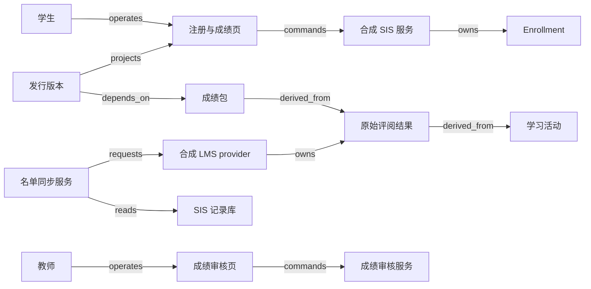

# V17 · 从注册到获批准的学习记录

学生能进入课程，证明系统给了访问资格；学生获得一个分数，证明一次评估有了结果；学校签发 transcript，证明学校愿意对一份确定的学习记录负责。这三件事不能由一个“同步成功”标签代表。本例以一所 synthetic 中学的选修课程为边界：学生注册，教务批准 enrollment，名单进入学习平台，教师评阅活动，授权审核人批准期末成绩，教务发行可追溯版本的 transcript。这里的 transcript 指学校签发的课程成绩记录，不承诺符合某个辖区格式、学分制度或数字凭证规范；重修、转学认定和法定保留年限需要学校另定政策。

OneRoster 是数据交换标准，不是学校管理制度。1EdTech 的说明将用途分为班级名单、学习资源使用名单和 gradebook 信息交换；CSV 与 REST 是可用的交换方式，不保证任何两个产品的所有能力都相通。[Rostering, Resources, and Gradebook Standards](https://www.1edtech.org/blog/rostering-resources-and-gradebook-standards)。标准门户把 OneRoster 放在 K–12 roster、gradebook 与 class 数据交换范围，把 Edu-API 面向高等教育数据交换，把 CLR 放在学习成果记录类别。[1EdTech Standards](https://standards.1edtech.org/)。本例选择中学课程正是为了保留这一范围；大学学位审核不能只换名称直接套用。

## 识题与选法

先按下面的线索选择方法，再读正文中的演算和反例；文末变式题改变其中一个条件，检验方法是否仍适用。

| 识题线索 | 解法与演算 | 验算要点 | 继续查证 |
|---|---|---|---|
| 名单里没出现，究竟是没变还是移除 | 先识别bulk/delta，再按来源scope应用差异 | 新增S3的delta保留S1/S2；坏引用批次不破坏旧名单 | 交换规范版本、manifest和供应商支持profile |
| 各项满分不同，贡献权重也不同 | 先归一化，再加权；18/20与70/100得到78 | 缺交、免交和零分分别处理；全免交拒绝零分母 | 学校评分、舍入、免交和attempt选择政策 |
| 事实继续变化，但已经有人批准 | 冻结输入包，按提交次序裁定批准；更正发行新版本 | T1保留78，G2批准后T2为84 | 成绩审核权、正式发行与更正通知机制 |

## 名单、教学事实与学校决定各有权威

学生负责提交与查看，教务负责注册与学籍关系，教师负责课程评价，成绩审核人负责批准，集成管理员负责同步。某人兼任两种角色时，系统仍记录本次使用的权限；不能因为他能导入 CSV，就让他有权批准成绩。学习平台 LMS 是活动、提交和原始评阅的权威；学生信息系统 SIS 保存学校认可的注册关系、获批成绩与发行记录。这个权威分配是本例 synthetic 设计，真实集成需由学校和供应商明确约定。

| 对象 | 身份与权威 | 独立状态及不能推出的结论 |
|---|---|---|
| 注册申请 `registration` | SIS；申请 ID、学生、课班和学期 | `requested → approved/rejected`；注册获批不等于 LMS 已有访问权 |
| 课程参与 `enrollment` | SIS；稳定 enrollment ID，关联 user、class、term | `active → withdrawn/completed`；退出访问不应抹去过去已评价的学习事实 |
| 名单同步批次 `roster-batch` | 集成服务；provider、tenant、batch ID、manifest hash | `received → validated → applied/quarantined`；批次成功只证明本批映射已处理 |
| 学习活动与结果 `assessment-result` | LMS；学生、lineItem、attempt、评分版本 | `assigned → submitted → graded/revised`，并保留 missing/incomplete 的明确语义 |
| 期末成绩包 `grade-package` | SIS 审核服务；结果版本集合、规则版本 | `draft → submitted → approved/rejected → superseded`；教师上传成绩不等于学校批准 |
| 成绩记录 `transcript` | SIS 发行服务；学生、发行 ID、不可变版本 | `prepared → issued → superseded`；修订产生新发行依据，不悄悄改变已签发内容 |

OneRoster Enrollment 模型把 user、class、school、role 联系起来，并定义可选 beginDate 为含起日、endDate 为不含止日；Base 定义 `sourcedId` 及修改时间等交换身份。[Rostering Service，§6.1.4、§6.1.14](https://www.imsglobal.org/spec/oneroster/v1p2/rostering/info)。不要把 `sourcedId` 换成学生姓名或邮箱；本例额外以 tenant、source system、object type 组成映射 scope，避免两个来源碰巧使用相同局部号。学期换了、学生改名了、课程分班了，都不能通过显示名称猜测是不是同一对象。

Gradebook 的 Result 模型把 score 与 student、lineItem 等上下文联系起来，并保存 scoreStatus，另有 inProgress、incomplete、late、missing 等属性。[Gradebook Service，§6.1.24](https://www.imsglobal.org/spec/oneroster/v1p2/gradebook/info)。这些可表达的数据不直接决定本校的总分权重、缺交惩罚、教师裁量或 transcript 批准规则。本例把它们当待解释的输入，而不是把某个标准字段叫“final”就自动发行学校记录。

## 从提交注册到老师真正看见学生

学生在注册页选择具体课班与学期，页面显示名额、时间和注册条件；提交绑定当前规则版本。SIS 在服务端核验资格和容量，原子地占一个名额并保存批准记录。课程已满时给出拒绝或候补结果，不能先让 UI 显示“已加入”再由夜间批处理悄悄删掉。教务批准后，页面显示“注册已批准，学习平台名单待同步”；同步失败不撤销已经作出的注册决定，但把访问异常交给集成管理员。

名单 worker 先读取 SIS 的确定快照，将数据放入 staging，验证 manifest、身份唯一性和外键，再计算差异；只有整批满足本例接收规则才发布新 roster revision。OneRoster CSV Binding 要求交换包含 manifest，bulk 文件中的对象引用保持语义完整。[CSV Binding 1.2.1，§2.1、§3.1](https://www.imsglobal.org/spec/oneroster/v1p2/bind/csv/)。本例选择拒绝整个坏批次，是比局部导入更容易解释的工程策略，不冒充标准强制的原子事务。

例如班级 C 有 S1、S2、S3；新批次新增 S4，却把教师 T1 的 user 行漏掉。预览必须列出“将新增 S4”和“教师引用不存在”，确认键不可用，原有效名单继续服务。把只有变化行的 delta 当完整名单覆盖，会把未出现的 S1、S2、S3 全部踢出课程；缺少记录与明确撤销记录在这里有完全不同的含义。管理员页面需要显示数据模式、来源范围、总行数、增删改差异和 quarantined 原因，不能只有一个上传成功提示。

注册撤销更暴露权威边界。教务将 enrollment 设为 withdrawn，安排停止 LMS 访问，页面显示停止访问任务尚未确认；LMS 的历史提交和评阅保留原学期上下文。标准的 `tobedeleted` 描述交换对象状态，不能在缺少学校保留政策时据此删除 transcript 或历史成绩。若撤销是误操作，恢复也记录新决定与有效期，不能把之前发生的活动时间改写成从未退出。

图中的 `derived_from` 表示计算来源，成绩传输本身由 integration request 和 result event 边表达，见 [V17.json](../../../../vault/distilled/saas-engineering-atlas/packages/people-service/V17.json)。同步管理员不能在传输链中顺手提高自己的成绩权限。学生页按本人、授权监护人关系及允许公布时间裁剪；教师只能查看所授课班，学校租户隔离还要叠加这些课班和个人权限。

## 一份成绩怎样成为可签发的版本

教师工作台应同时显示分数、分母、状态、版本和最后同步时间。“空白”不能同时表示没收到数据、未提交、免交与零分。教师将课程结果提交审核时，系统冻结输入版本集合及 grading policy hash，先展示逐学生差异和例外。审核人看到的是同一快照，批准 command 也携带快照 hash；修订先提交时，原包被标为过时，旧批准命令发生 hash/版本冲突，必须重新生成成绩包；批准先提交时，旧包仍是有效的既定决定，随后改分另建修订包。服务以事务提交次序区分这两种情况，不允许明知已有新输入还主动批准旧快照。

本例 synthetic 评分规则为两项必需活动：测验占 40%，项目占 60%，每项均先除以自身满分；缺交时成绩包不能提交，已批准免交才从分母移除并重新归一化。S1 测验 18/20、项目 70/100，期末分为 `18 ÷ 20 × 40 + 70 ÷ 100 × 60 = 36 + 42 = 78`。S2 测验 16/20、项目 90/100，得到 `32 + 54 = 86`。S3 测验 20/20、项目尚未提交，结果是 `incomplete`，不是 40，也不是将测验扩成 100。

若 S3 的项目获正式免交，则仅使用有效权重 40 重新归一化：`(20/20 × 40) ÷ 40 × 100 = 100`，同时在成绩包记录免交依据；它与正常两项满分的 100 具有不同证据路径。如果没有任何有效评分项目，分母为零，返回“无可计入评估”，不能生成零分或 100。门槛、舍入方式和免交权由学校规定，本例使用 Decimal 并只在最终显示保留一位小数。上述数字与规则是构造例，不属于 OneRoster。

计算先把 `(tenant, source, student_id, lineItem_id, result_version)` 建成索引，校验每个必需项目均有当前获准的结果，随后做归一化加权。朴素方法对每位学生、每项活动都扫描全部 r 条结果，约 `O(s × a × r)`；将 r 条结果建 hash 索引约 `O(r)`，遍历 s 名学生和 a 项活动约 `O(s × a)`，额外空间 `O(r)`。数据库复合索引适合增量读取，实际性能取决于查询计划。索引加快查找，却不能决定重复结果取哪个 attempt：本例采用学校明确批准的 attempt ID，既不自动选最高分，也不按网络到达顺序选最后一条。`ALG:lookup` 的身份前提比速度更重要。

反例是把所有原始分数相加再除以总满分。S1 会变成 `88/120 ≈ 73.3`，与政策要求的 78 不同，因为测验在该算法下只占了 1/6。另一个反例是把 S3 缺交项目当 0，产生 40 并通过格式校验；算术没有报错，却制造了学校没有作出的惩罚决定。重跑结果是否相同只证明计算确定，不证明输入或政策正确。

正常发行轨迹为：注册批准 → roster 应用 → 学生提交两项活动 → 教师评分并提交冻结成绩包 → 审核人批准 hash G1 → 发行服务按 G1 生成 transcript T1 → 发布结果通知 → 学生看到 T1 的发行编号与版本。若 LMS 随后修正 S1 项目为 80，新的 84 分不会替换 T1 的 78；系统建立 G2，说明修正原因，再经批准发行 T2，并让 T1 标明被 T2 替代。外部接收人已下载 T1 的事实不能靠刷新网页撤回，后续交付需依据实际发放渠道核对。

## 实现选择与恢复边界

React 或 Vue 可实现成绩网格，但应支持键盘操作、逐单元格错误定位和“未保存/待审核/已批准”的文字状态，不只靠颜色。表格虚拟化适合大班数据；批量粘贴必须先预览受影响的学生和活动，避免滚动位置变化导致错行。注册与审批后端可用 Django + PostgreSQL，方便把容量、版本、权限和审计落在一个事务里；已有 JVM 团队可用 Spring Boot + PostgreSQL，换取成熟的批处理组织方式，代价是部署与类型样板更重。这些是合成系统选项，不是 1EdTech 规定的栈。

CSV 适合已有批量交换、能接受延迟的学校；先保存受访问控制的原始批次与摘要，再在 staging 验证，便于复现。REST 适合频繁变更与局部核对，但分页、限流与 cursor 恢复增加工作。对象存储保存导入文件和已发行快照，关系库保存 manifest hash、来源映射、审核依据及发行唯一键；下载链接按权限临时生成，不写入公开日志。初期一个数据库加 worker 足够，不必为了几个异步步骤拆成许多微服务。数据压缩或缓存不能把两次发行混成一个可变 PDF。

合成容量假设为 100 所学校，每校 2,000 名学生、每人 8 个课班，每课班 30 项活动，一学年约 4,800 万条结果；若保留 3 次评分版本，约 1.44 亿条版本记录，不能把“学生只有 20 万”当作存储规模。学期开始 30 分钟内导入 160 万条 enrollment，吞吐目标约 889 条/秒；这是从假设得到的最低平均值，验收还需给解析、索引维护和重试留余量。拟定目标为 50 名并发教师时单班 40 人×30 项的成绩页 p95 ≤ 1 秒，注册本地响应 p95 ≤ 800 ms，增量 roster 对账 p99 ≤ 5 分钟；未做负载实测。

最容易丢责任的地方是部分外部成功。LMS 接受 roster 请求而本地超时，batch 保持 `unknown` 的外部交付子状态，通过 batch reference 或逐 enrollment 核对；不是再次全量覆盖。批次在 staging 崩溃可重建，发布 revision 后崩溃则读取已发布 revision，再补消费标记。迟到旧 revision 不得覆盖新 revision；没有来源序列保证时，重取确定快照，不能自行给时间戳排序就声称永不丢更新。成绩包批准与教师修订竞争由输入 hash 检查阻止；发行唯一键为 `tenant + student + approved_package_id`，同一获批包重放不能多发一个逻辑版本。缓存 key 包含学生权限、term、issued revision；学生读不到 draft，下载旧版必须明确旧版身份。

## 把边界变成可观察检查

本例的成绩与注册决定不使用 AI，因而不存在可诚实报告的模型准确率。若后续加入作文评分或学习建议，应另建人工标注标准、按学生划分的留出集、群体误差与申诉流程；聊天建议不能直接写入 `approved` 成绩。本例验收重点是身份、确定输入和批准权限，而不是生成一段解释是否通顺。

| 检查 | 操纵条件与业务预期 | 必须观察的证据 |
|---|---|---|
| 正常路径 | S1 两项结果生成 78，经批准后发行 T1 | roster revision、输入 hash、批准 actor、发行号和学生页内容 |
| 重复 | 同一批次重复上传、发行命令重复提交 | 仅一应用 revision、一个逻辑发行版本，重复尝试可追溯 |
| 乱序 | 先应用 roster v5，再到达 v4；成绩修订后送达旧结果 | 旧版被拒绝或隔离，当前获批包不被旧输入覆盖 |
| 并发 | 教师修订结果与审核人批准旧 hash 同时提交 | 修订先提交则旧批准冲突；批准先提交则旧包有效、后续另建修订；不得混合 |
| 租户隔离 | 学校 A/B 都有 S1，同教师不同课班授权 | roster、成绩查询、缓存和导出都不跨学校或课班泄露 |
| 未知结果 | LMS 已应用而响应丢失 | 保留交付未知，按原身份核对后恢复，注册事实不被撤回 |
| 恢复 | revision 已发布但消费标记未写；T1 已落库但通知未发 | 重放不重复应用或发行，补通知后能找回原 T1 |
| 重要失败 | 缺 user 引用的 bulk、S3 缺项目、全项目免交、无权审批 | 批次隔离、incomplete、无有效分母、权限拒绝分别可解释 |
| 修订 | 已签发 78 后项目改为 80 | T1 保留 78；新批准产生 T2=84 及替代关联 |

这是端到端设计，不是已经跑通真实 SIS/LMS 的报告。随附脚本只验证合成计算、名单差异与成绩批准边界；实际命令、范围和结果见 [证据](../../../../vault/distilled/saas-engineering-atlas/packages/people-service/evidence.json)。

## 前提变化后的迁移题

**练习一：同一学生退选后又重新加入同一课班，能否重用 enrollment 行并清空旧成绩？** 短答：可以保留稳定人员身份，但参与期间与批准决定必须可区分；本例建立新的参与版本或 enrollment identity，并由学校决定过去成绩能否延用。不变量是每条成绩可回到当时的参与与评价依据；失效条件是单一 active 布尔值抹去时间区间。检查在退选间隔提交的活动不能自动计入新期间，历史 transcript 也不能消失。`TR:V17:H04:membership-lifecycle` 保留成员关系与访问资格分离；雇佣关系、薪资与学生成绩的法定权利不能互相类推。

**练习二：项目从百分制改成 pass/fail，怎样计算期末分？** 短答：原来“分数除以满分再加权”的前提失效。先由学校决定 pass/fail 是独立完成条件、映射到数值，还是不计入平均；没有规则就不能输出数值总分。若它成为完成条件，测验分与项目是否通过并列，不能把 pass 默认为 100。不变量是输出有经批准的政策依据；检查给同样 pass、不同测验成绩的学生，确认结果符合新规则且旧版本可重演。`TR:V17:V19:approved-inputs` 迁移到工时批准的是冻结输入再授权的机制，成绩权重不能换成计费费率后就声称专业规则相同。

**练习三：名单只传 delta，未出现的学生能否删除？** 短答：不能。delta 中缺席表示本次没有变化，明确撤销才改变成员关系；只有范围完整、语义正确的 bulk 才能按约定做全量差异。不变量是交换模式决定缺席语义；失效条件是把增量当全集。观察检查让旧集合 `{S1,S2}` 接收新增 S3 的 delta，结果应为 `{S1,S2,S3}`；若是经验证的完整 bulk `{S3}`，当前名单才变为 `{S3}`，历史成绩仍保留。`TR:V17:X01:scoped-identity` 可复用租户与来源复合键；键正确也不证明老师有权看同租户所有学生。

演示可切换 bulk/delta、拖动结果版本到达顺序、把 missing 改成 excused、在审核期间改分；一侧展示当前学习事实，另一侧展示冻结成绩包与已发行版本。这样读者能看见为什么同步、计算和批准各自完成后仍不能互相取代。

## 先辨明交换范围与批准制度

进入教育领域时，先确定学校类型、人员关系、课班与学期身份，以及哪一方批准正式学习记录。SIS/LMS 对接、名单交换、gradebook 交换和数字凭证是不同方案家族；OneRoster、Edu-API 或 CLR 的适用范围需按实际场景分别查证，不能用一个标准 logo 代替能力清单。下一步读选定版本的规范与供应商支持 profile，核对批次模式、字段、错误处理，并向学校确认免交、重修与更正政策。用退选再入、缺交、全免交和已签发后改分的固定输入，检查参与关系、当前学习事实与学校发行版本仍可分别回查。
