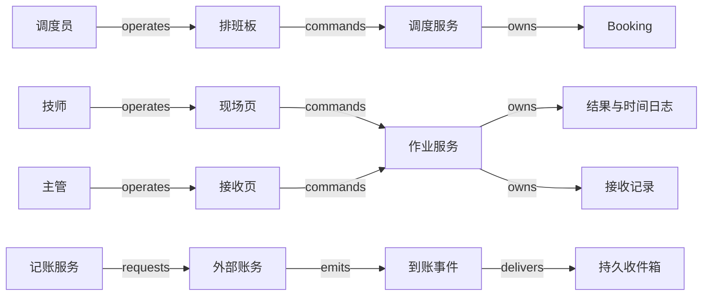

# V20 · 两次上门与一项服务承诺

客户买的是设备能正常工作，调度员安排的是某个技师在某段时间上门。安装完成后还要校准，第一次 booking（预约排班）结束，只说明这一次上门做完了。要判断整个 work order（工单）是否履约，系统还要逐项核对约定范围、现场证据与接收决定。把工单直接当作日历事件，到补件、返工和第二次上门时，还没完成的责任就无从追踪。

本例是一项服务：安装需 90 分钟，安装结束后稳定 30 分钟，再校准 60 分钟。人工价格为每小时 120 个记账单位，零件 200；只收实际工作时间，不收休息、等待或路程。本例不计算税、质保和备件采购。

## 识题：一次上门与多项工作

| 识题线索 | 首选解法与演算 | 验算要点 | 后续查证 |
|---|---|---|---|
| 任务有先后依赖，人员空闲有限 | 先沿依赖推算最早开始时刻，再找资源窗口；校准计划 120—180，安装延迟后改为 130—190 | 技能、30 分钟稳定期和资源时间窗同时满足 | 现场技能、路程、多人协作与需求同步配置 |
| 在场时间长于实际工作时间 | 先验证事件序列，再累加处于工作状态的半开区间；90+60 分钟，人工 300 | 休息不计费；日志乱序或重复时，安装仍计 90 分钟 | 离线序号、冲突裁决、计价与更正政策 |
| 一次上门结束，承诺包含多项工作 | 按需求逐项接收，再分别核对过账和付款 | 校准预约取消后需求仍未结；应收 500、已收 300，仍欠 200 | 多 booking 聚合、接收权限、posting 与到账映射 |

## 工单、需求、预约与接收的分工

Microsoft 的架构说明把 Resource Requirement 作为排程需求，把 Booking 作为某资源的时间安排；同一需求可以产生多次 booking。默认只自动同步工单与主要的资源需求，手工增加的多个需求不会自动获得同样的同步保证。这支持把“需要做的工作”与“安排了一次人手”分开建模。参见 [Work order architecture](https://learn.microsoft.com/en-us/dynamics365/field-service/field-service-architecture#the-work-order-is-scheduled-to-resources)。

Microsoft 的状态文档另外说明，工单和 booking 的生命周期相互独立；默认流程中，关联的 booking 都完成或取消时，工单可能进入 Completed，Posted 之后的开票及 Actuals 又受配置影响。因此 Completed、Posted 和已收款要分别观察。参见 [Work order lifecycle and system statuses](https://learn.microsoft.com/en-us/dynamics365/field-service/work-order-status-booking-status#statuses-in-the-work-order-lifecycle)。本例另加一条业务规则：两项必需任务都要有合格结果，并经主管接收。

| 对象 | 负责方（权威）与身份 | 状态流转与决定条件 |
|---|---|---|
| 服务请求与工单 | 租户、工单 ID、范围版本；服务主管拥有承诺范围 | 草稿提交后 approved；工作未开始时可 authorized cancel；修改范围产生新版本，不删旧承诺 |
| 安装/校准需求 | 每项 requirement ID 与范围版本；应用保存所需技能、时长、前置条件 | pending → satisfied 需要对应的结果；取消预约只撤销安排；取消需求要由主管明确变更范围 |
| 两次 booking | booking ID、技师 ID、时段与版本；调度服务拥有安排，技师报告实际进度 | proposed → scheduled → in_progress → completed；未执行的可 canceled；已完成的记录有误时用 correction 更正，原记录保留 |
| 接收记录 | 工单范围版本、逐项结果、签认人；主管有接受或退回的权力 | pending → accepted 或 rejected；缺任一必需结果不能接受；退回后补做，旧记录保留 |
| 过账尝试（posting attempt） | 工单、接收版本、费用版本组成唯一业务键；本地记账服务保存过账意图 | prepared → unknown/confirmed/rejected；外部未确认时保持 unknown |
| Invoice 与 Receipt | 账务系统拥有应收和到账；本地只存映射及查询副本 | 发票 open → partially_paid → paid |

请求人与技师可以是同一个人，权限仍按角色分开，不因在同一界面登录而合并。技师只提交自己被授权的 booking 的进度和用料，不能修改价格，也不能给自己接收结果；主管可以退回作业，财务可以过账。客户签认是证据的一部分，本例仍由主管检查范围是否全部满足。真实部署若允许客户直接接受，要写明授权、签名对象、撤回规则，以及版本变化后的重新确认条件。

## 从排班板到现场回执

调度员在详情页看到两项需求：安装尚未安排，校准依赖安装结果。拖动时间块只是预览。点击“确认安排”时，前端提交租户内的资源 ID、需求版本、起止时间和 operation ID；服务端重新核对资质、可用时间和冲突，在事务中保存 booking 与待发送的通知。两位调度员同时占用同一技师时，后提交的一方会看到“此时段已被另一安排占用”，并拿到当前版本。只在浏览器里禁止重复点击，发现不了另一台电脑上的竞争。

现场页把“设备上已保存”与“服务器已确认”分开显示。技师断网后可以记录开始、休息、恢复和完成；本地队列保存设备操作 ID、booking 版本与事件序号。网络恢复后批量上传，服务器按操作身份去重，按同一 booking 内的序号检查状态转换是否有效。两台设备同时报告互相矛盾的进度时，序号判断不了哪一方属实：这类事件进入冲突队列，由主管根据现场证据更正。已处理过的事件再次上传，返回原来的结果；迟到的旧事件不能覆盖新版本的接收或费用。

参考拓扑的箭头与 [结构数据](../../../../vault/distilled/saas-engineering-atlas/packages/people-service/V20.json)一致。

移动页可以用 React + IndexedDB 做离线草稿与待上传队列，桌面排班板沿用同一组件库；弱网频繁、需要受管设备能力时，可以选原生移动应用与 SQLite。前者部署方便，但要测试浏览器存储被清理、共享设备退出后清除本地资料的情形；后者会增加客户端发布和版本兼容的成本。两者都不能把未同步的草稿当作组织已接受的记录。

后端可以用 ASP.NET Core 或 FastAPI 实现有类型的命令入口，以 PostgreSQL 保存范围、booking、版本和 operation ledger。防止时间重叠，可以用资源行锁加事务内检查，也可以明确配置 PostgreSQL 的区间排他约束。PostgreSQL 官方示例表明这类约束能表达“同一资源的时间不重叠”，按租户和状态过滤仍要自行验证；参见 [Constraints on Ranges](https://www.postgresql.org/docs/current/rangetypes.html#RANGETYPES-CONSTRAINT)。选哪一种，看跨资源的预约是否必须一次提交。小规模的单库方案容易检查原子性，拆成独立的调度服务后，就必须处理“占位成功、工单更新失败”的释放或补偿。对象存储保存照片，数据库只保存受租户与工单权限保护的引用及摘要；图片上传成功后还要关联到具体的作业版本，没有关联的孤立文件不算验收证据。

通知从事务 outbox 交给 worker。账务集成用 adapter 封装外部身份、金额单位和状态映射，可以先接本地的 fake ledger。Redis 若用于排班查询，只缓存建议；提交时回数据库验证。托管消息队列能把现场上传的突发流量隔离开；早期也可以用数据库任务表，代价是要监控轮询和热点。

## 手算排程：约束与方案比较

设 09:00 为第 0 分钟，窗口用半开区间 `[start,end)` 表示。资源窗口已扣除路程和固定休息；安装只有林技师会做，校准林、陈两人都能做。林可用 `[0,120)`、`[180,300)`，陈可用 `[60,240)`。

安装放在林的 `[0,90)`；稳定期使校准最早从第 120 分钟开始。陈可以安排 `[120,180)`，林只能安排 `[180,240)`，所以以最早完成为目标时选陈，预计 12:00 完成。只按“谁最早空闲”排序，会把校准放到陈的 `[60,120)`：它虽然不与陈的其他任务重叠，却在安装尚未结束时开始，违反了业务依赖。

只考虑依赖时，沿拓扑顺序推算各任务的最早开始时间（`ALG:scheduling`），代价为 O(V+E)，V 是任务数，E 是依赖数；发现依赖成环就拒绝排程，避免无限等待。加入资源窗口后，本例逐个扫描资源与窗口，候选数为资源数 R 乘每个资源的窗口数 W，单个任务约 O(RW)。多张工单争用同一资源时，只顾局部最早结束，可能挤掉一个只有窄窗口的紧急任务；可以在小批次里枚举，或用约束求解器找可行方案，再比较迟到和路程成本（`ALG:optimization`）。求解要设时间预算，并返回约束检查结果；找到的启发式方案只能称可行或当前较好，不能称全局最优。

现场执行还会改变输入。安装实际在 `[0,40)` 工作、`[40,50)` 休息、`[50,100)` 工作，实际工作仍为 90 分钟，结束却晚了 10 分钟。校准最早开始随之变为第 130 分钟，陈的 `[130,190)` 仍然可行。系统应列出受影响的预约，请调度员确认；自动把客户已经确认的时间往后挪，等于改了对客户的承诺。只改工单的预计时长而不重算后继预约，排班板看似空闲，现场却无法开工。

## 手算计费：消耗时间与经过时间

按 booking 事件排序并验证转换后，只累加 `in_progress` 区间。本例安装为 `40 + 50 = 90` 分钟，校准 60 分钟，总计 150 分钟。人工为 `150 × 120 / 60 = 300`，加零件 200，应收 500。若按安装从开始到结束的 100 分钟收费，会多计 `10 × 120 / 60 = 20`。重复上传的 50 分钟工作段若被再加一次，又会多计 100，所以累加前要先按事件身份去重、检查状态转换。

朴素做法（`ALG:windows`）是每查一次费用就重扫并排序全部 m 条日志，约 O(m log m)。每个 booking 维护按序的日志与版本化小计后，列表可以读小计；补录或更正只重算受影响的 booking，已过账的费用仍指向原版本，用调整记录纠正。跨设备的时钟不能用来证明因果顺序，序号缺口、结束早于开始、没有开始的完成事件都进入核对。人工确认后生成新的费用版本，缺口不靠猜测补齐。

接收完成后，财务预览的 500 必须绑定范围、接收和费用版本。确认过账时，先把操作意图写入本地记录，再请求账务系统。若账务系统已建发票但响应丢失，本地显示“结果待核对”，按可查询的外部引用找回同一张发票。若 provider 不提供可靠的查询或幂等键，就暂停自动重试，由财务核对。先收到 300 时，发票仍欠 200；再确认收到 200，发票才变为 paid。

<!-- figure: v20-schedule -->
| 资源 | 可用窗口 | 本例安排 |
| --- | --- | --- |
| 林 | `[0,120)`、`[180,300)` | 安装 `[0,90)` |
| 陈 | `[60,240)` | 校准 `[120,180)` |

计费合计：工作 `90 + 60 = 150` 分钟，人工 300，零件 200，应收 500。
<!-- /figure -->

## 一条正常路径与三次中断

正常路径是范围获批 → 两次预约确认 → 安装日志同步并满足安装需求 → 重新确认校准时间 → 校准完成 → 主管按当前范围接收 → 费用版本锁定并确认发票 → 两笔收款核销。每一步都有各自的对象与回执，回到详情页仍能看到还没完成的责任。

若校准 booking 被取消，调度占位可以释放，但校准需求仍为 pending。产品侧的工单状态即使已经 Completed，本例的接收按钮仍显示“校准结果缺失”；主管可以重新预约，也可以经明确的范围变更取消校准。

若技师完成了安装但照片上传失败，日志可以同步成功，结果仍标明证据不齐。重传附件沿用同一内容引用和作业版本；主管只能在补齐证据、或记录有权限的例外决定之后接受。附件故障不影响已同步的工作时长。

若 worker 在确认发票后、标记任务完成前崩溃，恢复时先读取 posting ledger 与外部引用。业务唯一键挡住第二张应收，inbox 去重挡住重复的到账事件；两者保护的对象不同。真实系统还要处理已开票的结果后来被退回：通过有权限的调整或贷项流程修正，保留原发票历史。本例只定义这条接管边界，没有实现退款或贷项。

## 规模目标与检验

容量目标为 50 个服务组织、每个组织 500 名技师、每天 2,000 个 booking；一个热点组织同时有 30 位调度员，移动端每分钟集中同步 300 次状态动作。先测一个组织当天的列表和局部调度，不把全部历史日志装进浏览器。目标是 50 个 booking 的列表 p95 小于 500 ms，排程提交 p95 小于 1 s；冲突响应与冷缓存单独统计，离线上传另测积压消退的时间。这些是测试输入与预算，未做性能实测。

资源时间轴按组织、资源和日期索引。热门技师的资源行可能出现锁竞争，所以要专门测同一资源，不能只测均匀随机的数据；事务尽量短，复杂方案的求解放在锁外，提交时再次验证。缓存键如果只按日期，漏掉组织和资源的可见范围，两个组织里相同工号的数据就会互相泄露。缓存键包含租户、权限范围、日期与投影版本；命中缓存也必须执行访问检查。预览可以显示较旧的数据并标出更新时间，确认时必须用最新的可用时间重新核对。

## 验收与 AI 的边界

本例的关键排程约束、费用累计和接收 guard（放行接收前必须满足的条件）都用确定的规则验证，不需要模型裁决。若增加 AI 从现场描述中提取任务结果，应先用人工标注的独立留出集，测量缺项漏检、错误提取和拒答的比率，尤其要覆盖“已安装但未校准”“取消预约而未取消需求”这类否定与部分完成；模型不能直接触发接收或过账。

| 场景（given / when） | 应观察的业务结果与证据 |
|---|---|
| 两项合格结果、90+60 分钟工作、零件 200；接收并收两笔 300/200 | 一个已接受的范围版本、一张 500 的发票、最终余额 0；核对 UI、费用输入和账务凭据 |
| 相同的现场事件上传两次 | 安装工作仍为 90 分钟，未新增作业结果；保留操作去重回执 |
| 第 4 条 completed 先于第 3 条恢复工作事件到达 | 缺口待核对或缓冲，不虚构时长；齐备后重放得 90 分钟 |
| 两位调度员同时预占同一资源的重叠区间 | 一个提交成功，一个明确冲突；检查持久化的预约，而不是两张截图 |
| 两个租户都有 booking 42，读缓存与离线同步 | 各自只能读取或修改本租户授权的对象；未经授权的载荷被拒绝 |
| 外部已建发票而请求超时 | operation 为 unknown，重查同一引用确认只有一张发票；不新增第二张 |
| 发票已确认后 worker 崩溃并重放 | 仍只有一张应收；能解释任务的消费状态和页面最终结果 |
| 安装 completed、校准 canceled | 接收被拒绝，校准需求仍待完成；工单的产品状态不代替业务 guard |
| 安装日志先完成、后补录休息 | 原费用版本可回查，新版本重新算价；已开票部分进入调整接管 |

## 变式：条件变化与迁移

**练习一：把两次上门改成“安装与校准任选一项”。** 能否继续要求两个需求都 satisfied？

简答：不能。接收仍要有与承诺相符的证据，变的是承诺里的数量逻辑：范围版本应改成明确的 `one_of` 需求组，已完成的安装就能满足这一组；另一次预约以“不再需要”为明确原因取消。反例是把任何 canceled 都当作成功，连尚未执行的唯一选项也被略过。检查两项都取消时仍拒绝接收、一项合格时允许接收，并确认客户接受的是新版范围。

**练习二：把按时收费改成固定总价 500，客户只付了 300。** 10 分钟休息的更正是否改变余额？

简答：不改变。本例固定价下应收仍为 500，余额仍为 200；时长只影响内部成本与容量预测。履约、费用依据和到账仍然分开，变的只是计价从什么派生。反例是沿用按时算法，把休息更正自动变成给客户的折扣。检查发票仍为 500，成本版本的变化有记录，Receipt 合计仍为 300；若合同明确约定超时费，再另立计价规则并授权。

**练习三：第二次预约改为两名技师同时在场。** 为两个人各找一个空闲段是否足够？

简答：不够。要找两人共同空闲的时间交集，技能组合要满足要求，并且一次原子占位；两人分别在 11:00 与 12:00 空闲，凑不成同时到场。“需求先于分配”的模型仍然适用，单资源找最早空档的算法则不再适用。检查两个资源在同一区间成功占位，任一冲突都不留下孤立的半份安排。

迁到 V19（`TR:V20:V19:versioned-labor`），工作区间和计费输入按版本绑定的做法仍然成立，但现场时段不能自动当作已批准的项目工时，capped bill 还多了跨条目争用额度的问题。迁到 H06（`TR:V20:H06:acceptance-boundary`），接收与执行分开依然有用，只是客服可能靠文字就解决了问题，用不着 booking。迁到 H01（`TR:V20:H01:invoice-and-receipt`），发票与付款照样分开；本例是后付款，不能沿用预付订阅的开通 guard。

## 进入现场服务的先查项

进入现场服务业务时，先把承诺拆成必需的工作项，再确认是否需要多技能、多人同时在场、行程、材料和离线记录。Field Service、资源调度和移动作业方案可以记录需求、booking 和作业日志，账务与客户接收的边界仍要另行划清。下一步查目标系统的多 booking 聚合、自定义状态、资源需求同步、离线冲突和 posting 配置，把实际配置写成映射，不要直接沿用产品默认标签的含义。再把第二次预约取消、安装休息补录和开票响应丢失放在一起演练，核对校准需求仍未结、工时只计 150 分钟、最终应收只有 500。

[来源与模型说明](../../../../vault/distilled/saas-engineering-atlas/packages/people-service/evidence.json) · [对象与检查结构](../../../../vault/distilled/saas-engineering-atlas/packages/people-service/V20.json)
