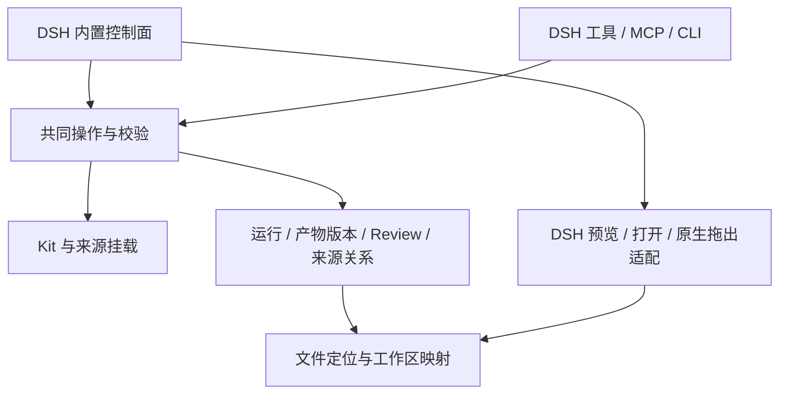

# Praxis 整合包：架构参考

状态：设计提案，已由 [ADR-039](../docs/decisions/039-dsh-praxis-artifacts.md)裁决并实现；与 ADR 不一致处以 ADR 为准。本文提炼产品目的与建议边界，不新增已采纳 ADR，不冻结字段、界面布局或实现技术。执行入口见 [产物工单](work-order-artifacts.md)；已有分层与对象定义继续以 [layers](layers.md)、[objects](objects.md)为准。

## 产品目的

Praxis 将个人工作方法、参考积累和任务产物连接起来：Agent 能按任务取用合适的 Kit，在工作发生时记录来源与产出；人能在 DSH 内置控制面中浏览、调整、审阅并直接取用这些东西。MCP 和 CLI 为其他 Agent 提供同一套操作。

整合包的价值体现在下一次工作的起点：已有参考能被发现并说明用途，产物能找到具体版本和依据，修改后能继续维护。产物管理是其中一条核心使用路径，应做到从工作界面找到和取出文件，不再依赖反复翻找 Finder。

## 从现有实现继续

| 已有基础 | 下一步应补的连接 |
|---|---|
| Task、Writing、Design、Publish 分层及按任务 resolve | 保持渐进读取；从实际取用连接到任务产物 |
| Source、Binding、题解、启用、收藏与 review | 保持来源身份和使用语境分离；从产物回查实际使用的版本 |
| core 与 DSH、HTTP、MCP、CLI 共用工具表 | 新的登记、查找和 review 也走同一能力层，宿主能力留在 adapter |
| consume 记录单元、挂载、来源、产物路径与 hash | 让产物有可发现、可预览、可取用的身份，而非只在运行中显示数量 |
| 版本与备份机制 | 对实际支持的范围验证恢复；区分程序、可复用 Kit、个人数据与外部工作区文件 |

[既有验收](../docs/verification/dsh-praxis-acceptance-20261025.md)描述的是指定提交的观察。后续可能已有修复；开工以实际代码和复测为准，不把历史失败永久写成现状。

## 建议架构

共同 core 负责身份、版本、关系、校验和持久状态。工具表统一表达操作的输入、成功结果和失败；UI 消费这些结果。宿主适配负责窗口、文件打开、原生拖拽等桌面行为，MCP/CLI 返回可供消费者读取的明确文件位置和状态。

来源 catalog、Kit Markdown 与已有维护数据各自继续承担权威内容。产物目录是新工作面，不能为了做列表再复制一套来源摘要或 Kit 正文。是否增加独立 artifact 存储、由现有 run 派生目录，或采用二者结合，由 worker 依据版本和 review 的实际需求裁决。

## 一条工作闭环

1. **准备。** Agent 根据任务选择 Kit 和参考；已有来源沿稳定身份复用，新线索按现有方式登记。没有实际读取的内容不能记为已消费。
2. **产出。** Agent 生成文件，在交付或阶段完成时登记产物及当前版本，连接该次运行、实际来源与采用的 Kit。记录动作返回可见回执；失败应反馈给任务，避免出现文件已交付而记录悄悄丢失。
3. **发现。** 控制面出现对应条目，可按任务、名称、媒介或近期活动找到；先给理解产物所需的名称、说明、版本和可用动作，细节按需展开。
4. **审阅。** 人在界面预览并针对具体版本留下 review；Agent 经同一操作读取、回应或修订。版本变化不能让旧 review 看起来仍在批准新版。
5. **取用。** 人直接打开或拖出所选文件；其他 Agent 经 MCP/CLI 找到同一版本。桌面成功标准是目标应用收到实际可用的文件，而非只收到路径文字。
6. **继续。** 修订产生可区分的新版本；旧依据仍可回查。来源变化提示哪些交付可能需要重看，文件搬走则报告位置失效，并提供重新定位的办法。

这条路径不要求每次产出先填写治理表单。Agent 负责尽可能自动填入已知信息，人处理真正需要判断的内容。

## 产物、版本与关系

以下是建议表达的语义，具体 schema 由 worker 决定。优先扩展已有对象，避免同义实体。

| 语义 | 要解决的问题 |
|---|---|
| 产物身份 | 同一作品改名、搬移或产生新版后仍可找到；路径和标题不单独承担身份 |
| 具体版本 | 明确这次预览、review、取用的是哪份内容；hash 可校验字节，但不替代作品身份 |
| 文件位置 | 能定位项目及文件，区分可用、失效、无法访问；工作区搬移后可重绑定 |
| 运行与依据 | 记录谁在什么任务产出了它、实际使用哪些来源与 Kit 版本；未知信息显式留空，不补造来历 |
| 派生关系 | 修改稿、导出件和另一媒介版本能关联；共享源材料不意味着它们是同一份文件 |
| Review | 意见、结论、操作者和被审版本相连；检查通过、用户接受与对外发布分别表达 |

同一产物后来被用作参考时，可以建立相应来源或素材关系，不必移动原文件，也不必把全部产物自动晋升成 Kit。

已有 run 的历史产物可以先投影成可发现条目。只有 path/hash 的旧记录如实显示有限依据；不能把迁移时找到的最新文件倒填成当年的已保存版本。保存旧字节、仅保留历史引用或按项目策略保留，都需要明确其能兑现的回查范围。

## 数据归属与隐私

程序代码、可泛化 Kit 与合成测试夹具可在仓库维护。个人产物、私有图片、客户材料和账号信息保留在所属工作区或私有数据位置；控制面能管理文件不意味着文件应进入本仓库。标题、路径、缩略图、review 文字和索引同样可能含敏感信息，需与文件按相应范围存放。

建议由文件所有者的工作区保存产物字节，Praxis 维护必要的引用和关系；需复制保留的版本使用明确的本地存储范围。不要为了“统一管理”默认扫描整台机器、采集全部会话，或把个人资料复制到通用 Vault。Agent 在交互中明确登记为主，用户指明目录后的补登记可作为独立操作。

下一轮只用合成文件验证；本次参考会话的原文、图片与附件不进入仓库。该限制不影响用户在自己的私有工作区管理图片产物。

## 文件预览与直接取用

预览可以复用 DSH 已有能力。先查当前宿主接口，再选择内嵌视图或宿主打开方式；渲染用户文件时应保留宿主认证与文件访问边界，尤其不能让 HTML 预览获得控制面写入权限。

原生拖出是待验证的宿主能力，不因页面有 `draggable` 就算完成。worker 应以合成文件在真实 DSH 桌面与至少一个目标应用中验证。若当前插件接口无法实现，记录具体阻碍，裁决可用的打开、导出或复制替代路径，并明确拖出仍未完成。不能用浏览器演示代替桌面验收。

## 可靠性与携带方式

人和 Agent 可能同时编辑。成功应返回写下的版本；过期写入应明确冲突且不产生部分副作用；review 必须绑定实际查看的版本。刷新界面或重新进入详情时应能取得当前状态，是否自动订阅更新可按实际需要决定。

“整合包”需要清楚的安装、连接与恢复入口，不必等同于单个 npm 包，也不要求发布。当前完整仓库加 link/plugin、MCP/CLI 可以继续作为个人使用方式。下一轮应说明代码与 Kit 如何取得、数据根如何配置、备份包含哪些权威状态，以及外部产物是否随包携带；不能用一个校验成功的归档暗示所有外部文件均已备份。

## Opus worker 的裁决范围

产品目标与用户明确的隐私边界是设计输入。本文的对象拆分、存储方式、界面组织、接口名称、实施顺序和可携带形式均为建议。**Opus worker 保留最后技术与设计裁决权**：可以合并、替换、缩减或延后建议，以当前代码、DSH 能力和真实任务证据说明理由，无需逐条照搬本文或旧 Chat。

裁决不能通过改写验收名称掩盖尚未完成的能力。确实改变当前已采纳契约时记录相应决定和迁移影响；日常实现取舍写进工单回执即可。完整任务产出、依据回查和直接取用应有观察证据，代码存在或单测通过只是其中一层。
