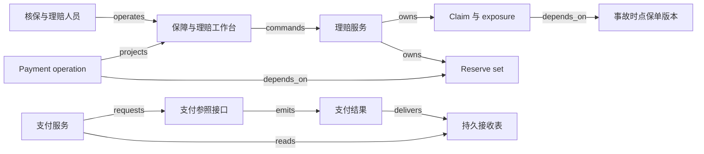

# V13 · 保险：从保障承诺到可核对的赔付

保险公司承诺：在约定保障范围内，特定事件发生后承担相应责任。保费换来的是保障承诺，每次报案仍要核定责任；reserve（赔付准备的业务记录）记的是批准过的估计，钱是否到了收款人账户，由付款结果证明。核心机制是按责任分组的余额：可新提交的赔付额同时受核定赔付、已批准估计、已付金额和未确认付款的占用约束。本章覆盖报价、绑定与出单的分界，理赔核定与 reserve 审批，付款结果未知时的恢复，以及条款版本改变怎样改变答案。

本例是一宗财产损失案例，使用单一记账单位（currency unit，CU；不是标准货币代码），只有一个被保险标的与一个事故。保障按事故发生日判断，保障区间为 `[0,365)`；赔付公式为 `min(max(核定损失−500, 0), 8,000)`，即先扣 500 免赔额，再受每事故 8,000 限额约束。无共同保险、比例分摊、追偿、再保险、汇率、年度累计限额或诉讼。保费 240 CU 只是给定的报价，不模拟费率精算。

## 识题：从现象到方法

估计、责任分组和条款顺序是三种不同的问题：估计先记录、不授权支付，余额按责任维度累加，免赔与限额的先后写成明确的函数。

| 识题线索 | 可选解法 | 后续查证与检验 |
|---|---|---|
| 损失仍在调查，却要先记录可能赔多少 | 按 exposure 记录估计，再另行认定责任 | 查 reserve line 维度和审批限额；检验估计金额不能直接授权支付 |
| 全案钱数够，某个责任却不足 | 按责任和费用分类累加，再扣未知付款占用 | 查 cost type/category、共享限额和 payment 状态；检验金额不跨责任挪用 |
| 损失变大后，免赔与限额顺序影响答案 | 把条款顺序写成明确函数，用边界值核验 | 查所选条款的触发日、免赔与限额顺序；用超过限额的样本验算 |

## 解法：报价、承保与理赔的分工

承保管未来的风险，理赔管已经发生的事故，两边的对象、状态和批准权限分开；bind 确认保障，issue 交付文件，两者分开取证。

经纪或投保人员准备 Submission，也就是为新保单发起的投保交易；核保人员决定是否接受风险及条款；出单人员交付保单文件。报案后，理赔员收集事故、损失与受益人证据，授权主管审批超限的 reserve 或付款，资金人员跟踪支付，财务核对下游入账。核保判断的是未来风险，理赔判断的是已经发生的事故；两边都有“批准”按钮，权限各自限定对象范围，分开授予。

Guidewire PolicyCenter 的公开文档用 `Draft → Quoted` 区分投保交易的准备与报价；已报价的交易要退回 Draft 才能修改，改完再重新报价。文档还把 bind 与 issue 区分开：前者确认保障合同，后者交付定义保单的文件，两者可以同时做，也可以分开。因此“有 PDF”和“保障已成立”要分开取证。[Guidewire：Submissions，Overview / Editing a quoted job / Completing the submission](https://docs.guidewire.com/cloud/pc/202507/cloudapibf/cloudAPI/topics/122-PCjobTypes/01-submissions/c_submissions.html)。

本例中，报价 v2 经核保人员和客户确认后 bind，并完成 issue；保单记下保障期间、条款与文件摘要。若文件生成失败，界面显示“已承保，文件待补发”，保障承诺保持已绑定。绑定后若要修改保障，另建带生效时间的变更版本；用今天的保单覆盖历史版本，昨天的事故就会被今天的条款错误裁定。本例只设一条经人工审核的变更通路；真实产品的取消、追溯生效和通知制度不在范围内。

| 对象 | 权威、状态与约束 |
|---|---|
| Submission / quote | 核保服务保存输入、费率版本引用与选中报价。`draft → quoted → bound`；编辑时回 `draft`，拒保或撤回分别保留原因 |
| Policy version / issuance | 保单服务保存保障约定与期间；`bound-unissued → issued`。文件是否交付与保障是否绑定分开记录 |
| Claim / exposure | 理赔服务保存报案与潜在责任单元。claim 为 `reported → investigating → resolved → closed`；有新证据时可 `reopened`。每个 exposure 关联一个保障与一个 claimant |
| Coverage decision | 获授权的理赔人员确认事故时点、适用条款、损失和核定赔付额。`pending → confirmed / denied`；有新证据时生成替代版本，原有理由保留 |
| Reserve set / reserve line | 理赔账务服务保存按责任和成本分类的估计交易。set 为 `proposed → awaiting-approval → approved / rejected`；已批准的交易另有下游 `submitting / submitted` 交接 |
| Payment operation | 支付服务保存金额、收款人和责任分配，外部系统确认现金结果。`prepared → submitted → settled / failed / unknown`；结果未确认的操作一直占用付款额度 |

Guidewire ClaimCenter 把 exposure 与 coverage、claimant 关联，用 cost type 和 cost category 组织 reserve line，并把多笔 reserve transaction 组成一组审批。文档还区分交易获批后的 `submitting` 与收到下游 acknowledgment 后的 `submitted`。[Overview of reserves in ClaimCenter](https://docs.guidewire.com/cloud/cc/202507/cloudapibf/cloudAPI/topics/112-CCFin/01-reserves/c_overview-of-reserves-in-ClaimCenter.html)。

## 投保与理赔工作台

工作台上的金额只是展示；绑定、核定和付款提交时，服务端都重读版本和授权。事故日与报案日分开显示，结果未知的付款继续占用额度。

投保列表显示缺失的风险资料，详情并排展示报价版本与当前拟承保版本。点击“绑定报价 v2”时，服务端重读对应版本及授权，页面当前显示的金额不作为权威输入。缺关键信息时，错误提示定位到具体字段，已填内容保留；版本冲突时列出变更项，免得用户不知条款已变就再次批准。

理赔详情的首屏展示事故日期、报案日期、被保标的、适用保单版本及待补证据。两个日期要分开：第 370 日报来的第 360 日事故，按本例以事故发生日判断保障的政策，仍可进入责任审查；日期比较只决定能否进入审查，最终是否获赔还要看其他证据。核定页展示损失 6,000、免赔 500、限额 8,000 与计算所得 5,500，让理赔员确认采用的是哪个条款版本。

<!-- svg: v13-dates -->

reserve 页面按 exposure 与费用类别展开，每条 reserve line 单独录入。普通理赔员的审批权限为全案 reserve 总额 3,000，主管为 6,000；初始赔款 reserve 4,000 加费用 reserve 300 的 set 合计 4,300，普通理赔员提交后要等主管审批，拆成两次 2,000 也绕不过全案限额。这两档额度和反拆分规则是本例设定的。Guidewire 文档能支持的只有：创建 reserve set 时检查该用户的权限额度，超限就建立审批活动，此时金额尚未计入 reserve line；额度可按全案或按 exposure 配置。[Creating reserves，Approval status](https://docs.guidewire.com/cloud/cc/202507/cloudapibf/cloudAPI/topics/112-CCFin/01-reserves/c_creating-reserves.html)。

支付页同时显示已核定赔付、已批准 reserve、已付金额、尚未确定结果的付款和本次可提交额。“发送付款”绑定核定版本、reserve line、收款人版本、金额与 operation ID；收款账户刚改变时，本例要求重新授权。提交后显示“等待支付结果”；银行结果未知时，占用照旧保留，本次可提交额以服务端的占用记录为准。

## 演算：按责任分组的余额

可付余额按责任维度分组计算，并扣除结果未知的付款占用；够不够付，按每个责任分别判断。

第 40 日事故后，初估赔款为 4,000，查勘费用估计 300，主管批准两条 reserve。第 45 日确认损失 6,000，按本例条款核定赔付 `min(6,000−500,8,000)=5,500`，赔款 reserve 追加 1,500；费用仍为 300。已付赔款 2,000 后，未付赔款估计为 `5,500−2,000=3,500`。若随后一笔 1,000 的付款结果未知，本例可再提交的赔款额度为 `5,500−2,000−1,000=2,500`，不是 3,500；这 1,000 仍算在尚未确认支付的风险里。

这里定义 `R` 为已批准累计估计赔款，`P` 为已确认支付，`U` 为已提交、尚未确认成功或失败的占用。reserve 余额为 `R−P`，可新提交额度为 `min(核定赔付−P−U, R−P−U)`，并且要满足非负与权限条件。reserve 可以在责任认定前用于估计，因此 `R` 与核定赔付分开取值，公式取两者中较紧的一个。费用 reserve 的 300 只用于费用：它对应另一类支出和另一套授权。

<!-- svg: v13-headroom -->

这一步用 `ALG:lookup` 加分组累加：用 `(tenant, claim, exposure, cost type, cost category, currency)` 找到同一 reserve line，再分别累加批准调整、已付和待确认操作。扫描 n 笔交易是 O(n)；按 line 预聚合可以降低反复查询的成本，但要保留事件水位，并在撤销、晚到批准和冲正时重算。小案子在数据库事务内同时更新金额与版本，最容易核对。Guidewire 的财务计算文档列出的交易类型包括 `Reserve`、`Payment`、`RecoveryReserve` 和 `Recovery`，并保留费用类别、币种与 exposure 的维度。[Financial calculations](https://docs.guidewire.com/cloud/cc/202507/cloudapibf/cloudAPI/topics/112-CCFin/05-financial-calculations/c_financial_calculations.html)。本例暂不实现后两种类型；带金额的交易按方向分别累计。

反例一是把另一 claimant 的 2,000 reserve 加到本案这位 claimant 的可付余额：全案总数可能合理，付款责任却错了。反例二是把 1,000 CU 与 1,000 个另一币种单位直接相加。反例三是把未知付款 U 归零，随后重发 1,000；两笔后来都成功时，界面无法凭“第一次超时”抹掉第二笔已付出的现金。按完整业务维度分组防的是责任混淆，保留占用防的是重复支付，两者各管一类错误，互不替代。

<!-- svg: v13-lines -->

`ALG:graph-paths` 负责解释一笔付款的依据：payment → coverage decision → exposure → policy version，以及 payment → reserve line。沿这些边可以找出“缺了哪个前提”；路径连通只说明前提齐全，是否满足保障条款另行判断。图遍历要检查对象权限、版本及事故时点；路径上出现别的租户的保单节点时，拒绝整条路径，不返回隐藏节点的金额摘要。

## 实现拓扑与恢复路径

理赔服务拥有 claim、exposure 和 reserve，付款依赖已批准的 reserve，现金结果由支付参照接口回报；恢复时按原参考号核对，U 只转为 P 一次，结案看责任与操作是否全部完成。

React + TypeScript 配合普通表格，就能实现条款差异、reserve 分组和付款明细；长列表可以再加虚拟滚动，屏外行里的错误也要有提示。团队以 .NET 为主时，可以用 ASP.NET Core 与 decimal 编写金额规则；Java/Spring 也可行。规则表适合清楚的免赔额和限额比较，复杂责任仍由理赔人员处理；把整段合同交给模型、只取回一个 boolean，说不清授权依据。

PostgreSQL 保存对象版本、reserve 调整条目、payment 占用与审计引用。照片、查勘文件放进受控对象存储，查询投影只显示当前角色能看到的元数据。数据库 outbox 能让业务决定与待发送任务在同一事务里写入；RabbitMQ 或工作流引擎可以帮着处理重试、超时和人工待办，资金对账仍要另做。支付适配器、保单适配器与总账适配器各自映射 provider account 和外部 ID；总账收到 reserve 信息只是会计交接，银行并没有因此冻结等额现金，claimant 也还没有收到钱。

正常路径先完成投保、报价与绑定出单，再登记事故、建立 exposure、核定 5,500、批准 reserve 调整、确认首付 2,000 与尾款 3,500。费用 300 若已确认仍需支付，赔款付足后全案仍保持开放；等费用已付或其估计经授权释放、所有 exposure 已处理且没有未知操作时，才能结案。结案 guard 逐项检查责任与操作是否全部完成。

失败路径可以从 reserve 审批开始：普通理赔员提交 4,300 后，界面显示待批，赔付等主管批准后才安排。主管批准后，下游总账 acknowledgment 暂未到达：reserve 在本例业务账中已批准，交接栏仍待确认；acknowledgment 缺失，不能成为把同一 reserve 再增加一次的理由。支付 1,000 超时后保留 U；按原参考号查询发现已成功，就把 U 转为 P，余额只减少一次。若 worker 在记 P 后、更新消费标记前崩溃，恢复时凭同一 payment ID 读取已付效果；若确认外部失败，则释放 U 并保留失败证据。新证据改变责任判断时，先冻结尚未执行的操作；已付金额走经授权的差额处理，原 decision 不删除，历史付款才有据可查。

## 验算：规模目标、检查项与模型评估

验收的重点是并发占用和未知付款：同案两人从 2,500 中各提交 2,000 只能成功一个，未知付款保持占用直到核对。

待测负载为 20 个租户、100 万保单、20 万开放 claim，每案平均 5 条 reserve line、100 笔财务事件；平时 30 次财务写入/秒，集中事件在 15 分钟内新增 5 万报案。报案接收目标 p95 小于 500 ms；查验可以异步，但要先返回一个已持久化的报案 ID。财务提交目标 p99 小于 1 s，只覆盖本地验证与持久化，不包含外部支付耗时。接收延迟、待核验积压和财务生效延迟要分别报告，否则快速返回的 202 会掩盖数小时无人处理的积压。

同案两人从 2,500 可用额度中各提交 2,000，是典型的 write skew：单看每笔都够，一起执行就超额。本例在 reserve line 与核定赔付版本的同一事务范围内检查并占用，第二个操作被拒绝；多个责任共享限额时，加锁和版本检查要放到共享限额这一层。按案分区可以保护单案顺序，按 tenant 调度可以防止集中报案挤占所有资源。保单查阅缓存带版本与事故时间，财务写入不依赖缓存余额；专业人员离线查看的资料也要标明版本，重新联网后要重新确认已变更的责任决定。

| 输入与操作 | 预期可观察结果 |
|---|---|
| 损失 6,000，免赔 500，限额 8,000；先付 2,000 再付 3,500 | 核定赔款 5,500；每笔款可追到同一责任与 reserve line；费用未处理时不能全案关闭 |
| 同一支付回执重复送达 | 一次 U→P 转换、一个现金效果；不同 payment ID 不按金额合并 |
| 旧的待审批通知晚于主管批准到达 | 按权威版本核对；已批 reserve 既不回退，也不重复增加 |
| 可用 2,500，两人各提交 2,000 | 一个占用成功，另一个冲突；占用后可用 500 |
| 相同 claim ID 分属两个租户 | 责任路径、附件、财务列表、缓存与导出均不可跨租户读取 |
| 支付接口已受理 1,000，响应超时 | U 保持 1,000；按原参考号核对后转 P，或确认失败后释放 |
| 付款入账后、消费标记前崩溃 | 重放后 P 不再增加；事件消费状态最终可解释 |
| 普通理赔员拆分提交 reserve，试图规避全案 3,000 权限 | 按变更后的全案额度复核并进入审批；单笔低于阈值不能放行 |
| 第 370 日报告第 360 日事故 | 读取事故时点保单并进入调查；报案日不直接决定拒赔 |
| 把费用、另一 claimant 或另一币种的余额拿来赔本 exposure | 因维度不匹配明确拒绝；不做静默的净额抵销 |

本例的承保与理赔决定由有权限的人和确定性规则完成。若加入 AI 查勘摘要助手，评估应冻结 200 份合成材料包：120 份完整，80 份缺事故日期、条款版本或收款人证据。逐项记录编造关键事实数/已输出关键事实数、缺证据却建议放行数/80、正确挂起数/80、人工修正材料包数/200，并单列“混淆事故日与报案日”“把另一人的损失挪入本案”的错误。即使语言评价很好，任一关键事实没有出处，也不能进入支付授权。样本还要覆盖实际的保单与灾害类型；合成题的成绩代表不了真实情况下的表现。

## 变式：条件变化与迁移

计算绑定条款版本、事故日与报案日分开保存、未知付款保留占用，这三条在条件改变后不变；变的是限额是否起作用、日期 guard 用哪个日期，以及估计能下调到哪里。

**练习 1：核定损失变为 10,000，免赔额和限额不变，应赔多少？**

简答：依本例“先扣免赔、后限额”的条款，`min(10,000−500,8,000)=8,000`；若写成 `min(10,000,8,000)−500`，会得到错误的 7,500。不变的是计算要绑定条款版本，变的是这次限额开始起作用。验收要包括超过限额的损失，不能只测 6,000 这种两种顺序结果相同的普通样本。

<!-- svg: v13-order -->

**练习 2：改成按报告时点判断保障的政策，第 370 日报告第 360 日事故还能照原答案处理吗？**

简答：不能。日期 guard 已改变，要按新条款评估报告时点及其例外；旧的事故日测试只证明事故发生在期间内。事故日、报案日仍分别保存，变的是适用规则与所需证据。用同一材料包分别跑两个明确版本，检查输出原因引用了不同的日期。

**练习 3：reserve 5,500，已付 2,000，另有 1,000 未知付款；理赔员现在降低估计至 2,500。能否直接释放 3,000？**

简答：不能，那样会让本例的可用余额变成负数。已付加占用为 3,000，低于这个水平的下调先挂起，核对未知付款，再由授权人员处理差额；不能靠改估计假装付款没发生。测试应观察 U 没有被清空、下调请求与理由仍保留，结果未知时不会重新付款。

V13 的版本化承诺可迁到 H01 的合同变更（`TR:V13:H01:versioned-coverage`），额度占用可迁到 V14 的订单预留（`TR:V13:V14:reserved-capacity`），按责任维度核对可迁到 H03 的分户账（`TR:V13:H03:responsibility-dimensions`）。保单责任与购买来的服务权利性质不同；reserve 在事实不全时就记下估计，之后持续修订，与银行余额或已确定的应付款分开记录。V12 的 payoff 要消灭已存在的债权，V13 的结案则要检查所有 exposure 和未决责任，所以结束条件按行业各自定义，“余额归零”只是贷款的那一条。演示可以调免赔额、限额、事故日、审批权限与未知付款，逐项观察是哪一条前提改变了结论。

## 进入陌生险种的先查项

进入一个陌生险种，先识别保障触发依据、被保对象、claimant、exposure、限额共享范围和费用分类，再选择保单版本管理、理赔案件管理与责任分组账务的组合。优先查适用的保单条款和对应产品版本的文档；没有拿到 ACORD 原文，就不要说数据模型符合该标准。用同一合成事故改变日期、免赔顺序和未知付款，验证责任判断、估计与可付额度各自变化；这些业务前提明确之后，通用审批流才有足够的信息决定是否放行。

拓扑与检查见 [V13.json](../../../../../vault/distilled/saas-engineering-atlas/packages/commercial-finance/V13.json)；来源边界与执行记录见 [evidence.json](../../../../../vault/distilled/saas-engineering-atlas/packages/commercial-finance/evidence.json)、[CHANGELOG.md](../../../../../vault/distilled/saas-engineering-atlas/packages/commercial-finance/CHANGELOG.md)。
