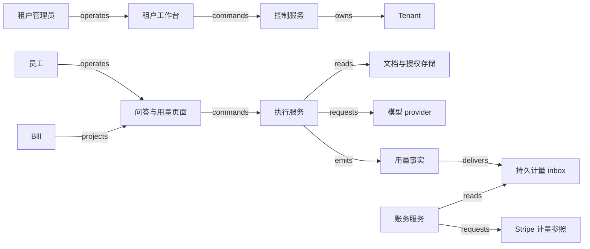

# X01 · 从租户开通到 AI 服务退出

一家 SaaS 向企业客户提供内部文档问答。一次工作算完成，要满足三项：在有效权限下读取被允许的文档，交付可追溯的结果，记下可核对的用量。生成过程中的进度提示只说明走到了哪个阶段；本例先把完整答案缓冲下来，校核后再交付，三项是否做到以服务端记录为准。机制是让租户、成员关系、运行、用量和账单各走自己的状态轴。本章覆盖开通、生成与交付、计费金额、退出与排空，以及问答质量的 eval。外部结果未知时，保留原请求身份和预留，先核对再处理。

## 识题：租户边界、额度、消费与收费

看到“同一个用户访问多家公司”，先解身份与隔离题；看到“并发请求都认为余额足够”，先解预留题；看到“失败也花了资源”，再处理计量与收费。

| 识题线索 | 解法 | 演算 | 验算 | 变式与后续查证 |
|---|---|---|---|---|
| 两个客户拥有相同编号，用户还能切换工作区 | 可信租户上下文贯穿身份、存储、队列和缓存 | A 的 run a=400、B 的 run a=900 分别归属各自租户 | 热缓存、导出及模型输入均不串租户 | 独立库仍需正确路由；查 membership 与当前权限从哪里取得 |
| 多个并发请求争用同一额度 | 原子预留，再按实际消耗结算 | 额度 1500，两次 800 只能先准入一个；第一个实际用 400 后，第二个可准入 | 已消耗加预留不超额度；unknown 不提前释放 | 实际消耗可能超预留时方法前提失效；查外部硬上限和取消语义 |
| 同一用量重复送达，失败成本与客户账单不同 | 稳定消费键、修订账本、业务时间窗和价格版本 | 成本 400+600+300=1300；计费 1000；金额 2 | 重投不增加用量；冲突进入 quarantine；定稿后的差异另立调整 | 失败也收费时金额为 2.6；查合同计费资格、provider 截止时间与汇总延迟 |
| 退出时仍有排队或在途任务 | 停新准入，终结未派发任务，核对已派发任务，再处理保留清单 | 退出先生效则 queued→failed；派发先生效则进入 running/unknown 核对 | 没有永久停在 queued 的 run；不提前显示 purged；成本仍可解释 | 身份停用不等于数据删除；查备份、导出与保留责任 |
| 模型答得流畅，却无引用或越权 | 分层留出题，分别计依据、拒答与权限违规 | 六条人工预测只有 3/6 符合预期，权限违规 1/2 | 评分器要把失败显示出来，平均正确率掩盖不了越权 | 换领域先研究证据标准和缺答案标签，再决定能否让模型参与动作 |

## 解法：开通对象与状态轴

租户是一个管理与隔离边界，用户是一个行动主体，membership 是用户在特定租户中的成员关系。一个人可能属于 A 和 B，在 A 是管理员、在 B 是只读者。所以“现在能否读 B 的合同”要看此人当前在 B 的 membership，“已登录”只说明身份已验证。服务端根据已验证的身份和当前 membership 选择租户，检查请求中的对象也属于该租户；不能相信浏览器自行提交的 `tenant_id`。AWS 文档要求将用户身份与租户身份结合，并在架构各层隔离租户资源。[SaaS Lens — General design principles](https://docs.aws.amazon.com/wellarchitected/latest/saas-lens/general-design-principles.html)。

| 对象与权威服务 | 状态与转换 | 状态变化的依据 |
|---|---|---|
| Tenant；控制服务 | requested → provisioning → active → draining → retained → purged；配置失败为 blocked | active 需要资源、管理员 membership 和隔离探针均通过；purged 需要各存储清单的处理回执 |
| Membership；身份适配与授权服务 | pending → active → revoked | tenant 内成员绑定和授权版本；撤销不等于删除业务记录 |
| Run；执行服务 | queued → running → succeeded / failed；外部调用超时为 unknown | 结果已保存、每块交付前授权通过、完整交付有接收证据，三项齐备才记为 succeeded；unknown 要核对原 provider request 与交付记录 |
| Usage entry；计量账本 | recorded → reconciled；冲突为 quarantined | 同一 run 的确定用量、计价版本及客户归属；重传不新增业务消费 |
| Bill；账务服务 | open → frozen → submitted → reconciled；外部不明为 unknown | 截止窗口、用量明细摘要、价格版本及 provider 回查；submitted 不表示已付款 |

这几条状态轴各自推进，可以同时处在不同阶段。租户在 draining 时，一个先前准入的 run 仍可能停在 unknown，等待外部回执；成员已 revoked 时，此人名下已 reconciled 的用量记录仍要保留，作为财务的历史消费依据；账单已 frozen 时，迟到用量仍可能抵达。把这些事实都塞进一个 `active` 布尔值，退出与计费就会互相干扰。

<!-- svg: x01-axes -->

控制服务负责开通、套餐、成员和退出，执行服务负责检索与生成，计量服务负责事件和账单依据。控制服务拥有跨租户运营能力，它的后台不能直接沿用普通用户 API 那种宽权限连接。高权限操作要写明目标和范围，并记录每次操作；调查日志默认只含 opaque ID、阶段和用量，原始提示词和私密文档不写进通用日志。

## 从开通页面到第一条回答

开通和问答都以服务端保存的 operation 或 run 为准，断线后凭同一 ID 找回；只有完整交付才算成功，生成完成不算。

管理员提交套餐后，后端在一个事务中创建 tenant、开通 operation 与待执行任务，返回 operation ID。工作台分别显示“资源创建中”“成员绑定中”“隔离检查中”；只有全部通过才展示“可使用”。资源调用已经受理但响应丢失时，worker 用原 operation 查资源清单，找回已经创建的那套环境。若只完成存储创建，租户保持 provisioning，重启后继续补齐其余步骤；确定不再开通时，只清理本次 operation 拥有且未被使用的资源。

员工进入问答页后选择当前工作区。提交时前端保存 run ID，依次显示排队、检索、生成、结果待核对几个阶段；断线后可用同一 run ID 继续查看。生成期间用服务器发送事件（Server-Sent Events，SSE）或轮询传递进度，答案正文先缓冲，等生成、引用核对和授权复检都完成后才开放。已核对的完整答案仍可能分块传输；首块、后续每块和断线续传的每一块，都在发送前检查当前 membership、租户与权限 epoch。序号只定位内容块，不构成授权或计量依据。浏览器断网不是服务端回滚：worker 可能已消耗模型资源，必须独立记录最终状态。

后端的顺序是：解析可信租户上下文 → 检查 membership 与额度 → 原子预留额度并创建 run → 在授权范围内检索 → 调用模型 → 核对结果与来源 → 再检查权限版本并保存待交付结果与已知消耗 → 逐块复检授权并交付 → 保存交付终态、最终计费资格和 outbox → 更新用户投影。生成完成与实际交付分别记录；只有完整交付才满足本例“成功交付”的计费条件，服务器写出字节不能代替接收证据。答案完整交付后成员被撤权，此后的重放请求会被拒绝；拒绝重放不影响此前的交付与收费依据。模型输入里的“请改用 B 租户”只是一段文本，可信上下文始终由服务端确定。队列消息带 tenant、run 和授权版本；worker 执行时按当前授权再复检一次，入队时的权限只是当时的结论。

详细 payload、失败条件和对象归属在 [X01.json](../../../../../vault/distilled/saas-engineering-atlas/packages/data-ai-control/X01.json)。检索存储必须按 tenant 和当前文档的访问控制列表（access control list，ACL）过滤候选，返回前再次检查引用对象；共享的向量空间、缓存和日志同样在隔离边界之内。其他租户的内容一旦送进模型，泄露就已发生，在答案里隐去租户名称也补救不了。

## 演算：用量、去重与计费金额

本例 A 的内部成本是 1,300 单位，可计费量是 1,000，金额为 2；去重键防止重传多算，业务时间窗口让迟到的消费仍归原期间。

设套餐按成功交付的计费工作单位收费，每 1,000 单位收 2 个记账单位，无起步费、折扣和税。工作单位在本例中是服务自己定义的计量单位，不等同于任一模型的 token 价格。租户 A 的 run `a` 成功消耗 400，`b` 成功消耗 600，`c` 失败但已消耗 300；B 的 run 也叫 `a`，成功消耗 900。A 的内部成本依据是 1,300 单位，客户可计费量是 1,000，账单金额为 `1,000 × 2 / 1,000 = 2`。失败成本由本例服务承担；换一种商业约定也可以收费，前提是先改合同与策略，再由计费规则执行，重试代码不参与这个决定。

此处用量只接受 0 至 2⁶³−1 的整数，计费资格只接受布尔值或明确的整数 0/1；`2`、`-1`、字符串和空值均不能参与资格相乘。接入校验先于持久化，数据库另约束整数用量非负、资格取 0/1。金额以十进制定点数按 `单位数 × 2 / 1,000` 精确计算，本例不额外舍入；例如 1 单位得到 0.002 个记账单位。若实际货币只允许两位小数，要在价格版本中另定舍入单位、时机与规则。

输入是确定 run 身份的一组终态事实，同一事实的重传只算一次。持久唯一键为 `(tenant, run, meter, revision)`，初始 revision 为 1；相同键且 payload 相同的重复消息忽略，相同键不同 payload 进入 quarantine。没有这个键，网络重传 `a=400` 会让 A 的可计费量从 1,000 变成 1,400；若去重只看 `run=a`，B 的合法 900 又会被吞掉。修正以新的 revision 明确替代旧版，并要求连续版本或回查完整链；计入的只是最新 revision 的量，原量随之退出合计。

<!-- svg: x01-dedup -->

这是 `ALG:lookup` 与 `ALG:windows` 的组合。朴素实现每到一条消息就扫描所有历史找重复，n 条累计最坏要 O(n²) 比较；数据库复合唯一索引使每次索引查找通常为 O(log n)，内存 hash 的平均 O(1) 只适合解释或有界批次，权威记录在持久账本里。窗口用租户合同规定的业务时间区间 `[start, end)`：恰好等于 end 的消费归下一期；接收时间另存，迟到的消费仍归原业务期间，收到的月份只记在接收时间里。

<!-- svg: x01-window -->

Stripe 文档说明 meter events 异步处理，汇总与即将开票的数值可能暂未反映新事件；还说明事件可被接受，并不保证已定稿账单会更新。所以本例把“已发出”“provider 已受理”“汇总已核对”“账单已核对”分成四个状态，四个状态依次到位才关闭对账，一次 API 调用成功只走到第二个（[Record usage for billing with the API](https://docs.stripe.com/billing/subscriptions/usage-based/recording-usage-api)）。

账务 worker 先冻结窗口与明细摘要，再以稳定 delivery ID 传递用量。安全重试要遵守实际 provider 的去重范围和有效期，一个 idempotency key 只在有效期内保护重试。超时后保留原请求身份，先核对接收、聚合和错误报告；若无法确定且安全重试条件已失效，就交人工核对。迟到的用量或更正若影响已 frozen 的账单，就创建调整记录、走批准流程，已提交的金额保持原样。

外部通知接收端先按 provider 要求验证来源，再存入 durable inbox，随后让 worker 核对对象。Stripe 文档要求使用原始请求体验证签名，并说明通知可能重复、送达顺序不保证。因此事件 ID 去重与业务用量唯一键分别保留：前者防重复消费通知，后者防两个不同通知产生两次收费。当前状态以回查到的 provider 对象为准，通知的到达顺序不参与覆盖。[Stripe webhooks](https://docs.stripe.com/webhooks)。

## 配额预留与用量账本

额度靠同一事务里的原子预留守住，实际消耗核定后才归还余额；结果未知时预留不释放。

A 的运行额度是 1,500 单位，已消耗为 0。两个并发 run 都申请最多 800：若各自先读剩余额度再写入，都可能通过，造成 1,600 的承诺。服务在同一事务中检查 `已消耗 + 未结算预留 + 新申请 ≤ 额度`。第一个取得 800 后，第二个被明确拒绝或排队；第一个完成并核定实际 400，释放剩余 400，第二个便可取得 800，此时已消耗 400、预留 800，合计 1,200。第二个实际消耗 600 后，总消耗 1,000；再有失败 run 消耗 300，总消耗为 1,300，剩余 200，而计费量仍是 1,000。这三次消耗就是演算中 A 的 run `a`、`b`、`c`。

<!-- svg: x01-quota -->

预留限制当下可承诺的资源；实际用量记录历史发生的消耗；计费规则从这些事实选出应收费的部分。外部执行结果 unknown 时，不因浏览器退出就释放全部预留。worker 需先核定实际消耗或确认任务终止，再归还余额。供应商能否硬性限制生成长度、取消后还有多少消耗，是接入时必须测量的边界；本例的额度不变量只在执行确实不超过预留上限的假设下成立。

`ALG:scheduling` 在这里用于有资源约束的准入。共享 worker 可按租户轮转取任务，再施加每租户并发上限，让 A 的大队列不会淹没 B；平均吞吐稍有下降，换来可解释的公平性。任务耗时差异很大时，只按任务数轮转仍不公平，可以按估计工作单位分配预算，执行后纠正估算。估计用于调度，不直接进入确定金额。

## 技术选型与隔离边界

一个实现可选 React/Next.js + TypeScript 显示阶段与引用，后端选 TypeScript 服务以共享请求类型，或 Python/FastAPI 便于连接检索和评估工具。共享类型能减少字段不一致，权限检查仍在服务端单独执行。SSE 适合单向进度；需要多方协作和双向状态时再考虑 WebSocket。前端缓存必须按 tenant、actor/权限范围、对象版本和策略版本分区；切换工作区立即清空可见旧结果，后台旧请求即使返回也不能覆盖新工作区。

小规模控制面与计量可以用 PostgreSQL 事务、复合唯一约束和 outbox；文档正文放对象存储，数据库存清单、hash 和 ACL；Redis 可缓存读模型，权威额度扣减在数据库事务里完成，缓存丢失不影响它。共享表配合 row-level security 可增加一道数据库约束，不过 PostgreSQL 官方文档明确指出，超级用户、BYPASSRLS 角色以及通常情况下的表 owner 都能绕过它。应用连接必须采用受限角色，并验证连接池复用时租户上下文不会残留。[Row Security Policies](https://www.postgresql.org/docs/current/ddl-rowsecurity.html)。

另一种选择是为大客户独立数据库乃至独立运行环境，减少资源互扰，但迁移、版本一致性和成本更难控制。AWS 的 full stack isolation 仍强调统一开通与运营；独享基础设施上运行的仍是同一套软件。[Full stack isolation](https://docs.aws.amazon.com/wellarchitected/latest/saas-lens/full-stack-isolation.html)。

测量计划设 100 个租户、20 个并发用户、每秒 20 次准入峰值、每日 10 万 run，单条精简计量记录约 400 字节。30 天原始计量约 `100,000 × 30 × 400 = 1.2 GB`，不含索引、副本、文档或模型输入。10 个 run 同时运行、平均持续 10 秒，容量只有约 1 run/s；20/s 短峰值必须排队、扩容或拒绝，不能靠“异步”掩盖积压。待测目标为准入 p95 < 200ms、队列等待 p95 < 5s（可承受流量下）、终态到用量可见 p95 < 60s；首 token 延迟另测，与权限校验和队列等待分开报告。观测要看各租户的分位数和最大积压，全局均值会掩盖单个租户的积压。

## 退出与排空

退出先挡住新的运行入口，再让每个在途 run 走到终态、完成用量核对，最后按清单逐项清除；身份 provider 的停用回执只覆盖身份同步。

正常路径是：管理员发起退出，控制服务将 tenant 从 active 改为 draining，并提高权限 epoch；禁止新的生成和新邀请。已准入 run 按本例政策停止继续执行，已发到外部的调用进入核对，不假定取消立即生效。待这些 run 均有终态和用量，账务完成截止核对，租户进入 retained，只允许约定的导出与审计读取。保留期届满且没有明确 hold，才逐项清除文档、索引、缓存、凭证与相关运行内容；完成清单齐备才显示 purged。备份的到期策略，以及恢复后重新执行删除清单，也必须有验收证据。清除按清单逐项进行，本例不保证即时物理擦除。

排队中的 run 也必须有结束路径。若退出与 worker 取任务同时发生，两者靠同一 run 的条件更新决出先后：确认尚未派发的任务转为 failed，记录零或已经明确发生的准备成本，并结算、释放预留；一旦派发已发生，就走 running/unknown 的核对路径。撤权之后，queued 的 run 再也等不到启动条件，只有这条结束路径能让租户完成排空。这里使用 failed 表示本次请求未交付，原因字段区分退出取消与技术错误。

Okta 的跨域身份管理（System for Cross-domain Identity Management，SCIM）2.0 文档说明，移除或停用用户时向应用设置 `active=false`，不对 SCIM user 执行 DELETE；Okta 内的 suspended 也没有对应的 deprovisioning event。这份文档说明的是身份同步的边界；应用自己的会话、文档和账单由应用自己核对。[Okta and SCIM Version 2.0 — Delete users](https://developer.okta.com/docs/api/openapi/okta-scim/guides/scim-20)。所以退出时先由本地控制状态挡住运行入口，再分别核对身份 provider、执行队列和存储，SCIM 回执只是其中身份一项的证据。

假设撤销发生在检索完成之后、答案返回之前。worker 已拿到 A 的文档；最终授权复检发现 epoch 变化，停止交付尚未发送的正文并记录受限原因，已消耗成本仍入账。若第一块已在有效授权下交付，随后权限改变，保留这次交付事实，后续块与重连回放都被拒绝；已经送出的字节收不回来。权限 epoch 变化后旧 run 不自动恢复交付，新授权需重新确认输入与运行身份。失败后的恢复只保留必要的核对信息，交给获授权管理员处理成本和退出进度，不会重新授予成员访问权。租户重新加入时要用新的生命周期身份或 generation，旧消息不能让旧 membership 复活。

<!-- svg: x01-revoke -->

## AI 质量与业务失败标准

问答质量与业务失败分开计：有依据的正确率、缺答案时的拒答率和越权泄露各算各的，工具动作越权必须为零。

OpenAI 将 Frontier 描述为帮助企业构建、部署和管理 AI agents 的平台，并在官方介绍中讨论上下文、评估、身份及权限。[Introducing OpenAI Frontier](https://openai.com/index/introducing-openai-frontier/)。

问答的实际 eval 应冻结文档版本、ACL、测试身份、模型与配置、检索参数、提示词和判分标准。拟设 200 条留出题：80 条授权且可回答、40 条授权资料缺答案、40 条恶意指令干扰、20 条仅另一租户有答案、20 条权限已撤销。调参集合不能重复用作留出集；两位审核者对事实与引用的分歧要留记录。可回答题按“内容正确且引用支持”统计成功率；缺答案题统计恰当拒答率；两类权限题单独统计越权内容泄露；工具动作越权必须为零，高平均答案分也抵消不了。业务方另设错误成本与放行阈值；200 条样本的结果不能直接当作生产环境安全的证明。

为了让分母可手算，随包提供六条**人工构造预测**：可回答且有正确引用、可回答但缺引用、资料无答案且拒答、资料无答案却编造、引用另一租户内容、撤销后正确拒答。按分组得到有依据正确回答 1/2、缺答案恰当拒答 1/2、权限违规 1/2；逐项符合预期为 3/6。这个故意失败的例子检查评分程序是否能识别错误，并非任何模型的成绩。检测到的越权样本使候选策略不能放行，修复后必须重新评估。对应本地执行范围见 [CHANGELOG](../../../../../vault/distilled/saas-engineering-atlas/packages/data-ai-control/CHANGELOG.md)。

## 验算：从 UI 到账单的验收轨迹

全链通过要求从开通、生成、账本到外部账单逐段可核对；重复、乱序、并发、未知结果和退出都不能多出一份效果或越过授权。

| 场景 | 可观察的完整链和失败判据 |
|---|---|
| 正常开通、生成与计费 | 提交开通 → 全部探针确认 → A 用户提交 a、b → 引用可读且终态成功 → 账本为 1,000 → bill 为 2 → 外部汇总与账单逐项核对。只看到回答不算全链通过 |
| 重复消费事件 | a 到达两次，两个接收轨迹指向一个业务 entry；相同键不同值进入 quarantine，不默默覆盖 |
| 乱序与迟到 | revision 2 先到而 1 缺失时不猜原值；旧成员激活消息在撤销 epoch 后到达不能恢复访问；截止后回执不改变业务时间 |
| 并发额度申请 | 两个 800 在 1,500 下只能先准入一个；进度页显示另一个排队或被拒绝；测试要有真实并发事务的证据 |
| 租户隔离 | A、B 都有 run a 和文档 d1；搜索、缓存 hit/miss、导出、重试、队列消费均只能读当前授权范围；检查模型输入也未夹带 B 内容 |
| 外部结果未知 | provider 已接收而本地 timeout，run/账单保留 unknown；恢复先查原请求身份；没有依据时不重复执行或多收费 |
| 崩溃恢复 | 在本地终态提交后、outbox 发送前终止 worker；重启后补送同一 entry，数据库账本与 provider 汇总均只有一个效果 |
| 退出与撤销 | 检索中撤销、draining 中重放旧请求、清理一处失败：答案交付被挡，新工作被拒，purged 不提前显示，已有费用仍可解释 |

表中各行是后续实现的验收标准。本地纯计算、SQLite 账本和结构检查覆盖计算与结构；SSE、真实 IAM、PostgreSQL RLS、provider sandbox、崩溃跨进程恢复和上述延迟目标要另行实测，AI 能否答对由 eval 回答。检查身份与所需证据见 JSON 的 checks。

## 变式：条件变化与迁移

消费事实、去重身份、租户隔离和授权责任在条件改变后不变；变的是计价策略、隔离落在哪一层，以及未知结果的成本由谁承担。

**练习一：套餐改成失败请求也收费，但不得超过管理员预算。** a、b、c 的数值不变，金额如何变，哪些不变量仍然成立？简答：规则允许全部 1,300 单位计费时，金额变为 2.6；消费事实、去重身份和租户隔离保持不变，bill 引用新的计价策略版本。若只有 2 单位预算，就不能等失败后才发现超额，准入时要按可能发生的最高费用预留。只改账单过滤条件、仍以为“失败总会退回预算”，预算就会被突破；检查时看失败终态后的预算扣减、余额和明细三者是否一致。

**练习二：A 要求独立数据库，并允许同一员工加入 B。** 是否能删除所有 `tenant_id`？简答：不能。物理连接可以把部分数据隔离，但 membership、路由、缓存、队列和计量仍然共享；请求必须选对连接且验证对象身份。典型的错误是 worker 用上一个任务保留的连接去服务下一个租户。检查时交替发送 A/B 相同的 object ID，测连接池归还后再取出的情形，分别测冷缓存与热缓存，连模型上下文也要核对。把隔离从行条件迁到连接选择，会改变故障位置，不会消除授权责任。

**练习三：供应商无法查询超时的原生成请求。** 能否重发后把两次成本都收给客户？简答：不能。技术失败推不出收费授权。本例保留 unknown 和预留，达到规定恢复期限后，由人工决定承担成本，或经客户明确同意新建 run；新 run 关联旧尝试，不能伪装为同一次无成本重试。检查时确认未知尝试在用量和操作面板中持续可见，不被“重试成功”覆盖。

账本输入版本与发布快照都要可追溯，这一点可以迁到 H07；区别是商业智能（business intelligence，BI）可以探索性近似，客户费用不能凭近似值定稿（`TR:X01:H07:versioned-inputs`）。最终执行前复检授权的做法可迁到 H08，但账号隔离的误伤恢复不能用租户永久退出替代（`TR:X01:H08:execution-authority`）。frozen bill 与已批准文档同样绑定确定版本，可与 H09 对照；签署的外部效力不同于账单汇总，撤销状态不能套用（`TR:X01:H09:version-bound-decision`）。与 H01 相接处，计费依据产生的 bill 不等于付款，更不等于收入确认（`TR:X01:H01:bill-payment-separation`）。

**下一步探索。** 进入陌生行业时，先确定租户究竟代表客户法人、部门还是项目，再问同一人能否跨租户、失败工作如何收费、退出后哪些记录仍需保留。共享服务适合能接受共同资源管理的客群；独享方案适合有明确隔离或负载要求且能承担运营成本的客群，两者都需要统一身份与计量。随后核查真实模型的用量和取消语义、账单截止以及数据清单，用同编号跨租户、失败计费、排队中退出和未知消费四种情形验证，再决定是否需要更复杂的 agent 管理平台。

[来源与模型说明](../../../../../vault/distilled/saas-engineering-atlas/packages/data-ai-control/evidence.json) · [对象与检查结构](../../../../../vault/distilled/saas-engineering-atlas/packages/data-ai-control/X01.json)
