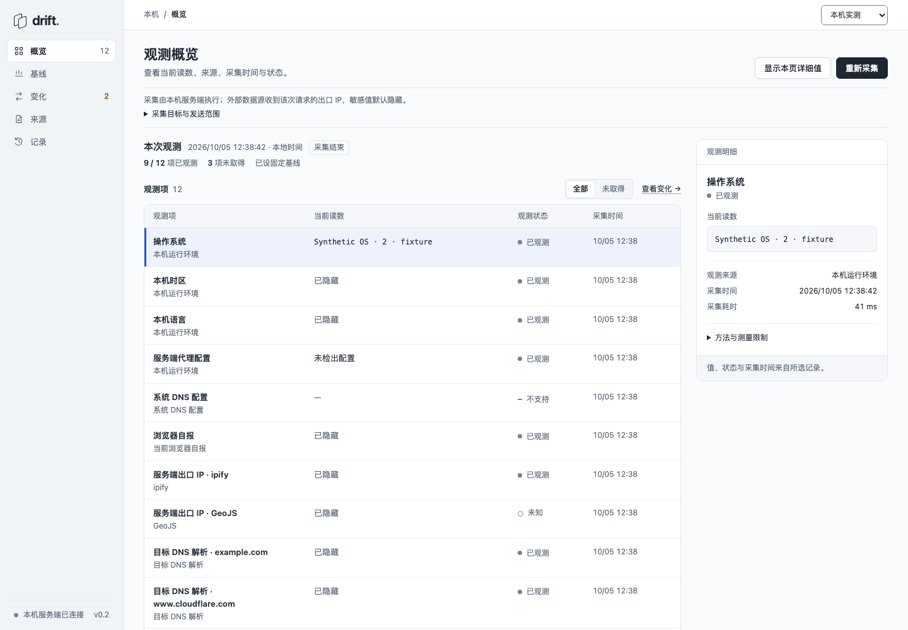
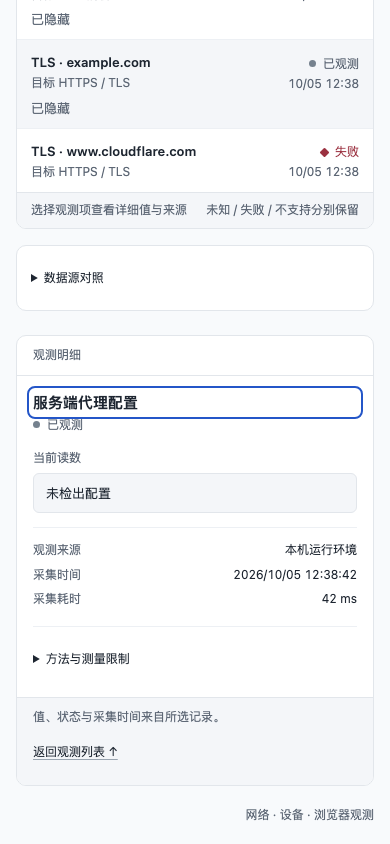
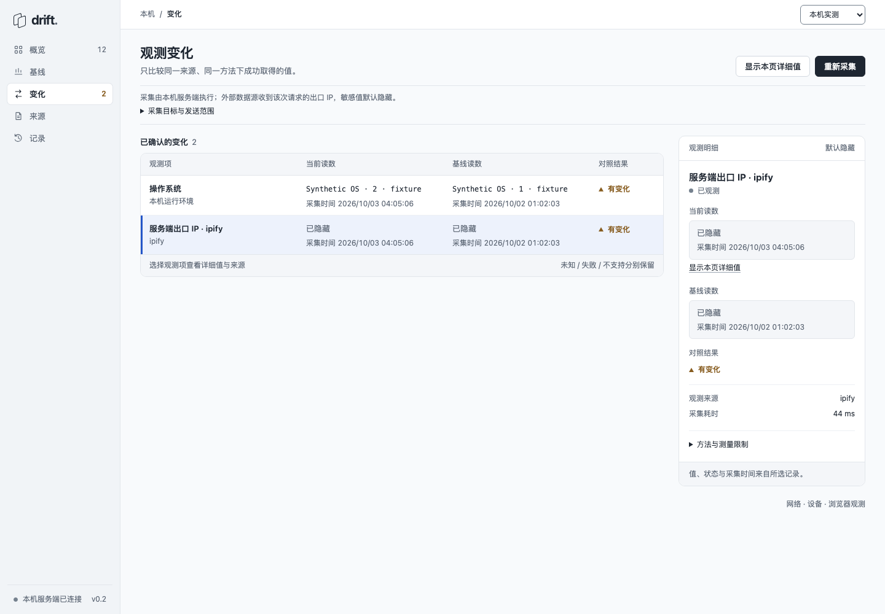
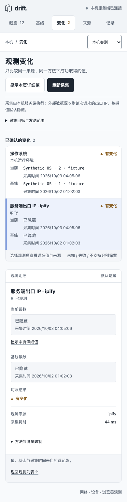
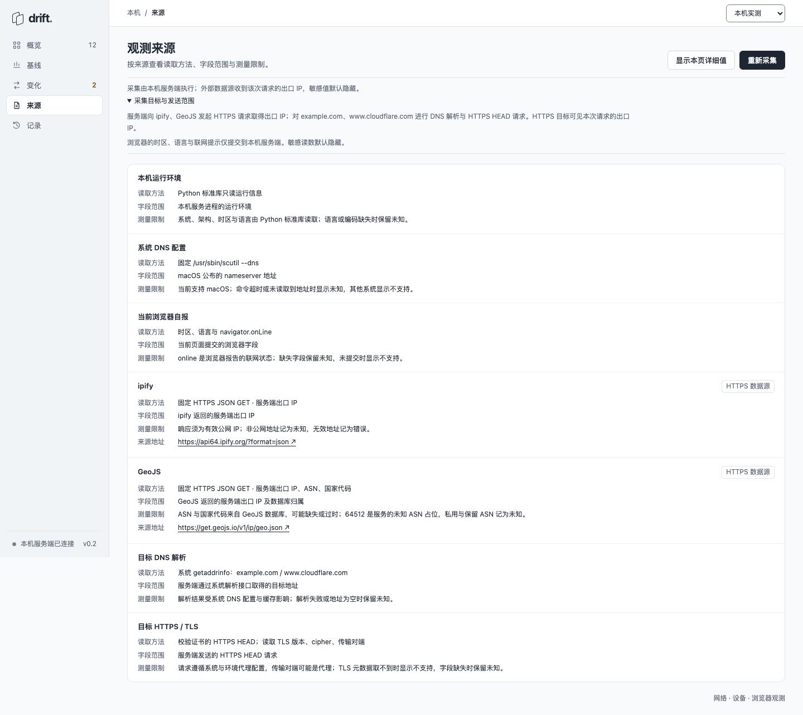
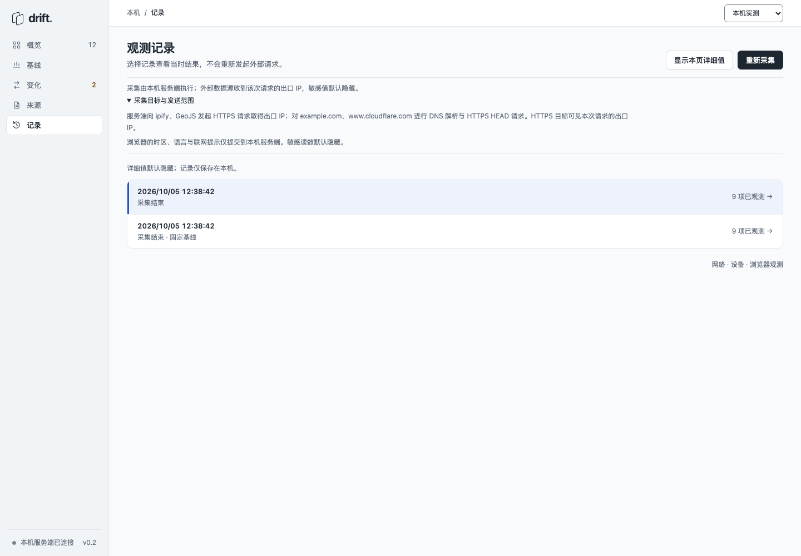

# Drift · Astra 验收证据

日期：2026-10-05。本目录为 Opus polish 后的独立检查与 grammar 增补证据，原目录中的作者交付截图保持原样。裁决见[验收回执](../../design-acceptance.md)。输入为合成探针、隔离数据目录及固定浏览器区域设置，使用无界面 Chromium。

## 复验与结果

- [五宽报告](layout-report.json)：320、390、720、1181、1440 宽度，五个视图，显隐与正常／加大间距，共 100 组。无水平溢出、无实际文字裁剪，最小字号 12px；五宽的系统 DNS 缺值行在辅助树中均保留 4 个单元格。
- 该轮在源码冻结后执行，报告保留四个源码文件前后相等的 SHA-256。普通状态的目标尺寸已达 24px；加大间距时仍发现 20 组中的宽屏折叠标题高度为 22px。随后仅增加其 24px 最小高度，后续窄检查单独记录，未冒充再次运行完整 100 组。
- [最后窄检查](summary-targets.json)：1181／1440 下，三种折叠标题在压力条件下由 22px 变为 24px；键盘 Enter 开／合和页面无横向溢出均通过。源码前后哈希相等，外部请求与浏览器错误为 0。[复跑脚本](check-summary-targets.py)单独保留。
- [检查脚本](check-layout.py)保留读取方式、文本裁剪容差、排除项和截图方式。`beforeRepairs` 是本轮修复前已经测得的历史值；每次运行实际重新测量的是当前实现。颜色结果由 token 与相对亮度公式得到，未做像素抽样。

从仓库根目录复跑，默认写入新的临时目录：

```sh
PYTHONDONTWRITEBYTECODE=1 python3 projects/drift/evidence/acceptance-20261005/check-layout.py --drift-dir projects/drift
PYTHONDONTWRITEBYTECODE=1 python3 projects/drift/evidence/acceptance-20261005/check-summary-targets.py --drift-dir projects/drift --layout-report projects/drift/evidence/acceptance-20261005/layout-report.json
```

原始结果中的截图绝对输出路径已替换为本目录文件名；数值、检查方法与源码哈希保持原值。脚本的本地输出定位仅供操作者使用，对外分享日志时去除本地路径。没有读取默认私有记录、操作 8765 运行实例或调用实际外部探针。

## 按步骤查看

1. **概览**：读数、状态、来源与采集时间可直接查阅，当前连接名称统一。[桌面](desktop-top-steady.png)、[窄屏](mobile-top-steady.png)。
2. **明细**：等待有限淡入结束后截图，文字处于稳态，显隐和返回原行入口可见。[桌面](desktop-detail-steady.png)、[窄屏](mobile-detail-steady.png)。
3. **基线与变化**：固定参照保持独立，两个值分别带上各自完整采集时间。[基线](1440-baseline-steady.png)、[宽屏比较](desktop-comparison-times.png)、[窄屏比较](mobile-comparison-times.png)。
4. **来源**：方法、范围、限制和来源地址分列。[桌面](1440-sources-steady.png)、[窄屏](390-sources-steady.png)。
5. **记录**：当前记录与固定基线身份明确。[桌面](1440-history-steady.png)、[窄屏](390-history-steady.png)。

画面经过独立查看；截图与 DOM／辅助树检查仍不能代替真实用户任务、VoiceOver、原生浏览器缩放或跨浏览器验收。

## 关键画面

### 1. 观测概览



### 2. 观测明细



### 3. 当前与基线的精确对应





### 4. 观测来源



### 5. 观测记录


