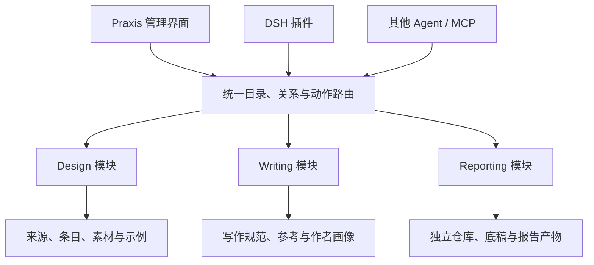

# 规划Praxis插件 control plane

Source: <https://chatgpt.com/c/6ada3159-c90c-83ec-8974-8fe45f656606> · 20 turns · verification: partial
<!-- selected branch: bf9bb6b8-ccdd-4aa9-aaf8-42a633957e0b -->

## Content checks

- The source reports that this answer was interrupted or reached its length limit. Review it before handing off.
- Inline images or widgets from the original turn are not included. Review it if they matter.
- dsh-praxis-fde-kit-review-20261022.json: download this file from the original conversation and select it separately; this export contains a reference only.
- Citation metadata has an unfamiliar structure. Its links may be missing; review the original turn.
- Citation metadata contains an unfamiliar source field. Some links may be missing; review the original turn.

## Turn 1 — User
<!-- source: response.mapping["81f46a32-19ea-4baf-8acf-a48f2dbf26a0"].message -->

如果我想为基于 praxis 为 dsh 制作一个 plugin，能够覆盖几条 workflow，登记 design/writing source 有摘要和index，并能够让 meritial 在本地 workspace 按照规范存在，artifact 能够统一管理，因为 praxis 是个性化工作流，不涉及 release，所以可以先按照个人习惯完成，现在需要 review kit 体例与规划实现方式后，grill me 并逐步补全功能与 control plane

## Turn 2 — Assistant
<!-- source: response.mapping["9d7b0f63-fd06-5b6c-8e39-1f3f482500d1"].message, response.mapping["60a493d8-7b04-53c0-97d9-d4dabd6f0d85"].message -->

我先沿着 Praxis 现有的 kit、目录约定和 DSH plugin 能力做一轮审阅，再据此追问真正影响实现的选择。我会用个人上下文技能找回相关决策，把问题逐步收敛到可执行的工作流与 control plane。

已找到 Praxis 当前主线 `9f9f69d`。现有仓库已经有来源生命周期、消费索引、写作与设计分工，以及 workspace contract；这次应重点检查这些约定怎样被插件执行、哪些状态需要保存。我把 DSH 的接口核对与 Kit 的体例审阅分开并行进行。

## Turn 3 — User
<!-- source: response.mapping["49ed83ba-c452-489a-a59c-07391acf463d"].message -->

比如 design kit 可以是一个单独的 controlplane，每条带有 description 与 source，能够分类管理、或标注 tag 等，以及每次看到相关参考，可以入账，agent 能够直接修改，数据可以本地存在，也可以人类在 control plane 编排；然后这个 plugin 可以打包、备份，作为 plugin/mcp 被其他 agent 调用，让积累的外部参考真正可视化管理，而不是散落在文档中，失去维护能力——以及必要的版本对齐、review 等。

## Turn 4 — Assistant
<!-- source: response.mapping["7a7550fe-b124-544d-9207-cc6ac8db5009"].message -->

这个补充把首个实现单元说清楚了：Design Kit 要有自己的本地资料库和管理界面，人和 Agent 都能持续编辑；DSH 是操作入口，其他 Agent 可通过 MCP 访问同一份数据。我会据此审阅现有来源卡与索引，重点看可视化编排、并发修改、版本对齐和备份恢复如何共用一套数据，避免再形成几份各自维护的副本。

## Turn 5 — User
<!-- source: response.mapping["38c75462-7d0c-4f28-873e-25de0aa136b2"].message -->

比如 workflow，可以以个人拟合的方式单独定制，如 reporting workflow，但其存储与结构上是解耦的，统一接入 praxis 的 control plane

## Turn 6 — Assistant
<!-- source: response.mapping["9111a03e-8578-53c2-993e-56d0420f7844"].message -->

对，Reporting 可以保留自己的仓库、目录、流程状态和发布方式，由 Praxis 统一呈现项目、资料、产物、待审项及可执行动作。共享的是接入契约和跨模块目录，各模块继续维护自己的权威数据。

审阅也发现了一处实现时必须处理的现状：Praxis 同时有脚本生成的来源卡和人工维护的来源卡，registry 则是派生索引。编辑界面和 MCP 必须知道字段归谁维护，否则一次“更新摘要”就可能覆盖原有人工内容。

## Turn 7 — User
<!-- source: response.mapping["cba5187b-7130-4232-b948-01101e2e86a1"].message -->

比如 design 方面，会像一个藏书目录，按照 design grammar 划分 source 参考并有 description 指引如何取用消费，这些条目也可以手动管理/手动打 tag 推荐取用偏好/收藏、定期更新快照，praxis 不是总会默认挂载全部，而是渐进展开，同时 ux 与 agent 都能够进行维护，数据统一缓存。

## Turn 8 — Assistant
<!-- source: response.mapping["91c5e0e9-fe5b-5761-9061-40d239ee1228"].message -->
_Content: partial_

**是的。按你这几次补充，Praxis 应当成为统一的工作控制面；Design、Writing、Reporting 等模块各自维护内容、存储和工作方式，通过共同接口接入。** DSH 提供其中一个操作入口，其他 Agent 可以经 MCP 使用同一套能力。

这样，Reporting 可以继续按你的习惯演进，Design Kit 也可以独立成为可浏览、可编辑、可复核的资料库。Praxis 负责把它们连接起来：找到材料、理解用途、定位原件、调用动作、查看变化、管理产物与引用关系。

我已经审阅了 Praxis 主线 `9f9f69d` 的体例、来源登记、索引生成和 workspace contract，并核对了 DSH 当前官方扩展文档。**现有 Kit 的内容组织值得保留，接下来最需要补的是可操作的数据接口，以及人和 Agent 共用的管理界面。** 本轮属于源码与契约审阅，尚未运行本机插件。

## 一、先确定结构：统一接入，各自维护

建议把这条边界定下来：

这里的“模块”可以是一套 Kit，也可以是一条个性化 workflow。**接入 Praxis，意味着它能被发现、读取、操作和追踪；其内部结构仍由自己的工作需要决定。**

| Praxis 统一提供 | 模块自己维护 |
|---|---|
| 模块登记、统一搜索、入口导航 | 内容分类、目录结构、存储格式 |
| 对象身份、原件定位、跨模块引用 | 来源卡、写作规则、报告底稿等正文 |
| 可执行动作的发现与调用 | 动作如何执行、使用哪些工具和模型 |
| 变化、待审事项、版本关系的汇总 | 审阅标准、状态含义和采纳规则 |
| 产物目录、预览与来源追踪 | 产物生成、验收和发布流程 |
| 备份入口、恢复检查、路径重绑定 | 各模块应导出哪些权威数据 |

例如，Reporting 可以保留独立私有仓库，Markdown 仍是正文权威，HTML 是编译产物；个人内部报告与客户报告继续拥有各自的发布流水线。Praxis 能呈现这些项目、调用其工作流、打开产物并显示待审事项。

**控制面收到“发布报告”这个动作时，应交给 Reporting 自己处理；文件存在、编译成功、用户接受、对外发布，各自保留原来的含义。**

这与现有 Praxis 的归属原则相符：工具接入由 adapter 承担，具体业务与项目状态由实际消费者维护。[现有架构](https://github.com/lesPrivilege/Praxis/blob/9f9f69d4ec38fdfab140316906a5e32d66e29c93/docs/architecture/README.md) · [Adapter 边界](https://github.com/lesPrivilege/Praxis/blob/9f9f69d4ec38fdfab140316906a5e32d66e29c93/kit/adapters/README.md)

## 二、Kit 审阅：有基础，也有几处必须先处理的接缝

### 1. 来源与方法条目已经分开，可以直接成为两种相连的视图

现有体例区分：

- **来源卡**：作者说了什么，证据在哪里，读过哪些部分。
- **Kit 条目**：遇到什么问题可以采用，如何调整，何时不适用。
- **已采纳规范**：当前工作应遵循什么。
- **项目消费记录**：这次实际用了什么，产生了什么结果。

这对 Design Control Plane 很有价值。用户可以从“我想解决窄屏比较问题”进入，也可以从“我之前收录过的那篇文章”进入，两条路径指向同一组内容与来源关系。[文档结构契约](https://github.com/lesPrivilege/Praxis/blob/9f9f69d4ec38fdfab140316906a5e32d66e29c93/docs/architecture/documentation.md) · [ADR-029](https://github.com/lesPrivilege/Praxis/blob/9f9f69d4ec38fdfab140316906a5e32d66e29c93/docs/decisions/029-design-writing-reference-encyclopedia.md)

**因此，“每条带 description 与 source”需要容纳一对多、多对多关系。** 一条设计方法可能参考三份来源；一份来源也可能支持几个不同条目。自己的实验、样张和设计实践同样可以入库，来源标为自撰或具体项目记录。

### 2. 已经存在可用的数据基础，首先应接通它

当前来源记录已有稳定 ID、摘要、用途标签、来源卡路径、原件定位、历史记录，以及可选分面。`build_registry.py` 从这些记录生成统一 registry；Design / Write 另有交叉索引与分面查询脚本。[索引生成说明](https://github.com/lesPrivilege/Praxis/blob/9f9f69d4ec38fdfab140316906a5e32d66e29c93/scripts/README.md) · [材料登记模板](https://github.com/lesPrivilege/Praxis/blob/9f9f69d4ec38fdfab140316906a5e32d66e29c93/templates/intake/material-record.json)

初期可以把这些文件作为 Design 模块的权威数据，给它们增加编辑与查询接口。搜索缓存、缩略图、列表排序等可以独立生成、随时重建。

### 3. “人工维护”与“脚本生成”的归属，必须进入编辑逻辑

当前 catalog 用 `cards: generated | maintained` 区分两种来源卡：

- `generated` 的卡片由 catalog 生成；
- `maintained` 的卡片包含人工维护的正文，有时一张卡对应多个 URL。

现有生成脚本已经按这个边界工作。管理界面也必须遵守它：编辑生成卡时修改其源记录；编辑人工卡时保留正文及其独立内容。当前脚本说明也明确，人工卡与 catalog 之间仍有需要维护者同步的部分。[来源卡维护说明](https://github.com/lesPrivilege/Praxis/blob/9f9f69d4ec38fdfab140316906a5e32d66e29c93/scripts/README.md#来源卡由谁维护) · [ADR-022](https://github.com/lesPrivilege/Praxis/blob/9f9f69d4ec38fdfab140316906a5e32d66e29c93/docs/decisions/022-source-card-ownership.md)

这意味着第一版应明确**每个可编辑字段写回哪里**，再开放人类和 Agent 的编辑能力。

### 4. 现有 registry 可以用于发现，尚不足以直接承担完整编辑

有一个具体例子：Design / Write 的来源 catalog 已有 `reference_priority`、`reference_status` 等字段，但当前 `build_registry.py` 的扩展投影没有带出这些字段。仅凭统一 registry 构建编辑器，会遗漏原记录中的信息。[来源记录实例](https://github.com/lesPrivilege/Praxis/blob/9f9f69d4ec38fdfab140316906a5e32d66e29c93/vault/provenance/design-writing-encyclopedia/interaction/catalog.json) · [registry 生成代码](https://github.com/lesPrivilege/Praxis/blob/9f9f69d4ec38fdfab140316906a5e32d66e29c93/scripts/build_registry.py)

我的实现建议是：

> 列表与搜索消费派生索引；打开详情、编辑与审阅时，通过稳定 ID 回到权威记录。

这样既能复用现有积累，也能逐步补齐索引字段。

## 三、Design 模块应该怎样变得可维护

我建议先做三个工作面，而不是先铺开很多页面。

### 资料库：发现、归类与编排

默认展示标题、description、归属、标签和当前状态；图片、排版样张、motion 素材有实际预览。

支持两条浏览路线：

- **按问题与方法找**：层级、比较、邻接、反馈、运动、字体等。
- **按来源找**：文章、站点、作者、项目、工具、作品。

分类、tag、collection 各有用途：分类提供稳定入口，tag 用于交叉查找，collection 可以保存“这次报告的参考”“准备试用的 motion 方法”等个人编排。它们都引用同一条目。

普通的个人标签可以轻量维护；证据状态、采纳状态与版本判断继续使用明确字段。

### 条目详情：理解、编辑与取用

详情页把以下内容连接起来：

| 内容 | 用处 |
|---|---|
| 简介与完整说明 | 快速判断相关性，按需深入 |
| 来源及精确定位 | 回查文章章节、代码、截图或例子 |
| 本地 material | 打开已保存的原件、摘录、图片和可复用素材 |
| 适用条件与边界 | 支持实际选用 |
| 相关条目、变体与示例 | 沿着问题继续探索 |
| 使用它的项目与产物 | 看见积累如何进入真实工作 |
| 修改历史与 review | 理解当前内容如何形成 |

这里有一个值得保留的区别：**来源摘要、方法条目、文件素材、交付产物分别具有身份，通过关系连接。** 同一个 SVG 可以是某次任务的交付物，也可以成为后续任务的素材；身份与用途允许并存。

### 变化与 review：把维护负担集中呈现

需要能够回答：

- 哪条来源有了新版本？
- 哪个摘要被 Agent 改写了，具体改了什么？
- 哪个项目使用的是旧版方法？
- 哪项旧 review 的依据已经发生变化？
- 哪些引用或本地文件已经找不到？

版本和审阅信息放在独立记录与界面中，正文继续保持可读。现有 Kit 已经要求将版本、获取时间、修订经过放到独立历史记录，这个体例可以直接延续。[参考生命周期](https://github.com/lesPrivilege/Praxis/blob/9f9f69d4ec38fdfab140316906a5e32d66e29c93/docs/governance/reference-lifecycle.md)

## 四、个性化 workflow 如何接进来

共同接入契约可以很小。每个模块只需要说明：

1. **我是什么**：名称、description、入口与数据归属。
2. **我有哪些对象**：可列出、查询、读取和定位的项目、资料或产物。
3. **我能做什么**：登记、修改、生成、比较、审阅、导出等动作及参数。
4. **发生了什么变化**：对象版本、动作结果与必要的变化记录。
5. **怎样迁移**：导出范围、恢复方式、路径映射与依赖。

Reporting 自己决定采集证据、撰写、编译、审阅如何编排；Design 自己决定来源如何入账、摘要怎样维护、何时成为优先参考。**统一控制面可以呈现它们的状态，但状态定义与转换仍由所属模块负责。**

模型分工也放在具体 workflow 中。例如 Jev 项目的探索与 Opus 中文编订要求，可以成为该项目的执行约定；其他 workflow 按自身需要配置。Output-first、产出后的 review 与 RSI，也应落实为实际任务步骤，而不是要求用户先完成整套治理表单。

对于 artifact，Praxis 先掌握工作流已经明确知道的信息：作品身份、版本、路径、来源、生成关系、审阅与交付状态。Gleaner 后续可以通过明确接口消费这些记录，延续它独立管理跨 Provider 产物的职责。

## 五、版本、直接修改与备份，要从首次写入开始考虑

### 人和 Agent 共用修改路径

界面编辑与 MCP 修改应调用模块的同一套操作。Agent 可以直接完成日常入账、补充摘要、分类和整理，操作结果立即可见，并保留可比较、可撤回的变化。

多 Agent 同时工作时，最小必要机制是：**修改必须带上它读取的版本；遇到版本冲突，返回差异并重新处理。** 这样，人刚改好的 description 不会被另一位 Agent 按旧内容整段覆盖。

如果继续允许 Codex、Claude Code 直接编辑 Markdown / JSON 文件，控制面还需要识别这些外部修改、检查数据、重建索引。这会影响第一版的实现方式，我放在下面首轮问题里。

### 对齐“当前版本”与“本次使用版本”

建议至少区分：

- 来源或原件的版本；
- Kit 条目及其 review 所针对的版本；
- 项目实际消费的版本；
- 插件与数据格式的兼容版本。

例如，Design 条目更新后，本周报告仍能说明它用的是哪一版；控制面可以提示相关变化，由 Reporting 决定是否重新取用。改一个标签，也不应让全部历史产物进入重审。

### 插件包与资料备份分别管理，可以一起导出

插件包保存代码、入口和兼容约束；资料备份保存模块数据、正文、需要携带的原件与版本记录。统一导出时，清单说明哪些文件已包含、哪些保留为外部引用；恢复时检查身份、文件和链接，并重新绑定本机目录。

这也符合现有 workspace contract：机器路径由配置映射，升级应保留人工配置，迁移边界必须明确。[Workspace contract](https://github.com/lesPrivilege/Praxis/blob/9f9f69d4ec38fdfab140316906a5e32d66e29c93/kit/environment/workspace-contract.md)

## 六、DSH 可以承担这个入口，首轮范围可以收得很具体

当前 DSH 官方文档支持本地 bundle 安装，能够从本地目录链接插件，也可以安装已打包的文件；个人使用可以直接走这条路径。

它也提供客户端扩展槽与侧栏 tab，可以容纳资料浏览、当前项目引用和 review 入口。具体布局与状态保持仍需要按你本机版本实测。

MCP 接入同样成立：DSH 可以启动 stdio 服务或连接独立 HTTP 服务，数据存储与迁移由服务自己负责。因此，Praxis 各模块可以拥有独立数据生命周期，DSH 与其他 Agent 作为调用方。

**我建议首轮做“Design 完整闭环 + Reporting 最小接入”。**

Design 的验收是一件真实小事：你给出一个参考，Agent 入账并形成说明；你在界面中修改分类或内容；下一次任务能找到并使用它；使用记录能回到具体版本；修改后可以比较与恢复。

Reporting 的验收则专门验证解耦：保留原有仓库与结构，Praxis 能找到报告、显示产物、打开原件，并调用一个已有动作。用这两个性质不同的模块检验共同接口，再决定哪些能力值得继续共享。

## 首轮 grill：先回答三个会改变实现的问题

### 1. 原始文件能直接编辑，是不是你希望长期保留的能力？

具体场景：Claude Code 直接修改了来源卡或 catalog，Praxis 随后识别修改、校验并更新界面。

我的倾向是**保留**，因为这符合你目前的 repository-native 工作方式。这样需要设计外部修改的识别与冲突处理；如果主要通过 MCP 和界面写入，第一版的一致性处理会简单一些。

### 2. Agent 改写已经采用的内容后，你希望何时用于后续任务？

例如某条设计方法或写作规则已经被采用，Agent 又根据新来源重写了它。

两种行为有实质区别：

- **立即采用新版，事后 review**：适合高自主、快速积累。
- **自动保存新版，默认消费仍用已采用版，review 后切换**：适合你希望保持稳定的指导内容。

我的倾向是按对象区分：标签、编排、普通收录可直接生效；已采用的指导内容保留明确的切换动作。**你希望这个边界设在哪里？**

### 3. 新收录的个人资料，默认落在哪里？

现有 Praxis Kit 和来源记录已经有自己的仓库归属。新增的日常参考可以继续写回其中，也可以存进独立的私人资料目录，再由同一个 Design 模块联合管理。

我的倾向是：**现有内容原地接入，新个人资料有独立数据根；跨库引用保留稳定身份，后续再按实际使用决定哪些内容回流 Kit。**

这三项分别决定编辑模型、版本生效方式和数据归属。先把它们定下来，就能把第一批功能拆成具体、可验收的实现工单。

### References

1. [Package and install a plugin](<https://deepseek-harness.github.io/deepseek-harness/en/develop/basic/publish?utm_source=chatgpt.com>)
2. [https://deepseek-harness.github.io/deepseek-harness/en/develop/basic/publish](<https://deepseek-harness.github.io/deepseek-harness/en/develop/basic/publish>)
3. [Web Client Slots](<https://deepseek-harness.github.io/deepseek-harness/en/reference/subsystems/slots?utm_source=chatgpt.com>)
4. [Right Sidebar](<https://deepseek-harness.github.io/deepseek-harness/en/reference/subsystems/sidebar-right?utm_source=chatgpt.com>)
5. [https://deepseek-harness.github.io/deepseek-harness/en/reference/subsystems/sidebar-right](<https://deepseek-harness.github.io/deepseek-harness/en/reference/subsystems/sidebar-right>)
6. [https://deepseek-harness.github.io/deepseek-harness/en/reference/subsystems/slots](<https://deepseek-harness.github.io/deepseek-harness/en/reference/subsystems/slots>)
7. [Connect a third-party memory MCP server](<https://deepseek-harness.github.io/deepseek-harness/en/guide/mcp-memory?utm_source=chatgpt.com>)
8. [https://deepseek-harness.github.io/deepseek-harness/en/guide/mcp-memory](<https://deepseek-harness.github.io/deepseek-harness/en/guide/mcp-memory>)

## Turn 9 — User
<!-- source: response.mapping["8aadf052-7c41-4d1c-8433-d72d4b557c09"].message -->

我会将这次设计作为一次 fresh 重构，打通交互和长久维护性，后续也可以在 rsi 或 explore 任务中主动登记 source 收录到缓存中，以便后续消费。
design 以外，其他 workflow 也可以测试，比如 video 制作，可以在 control plane 填写和管理 tts provider、设置 video 风格、tag、方向；比如 publish，md 底稿，HTML 可视化/motion 材料，又如 reporting，完全可以做一个通用平台底层，有新的素材就可以稳定产出——这些工作流的设计本身也可以参考成熟实践。

## Turn 10 — Assistant
<!-- source: response.mapping["a48775d1-9ea3-553d-b9eb-7b8046760eaa"].message, response.mapping["e3433e39-65f2-59ab-8fc3-483e3d3e00e2"].message -->

那就按 fresh 重构来规划：保留已经积累的内容和有价值的体例，重新设计数据结构、交互与维护机制。共同底层需要打通来源收录、材料保存、工作流执行和产物管理；视频、Publish、Reporting 则各自定义流程与配置。

我会补查几类成熟实践，分别看资料编目、内容发布与视频制作、持续工作流执行，提炼适合个人平台的做法，再据此收敛第一批实现和下一轮问题。

我会用 Exa Search 核查这些实践。检索重点是可借用的机制：参考资料怎样持续维护，配置怎样进入每次任务，以及新材料到来后怎样复用已有流程、定位失败并只重做受影响的部分。

## Turn 11 — User
<!-- source: response.mapping["57284d89-1369-476f-9a0c-06cf90d21380"].message -->

我会先把它挂在 praxis repo 下，作为 dsh-praxis 的目录存在，主要是一套 FDE 工作 kit，writing 会纳入中英文写作规范，可以分级维护，类 skill 的 description 与各级内容和 user personal 部分。

## Turn 12 — Assistant
<!-- source: response.mapping["ca923f6b-aed7-5679-8be6-108760316fc7"].message, response.mapping["64b7833f-57e6-57af-87b9-fd33b5c6795e"].message, response.mapping["8a33de93-4c6e-5fad-b5d3-70b4473c04a4"].message, response.mapping["38f7c442-abaf-5086-9b49-a3dd5c853357"].message -->
_Content: partial_

目录位置和定位明确了：后续以 `Praxis/dsh-praxis/` 为实现边界，主轴是个人 FDE 工作 Kit。Design、双语 Writing、Video、Publish、Reporting 都围绕具体工作与交付接入，共用资料、配置、执行和产物管理能力。

Writing 我会按“入口 description → 共通规则 → 中文／英文规范 → 任务文体 → personal 偏好”检查分层；同时区分内容归属与读取顺序，让 Agent 按任务展开。

现有 Writing Kit 已经划清了两个边界：中英文各自遵循语言规范；“作者本人语体”则是单独开关，当前默认关闭。新结构可以保留这两点，把常用偏好与代拟本人声音分开配置。

我也会用 Library 技能保存本轮评审与来源记录，供后续实现接续使用；已确定的需求、建议方案和待裁决项会分别标明。

实现边界也收敛了：DSH 插件、MCP 和控制界面共用一套内容与操作逻辑，各 workflow 保留自己的数据结构。Writing 的读取层级与规则优先级分开定义，避免 personal 因为最后加载，就覆盖了任务要求或语言规范。

下一步最值得确认的是 personal 的维护方式：你亲自写入的规则，以及 Agent 从使用中推断的偏好，是否采用不同的生效方式。这会直接决定编辑、review 和版本设计。

**实现边界可以定下来了：`Praxis/dsh-praxis/` 承载一套个人 FDE 工作 Kit，control plane 负责让这套 Kit、资料积累和具体工作能够被持续使用、修改与维护。** Writing 的中英文规范、分级内容和 personal 都应进入这个体系。

我已经把本轮评审整理成设计记录。下面先收敛体例与实现方向，最后只问一个会明显影响后续设计的问题。

## 1. 以 FDE 工作为主线组织 Kit

Design、Writing、Video、Publish、Reporting 都应能服务于具体的 FDE 工作：理解现场问题、形成方案、验证、交付、跟进，以及把有效的方法和材料沉淀下来。

现有 Praxis 的 `field-loop` 已经按这些工作组织，并允许阶段合并、退回或结束；`field-governance` 也区分了实际收益与可复用资产。这部分可以作为新 Kit 的工作主线，按具体任务展开。[现场闭环](https://github.com/lesPrivilege/Praxis/blob/9f9f69d4ec38fdfab140316906a5e32d66e29c93/kit/work-system/field-loop.md) · [现场治理](https://github.com/lesPrivilege/Praxis/blob/9f9f69d4ec38fdfab140316906a5e32d66e29c93/kit/work-system/field-governance.md)

这样，control plane 的入口可以同时支持两种使用方式：

- **从工作进入**：我要写一份 discovery memo、做一次方案演示、整理本周 reporting，系统据此找到所需 Kit、材料和配置。
- **从积累进入**：我看到一个参考，先登记、写题解、归类；以后做工作时再取用。

这两个入口共用资料与版本记录，才能把“收藏资料”和“完成工作”接起来。

## 2. Writing 的分级：读取深度、适用范围、规则优先级分别定义

你说的“类 skill 的 description 与各级内容”很适合做渐进展开。我建议把内容组织成下面几层：

| 层级 | 内容 | 如何消费 |
|---|---|---|
| **入口 description** | 什么时候使用、能帮助完成什么、适用语言与文体、下一层入口 | 能力发现时读取短描述 |
| **共同写作原则** | 事实、证据、论证、读者、信息组织、交付要求 | 根据任务读取相关部分 |
| **语言规范** | 中文、英文分别维护，包括句法、标点、语域、术语与编辑习惯 | 按目标语言选择 |
| **任务与文体** | Discovery memo、方案、状态报告、技术说明、交付文档、旁白等 | 按当前工作选择 |
| **示例与参考** | 好坏示例、修订案例、来源题解、原始材料 | 遇到具体问题时继续展开 |

**Personal 是作用于这些层的独立配置维度。** 它可以影响语言、文体、选用偏好，但不应因为最后加载，就自动获得最高优先级。

例如，“给客户写英文阶段报告”可以展开：

- 共同写作原则中的证据与状态表达；
- 英文规范；
- 阶段报告文体；
- 该客户的术语与交付约定；
- 当前启用的个人英文偏好。

只有遇到具体写作问题，才继续读取示例或原始来源。界面上应能查看“本次用了哪些规则、为什么用、来自哪个版本”。

### 中英文需要各自成体系

现有多语言条目已经明确：语言特有的表达规则应分别处理，翻译、本地化和改写也有不同边界。这是很好的起点；但已读到的这份边界说明，尚不足以充当完整的英文写作规范。[多语言写作与本地化边界](https://github.com/lesPrivilege/Praxis/blob/9f9f69d4ec38fdfab140316906a5e32d66e29c93/kit/write/prose/multilingual.md)

因此，双语内容还要标明关系：

- **独立成文**：共用事实材料，两种语言各自组织表达。
- **翻译**：明确源文版本与目标版本。
- **本地化或改写**：说明允许改变哪些表达、例子和结构。

英文 personal 也需要独立维护，不能默认由中文偏好翻译得到。

### Personal 至少区分三类

| 类型 | 例子 | 建议的作用范围 |
|---|---|---|
| 常用偏好 | 详略、术语选择、常见表达取舍 | 可以配置为日常默认 |
| 作者语体 | 按你本人的句法、判断方式和语域代拟 | 按任务或明确配置启用 |
| 项目与客户约定 | 特定读者、品牌表达、既有文档习惯 | 绑定项目或客户 |

现有 `author-profile` 已把“作者本人语体”设为默认关闭，并限定它处理句法、判断呈现和语域。这个边界值得保留；新版本是否允许更主动的 personal 学习，需要再明确。[作者语体配置](https://github.com/lesPrivilege/Praxis/blob/9f9f69d4ec38fdfab140316906a5e32d66e29c93/kit/write/prose/author-profile.md)

## 3. `dsh-praxis/` 的职责：内容、业务操作、宿主适配分开

我建议先采用下面的目录职责。这里是规划，尚未创建这些目录。

| 位置 | 职责 |
|---|---|
| `dsh-praxis/kit/` | FDE 入口、分级内容、领域题解、Writing 与 personal 的组织方式 |
| `dsh-praxis/modules/` | Design、Writing、Video、Publish、Reporting 各自的配置、流程和存储适配 |
| `dsh-praxis/core/` | 来源身份、版本、有效配置、运行、artifact 等共同操作 |
| `dsh-praxis/adapters/` | DSH 插件、MCP，以及必要的命令行入口 |
| `dsh-praxis/ui/` | Control plane 外壳和各模块的专用界面 |
| `dsh-praxis/schemas/` | 表单、Agent 参数和数据校验共用的结构 |
| `dsh-praxis/docs/` | 设计决定、迁移映射和维护说明 |

关键是：**UI、DSH 和其他 Agent 通过同一套业务操作维护内容。** 修改一次，所有入口看到同一份结果。

DSH 官方文档已有本地插件包和 MCP 接入方式，可以承担宿主入口；具体兼容性仍需对照你实际安装的版本验证。

另外，有两个目录问题需要明确区分：

**现有 Kit 的内容归属。** 初期可以显式引用现有 `kit/` 的共同规则，FDE 专属内容进入新目录；需要迁移的条目再逐条转移 owner。同一规范保持一个可编辑来源，打包时固化依赖版本。现有 Praxis 对文档职责与来源卡片所有权已有约定，可用作迁移检查依据。[文档结构契约](https://github.com/lesPrivilege/Praxis/blob/9f9f69d4ec38fdfab140316906a5e32d66e29c93/docs/architecture/documentation.md) · [来源卡片所有权](https://github.com/lesPrivilege/Praxis/blob/9f9f69d4ec38fdfab140316906a5e32d66e29c93/docs/decisions/022-source-card-ownership.md)

**代码位置与运行数据位置。** `dsh-praxis/` 的实现位置已经确定；个人资料、项目材料、运行记录的根目录可以另外配置。这也方便以后备份、迁移和接入独立 workflow。

## 4. Control plane 应维护哪些东西

### 来源与材料

Design 的“藏书目录”可以成为最先做扎实的资料界面：

- **Source** 保存来源身份、出处和概要。
- **Source 与 grammar 的关系**保存“在这里为什么值得用、如何取用”。
- **材料版本**保存实际取得的原文、片段、图片或附件。
- **人工编排**保存标签、收藏、偏好和补充说明。

同一个来源用于交互设计与写作时，可以有两份不同的取用题解，而来源身份保持一致。现有 Kit 对来源、grammar 和消费的区分值得继承。[Design 参考入口](https://github.com/lesPrivilege/Praxis/blob/9f9f69d4ec38fdfab140316906a5e32d66e29c93/kit/design/references/README.md)

“统一缓存”则需要保留内部区别：**人工题解和偏好属于长期内容；原始快照属于版本化材料；全文索引与缩略图属于可重建数据。** 更新快照、清理缓存或重建索引，都应保留人工积累。

### 配置、运行与产物

跨 workflow 最值得统一的，是下面三个对象：

| 对象 | 作用 |
|---|---|
| **Preset** | 你平时维护的默认配置，如报告结构、写作偏好、视频风格、TTS voice |
| **Run** | 某次任务实际使用的输入、规则版本、配置和临时覆盖值 |
| **Artifact** | 这次任务产生的文稿、HTML、图表、音频、字幕、视频，以及它们之间的派生关系 |

这样修改默认 TTS voice 后，旧视频仍然能查到当时使用的配置；修改 Writing 规范后，旧报告仍能追溯其依据。

各模块可以保留自己的细节：

- **Video** 管理 provider、voice、语言、风格与创作方向，以及音频到字幕、视频的关系。
- **Publish** 管理 MD 底稿与 HTML、视觉和 motion 产物。
- **Reporting** 保留自己的材料范围、游标与存储，通过接口接入共同目录和运行视图。

版本管理在这里主要服务于追溯、比较、恢复和重做受影响的部分；个人使用也需要这些能力。

## 5. 成熟实践中，可以借用哪些具体机制

这轮查阅的实践支持上述方向。下面的“用于 Praxis”是设计建议。

| 实践 | 已核查的机制 | 用于 Praxis |
|---|---|---|
| **Zotero** | 同一条目可进入多个 collection，另有 tag 与保存的搜索视图 | 来源身份稳定，grammar、标签和个人视图分别组织。 |
| **Quarto** | Profile 组合项目配置；执行缓存与渲染有不同语义，外部输入变化可能需要显式刷新 | Preset 与本次运行配置分开；MD、数据与 HTML 的依赖要记录清楚。 |
| **Remotion** | Schema 可以校验视频参数并支持编辑控件 | Video 配置使用同一份结构支撑 UI 和 Agent 参数。 |
| **Dagster** | 区分资产、运行与检查；sensor 的 run key 和 cursor 分别处理去重与进度 | 区分“发现新材料”“启动任务”“产生新产物”，让重试与增量处理有据可查。 |

实现时可以先用本地业务库与脚本落实这些机制。是否需要常驻服务，取决于你是否要求关闭 DSH 后仍继续更新快照、执行 TTS 或生成报告。

## 6. 第一条完整验收，应落在真实 FDE 交付上

我建议用一条你已有的 Writing／Reporting 任务贯穿开发：

**登记材料 → 选择写作层级与 personal → 形成 MD → 生成 HTML → 查看依据与版本 → 修改后再产出。**

最早就检查四件事：

1. 人和 Agent 修改同一条目后，界面与消费结果一致。
2. 任务只展开所需 Kit 内容，能解释选用理由。
3. 材料或规范更新后，能定位受影响的交付。
4. 刷新快照和重建索引后，人工题解、标签与偏好仍然存在。

随后再用 Video 验证 provider 配置、较长执行、失败恢复和多种产物；用独立 Reporting 存储验证模块解耦。

安装包与数据备份也要分别设计：安装包携带代码、Kit、模板和依赖；备份携带个人编排、材料、产物及恢复所需记录。

本轮的需求、评审依据、实现草案和 **10 个已阅读的外部实践来源**已记录在 [dsh-praxis-fde-kit-review-20261022.json](sandbox:/workspace/scratch/54e5b5ac8f3e/dsh-praxis-fde-kit-review-20261022.json)。这是可继续维护的评审记录；尚未修改 Praxis 仓库、实现插件或归档这些外部网页的完整快照。

## 第一轮 grill：Personal 如何成长？

**你是否希望 Agent 从你的改稿、删句、调整标签和 review 反馈中学习 personal？如果允许，推断何时生效？**

| 选择 | 行为 |
|---|---|
| **A．明确指令维护** | 只有你明确说“记住这个偏好”或手动编辑时，才修改 personal |
| **B．主动提出候选** | Agent 根据使用记录提出偏好，展示依据和适用范围；你接受后成为默认 |
| **C．主动生效，可回退** | Agent 持续维护 personal，记录变化；你可以纠正或撤回 |

**我倾向以 B 起步：你明确写入的规则立即生效，Agent 推断的偏好进入候选；本人语体保持按任务或明确配置启用。**

例如，你把一份客户报告里的长句全部拆短，系统应先判断这是否只是该客户、该文体的要求。你希望它停在候选，还是可以直接更新对应范围的 personal？

### References

1. [Connect a third-party memory MCP server](<https://deepseek-harness.github.io/deepseek-harness/en/guide/mcp-memory?utm_source=chatgpt.com>)
2. [Package and install a plugin](<https://deepseek-harness.github.io/deepseek-harness/en/develop/basic/publish?utm_source=chatgpt.com>)
3. [https://deepseek-harness.github.io/deepseek-harness/en/develop/basic/publish](<https://deepseek-harness.github.io/deepseek-harness/en/develop/basic/publish>)
4. [https://deepseek-harness.github.io/deepseek-harness/en/guide/mcp-memory](<https://deepseek-harness.github.io/deepseek-harness/en/guide/mcp-memory>)
5. [Collections and Tags](<https://www.zotero.org/support/collections_and_tags?utm_source=chatgpt.com>)
6. [https://www.zotero.org/support/collections_and_tags](<https://www.zotero.org/support/collections_and_tags>)
7. [Project Profiles](<https://quarto.org/docs/projects/profiles.html?utm_source=chatgpt.com>)
8. [Managing Execution](<https://quarto.org/docs/projects/code-execution.html?utm_source=chatgpt.com>)
9. [https://quarto.org/docs/projects/code-execution.html](<https://quarto.org/docs/projects/code-execution.html>)
10. [https://quarto.org/docs/projects/profiles.html](<https://quarto.org/docs/projects/profiles.html>)
11. [Defining a schema for your props](<https://www.remotion.dev/docs/schemas?utm_source=chatgpt.com>)
12. [https://www.remotion.dev/docs/schemas](<https://www.remotion.dev/docs/schemas>)
13. [Concepts](<https://docs.dagster.io/getting-started/concepts?utm_source=chatgpt.com>)
14. [Sensors](<https://docs.dagster.io/guides/automate/sensors?utm_source=chatgpt.com>)
15. [https://docs.dagster.io/getting-started/concepts](<https://docs.dagster.io/getting-started/concepts>)
16. [https://docs.dagster.io/guides/automate/sensors](<https://docs.dagster.io/guides/automate/sensors>)

### Files

- dsh-praxis-fde-kit-review-20261022.json — download-needed

## Turn 13 — User
<!-- source: response.mapping["78fad8f3-45db-46c0-a103-b523a30b40c2"].message -->

我建议 control plane UI 级的体例 grammar 稳定，但并不主要由人类修正，而是 agent 可以按照范例修改，UI 也会更加智能，只是工作方式，比如入账与消费等会更稳定。

## Turn 14 — Assistant
<!-- source: response.mapping["b20cf07d-b14e-55b0-90ab-5da653932387"].message -->
_Content: partial_

**我会把设计原则调整为：稳定的体例与操作方式，Agent 按范例承担日常维护，UI 提供智能呈现、编排和纠错能力。** 上一轮把讨论过早带向了“候选—人工接受”；这不适合作为整个 control plane 的默认工作方式。

这里需要稳定的是：一个条目如何被理解、如何入账、如何被消费，以及修改之后如何继续维护。

## 1. Grammar 应当成为 Agent 和 UI 共用的契约

我建议把它分成三个部分：

| 部分 | 定义什么 | 如何维护 |
|---|---|---|
| **对象体例** | Source、题解、Kit 条目、配置、运行、artifact 各自是什么，彼此怎样关联 | 保持字段含义与关系稳定 |
| **操作方式** | 入账、编排、选择、消费、刷新、修订分别需要什么输入，会产生什么结果 | Agent、UI、MCP 共用 |
| **完整范例** | 一次好的入账、题解、消费或更新具体长什么样 | 随实际使用持续补充和修订 |

**范例需要进入实现本身。** 每个范例应包含输入语境、修改后的完整条目、取舍理由和完成条件，让 Agent 能照着完成工作，也让系统能检查结果。

例如，一个“来源更新”范例可以说明：怎样追加快照、怎样更新题解、怎样保留已有收藏和标签，以及怎样保持历史任务的版本引用。

Schema 可以检查字段、引用和版本；范例负责传达“怎样维护才合适”。两者共同支撑稳定操作。

## 2. Agent 的常规维护可以直接生效

按这个原则，下面这些都可以成为正常的 Agent 工作：

- 发现来源后去重入账，补充摘要与材料；
- 按 grammar 归类，添加标签和取用题解；
- 根据具体任务编排参考集；
- 更新快照，检查原有题解是否仍然适用；
- 按已有体例修订 Writing 内容、示例和明确范围内的 personal 配置；
- 登记消费记录与产物关系。

这些修改经过必要校验后直接生效，同时保存修改依据、前后版本和相关任务。人类可以随时介入，但日常运行不依赖逐条确认。

Review 也因此成为工作中的检查活动：Agent 自查、比较版本、发现冲突、检查产物；需要你判断时，带来的是一个具体问题。

这里还有一个区别：**Agent 按已有 personal 规范维护内容，与它从未明确表达的行为中推断新的长期偏好，是两种操作。** 后一种可以稍后单独设计，不必成为当前入账、修订和消费的前置条件。

## 3. UI 的稳定体例可以支持更智能的交互

稳定 grammar 并不要求每次都展示同一张表单。UI 可以根据任务生成不同的视图：

- 浏览资料时，呈现按 grammar 编排的目录、题解和快照状态；
- 准备交付时，呈现“这次任务适用的参考、规则与材料”；
- 来源更新时，呈现变化、受影响的题解与相关项目；
- 修改 Writing 时，呈现规则、示例、适用范围和修订效果；
- 检查产物时，呈现它实际使用的材料、配置与版本。

人也可以用自然语言提出操作，例如“把这组参考整理成适合技术演示的取用集”。UI 和 Agent 最终调用相同的编排操作，结果回到同一份数据中。

**智能交互负责理解意图、选择操作和解释结果；稳定 grammar 保证这些操作能够连续使用。**

同样，新增一个设计分类或专题视图，可以属于日常内容维护。改变字段含义、对象身份或消费接口，才属于需要显式迁移的结构变化。这样既能保持长期一致，也给内容生长留下空间。

## 4. 用一条具体路径把体例做实

以你说的 explore 收录为例，我会把首个范例写成：

1. **发现**：Agent 在 explore 中遇到一个设计参考。
2. **入账**：按范例确认来源身份，保存可取得的材料，补齐摘要、分类与取用题解；暂时取不到的部分明确记录。
3. **呈现**：条目直接进入目录，UI 能说明其来源、适用问题和当前材料状态。
4. **消费**：后续任务按 grammar 找到它，展开必要内容，并记录使用的版本。
5. **维护**：Agent 刷新来源或改进题解，新任务使用更新后的内容，历史任务保留原有依据。

这条路径跑通以后，Writing 的参考与规范、Video 的风格材料、Reporting 的资料积累，都可以复用同一套工作方式，再增加各自需要的字段与操作。

我已将这些调整写入 **v0.2 评审记录**，包括 Agent 主维护、操作范例、智能 UI 和稳定 grammar 的边界：[dsh-praxis-fde-kit-review-20261022.json](sandbox:/workspace/scratch/54e5b5ac8f3e/dsh-praxis-fde-kit-review-20261022.json)。

## 下一问：入账之后，什么触发消费？

用一个具体场景继续 grill：

> Agent 收录了一批新材料。你希望它们先进入目录，由当前或后续任务选择消费；还是已有 workflow 可以订阅这类材料，自动开始产出？

例如，Design 新参考入账后等待具体设计任务选用；Reporting 收到符合条件的新材料后自动更新草稿。这两种方式可以按 workflow 分别配置。

**首版你更希望先打通哪一条：任务带动入账与消费，还是材料到达后带动 workflow 产出？** 这个选择会决定我们先做任务中的工作界面，还是先做订阅、后台执行和运行恢复。

### Files

- dsh-praxis-fde-kit-review-20261022.json — download-needed

## Turn 15 — User
<!-- source: response.mapping["0f330901-a8a5-4088-8790-9268ec459322"].message -->

对，先设计分层体例，design、writing 常驻，素材分级最全，publish 又会分为 video、HTML 等 pipline，不同的 task 类型，需要调用不同的 design 范式，和 writing 内容组织技巧（或者这部分应该称为 publish 规范？）

## Turn 16 — Assistant
<!-- source: response.mapping["19925933-718d-51f3-8449-a06d3579dbf2"].message -->

我先按这次划分整理层级：Design、Writing 作为长期维护的能力层，素材按深度展开，Publish 承载 Video、HTML 等交付流水线。重点会放在任务类型如何选择设计范式与内容组织方法，以及哪些要求确实属于输出媒介。

## Turn 17 — User
<!-- source: response.mapping["bdba3717-51db-4c6d-80ab-7ee507d2af1b"].message -->

以及，很简单的可以用滑动组件控制 design 中的条目是否启用或 delete、add、收藏，皆有相应的 svg 原生 icon ，提供 description 的 review。

## Turn 18 — Assistant
<!-- source: response.mapping["672b2f56-a516-5699-ad65-cb751bececda"].message, response.mapping["8ecc8c59-19a3-515d-b0c1-a760ce808adc"].message, response.mapping["7e8d89d1-337f-52e0-a342-a8089839ca64"].message, response.mapping["b22e456e-a998-58eb-a215-65d978d556a9"].message -->
_Content: partial_

现有 Kit 的分工能支持这次调整：Write 已负责文字、内容编排和叙事；其中的 Publish 偏空间编排，Motion 偏时间叙事。新设计可以把顶层 Publish 扩展为交付流水线，同时让内容组织方法继续由 Writing 维护，避免 HTML 和 Video 各自复制一套。

素材会单独设计更完整的展开层级：目录、来源说明、取用题解、摘录注解、原件与附件。层级表示读取深度，收藏偏好和证据状态另行记录。

界面可以按这个粒度保持简洁：启用用滑动开关，添加、删除、收藏用有明确含义的原生 SVG 按钮，点击 description 展开查看与 review。开关控制条目能否被默认选用；实际读取仍按任务渐进展开。

我会用 Visualize 技能做一个小型交互示意，把这些控件和条目体例放在一起检查。

条目的几个状态会独立保存：启用决定能否被任务默认选用，收藏提供快捷标记，description review 对应具体版本。删除先移除当前目录中的条目，并提供撤销；已有任务的来源引用仍可回查。

这也确定了常见操作的作用范围：同一来源挂在不同 grammar 下时，可以分别维护题解与启用状态。

**可以，条目层就保持这些直接操作。整体体例则定为：Design、Writing 常驻，Task 选择方法，Publish 承载 HTML、Video 等流水线，素材提供完整的分级展开。**

你前面问的命名问题，我建议：**“内容组织方法”继续归 Writing；“媒介编排与制作规范”归 Publish。** 两者通过任务体例组合。

## 1. 先把几类职责分清

| 层 | 负责什么 | 例子 |
|---|---|---|
| **Task／任务体例** | 这次为谁完成什么工作，需要调用哪些方法 | 技术说明、方案比较、操作演示、工作报告 |
| **Writing** | 主张、论证、内容组织、文体、中英文规范、personal | 怎样解释机制、比较方案、组织论据、写口播 |
| **Design** | 如何让关系可见、可操作、随时间呈现 | 对照、层级、关系图、注释、交互反馈、运动 |
| **Publish** | 内容如何适配媒介，并经过制作、检查形成交付物 | HTML 的阅读与交互结构；Video 的分镜、音画编排与渲染 |
| **Materials／素材** | 保存来源及其逐层可消费的内容 | 目录、来源说明、题解、摘录、快照、附件与可复用资产 |

现有 Kit 已经有这个基础：[Write 入口](https://github.com/lesPrivilege/Praxis/blob/9f9f69d4ec38fdfab140316906a5e32d66e29c93/kit/write/README.md)负责文字、内容编排和叙事；其中的 [Publish](https://github.com/lesPrivilege/Praxis/blob/9f9f69d4ec38fdfab140316906a5e32d66e29c93/kit/write/publish/README.md)偏空间编排，[Motion](https://github.com/lesPrivilege/Praxis/blob/9f9f69d4ec38fdfab140316906a5e32d66e29c93/kit/write/motion/README.md)偏时间叙事。Fresh 重构时，可以把顶层 Publish 扩展成媒介编排与生产流水线，并逐条明确旧内容的新归属。

具体到视频：

- **旁白怎样组织论证、处理指代、选择句式**：Writing。
- **每段时间承载多少信息，旁白与画面如何配合**：Publish / Video。
- **对象怎样移动，状态变化怎样被理解**：Design / Motion。
- **TTS、音轨、字幕、画幅、渲染和导出**：Video pipeline。

这样，共同的内容方法和设计范式都只维护一处。

## 2. Task 负责选择，避免由文件格式决定内容结构

例如，同样输出 HTML：

- **技术说明**可能调用机制解释、关系图、渐进展开和局部注释。
- **方案比较**可能调用论据组织、共同比较维度、差异强调和证据回查。
- **操作指南**可能调用步骤说明、状态反馈、异常与恢复路径。

它们可以共用 HTML pipeline，同时保留不同的 Writing 与 Design 取用方式。

反过来，同一份技术说明也可以有 HTML 和 Video 两条分支：共享事实、来源与主要判断，各自维护阅读编排或时间编排，以及相应产物。

任务体例应提供**选择原则与完整范例**，章节随实际材料组织。常驻的是 Design、Writing 的入口、简短共同约定和路由；具体规范、范例与素材按任务展开。

## 3. 素材层做得最完整

素材可以依次提供五层：

| 层级 | 内容 | 消费时解决的问题 |
|---|---|---|
| **目录** | 名称、短 description、类型、grammar 与状态 | 是否值得展开？ |
| **来源条目** | 出处、概要、语言、实际读取范围、版本 | 这是什么，已经取得什么？ |
| **取用题解** | 适用问题、使用方法、条件、限制与范例 | 在当前工作中怎么用？ |
| **摘录与注解** | 可定位的原文片段、图表、代码、译释与说明 | 具体判断依据在哪里？ |
| **原件与附件** | 完整快照、原文件、图片、音视频等 | 如何回查或直接取用？ |

组件、模板、SVG、音频等可以作为关联资产登记，按需要直接取得。分级表示展开深度；收藏、推荐偏好、证据状态分别保存。

## 4. Design 条目就用你提出的轻量交互

每行保持**名称、description、启用开关、收藏、删除**，列表提供添加入口。Description 可以展开编辑、查看上一版和记录 review。

几个操作的含义需要固定下来：

- **启用**：进入任务默认可选范围，实际内容仍按需读取。
- **收藏**：提供个人快捷标记，与启用独立；可以收藏一个暂时停用的条目。
- **删除**：移除当前目录中的条目或关系，提供撤销，历史消费仍能回查。例如从“交互”分类移除某个参考，不影响它在“排版”中的用途。
- **Description review**：查看描述是否准确、是否说明适用条件与取用方法；复核记录对应具体版本。Agent 可以完成修订和检查，UI 提供同样的入口。

同一个 description 同时服务于目录浏览、Agent 发现和 review。原生 SVG 图标用于表达这些明确动作，条目本身以名称和内容承重。

这轮已更新到 **v0.3**，包含层级归属、五级素材、四种任务范例和上述控件语义：[dsh-praxis-fde-kit-review-20261022.json](sandbox:/workspace/scratch/54e5b5ac8f3e/dsh-praxis-fde-kit-review-20261022.json)。

下面可以试开关、收藏、增删和 description review；修改只作用于示例，尚未连接 DSH 或真实资料库。

### Files

- dsh-praxis-fde-kit-review-20261022.json — download-needed

## Turn 19 — User
<!-- source: response.mapping["3f91f6e3-4da3-4ae9-8dd0-64a16851e415"].message -->

测试 add to Claude 对交互式 UI 的兼容性，新的 turn 是否能被读到

## Turn 20 — Assistant
<!-- source: response.mapping["bf9bb6b8-ccdd-4aa9-aaf8-42a633957e0b"].message -->
_Content: partial_

本轮作为 **Add to Claude 的增量读取与交互式 UI 兼容性测试**。下面包含普通 Markdown、交互组件、动态状态及独立测试标识。

**Turn Canary：`ATC-PRAXIS-20261023-0126`**

## 交互测试样本

**Design / Composition**

TEST-REF-001 · 比较连续性

<checkbox checked={enabled} onChange={setEnabled} lineThrough={false}>参与默认消费</checkbox>

<label>Description · 可编辑</label>
<textarea value={description} onChange={setDescription} rows={3}/>

保存 Review

最近一次 Review

动态列表测试
Add

TEST-REF-002 · 新增参考
动态创建的条目

Delete

## 验收方法

1. 先点击 **Add**、切换收藏和启用状态，并修改 Description 后保存 Review。
2. 在 Add to Claude 中执行增量 Add，检查是否识别本条新 assistant turn。
3. 检查导出的内容是否保留 Canary、正文和条目描述，是否出现原始组件代码泄漏。
4. 检查动态操作后的状态是否被捕获；如果只导出初始状态，也应与完全遗漏 UI 区分记录。

**预期：** 普通正文及 Canary 必须能读到；交互组件应有可读的文本降级，不能变成大段 `{@body ...}` 或事件处理代码。

我无法从当前对话直接观察你本机 Add to Claude 的实际读取结果。执行 Add 后，把显示的 `Turns X–Y of Z` 和 Claude 接收内容返回，即可判定增量读取是否成功，以及 UI 兼容性具体落在哪一层。
