# SaaS 官网与产品内价格／服务浮层：可组合的设计参照

**采集：2026-10-28 · 六个官方站点 · 20 张云端浏览器实拍**

这份资料服务于两个不同目的：一是未来产品官网的叙事、证明与转化；二是产品内 price / service popover、dialog、drawer 的局部决策。第二者不能由第一者等比例缩小得到。官网解释“为什么值得进入”，产品内浮层解释“眼前这件事为什么受限、付费或服务能改变什么、怎样回到当前工作”。

## 1. 如何使用与证据边界

- 先读第 2 节的差异，再按第 4 节组合机制；实现产品内付费／服务交互时，以第 5 节为直接规格起点。
- **观察**来自本目录原始截图或公开页面可访问文本；**解释**是对视觉机制的推断；**建议**是迁移方案，不是原厂设计规则。
- 所有图均来自 dot 的云端 Chrome，未使用用户 Mac；未登录、提交邮箱、注册、联系销售、购买或操作实际账户。首页中的产品 UI 是营销演示，不是登录后工作流实测。
- 截图是特定时间和断点的取样，不代表所有设备。原始图像像素宽高在 JSON 中；没有逐页测量 CSS 视口和字体，不把图片像素冒充 CSS px。采集末尾的受支持 DOM 只读检查为 `documentElement.clientWidth=1173`、`clientHeight=761`，不能倒推所有旧帧。
- Stripe 浏览器自动落在 **zh-us**，首页、定价均保持该路径；不混用文本检索曾返回的其他国家版本。其他五站主要为英文。Notion 留有语言推荐条，已拒绝可选 Cookie 并重新截图。
- Intercom 图 18–20 的自动聊天邀请遮挡右下部分：**不是干净页面截图**，专用于展示浮层竞争；不从被遮区域推导内容。图 19 是实际点击价格旁信息控件打开的公开定价 modal，图 20 是关闭后的上下文核验。它不是产品内付费弹窗实测。
- 定价仅用于研究信息组织。币种、年付、促销、平台费、用量费都依当前图状态记录；不是报价或采购建议。品牌的用户数、节省效果、可靠性等文案均为厂商主张，本研究不验证其真实性。

## 2. 六种视觉语法：差异在关系，而不在配色

### Linear：把营销承诺与工作对象放在同一条轴上

[官方首页](https://linear.app/) · [官方定价](https://linear.app/pricing) · 图 01–03

**观察。** 首页黑底，导航是一条很轻的顶边；大标题左对齐，标题前有明显空场，短说明在其下，产品界面从首屏下缘切入。文字与产品区都向左建立稳定起点。首屏没有让多个高饱和 CTA 同时争夺注意，主要注册入口在导航右端。产品面板里的任务名、侧栏、代码语义提供“这是工作工具”的细节，而不是纯装饰球体。

定价改为四列，列间用细线，卡片本身几乎不被容器包围；方案名大于功能文字，但价格不是夸张数字广告。Basic 与 Business 各自紧邻年付开关；Enterprise 用 Custom 与 Annual billing only 明示另一种交易关系。下一屏先用客户标识留出呼吸，再进入逐行比较表。

**解释。** 价值来自“宽阔的入口 + 可辨认的细节”，而不是全站都密。首屏的稀疏负责定位，产品面板和比较表负责可信度。弱边框使列更像一份专业清单，而非促销货架。

**可迁移。** 官网可先给一个清楚的工作目标，再露出真实任务对象。产品内升级浮层只借用“同一列里先价格／计费单位，再限额／权限”的关系，不借大面积黑色英雄区。警惕黑底灰字的对比不足，以及重要购买按钮落到折叠线以下。

### Stripe：先分交易关系，再展开复杂产品体系

[官方首页](https://stripe.com/zh-us) · [官方定价](https://stripe.com/zh-us/pricing) · 图 04–06

**观察。** 首页以大段中文价值描述为视觉主体；明艳流动色带从右侧穿入，文字仍由规则边界定位。导航与客户标志带有清晰水平分隔。标题并非单一黑色：文字内部存在明暗层次，动态色彩与字叠加。定价首页把“标准”与“定制”并列为两种入口：标准侧给交易费率和自助入口，定制侧深底承载折扣／地区条件等条目。下面出现页内分段入口，再用四列小图标与短清单解释包含能力。

**解释。** 面对复杂商业结构，先让读者判断自己属于哪种关系，比直接展示一张巨型价格矩阵更可读。彩色只负责识别与段落过渡，详细条款回到规则网格。

**可迁移。** 官网可把“自助软件”与“需人工界定范围的服务”并列，但不应把人工服务伪装成高级软件套餐。产品内浮层可先选“升级权限”或“请求范围评估”，再展示各自条件。色带不能覆盖计量单位；中文标题长度与英文不同，必须重新排版而非继承英文固定高度。

### Notion：大字建立亲和，套餐先按工作形态分组

[官方首页](https://www.notion.com/) · [官方定价](https://www.notion.com/pricing) · 图 07–09

**观察。** 首页中心对齐、非常粗的大标题，动词在柔和彩色胶囊中轮换；蓝色主按钮、浅蓝次按钮组成紧凑一组。产品演示从下方露出，手绘人物只在边缘出现。当前宽度导航收为汉堡菜单，不是桌面全展开导航。

定价不是惯常的四张横排卡：两个大主列先分别表述“组织基础”与“AI 工作空间”，Free／Plus 纵向归于一侧，Business／Enterprise 归于另一侧；后者用淡蓝底关联。周期控制与 USD 标识位于方案区上方；推荐标签不需要巨大贴纸。Enterprise 的组织治理与数据处理条件出现在商业功能之后。

**解释。** 先分“要做哪类工作”，再分规模／治理等级，降低四个名字同时竞争的认知负担。插画是边缘的情绪调节，不承担信息解释。

**可迁移。** 如果产品确有“基础工具”与“委托型 agent 工作”两条价值线，可先做二级分组，再呈现版本。若区别只是配额，不要生造两套使命。产品内不能复制滚动动词标题：它会干扰计费确认，也给减少动态效果的用户增加负担。

### Vercel：空间本身成为信号，价格页回到成本控制

[官方首页](https://vercel.com/) · [官方定价](https://vercel.com/pricing) · 图 10–12

**观察。** 首页由左侧短标题及 CTA、中央巨大三角、右侧三句短说明形成三段；上下有大空场，客户标志贴近底部。没有首屏产品截图。字体相较 Notion 更轻，黑白对比强，主次按钮由实心／描边分开。

价格页仍左对齐，以两行大标题进入三列浅边框方案；Hobby、Pro、Enterprise 顺次排列，价格数字比方案名更强。第二屏没有立即堆更长的功能表，而是说明按实际执行计费、限额／提醒／停止用量等成本控制机制；税费说明直接位于套餐下方。

**解释。** 极简首页成立的前提是符号与受众已有认知基础；价格页的信任则来自成本如何被控制，不只是单价看起来低。二者不能混为一种“高级简洁”。

**可迁移。** 官网只有在一句话足以辨认产品时才可使用高空白符号构图。新产品需要工作证据，不应直接模仿空场。产品内升级可迁移“价格 + 额度 + 风险控制”三件套；把告警、封顶与到期后行为放到费用附近。

### Ramp：把 AI 档位、业务模块与实施服务放到连续阶梯

[官方首页](https://ramp.com/) · [官方定价](https://ramp.com/pricing) · 图 13–15

**观察。** 首页黑字白底，细密点阵作为背景，酸黄绿色只集中在关键行动；短价值句紧接邮箱输入与免费开始按钮。下方的卡片／手机形象与实体金融对象建立联系，顶部公告带另占一层。

价格页的 Free／Plus／Enterprise 三列顶部分别标记 AI-assisted、AI-powered、AI-tailored。中间列边框与标签高亮，而非整列大面积填色。Plus 单价下紧贴团队规模相关平台费与年付优惠，Enterprise 标年付。深入内容按费用、应付等业务模块组织，高阶列出现实施范围、集成验证、培训／变更管理等人工服务。当前断点可见横向滚动条：不能把这组图当作已证明的响应式最佳实践。

**解释。** 它把版本差异解释为工作介入程度，并承认复杂组织需要实施服务。信息价值在于把“能用功能”与“怎样落地”分别列出。

**可迁移。** Agent 服务可分辅助、自动执行、定制流程，但必须配合权限与人工介入定义，否则三个 AI 标签只是包装。产品内服务 drawer 应陈述交付范围、前置材料和人工责任，不复用软件升级的“即时解锁”承诺。邮箱表单并不是默认可复制的优点：在已登录产品内重复索取邮箱可能增加摩擦。

### Intercom：叙事有温度，价格解释像一份有注释的工作文件

[官方首页](https://www.intercom.com/) · [官方定价](https://www.intercom.com/pricing) · 图 16–20

**观察。** 首页中心标题以黑与灰区分重点，正文用衬线字，左右边缘是人物、眼睛、光影照片；照片没有挡住中心行动。定价页放弃并排窄卡，采用纵向方案行，每行左侧说明对象、计费与 CTA，右侧列关键差异，用细线划界。年付／月付是明确的分段控件。

每席位费用与每 Fin outcome 费用同时出现。旁边的信息控件打开 **Outcome Pricing** modal：背景淡化但原套餐位置仍可辨认；顶部有文字 Close；主体先解释一次对话的计费关系与使用限额，再用小表区分 outcome 类别和价格，底部留销售咨询出口。关闭后回到相同的 Advanced／Expert 区段，未发生页面跳转。与此同时，自动聊天邀请继续压在 modal 上，造成真实的层级竞争。

**解释。** 长名称、混合计量和较多条件适合宽行式比较，不必坚持“三张卡”。把计费定义放在紧邻价格的说明弹层，能够在不离开方案判断的情况下消除歧义；但浮动客服不能拥有无条件最高层级。

**可迁移。** 只借“单位定义在原位展开”的关系。产品内确认购买仍需完整的预计费用、付款／续费条件与确认边界；信息 modal 不能替代交易确认。图片的温度应服务于“有人承担结果”的表达，不能拿图库笑脸代替服务范围与责任。

## 3. 不要把像素表误当设计系统

| 维度 | 本轮实际差异 | 建设时的判据 |
|---|---|---|
| 标题尺度 | Notion 极粗居中；Linear 大而左齐；Vercel 轻一些；Intercom 黑灰分层 | 标题承载几个意义层？中文换行后是否仍有一个主焦点？ |
| 内容宽度 | 多站首屏接近视口宽度；Notion 方案区明显内收；Intercom modal 再内收 | 宽度随任务改变，不用一个 max-width 统治标题、表格与弹层 |
| 留白节奏 | Linear／Vercel 在英雄区空；Ramp／Intercom 在方案内密 | 让定位阶段稀疏、证据阶段紧密，不能所有区段等高等空 |
| 对齐 | 左轴、中心轴、三段并列都有成立实例 | 同一信息家族共享轴；不要为了“变化”任意换轴 |
| 图像角色 | 实际 UI、品牌符号、实体物件、人物氛围四种 | 每张图必须承担“解释工作／证明可信／表达服务关系”之一 |
| 边框 | 细分隔线多于厚重阴影，重点色使用有局部约束 | 用边框定义关系；用强调色表示决策，不给所有卡相同声量 |
| 导航 | 菜单折叠、分类入口、登录／行动独立出现 | 本轮未逐个展开菜单；不能凭箭头就宣称发现其完整交互 |
| 证明 | Logo 带常与价格／英雄区分离 | Logo 是厂商主张的证明形式，不是本研究的事实背书 |
| 企业入口 | Custom、Contact、Demo、实施清单等不同组合 | 企业需要更多控制还是更多服务？先回答这个问题再选按钮 |

不提供未经测量的“原站字号 64px／容器 1200px”等数字。实现阶段可建立自己的字号、行高、间距 token，再以真实中文内容验证：标题不压主行动、计量单位不换行失联、脚注在关键决策时可见。精确数字应来自后续本地实现测量，而不是截图猜测。

## 4. 陌生化机制卡：保留关系，改变表面

每张卡都可以独立使用；不要求拼成一种固定审美。

### A. 从品牌英雄区转为“任务—证据”序列
- **观察：** Linear 首屏短承诺下面立刻露出工作 UI；Notion 也让演示靠近行动。
- **解释：** 不让抽象承诺悬空，下一眼就能见到工作对象。
- **可复用关系：** 一个主张对应一个具体对象，而不是对应三张装饰图。
- **变换：** 将代码任务演示替换成“来源—论点—待确认事项”的任务片段；改变颜色、字体和材质，保留可追溯对象与状态关系。
- **失效条件：** 演示文字只是 lorem ipsum，或把未实现功能画成已交付产品。

### B. 从套餐卡转为“能力边界切面”
- **观察：** Linear 由摘要列进入比较表；Intercom 用宽行呈现混合计量。
- **解释：** 用户先选方向，再检查边界。
- **可复用关系：** 摘要负责筛选，细表负责核验。
- **变换：** 产品内弹层仅展示当前被阻断能力及相邻方案差异，完整矩阵移至全页。
- **失效条件：** 为了极简隐藏额度、平台费或使用后果；只保留大数字和升级按钮。

### C. 稀疏／密集节奏反转
- **观察：** Vercel 首页空、价格解释密；Ramp 套餐内按模块分组。
- **解释：** 密度来自阶段，不来自统一品牌性格。
- **可复用关系：** 宽松定位 → 紧密证据 → 松弛决策。
- **变换：** 官网可在疏标题后放紧密示例；产品内则先紧凑解释当前问题，用户展开后才给宽松的方案比较。
- **失效条件：** 把首页巨大空场带进弹窗，逼用户滚动才能看见价格或关闭。

### D. 从商业分流转为服务责任分流
- **观察：** Stripe 标准／定制并列；Ramp 单列实施服务。
- **解释：** 定价差异不总是数量差异，也可能是交付方式差异。
- **可复用关系：** 自助、自动化、人工承担范围分别有不同承诺。
- **变换：** 同样的克制边框中并列“立即解锁软件能力”和“先确认服务范围”；服务侧用交付物／周期／资料要求，替代软件侧的席位／额度。
- **失效条件：** 用“高级版”掩盖人工报价不确定性，或将询价按钮写成购买成功。

### E. 用注释层而非广告层解释费用
- **观察：** Intercom 图 19 的 info 控件打开计费定义表。
- **解释：** 在疑问发生处提供定义，降低切页后的记忆负担。
- **可复用关系：** 单位旁说明 → 局部解释 → 回原处。
- **变换：** 将 outcome 定义换成“什么计一次、失败是否计费、人工复核是否另收费”；采用自身字体和色板。
- **失效条件：** 说明浮层里又放升级弹层，或关闭后丢失原任务／方案选择。

### F. 把“高端”改写成可检查的纪律
- **观察：** 六站表面差异很大，但标题、说明、价格单位、CTA 都有明确层级。
- **解释：** 高质量来自少量规则被持续执行，不来自一种渐变或一种黑底。
- **可复用关系：** 强调预算有限，只有重要决策得到最大对比。
- **变换：** 保留层级，反转色温、换字体气质、把摄影换成文档边注、把圆卡改成栏线；一次只变一个视觉维度。
- **失效条件：** 换完材质后，正文对比、主次按钮、计量单位或错误状态失去可读性。

## 5. 两条落地线必须分开

### 5.1 未来产品官网：允许叙事展开

建议的可组合序列：

1. **定位。** 谁在什么工作里获得什么改变。一个主行动、一个低承诺次行动；不要同时强调注册、预约、下载、联系四条路。
2. **证据。** 用真实产品片段解释一次输入到输出的关系；标明示例。来源、结果、状态与人工检查点比空洞 AI 光效更重要。
3. **能力分组。** 按工作阶段或用户责任分组，别直接照搬内部模块菜单。
4. **可信条件。** 数据边界、可追溯性、导出、人工确认、服务范围等放在与承诺关联的位置；不能仅放安全徽章。
5. **商业结构。** 软件授权、用量、附加服务分别讲清。先给选型摘要，再给限额比较与例外。
6. **行动。** 自助试用与需要讨论的服务分流；每种行动预告下一步。

可以选择编辑式留白、技术式网格或温暖服务式摄影，但同一页不要平均混用所有语法。选一个主要阅读轴，再用第二种语法只承担证据或服务角色。

### 5.2 产品内 price / service pop：只解决眼前决策

以下是**迁移提案，不是上述站点登录后实测**。

| 容器 | 适合内容 | 退出与升级路径 |
|---|---|---|
| Popover | 单个计量单位、限额解释、简短包含／不包含 | 点击外部或明确关闭；更复杂条款进全页，不在内层再嵌 modal |
| Dialog | 当前能力需升级、两到三个可直接比较的选择、明确确认 | 始终可见关闭；取消不丢原输入；长比较走独立全页 |
| Drawer | 服务范围、交付物、材料清单、周期与人工协作，需要对照原任务 | 保留原任务可见；保存草稿和返回；提交前单独确认授权 |
| 全页 | 多币种、多人席位、完整比较、复杂报价／采购条款 | 返回原任务入口及上下文，不强迫重新寻找文档 |

#### 软件升级 dialog 的最小信息顺序

- **触发上下文：** “当前操作需要哪项能力／额度”，而不是一上来“解锁无限潜能”。显示当前方案和现有额度，避免让用户猜为什么出现。
- **增量价值：** 本次任务会增加什么权限、数量或工作方式。仅展示与当前触发有关的两三项差异。
- **价格表达：** 金额、币种、周期、单位、席位数、包含用量、额外用量／平台费；与主行动处于同一阅读区，不能依赖脚注翻屏。
- **后果：** 是立即生效、下期生效还是仅发起请求；有无试用到期、续费、使用限制。未确认的条款不能默认。
- **行动：** 一个确认主按钮；清楚的取消／返回；“查看完整方案”是次级出口而非竞争主按钮。
- **状态保全：** 打开前缓存原任务内容、选择、滚动位置；关闭后恢复。付费成功再解除阻断，失败保留任务，不能把支付完成等同任务执行完成。

#### 人工服务 drawer 的最小信息顺序

- 服务对象与当前任务关联；清楚说明“软件自动处理”与“人提供服务”的不同责任。
- 交付物、包含／不包含、需要的资料、预计周期、可修改轮次或范围变化机制；不能只列抽象的“专属支持”。
- 费用是固定、估算还是待报价；报价有效性、范围变更与额外费用另有明确位置。
- 发出材料／请求前展示接收方、将发送哪些资料及授权动作。查看服务介绍不等于同意传输当前案卷或客户文件。
- 主按钮按真实行为命名：查看范围、保存需求、请求报价、确认提交分别不同。询价完成不显示“服务已购买”。

#### 层级与验收

图 19 的公开 modal 证明了“紧邻单位展开定义”可观察；同时暴露聊天邀请越过 modal 的冲突。自己的产品应在关键费用解释／交易确认期间收起营销提示和聊天邀请，不能让它们遮住价格、关闭或条件。

验收至少覆盖：关闭与返回恢复上下文；键盘可达、焦点进入／返回和 Escape 行为；窄屏不横向溢出；长中文条件不截断；计量单位与数字不分离；滚动后关闭仍可找到；减少动态效果设置；错误／加载／无权限状态；服务提交前资料范围可核验。本轮只实测 Intercom 打开／关闭及视觉位置恢复，未验证其键盘焦点、读屏或移动端行为，不将其声明为可访问性合格样本。

## 6. 截图图谱

原图未经重绘、去品牌、修补或移除遮挡。截图可用于理解机制，不应复制品牌标识、专有插画或产品素材用于自己的商业界面。以下图片与正文互相解释；JSON 提供逐帧状态及限制。

### 图 01 · linear · 首页顶部

用途：左齐大标题、暗色任务演示入口。限制：无弹窗遮挡。原图 1173×751 像素。[官方页面](https://linear.app/)

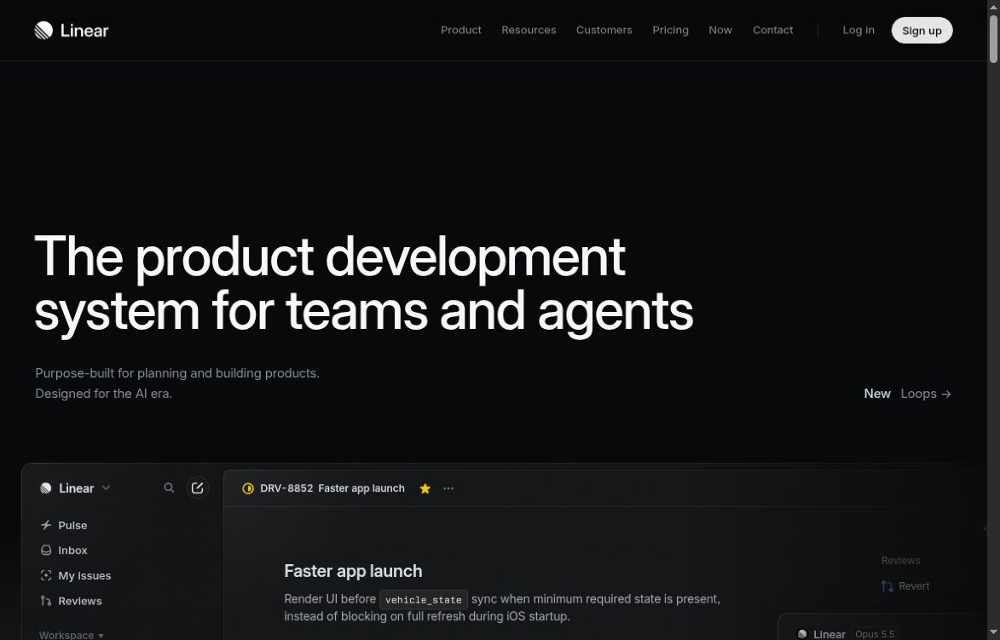

### 图 02 · linear · 定价顶部，Basic/Business 年付开启

用途：四列细分隔、价格单位邻接周期。限制：下部 CTA 在视口之外。原图 1173×751 像素。[官方页面](https://linear.app/pricing)

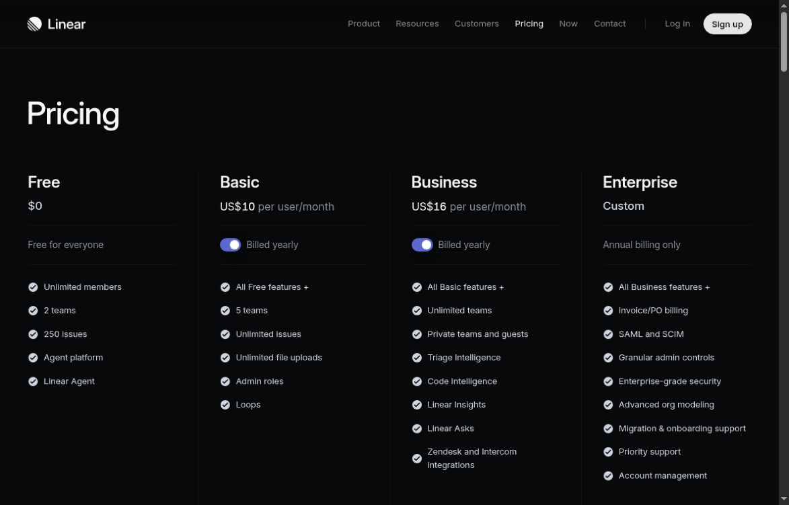

### 图 03 · linear · 定价向下滚动一屏

用途：证明带与比较表之间的稀疏节奏。限制：仅表格起点，不代表完整比较。原图 1173×751 像素。[官方页面](https://linear.app/pricing)

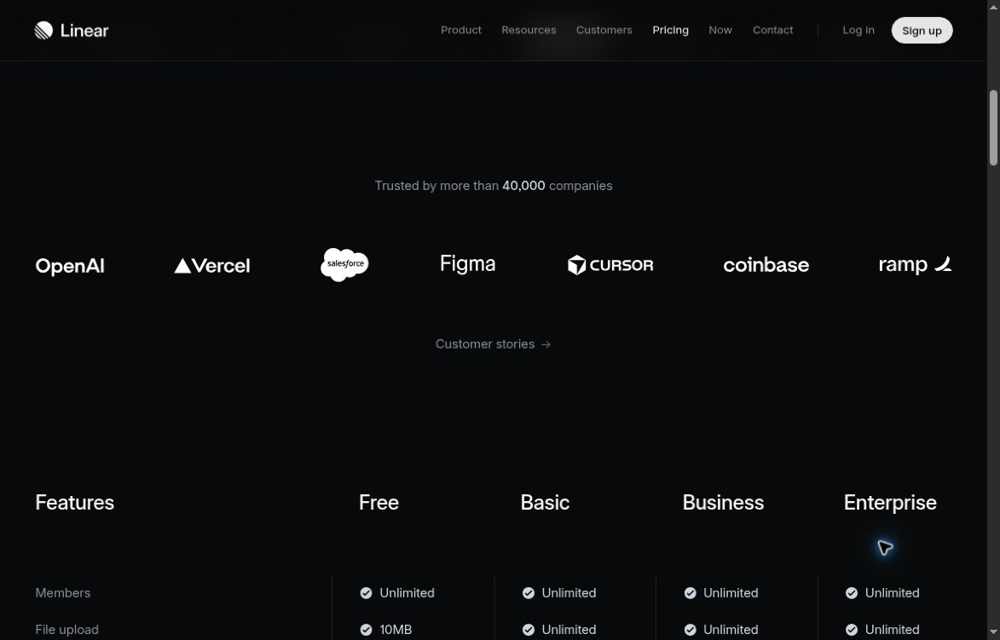

### 图 04 · stripe · 首页顶部，自动区域重定向

用途：中文长标题与彩色背景、行动及品牌带。限制：动画瞬时采样。原图 1173×751 像素。[官方页面](https://stripe.com/zh-us)

### 图 05 · stripe · 定价顶部，美国中文版本

用途：标准/定制两种商业关系并列。限制：费率为页面当时显示，非报价。原图 1173×751 像素。[官方页面](https://stripe.com/zh-us/pricing)

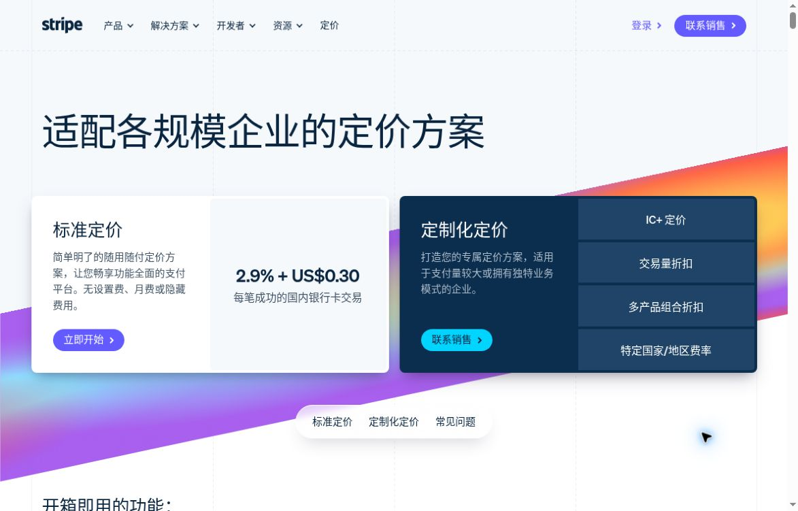

### 图 06 · stripe · 定价向下滚动一屏

用途：四列功能与支持说明。限制：截到分段中间，上方标题不完整。原图 1173×751 像素。[官方页面](https://stripe.com/zh-us/pricing)

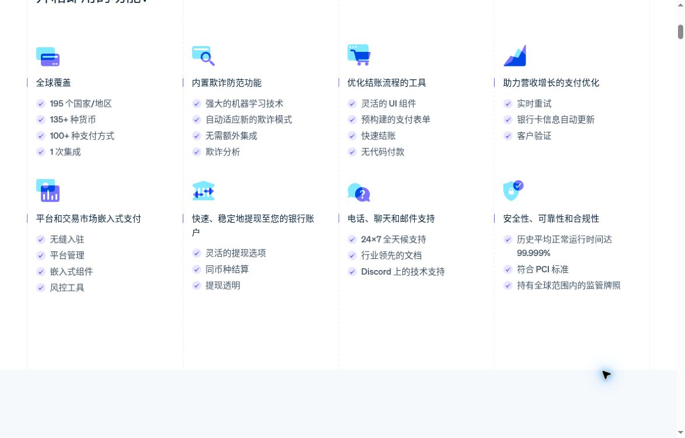

### 图 07 · notion · 首页顶部，拒绝可选 Cookie 后重拍

用途：中心大字、动态动词胶囊、UI 入口。限制：语言推荐条保留；动态词采样为 Build。原图 1173×751 像素。[官方页面](https://www.notion.com/)

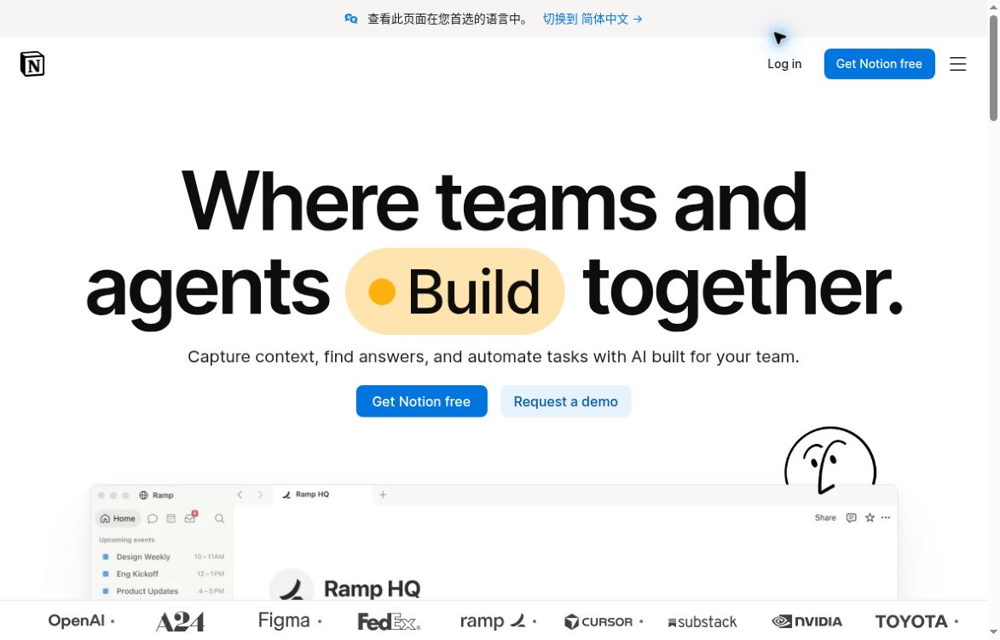

### 图 08 · notion · 定价顶部，Pay yearly，USD

用途：双主列按价值分组。限制：此帧拍摄时 Cookie 尚未出现；不声称所有时刻无浮层。原图 1173×751 像素。[官方页面](https://www.notion.com/pricing)

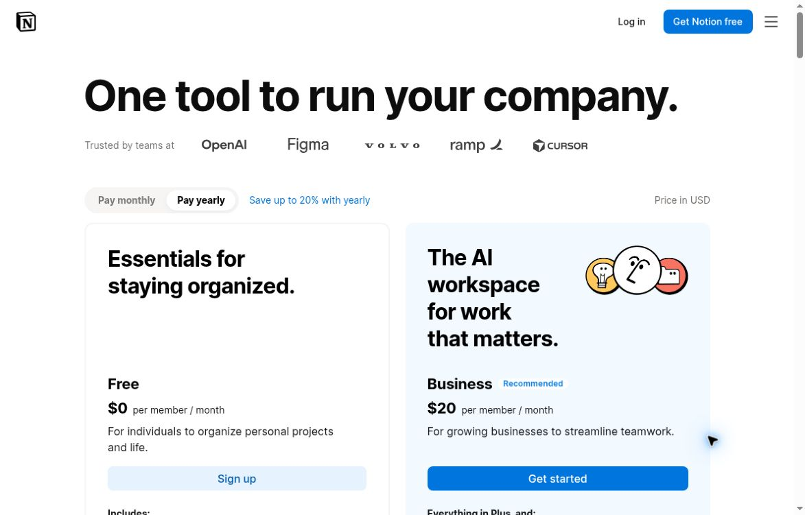

### 图 09 · notion · 定价向下滚动一屏，已拒绝 Cookie

用途：Free/Plus 与 Business/Enterprise 纵向归组。限制：从卡片中段开始，非全表。原图 1173×751 像素。[官方页面](https://www.notion.com/pricing)

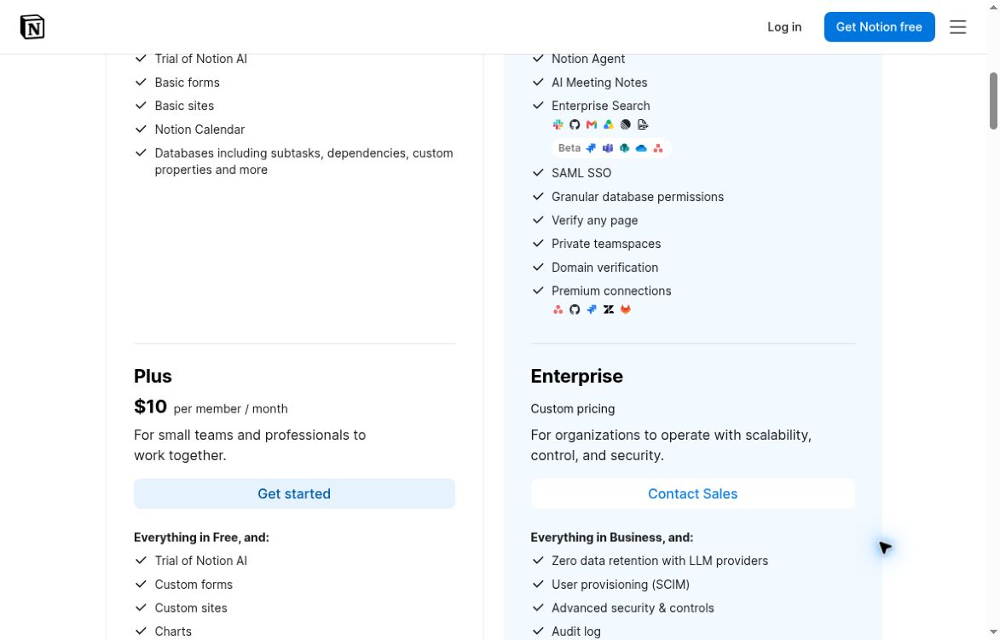

### 图 10 · vercel · 首页顶部

用途：短标题/符号/说明三段空间构图。限制：营销页，不是产品 UI。原图 1173×751 像素。[官方页面](https://vercel.com/)

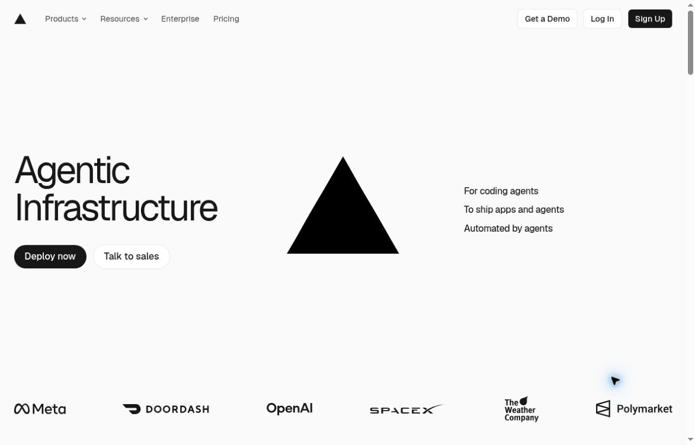

### 图 11 · vercel · 定价顶部

用途：三列框架与大数字，Pro 用量 credit。限制：CTA 下部未完全进入视口。原图 1173×751 像素。[官方页面](https://vercel.com/pricing)

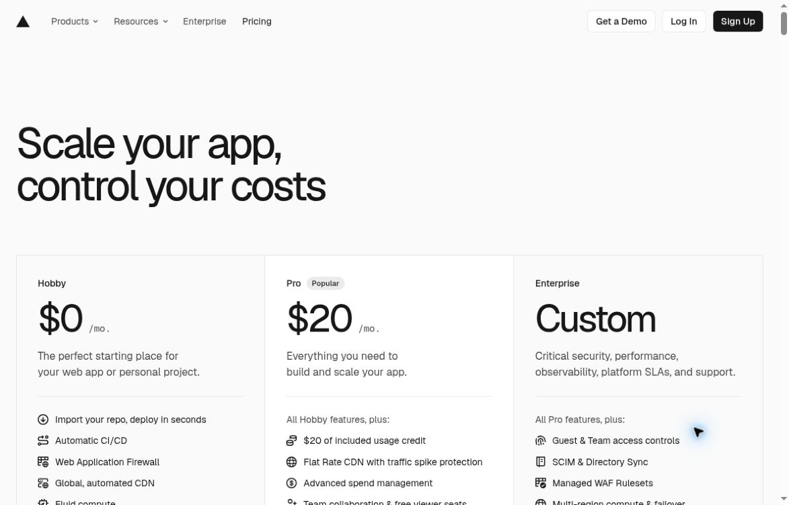

### 图 12 · vercel · 定价向下滚动一屏

用途：税费说明和成本控制卡片。限制：动态图示为瞬时状态。原图 1173×751 像素。[官方页面](https://vercel.com/pricing)

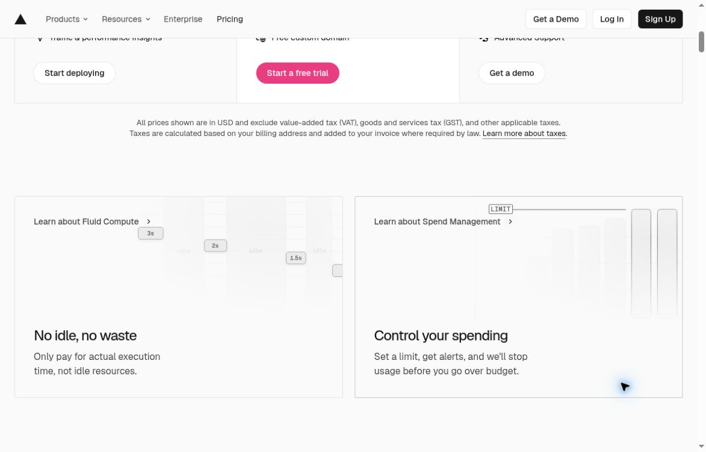

### 图 13 · ramp · 首页顶部，公告带可见

用途：点阵底、短价值句与邮箱入口。限制：表单未填写；底部动态对象局部可见。原图 1173×751 像素。[官方页面](https://ramp.com/)

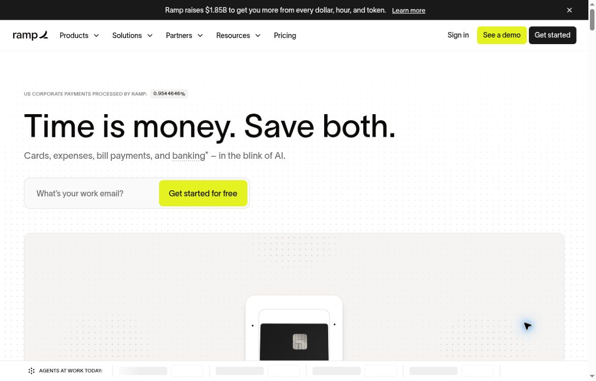

### 图 14 · ramp · 定价顶部

用途：AI 档位标记、Plus 高亮、平台费邻接。限制：可见横向滚动条，不视作响应式优良证据。原图 1165×746 像素。[官方页面](https://ramp.com/pricing)

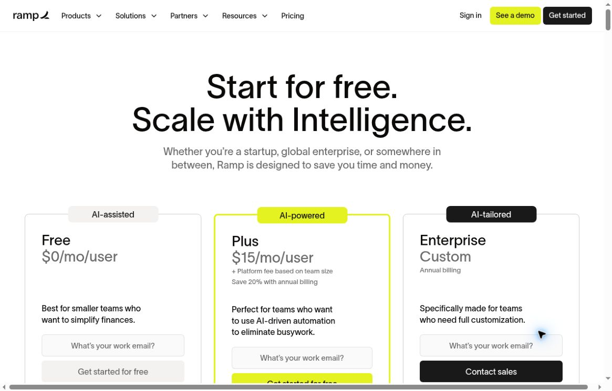

### 图 15 · ramp · 定价向下滚动一屏

用途：业务模块清单与实施/人工服务。限制：保留横向滚动条；仅中段。原图 1165×746 像素。[官方页面](https://ramp.com/pricing)

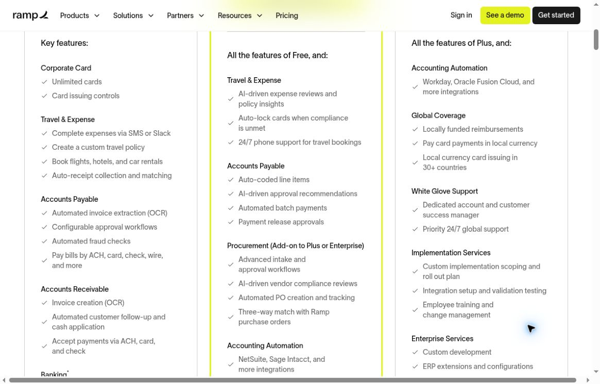

### 图 16 · intercom · 首页顶部

用途：黑灰标题、衬线说明、边缘人文照片。限制：营销摄影，非服务结果验证。原图 1173×751 像素。[官方页面](https://www.intercom.com/)

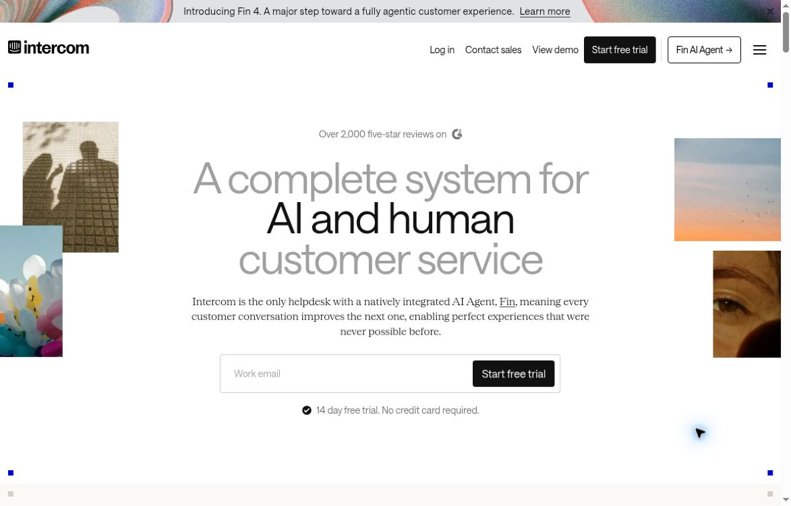

### 图 17 · intercom · 定价顶部，Billed annually

用途：宽行式方案、席位+outcome 混合单位。限制：促销为当时状态，不推断持续时间。原图 1173×751 像素。[官方页面](https://www.intercom.com/pricing)

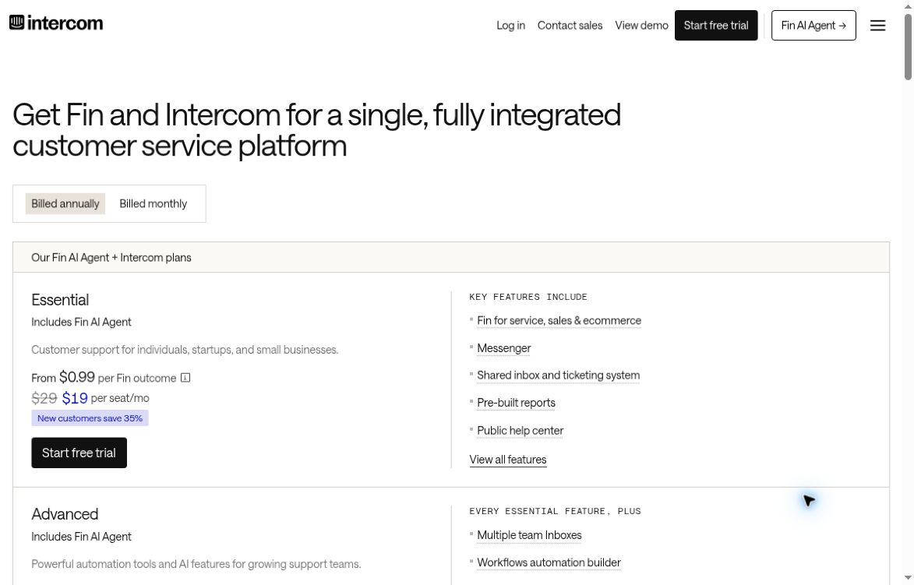

### 图 18 · intercom · 定价中段，关闭 Cookie 说明后

用途：Advanced/Expert 继承关系。限制：自动聊天邀请遮挡右下；非干净比较截图。原图 1173×751 像素。[官方页面](https://www.intercom.com/pricing)

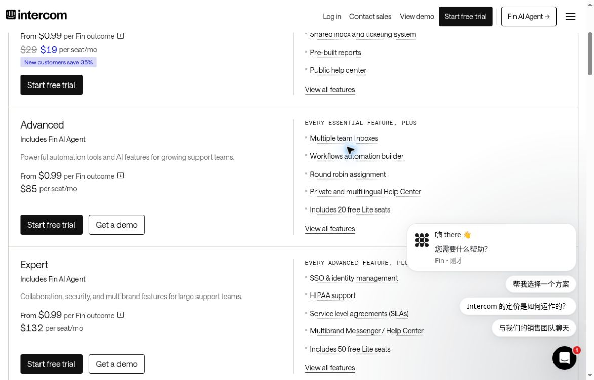

### 图 19 · intercom · 点击 Expert 价格旁 info 后，Outcome Pricing modal 打开

用途：原位解释计费定义、分层表及 Close。限制：聊天邀请压住 modal 右下，遮挡内容不作证据；公开官网 modal 非产品内升级实测。原图 1188×761 像素。[官方页面](https://www.intercom.com/pricing)

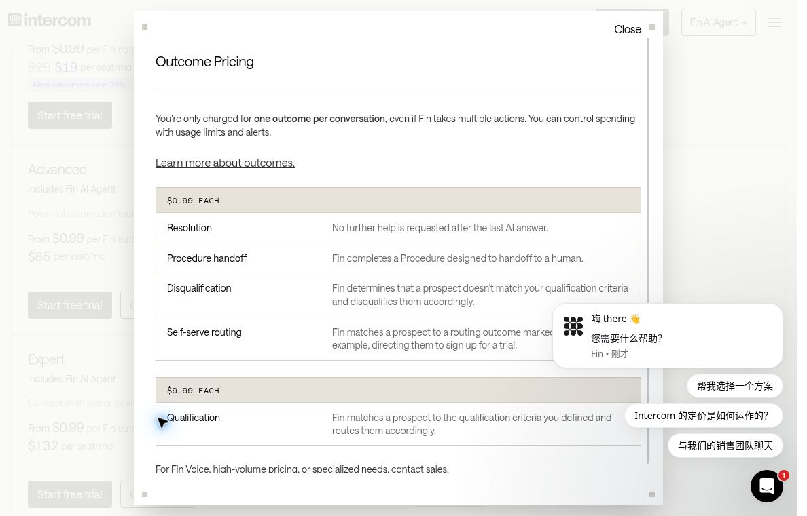

### 图 20 · intercom · 点击 modal Close 后

用途：返回 Advanced/Expert 原滚动区段。限制：聊天邀请仍在；仅视觉上下文恢复，未测焦点。原图 1173×751 像素。[官方页面](https://www.intercom.com/pricing)

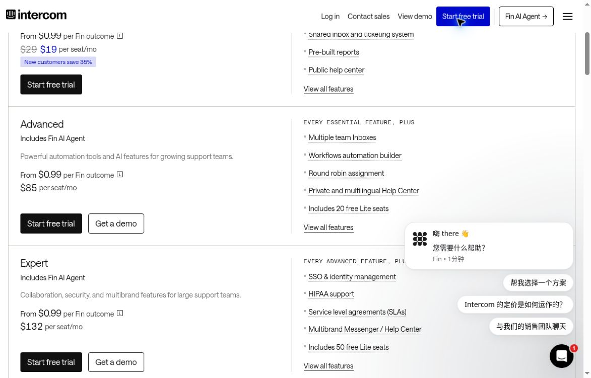
