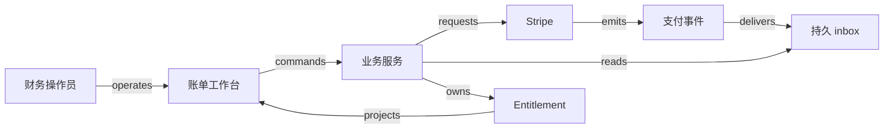

# H01 · 承诺、收款与履约

一家公司向客户出售 30 个服务日的订阅，价格为 300 个记账单位，预付后开通。这是 synthetic 教学案例：不含税、手续费、汇率、退款、credit balance 和部分付款；服务日等长，区间为 `[0, 30)`。报价、合同、服务权利和教学收入表由合成系统管理；Stripe 作为公开文档支持的发票与付款 provider 参照。合同签署工具未指定，不把集成能力归给未读过文档的厂商。

销售承诺的是 30 天服务，客户支付的是约定价格，财务需要解释服务期间内完成了多少义务。因此，合同生效、发票支付、服务开通和收入累计分属不同对象。三个阶段可能紧邻发生，仍不能用同一个绿色勾代表它们。

## 对象与决定

| Actor / object | 工作与权威 | 不变量 |
|---|---|---|
| 客户与财务操作员 | 客户接受合同，获授权操作员确认开票；权限在服务端检查 | 不以 UI 按钮是否显示代替授权 |
| Quote / contract | 合成合同服务保存版本与 accepted 事实 | accepted 针对确定版本；改价需要新版本与重新确认 |
| Invoice | Stripe 记录发票状态，本地保存映射和查询副本 | 外部 ID 连同 provider account、tenant 构成映射身份 |
| Entitlement | 合成业务服务决定客户能否使用服务 | 本例必须有有效合同及经核对的付款确认；同一购买只开通一次 |
| Revenue schedule | 合成账务服务保存演算规则、区间与结果版本 | 累计值能追溯输入；修正不无痕覆盖旧依据 |

Stripe 文档把 invoice 状态区分为 `draft`、`open`、`paid`、`void` 和 `uncollectible`。本例的正常路径只取 `draft → open → paid`；真实产品还存在更复杂的后续动作，状态全集不等于此例的允许转换。`STRIPE_INV-C1`：[Invoice lifecycle](https://docs.stripe.com/invoicing/overview)。

合同自己的路径为 `draft → accepted → superseded`；权利为 `pending → active → ended`，允许由人工恢复流程进入 `suspended`。合同改价不会自动重写已支付发票；暂停权利也不自动表示已退款。每个转换都写明 guard、持久化效果和恢复方式，见 [结构数据](example-h01.json)。

## 从按钮到外部确认

操作员在账单工作台查看合同版本、金额和服务期间，点击“确认开票”。服务端核验权限与版本，把 operation ID 和请求内容持久化，再向 provider 发出请求。页面先显示“请求已保存”，随后展示外部返回的发票状态。若调用超时，operation 保持 `unknown`，恢复流程先核对外部对象，不能因页面没有结果就重新产生一张发票。此处的操作记录与恢复机制是合成设计。

客户完成支付后，通知先进入接收边界，再驱动业务状态和查询投影。Stripe 的 webhook 文档说明事件可能重复、顺序不保证；它要求签名验证，并介绍去重与异步处理。`STRIPE_WEBHOOK-C1`：[Event ordering / Handle duplicate events](https://docs.stripe.com/webhooks)。

因此，本例将经过验证的通知先存入 durable inbox，再由 worker 核对对应 invoice。去重和“尚未开通则开通”的业务约束各有职责：event ID 防重复投递，同一购买的唯一业务键防不同通知重复触发同一效果。inbox 写入、业务变更与消费标记需要相容的事务边界；若外部副作用不在同一事务内，就记录尝试并对账。页面显示最后核对时间与当前操作状态；通知抵达不是自动宣告所有后续工作成功。

下图为合成设计的简图。箭头旁的类型与 [typed relations](relation-types.json)一致；详细 payload、失败与不变量在 JSON 中。

## 手算一次收入区间

教学算法把 300 单位均匀分配到 30 个服务日。观察窗口 `[0, 10)` 与服务区间重叠 10 天，累计为 `300 × 10 / 30 = 100`；窗口 `[10, 15)` 另有 5 天，为 50；截至第 15 天累计 150。半开区间让相邻窗口的边界不被重复计算。输入若有空区间、负金额或重叠修订，必须先验证语义，不能直接相加。

这对应 `ALG:windows`：逐条扫描 n 个 line item 的朴素计算是 O(n)；预聚合能降低反复查询的工作，但输入修订后必须重算受影响窗口。金额用固定最小单位或明确小数规则保存，尾差按显式规则分配。时间规则改变为真实日历日后，月长不同，不能继续假设每个月都是 30 天。

Stripe Revenue Recognition 的公开说明以 finalized invoice 的 line item 服务期间为重要输入；取消 subscription 不自动修改这些发票的收入计划。它支持“收款与收入计划要分开理解”这一点，不为本例的简化算法提供财务合规证明。`STRIPE_REV-C1`：[Subscriptions and invoicing](https://docs.stripe.com/revenue-recognition/methodology/subscriptions-and-invoicing)。

## 算得快与执行可靠

`ALG:lookup` 用 `(provider account, tenant, invoice ID)` 找本地映射，避免扫描所有账单。`ALG:top-k` 可为操作员取出金额最大的 k 个待核对项目；金额相同再按稳定 ID 排序。优先队列提高处理选择效率，却不能让被选中的付款自动变成已到账。

`ALG:caches` 缓存工作台读模型，key 包括 tenant 与对象身份，返回值带核对时间。合成目标是在 100 个租户、每租户 1,000 张账单、20 个并发查询下测量列表延迟 p95 与 p99，并分别测 cache hit/miss；这些是待测 workload，不是性能结论。权利开通读取权威证据，不由缓存中的绿色标签授权。

并发操作员提交同一合同版本时，唯一 operation key 与版本检查将第二次提交关联到同一尝试或明确拒绝。worker 在更新后崩溃时，重放不得再开通一次服务。若无法确认外部是否成功，先保留 unknown 与人工核对入口；只有确定失败或可按 provider 语义安全重试时才重试。去重记录的保留期也要覆盖可能重放的范围，不能由一次性能优化随意缩短。

## Eval 与检查答案

本例的关键决定由规则与人完成，AI eval 不适用。若以后由模型建议催收或合同解释，需要单独设置有标签的留出集、错判成本与人工接管条件；不能把本例的确定性验收当作模型评估。

| Given / when | 应观察的结果与理由 |
|---|---|
| 有效合同、金额 300，付款核对完成 | 一张对应 invoice、一个 active entitlement；第 10 天教学累计为 100。付款和收入分别可查 |
| 同一通知投递两次 | inbox 可记录两次接收，但一个业务效果；去重与业务唯一性均可观察 |
| paid 相关通知先于旧的 open 信息到达 | 先核对 provider 当前对象，再投影；不能按到达顺序把 paid 回退成 open |
| 两个操作员同时点击 | 一个购买对应一个开票尝试，另一请求返回同一尝试或版本冲突 |
| 两个租户使用相同本地编号 | 分别读取各自数据；命中缓存也不跨租户 |
| provider 接受请求后客户端超时 | 保留 unknown，通过 operation 对账；不盲目新建第二张 invoice |
| worker 在业务更新后、消费标记前崩溃 | 恢复后仍只有一个 entitlement，最终可解释消费状态 |

这些是检查定义及手算答案。尚未建立服务、调用 provider sandbox、执行端到端测试或测量负载。需要的执行证据和固定 ID 见结构数据中的 checks。

## 条件变化

把预付改为赊账，合同已接受即可按信用规则先开通，`paid` 不再是相同的 guard；逾期风险和暂停策略成为新对象与规则。保持不变的是每次状态变化仍需明确的权威与证据。把一张服务合同改为三批实物交付，则需要数量与部分履约对象；用相同 `active` 状态会掩盖欠交。完整练习与简答见 [教材主线](../../../projects/books/saas-engineering/learning-path.md)。

演示可以让读者拖动服务区间、重复发送通知、颠倒投递次序或模拟超时，同时观察合同、发票、权利和收入表各自的变化。布局和动效由本地 Claude 选择；synthetic 假设、未确认状态和 provider 事实的界限应在操作时可见。证据与核查记录见 [来源卡](../../provenance/saas-engineering-atlas/sources.md) 与 [CHANGELOG](../../provenance/saas-engineering-atlas/CHANGELOG.md)。
