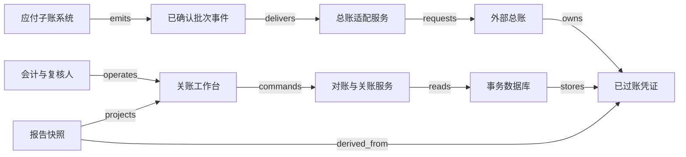

# H03 · 子账、对账、关账与管理报告

关账向报告使用者作出的承诺是：在明确的法人、期间、币种与规则版本内，这组数字能解释其来源、遗漏、调整和批准依据。关账页面全部打勾，只能证明有人完成了登记的任务；账目是否完整、期间是否仍可写入、管理报告是否使用同一批数据，还需要各自的证据。

[H02](H02.md) 产生了采购发票 A 707.00、修订后的 B 50.50，以及付款 A 707.00。本章把它们接入应付子账，再核对总账，形成有版本的月度报告。以下金额、科目、期间政策、调度与技术方案均为 synthetic 教学设计：一个法人、一种记账币种、不计税与汇率，不涉及法定报表、合并抵销或真实会计准则裁决。为方便演算，假定采购在当期计入费用；真实采购是否形成存货、资产或费用须另行判断。期初应付为 1,000.00，教学期间为 `[10 月 1 日 00:00, 11 月 1 日 00:00)`，按法人既定时区确定边界。

## 识题：从现象找到方法

| 识别线索 | 可选解法 | 接着查什么、验什么 |
|---|---|---|
| 总差为零，明细仍可能漏或重 | 按来源键对齐两侧，保留未匹配项 | 查逐笔/汇总过账映射与控制总额；检查覆盖而不只看净额 |
| 报告发布后又收到旧期间记录 | 固定截止范围，授权修订生成新版本 | 查会计日期、期间锁和重开政策；验旧报告内容不变 |
| 先后关系清楚，完成时间仍排不出 | 先检查依赖图，再加人员与时间约束 | 查任务前提与资源日历；分别验无环、前提满足、资源不冲突 |

下面沿这些线索建立对象与边界，再手算一组数据、用反例验算，最后改变前提重做判断。

## 解法：账目与工作清单分别说明什么

子账保留“向哪家供应商、因为哪张发票、尚欠多少”的业务明细；总账把这些事实归入科目与维度，支持统一汇总；对账解释两种记录是否相容；关账日程协调谁在何时提供证据；报告从固定版本的数据计算指标。这些对象共同服务于一个期间，却没有同一条生命周期。

Microsoft Dynamics 365 Finance 的 **Financial period close workspace** 允许按公司、领域和责任人观察关账任务；依赖未完成的任务不能标为完成，任务可附凭证号、说明或报告等材料。[Financial period close workspace](https://learn.microsoft.com/en-us/dynamics365/finance/general-ledger/financial-period-close-workspace)（`H03:claim:d365-close-dependencies`）。这个产品事实帮助理解“任务依赖”，并没有证明勾选完成会自动核实凭证内容或锁住期间。

期间过账控制有自己的语义。Microsoft 的另一篇文档将 Open、On hold、Permanently closed 区分开：On hold 可重新打开；Permanently closed 不能重开，也不能再记调整；模块与用户组访问还有单独控制。[Mass financial period close](https://learn.microsoft.com/en-us/dynamics365/finance/general-ledger/tasks/mass-financial-period-close)（`H03:claim:d365-period-status`）。本例选择可授权重开的封存流程，不借用永久关闭来实现日常“出报表”按钮，也不把合成状态名当作 Dynamics 的状态全集。

| 对象 | 权威、身份与约束 |
|---|---|
| Subledger entry 子账记录 | 应付服务拥有业务金额；身份含租户、法人、来源对象、事件版本。记录会计日期、业务发生时间与收到时间，不混成一个 timestamp |
| Journal 凭证与 journal line 分录 | 总账服务拥有 posted 事实；凭证使用唯一来源映射与规则版本，借贷平衡只是必要检查，不能证明科目、期间或业务真实性 |
| Reconciliation 对账运行 | 对账服务保存输入快照、控制总额、明细差异与人工处置；run ID 绑定同一法人、期间、币种、cutoff 和规则版本 |
| Accounting period 会计期间 | 关账负责人决定开放、冻结与授权重开；总账写入服务执行 guard，后台导入也不能绕过 |
| Close task 关账任务 | 任务负责人完成具体核对；复核人批准证据，模板版本与前提变更都可追溯 |
| Management report 管理报告 | 报告服务拥有已发布版本；每个数能追到输入 run、凭证与分类规则，旧版本不会被新数据无声覆盖 |

应付会计提交业务记录，总账会计处理科目与调整，复核人判断差异，关账负责人冻结期间，管理者读取报告。角色冲突通过“编制与复核分离”处理；报告读取权不授予过账权，同一租户中的法人访问也要单独验证。源票据的更正与总账更正不能由一个管理员直接覆盖两侧，否则会失去解释差异的依据。

## 演算：一次对账的手算与反例

本例用正数表示应付增加、负数表示应付减少。正确的子账期末为：

`1,000.00 + 707.00 + 50.50 − 707.00 = 1,050.50`。

为暴露集成错误，假设总账中的 A 被重复过账，而 B 丢失。按来源身份展开后能得到：

| 来源键 | 子账变动 | 总账变动 | 总账减子账 | 解释 |
|---|---:|---:|---:|---|
| A | +707.00 | +1,414.00 | +707.00 | 同一来源有两笔总账记录 |
| B | +50.50 | 0.00 | −50.50 | 子账已确认，总账未入账 |
| PAY-A | −707.00 | −707.00 | 0.00 | 金额相符，仍应核对法人、期间、币种与来源 |
| 合计 | +50.50 | +707.00 | +656.50 | 总账期末 1,707.00，子账期末 1,050.50 |

修复时，不能把总账余额字段直接改成 1,050.50。应先确认哪一笔 A 是重复来源，追加与该错误凭证关联的冲销 −707.00，再补记 B 的 +50.50；既有记录保留。修复后的总账变动为 50.50，差异为零。假设 A、B 都按费用处理，则两张发票合计借记费用 757.50、贷记应付 757.50，付款借记应付 707.00、贷记现金 707.00。这说明付款清偿负债，不会在本例中再次产生 707.00 费用。

**反例一：净差为零也可能缺账。** 若一笔发票 +100.00 和一笔付款 −100.00 都未传入总账，期末余额依然对得上，明细却缺失两笔。一个只看总差是否小于 0.01 的程序会错误关闭对账。检查必须同时看来源覆盖、重复计数、金额、币种、期间和例外处置。借贷总额相等也有类似盲点：错误地同时借费用、贷应付 100.00，仍然平衡。

**反例二：同额不等于同一笔。** 两个供应商分别有 100.00 发票，按金额贪心配对可能把甲的子账连到乙的总账。系统应先按稳定来源身份找候选；外部银行记录确实缺乏相同 ID 时，金额、日期、账户与参考号只能形成待核对候选，不能为了“自动匹配率”任意消除差异。

`ALG:lookup` 对每一侧按完整来源键聚合，执行 full outer join，保留仅左侧、仅右侧、同键多笔与金额不等四类情况。若有 n 条子账、m 条总账，逐一互找约为 O(nm)；哈希聚合与连接在合适内存条件下平均约 O(n+m)，还需内存存储键与累计值。超出内存时可按法人、期间和来源类型分区，或排序后合并，排序成本约 O(n log n + m log m)。优化不能把来源键压成金额，不能把未匹配行过滤掉。

如果允许按“科目＋日期＋币种”汇总过账，源记录与总账不再一对一。需要保存 posting batch 的明细映射和控制总额，再在批内对齐；不能要求总账行数等于发票行数。每次对账保留输入摘要、数量与批次成员范围，确保“两个摘要相同”没有遮住不同明细。

## 时间窗口决定哪些事实属于这版结果

`ALG:windows` 不只处理日期筛选。10 月 31 日发生的业务，11 月 2 日才到达接口，是否属于 10 月要由会计政策决定，而非由网络延迟决定。本例规定：冻结前已获专业确认且会计日期落在期间内的记录进入候选集合；每个上游同时给出导出批次号、截止点和控制总数。对账运行固定这些输入，不能在计算途中混入新批次。

“取了截止到序号 500 的事件”只说明系统读到了哪里，不能证明现实世界已没有遗漏。应付负责人还要确认该批次覆盖范围，并登记已收货未到票、未完成调整等已知例外。cutoff 是一致取数条件，完整性声明是业务责任；两者缺一，都不应让报告变成“最终版”。半开区间使 11 月 1 日 00:00 只属于下一期间；日期边界采用法人时区，存储中保留明确的会计日期及其规则。

本例期间状态为 open → freezing → frozen。开始冻结后，系统阻止普通新过账，记录边界版本；已在执行的事务必须与冻结使用相同的期间写入门槛，确定它在边界前提交，或被拒绝重提。只读一个 `is_closed` 布尔值再过几秒写入，会让关账与过账竞争。冻结前所有需要纳入的事务完成，输入核对和调整复核通过，才能生成 frozen 快照。

迟到发票不能悄悄改变已发布报告。合成政策允许关账负责人授权重开：记录理由与旧报告版本，期间进入 reopened，重新核对后生成新快照和报告 v2，v1 保留并标明被替代。若真实政策禁止重开，则由专业人员决定下一开放期间的调整及披露；系统不自动替用户决定期间归属。这个边界与 Dynamics 的 Permanently closed 不可重开事实相容，但本文的重开流程属于本例设计。

## 关账依赖是一张有向图

设 A 为完整导入子账，B 为应付与总账对账，C 为银行核对，D 为差异调整复核，E 为生成报告。合成依赖为 `A → B`、`B → D`、`C → D`、`D → E`。只有全部前提完成且证据版本有效，后继才能开始。一次“报告生成成功”不反向证明 B、C 已正确完成。

`ALG:scheduling` 可用入度表进行拓扑排序，每完成一个任务就减少其后继的未完成前提数；对 v 个任务、e 条依赖，遍历为 O(v+e)。入度始终不能归零的节点提示依赖环或未满足条件。若 A、B、C、D、E 分别需要 2、3、4、1、1 小时，假设资源独立、无工作日限制、时刻 0 开始，则 A 在 2 完成，B 在 5 完成，C 在 4 完成，D 只能在 5 开始，于 6 完成，E 于 7 完成。直接相加得到 11 小时忽略了并行。

这个 7 小时只是依赖下界。若 B、C 都由同一会计独占处理，则至少有 3+4 小时的该人员工作，加上后续 D、E 的 2 小时，下界升至 9 小时；安排 C 在 0–4、B 在 4–7 恰可达到 9，前提是 A 使用另一资源。现实还有休息日、审批等待和访问限制。拓扑排序给出合法先后，不保证资源可行，更不能把复杂人工复核压成确定时长。若新增 `E → A`，形成环，应在保存模板时拒绝并指出路径，而不是让任务长期显示“等待”。

## 工作台怎样形成可复核的结果

工作台首要筛选是法人、期间、记账币种与对账运行版本。首页给出未完成前提、差异数量、数据截止点和负责人；对账详情同时展示控制总额与未匹配明细，点击差异可回到源记录、凭证与处置理由。“差异总额 0”旁仍要显示未匹配条数，避免视觉绿灯盖住抵消错误。

“运行对账”是有身份的异步命令。服务端校验权限、冻结输入 manifest，并保存 run ID；页面显示 queued、running、failed 或 completed。刷新页面与重新连接后按同一 run 查询。completed 意味着计算完成，只有经过复核、没有未解释差异且依赖版本未变，才可显示 reconciled。任务完成按钮写入责任人、证据引用与被核对版本，证据改变使相应任务及后继结果失效，而不是只改一个百分比。

下图与结构数据选择独立总账的部署方式：适配器只拥有导入尝试，外部总账拥有 posted 事实，本地保存已核对的副本。单体部署可以合并服务边界，仍须保留这些对象责任。

合成后端可以用 Java/Spring 或 Python/Django 管理凭证、期间锁与任务，配 PostgreSQL；前端用 React/Vue 展示可展开差异表和依赖图，或用服务端页面先交付可复核表格。小规模直接在事务数据库中计算减少数据搬运；大规模可将冻结明细导出到 Parquet，用 DuckDB 或独立分析服务计算，但必须保留导出 manifest、版本与校验总额，再将结果登记回权威对账记录。分析副本不能直接授权过账。

金额采用精度明确的小数或整数最小单位，拒绝 NaN、Infinity、币种缺失和不明确的舍入。PostgreSQL 文档将 numeric/decimal 与不精确浮点区分，说明声明 scale 后存储会发生相应舍入。[Numeric Types §8.1.2、§8.1.3](https://www.postgresql.org/docs/current/datatype-numeric.html)（`H03:claim:postgres-numeric`）。因此数据库字段类型也需要服从金额政策；把所有中间单价都过早存为两位小数，可能在大量行累计时损失信息。这是技术选择推论，不声称 Microsoft 使用 PostgreSQL 或上述计算方案。

## 故障、并发与规模

正常链路是：业务侧确认 A、B、PAY-A；总账按固定映射各过账一次；会计运行对账并检查全部明细；复核人接受处置证据；关账服务完成冻结；报告服务生成 v1，展示应付期末 1,050.50 与费用 757.50，并允许向下追溯来源。银行核对是另一个控制：若现金期初 2,000.00，本例仅有付款 707.00，则期末现金为 1,293.00；银行记录有其他费用时，须另外解释，不能靠应付对平推定现金也对平。

外部总账导入请求超时，可能是“凭证已入账、响应未返回”。适配器先保存稳定的 `(tenant, company, source_id, accounting_rule_version)` 与 operation ID，再发送；超时保持 unknown，以外部批次或来源引用查回。接收方没有唯一来源约束时，本地重试还不足以防重，必须先对账或人工接管。重复子账事件不得生成第二笔凭证；更正事件需引用被更正版本，早于原事件到达时暂存依赖，不把负数冲销孤立当作已完结。

报告任务在写出文件后崩溃，可以通过同一 report ID 和内容校验找回已生成对象，再完成登记；未登记文件不自动成为发布版本。对账任务在汇总中断后，从同一冻结 manifest 重跑，不能偷偷使用新的实时明细。报告缓存键包含租户、法人、期间、report version、mapping version 与权限范围；新版本发布时更新当前版本指针，旧版仍可按明确链接查阅。不可用缓存的“任务完成”标签绕过期间 guard。

假设 50 个租户、500 个法人，每月共 1,000 万条分录，最大单法人单期间 200 万条、4,000 个关账任务，20 人同时复核。待测目标为有索引的 50 行差异列表 p95 800 毫秒，任务命令 p95 1 秒，冻结输入的 200 万行核对在 10 分钟内完成；同时记录内存、磁盘临时数据、队列等待、重跑成本及缓存冷/热条件。扫描期间不持有长时间写锁；固定快照与输入 manifest 提供一致性。期间冻结与新过账必须保持串行的边界判定，繁忙法人不应通过一个全库锁阻塞其他法人。以上是工作负载与验收目标，没有负载实测结论。

## 验算：检查与 AI 使用边界

| 检查情境 | 期望结果与实际观察点 |
|---|---|
| 正常路径 | A、B、PAY-A 各有一组来源关联，子账与总账均为 1,050.50，报告可追溯到该 run |
| 重复 | 重放 A 的事件与过账请求，总账来源效果只有一份；重复投递日志可见 |
| 乱序 | 更正先于原凭证到达时等待依赖；旧 completed 通知不能恢复已经失效的任务版本 |
| 并发 | 冻结与新过账竞争，一笔明确进入被冻结版本或被拒绝；报告不出现半笔凭证 |
| 租户隔离 | 相同来源号、期间名和报告号跨租户/法人存在，查询、导出与缓存均保持授权范围 |
| 未知结果 | 外部总账已接受后响应丢失，查回原凭证，不新建第二笔；无法确认时阻止关账 |
| 恢复 | 汇总中途失败后使用相同 manifest 重跑；报告登记失败后恢复同一版本，旧版内容不变 |
| 抵消与错误科目 | 净差为零但存在两条缺失来源时阻止 reconciled；借贷平衡但科目映射错误进入人工复核 |
| 依赖与迟到 | 有环模板被拒绝；迟到记录不得改写 v1，授权重开后生成 v2 并使相关复核失效 |

规则计算与关账 guard 不需要 AI。若为管理报告加入 AI 差异解释，输入应是有权限的结构化结果与来源链接，输出只能建议原因，不能生成凭证、消除差异或宣告“已审计”。可冻结 100 个留出差异包，包含真重复、跨期、错误科目、零净差缺账与信息不足案例；分别计算有来源支持的事实句数/全部事实句数、错误原因数/给出原因的案例数、应表示不确定却给确定结论数/信息不足案例数、复核更正数/全部案例数。把“依据不足”作为允许答案，并记录人工修改后的原因。流畅度不进入关账放行条件；本章未运行模型评估。

## 变式：改变前提后的迁移练习

**练习一：11 月 2 日收到一张会计人员认定属于 10 月的 50.00 发票，v1 已发布；怎样处理？**

简答：保留 v1 的输入与结果，先查期间政策和授权。本例可以授权重开，则新记录增加应付 50.00，重新对账后期末为 1,100.50，产生 v2 并清楚关联 v1。若禁止重开，不能继续使用这个数，应由专业人员确定下一期间调整及披露。反例是后台按会计日期直接插入旧期间，导致同一 v1 链接数字变化。检查 v1 内容哈希不变、新记录只出现在获批版本、相关任务重新复核。

**练习二：总账改为每天只记一笔应付汇总，是否还要求每张发票对应一条总账行？**

简答：保持业务来源可追溯与总额守恒，匹配单位改为 posting batch；批次必须保存来源明细成员、金额、币种、期间和规则版本。A 与 B 可合并为 757.50，但 PAY-A 的 −707.00 与其身份仍能追查。反例是只存一个 50.50 净额，无法分辨 757.50 的新增与 707.00 的清偿是否都发生。检查批次成员恰好覆盖获批输入、无重复或遗漏，并能重算到每个科目及维度。

**下一步探索。** 接触一种新财务系统，先列出来源如何进入总账：逐笔、汇总批次还是人工凭证，以及哪个角色声明截止范围完整。再选择来源级连接核对、批次控制总额或需要人工确认的候选匹配；这些方案不能在缺失身份时互相替代。查期间锁、重开政策与依赖任务语义，用一组“净差为零但缺两笔”的合成输入和一次迟到补录试验，验证系统既能指出缺项，又能保持旧报告版本不变。

`TR:H03:X02:reconcile-before-consolidate` 可迁移到集团内部往来核对，保留身份、两侧金额、期间与差异责任；跨法人可能有汇率、内部交易双方确认与抵销规则，不能把同币种子账—总账等额关系直接当作抵销分录。`TR:H03:H07:dependency-not-capacity` 可迁移关账任务的依赖图；生产排程还须考虑设备、物料与工艺约束，拓扑有序并不保证可生产。演示可切换“净额匹配/来源匹配”、注入晚到记录或给依赖图添加环，让读者观察为何数字相等、任务完成、报告发布是三个不同判断。证据与执行范围见 [evidence.json](evidence.json) 与 [CHANGELOG.md](CHANGELOG.md)。
