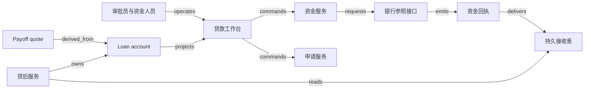

# V12 · 贷款：让批准、资金和债权各有依据

贷款把今天的一次资金交付，换成未来一段时间内的还款义务。申请通过只说明机构接受了某组条件；放款记录说明一次执行；债权余额说明此刻还欠什么；payoff（提前结清）则要求把某个时点的全部剩余义务与实际收款核到一起。它们分别回答不同问题。把四者压成“成功”，会让页面看似完成而资金或利息仍未结清。

本例采用 synthetic 封闭教学政策：单币种 CU，最小金额单位 0.01 CU；一次放款本金 1,000 CU，日单利率 0.1%，按未偿本金计息，不复利；在整数日边界处理现金，区间为 `[起日, 止日)`；每个结算事件汇总利息后四舍五入到分，先冲利息再冲本金。无费用、罚息、抵押、税或信用评分。第 10 日约定还 310 CU，第 15 日请求结清。它是演算模型，不是 Mambu 的产品配置、市场利率或可直接上线的信贷政策。

## 识题：从现象找到方法

| 识别线索 | 可选解法 | 接着查什么、验什么 |
|---|---|---|
| 同笔还款换一个生效日，结清额改变 | 按本金变化的生效时间分段重演 | 查day-count、舍入、分配顺序和回填规则；把本金与利息分开复算 |
| 已经批准，实际资金还不确定 | 批准额度、放款尝试与已放本金分开 | 查disbursement身份与资金确认来源；验未执行额度不被当作计息本金 |
| 昨日的结清报价今天已不够 | 报价绑定余额版本与有效时点 | 查payoff有效期和迟到付款政策；验真实来款保留且差额有去向 |

下面沿这些线索建立对象与边界，再手算一组数据、用反例验算，最后改变前提重做判断。

## 解法：申请是决定的输入，账户是决定的后果

客户提交资料，贷款操作员检查完整性，信贷审批员判断是否接受风险，资金操作员发起放款，贷后人员处理到账和余额差异。角色分工的目的不是多设几个按钮，而是保留“谁提出条件、谁批准条件、谁执行现金动作”的责任。本例规定申请人不能批准自己的申请；审批后改变金额或利率必须重开审批。这是合成职责分离政策，不宣称是所有贷款机构的规则。

Mambu 文档说明 `Partial Application` 表示资料不完整，`Pending Approval` 表示正在评估；批准后条款不能直接改动，放款后账户成为 `Active`；逾期与结清另有状态。这支持“批准、执行、履行分开”的产品参照，不证明某次银行转账已到账。[Mambu：Loan Account Life Cycle and States](https://docs.mambu.com/docs/loan-account-life-cycle-and-states/)（`V12:claim:mambu-states`）。另一页明确要求有 `Approve Loan` 权限的用户先批准，并限定批准入口为 `Pending Approval`。[Mambu：Approving a Loan](https://docs.mambu.com/docs/approving-a-loan/)（`V12:claim:mambu-approval`）。

| 对象与身份 | 本例权威、状态与约束 |
|---|---|
| Application：`tenant + application ID + version` | 申请服务保管资料清单、条款版本和审批证据。`draft → review → approved / rejected`；缺资料回 `draft`，批准后变更进入 `superseded` 并产生新版本 |
| Disbursement：`tenant + funding operation ID` | 资金服务保管请求，银行参照系统对执行结果负责。`prepared → submitted → settled / failed / unknown`；`unknown` 不允许改金额后当作同一请求重试 |
| Loan account：`tenant + loan ID` | 贷后服务保管本金、应计利息、还款分配和冲正。`pending-funding → active ↔ arrears → paid-off`；到账证据与放款入账共同支持激活 |
| Repayment：`tenant + bank account + bank transaction ID` | 入账服务核对现金并分配到债权。`received → applied`，无法匹配为 `unmatched`；退回或错误更正通过 `reversed` 与补正条目保留原链 |
| Payoff quote：`loan ID + quote version + as-of day` | 贷后服务计算可追溯金额。`quoted → accepted → settled`，余额变化或过期进入 `expired`；接受报价本身不消灭债权 |

拒绝申请没有本金偿还动作，因为尚未交付资金。已放款后的“撤销”却不能通过删除申请实现：如果现金已出账，需要核对收回或另行处理，原放款证据必须保留。Mambu 还区分全部义务履行后的关闭与核销关闭，本例只实现前者；免除部分余额必须另有授权记录，不能把应收差额静默清零。上述产品边界见同一生命周期页面的 `Closed` 章节，计算和授权政策仍由本例自行定义。

## 一次点击跨过哪些边界

申请工作台同时展示资料完整性、当前条款版本和待办责任人。“送审”只是提交评估请求，不能显示“已获贷款”。审批页固定展示本金、利率、日计息规则、到期安排及证据版本；点击“批准 v3”后，服务端重新检查权限与版本，用一个事务保存决定与待放款任务。旧标签页仍拿 v2 提交时，返回版本冲突及差异，要求重新审阅，不能自动把旧批准套到新金额。

资金页从已批准版本生成一条 operation，预览收款人指纹、金额、币种和外部账户映射。服务先持久化操作身份与 payload 摘要，再发外部请求；页面立即展示“请求已保存”，随后才显示“银行已确认”或“结果待核对”。刷新页面、重复点击和网络重连都找回同一 operation。银行已受理但 HTTP 响应丢失时，重新创建另一条转账会把一次借款变成两次现金交付。

本例的实现拓扑如下，全部为 synthetic-design。Mambu 仅是已读的业务参照；此图没有声称 Mambu 使用这些内部服务、队列或数据库。若选择 Mambu 作为核心账务，loan account 的权威应转到其适配器映射，本地利息表退为核对模型，不能两个系统同时作最终余额决定。

React + TypeScript 适合把审批表单、还款分配表和操作状态做成同页工作台；简单内部试验也可用 Django 模板减少前后端状态同步。前端只格式化金额，不能用浏览器浮点计算决定收款额。后端可选 Java/Kotlin + Spring 的十进制领域服务，或 Python + FastAPI/Decimal 以便与合成演算共用规则；前者利于既有 JVM 团队，后者开发较轻，但两者都要明确小数精度和舍入点。它们是建模选择，不是 provider 技术栈断言。

PostgreSQL 保存申请版本、贷款分户条目、operation、inbox/outbox 与唯一业务键；资料文件进入对象存储，数据库保存受控引用和摘要，不把资料原文复制到事件总线。初期可用数据库任务表承接异步任务，部署组件少且事务边界清楚；积压规模扩大后可用 RabbitMQ 分发任务，但确认消费和数据库提交仍是两个失败点。租户、角色、贷款归属在服务端校验；消息携带 tenant 和对象身份也不意味着消费者自动拥有权限。

## 演算：时间改变了欠款，到账顺序不能决定利息

第 0 日放款 1,000 CU。第 10 日还 310 CU 前，`1,000 × 0.001 × 10 = 10` CU 利息已形成；310 先冲 10 利息，再冲 300 本金，本金剩 700。第 15 日结清需另计 `[10,15)` 的利息 `700 × 0.001 × 5 = 3.50`，因此 payoff 为 **703.50 CU**。这次贷款累计收回 `310 + 703.50 = 1,013.50`，其中本金 1,000、利息 13.50。核对等式既说明金额从哪里来，也能发现把已还本金继续计息的错误。

`ALG:windows` 的输入是按生效日排列的本金变化事件，输出是每个本金稳定区间的利息；`ALG:lookup` 负责把到账记录映射到唯一贷款。朴素方法逐日遍历 d 天；按事件分段只处理 m 个边界，已排序时 O(m)，需要排序时 O(m log m)。规模应按“每户历史事件数”估计，不能只报总贷款数。累加未到舍入点的精确小数，再在本例指定的结算事件舍入；若改为每日舍入，结果可能不同，必须成为新规则版本。

反例是第 11 日才收到一条**生效日为第 8 日**的 310 CU 还款。按收到日处理，会多计客户已经归还部分的利息。按本例规则重演：前 8 天利息为 8，冲本金 302，本金剩 698；至第 15 日再计 `698 × 0.001 × 7 = 4.886`，舍入为 4.89，payoff 为 **702.89**。旧报价 703.50 必须失效，已记利息通过差额调整保留痕迹。这里的生效日必须来自经过授权和核对的资金证据，不能允许普通用户任意回填更早日期来降低利息。

晚到事件使“只增量加今天的利息”失效。一个可选实现保存余额 checkpoint 与其事件水位；补录发生在 checkpoint 之前时，从更早的可靠点重演受影响区间，产生新版本与调整差额。全历史重算最容易解释但代价高；checkpoint 降低重演量，却必须保存规则版本、事件集合和舍入状态。缓存 key 至少包括 tenant、loan、余额版本、规则版本和 as-of day；收款、冲正、回填或规则修订均会使旧 payoff 失效。

## 正常路径与资金结果未知时的恢复

正常路径从客户补齐申请开始。审批员确认条款 v3，资金员提交 1,000 的 operation D1；银行参照接口确认 D1 已执行，贷后服务在唯一 D1 键下登记本金并激活账户。第 10 日到账 R1 核对后，界面显示“收到 310；利息 10；本金 300；剩余本金 700”。第 15 日客户接受 Q1，703.50 的到账 R2 应用后，本金与应计利息均为零，且无未分配到账、未解决转账或待冲正操作，账户才转为 `paid-off`。结清证据能回查 D1、R1、R2 与 Q1，单看一张余额截图无法替代这条链。

失败路径的起点是银行接受 D1 后客户端超时。operation 进入 `unknown`，本地账户仍为 `pending-funding`；资金人员可看到“等待银行结果”，而非可再次点击的“放款失败”。核对任务按原参考号查询。银行确认已出账后，贷后登记本金；若此时 worker 在本金提交之后、回执消费标记之前崩溃，重放应读取已存在的 D1 分录并补齐消费标记，不能再加 1,000。银行不能查询原请求身份时，自动恢复到此为止，由资金人员核对流水；未经确认不生成新支付身份。

贷后还有不同的失败语义。重复 R1 回执必须只分配一次；金额相同但银行交易 ID 不同的两笔付款则不能被当成重复。退票使既往还款失效时，需要反向分配、重演余额并失效相关报价，不把原 R1 删除。两个操作员同时结清同一余额版本，只有一个版本能被消耗；第二笔实际来款仍要保存在未分配款中，供退款或人工处理，不可因版本冲突丢掉现金事实。

## 验算：规模、检查与判断责任

合成待测负载为 50 个租户、100 万活跃账户，每户平均 60 个历史事件，最忙租户占写入的 40%；白天 100 笔到账/秒、300 次工作台读取/秒，晚间对全部账户作计息核对。单户 payoff 请求的目标为 p95 小于 300 ms、p99 小于 1 s，覆盖冷缓存与含 1 万条历史事件的长尾账户；外部支付时间不计入该同步计算目标。晚间核对应在 2 小时预算内完成，须报告分片积压、回填重演量及未解释差额。以上是负载假设与验收目标，没有实测达标结论。

同一贷款的余额更新串行化或采用版本比较，才能避免两笔并发付款都从相同本金开始分配；不同贷款可分区并行。按 tenant 配额调度回填任务，可以防止一个大客户的历史修正拖住其他客户。缓存适用于工作台列表；批准放款、执行分配与关闭账户均重新读取权威版本。最重要的运行指标是“资金已确认但尚未入账的操作数及最长年龄”，因为它指向真实现金与软件债权的裂口。

| 检查输入与动作 | 应得到的可观察结果 |
|---|---|
| 正常放款、日 10 收 310、日 15 收 703.50 | 从 UI 操作记录到资金回执、贷款条目与关闭投影可贯通；本金为零、利息累计 13.50 |
| 重投 R1；另投金额同为 310 的独立 R3 | R1 只分配一次，R3 保持独立现金身份；不能按金额去重 |
| 第 11 日收到生效日 8 的 R1 | 依据生效时间重演，日 15 payoff 为 702.89，旧报价失效 |
| 两人按同一余额版本提交结清 | 一个提交生效或明确版本冲突；第二笔真实到账仍可核对 |
| 两个租户使用相同 loan ID 与银行参考号 | 列表、详情、缓存命中、导出与恢复查询均隔离 |
| 银行已执行 D1，但请求超时 | `unknown` 保留原 operation；先查询，不能盲目第二次出账 |
| 本金已登记，worker 在消费标记前退出 | 恢复后本金仍只增加 1,000，操作与消费状态最终一致 |
| 第 16 日才按日 15 报价付款 703.50 | 当日应付 704.20，差额 0.70 进入待处理；不误关账户 |
| 已应用 R1 后收到确认退票 | 保留原款与反向条目，重演利息，撤销过期结清依据 |
| 未获批准或已批准 v3 被换成 v4 | 服务端拒绝放款；不以界面有按钮代替 guard |

结构数据给出对应 check ID 与执行证据。`checks.py` 只提供确定性算术及反例检查；它不能证明 API 幂等、持久化恢复、实际到账或端到端 UI 通过。

本例不让模型决定授信、拒贷或余额，因此这些决定不需要 AI eval。若新增资料提取助手，可先冻结 120 份合成申请，其中 40 份缺金额、日期或币种，80 份完整；按字段标注来源位置，分别测关键字段错误数/已提取关键字段数、缺失资料错误填满数/40、人工修正数/120。存在冲突时显示待核查并引用原页，模型输出无权改变条款版本。该留出集与阈值设计尚未执行，也不能代表真实申请分布。

## 变式：改变条件以后

**练习 1：日 10 的 310 CU 被确认退回，但页面已经生成日 15 的报价。怎样修正？** 简答：撤销该笔分配的经济效果，保留原款、退回证据和调整链；本金回到 1,000，按本例规则日 15 应付 `1,000 + 1,000×0.001×15 = 1,015`。旧报价失效，不能只把“已付款”标签改灰。保持的不变量是本金变化与已确认资金对应；观察检查是原 R1 可追溯、净收款为零、新旧报价原因可解释。若采用其他退票计息政策，金额需重新定义，不能继承此答案。

**练习 2：合同允许分两次各放 500，第二次尚未执行，是否按批准总额 1,000 计息？** 简答：在本例“实际未偿本金计息”的前提下，只按已确认交付的 500 计息；引入 tranche（放款分段）对象，各有额度、条件和 operation，账户不能因第一段成功就显示全部资金已交付。保留批准额度与实际本金的区别，检查两段已执行金额之和及剩余额度。若合同约定未提款额度费，它是另一个费用规则，不能塞进本金利息。

**练习 3：把利息窗口计算迁到 H01 的收入期间，哪些部分能保留？** 简答：可保留半开区间、事件修订和可重演版本；贷款基数随本金变化，H01 的教学收入基数由服务价款与期间决定，现金早到不自动让收入提前完成。反例是借用 payoff 公式把提前收款当全部收入。检查应分别固定服务区间和资金日期，观察两个模型不随同一个按钮一起清零。

**下一步探索。** 面对新贷款产品，先确认本金何时形成、利息以什么余额和日历为基数、还款如何分配、资金退回怎样影响历史。一次放款、分段提款与循环额度需要不同对象，不能仅修改利率字段来复用。研究核心账务系统的生效日、舍入、冲正与payoff报价有效性，再用一笔迟到还款把余额引擎重演结果与逐区间手算对照；现金身份守恒和旧报价失效都应可观察。

`TR:V12:H01:effective-time` 标记前一练习的时间窗口迁移；`TR:V12:H02:unknown-funding` 与 `TR:V12:V14:unknown-funding` 标记下述资金核对迁移。V12 与 H02、V14 可以共用“外部资金结果未知先核对”的操作模型；它们不能共用债权关闭条件，因为采购付款还依赖验收，而证券结算还依赖成交与资产交割。与 V13 共用审批版本和金额权限也不意味着共用金额含义：贷款本金是已经交付后应收的债权，保险 reserve 是对潜在赔付的估计记录。后续演示可拖动还款生效日、延迟回执、触发退票，观察本金、利息、现金和 payoff 四个数为何不同步；视觉实现可自由改写。

拓扑与检查见 [V12.json](V12.json)；来源边界与执行记录见 [evidence.json](evidence.json)、[CHANGELOG.md](CHANGELOG.md)。
