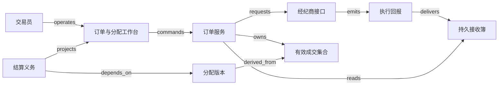

# V14 · 投资订单：成交、撤单、分配与结算

投资订单把一项投资意图变成可执行的数量与价格约束；成交把部分意图变成已发生的交易；分配决定哪些账户承担交易；结算再确认证券与资金义务是否履行。四件事各有证据。交易员按下“撤单”只能提出停止后续执行的请求，无法凭这个动作让已经成交的数量消失。这是本例接回全包共同模型的地方：承诺、执行事实、责任归属和资金结果必须分别保存。

本章构造一个 **synthetic** 的买方订单管理系统。基金经理获准买入 100 股证券 S，限价为每股 10.10 记账单位，预先确定三个账户 A、B、C 的目标权重为 50%、30%、20%。数量只允许整数股，现金精确到分；不含税费、融资、公司行动、卖空或汇率。交易与结算日期作为输入，不预设任何市场的结算周期。账户适格性、分配公平性和限额政策在真实业务中需要专业人员确定，本章规则仅用于推演。

## 识题：从现象找到方法

| 识别线索 | 可选解法 | 接着查什么、验什么 |
|---|---|---|
| 发出撤单后又收到成交 | 订单尝试与有效成交簿并行推进 | 查ExecType、OrdStatus及对手方恢复协议；验取消余量不吞掉已成交量 |
| 按比例分配出现多一股或多几分钱 | 整数配额与现金分别按明确尾差规则分配 | 查账户资格、整手、容量与公平政策；验数量金额守恒且约束同时满足 |
| 已报成交后来被撤销或纠正 | 按执行身份替换有效贡献，重建分配版本 | 查ExecID作用域与纠正引用；验旧分配及已结算义务有调整路径 |

下面沿这些线索建立对象与边界，再手算一组数据、用反例验算，最后改变前提重做判断。

## 解法：一张订单需要同时保留哪些事实

基金经理负责意图与账户范围，交易员负责向经纪商发单和撤单，运营人员负责核对成交、分配与结算。三者的权限有意分离：运营不能修改经理的限价来消除超限异常，交易员不能用一次撤单覆盖已经确认的成交。经纪商和托管/结算机构是外部证据来源；本地系统负责保存发出去的意图、接收到的回报及处理决定。这个权威分工是教学设计，不是对特定经纪商的内部实现描述。

| 对象 | 身份与权威 | 应保留的状态与关系 |
|---|---|---|
| 投资指令 | 本地 `order_id`、经理授权版本 | `draft → authorized → routed`；原始数量、限价、账户集合冻结成版本 |
| 经纪商订单 | 经纪商账户、交易业务日期与外部订单 ID | 外部报告的状态以及本地最后核对点；页面不能自行制造 `Canceled` |
| 撤单尝试 | 新的请求 ID，关联原始 `ClOrdID` | `prepared → sent → pending → confirmed/rejected`，另设 `unknown`；拒绝撤单不等于拒绝原订单 |
| 成交簿 | 经纪商约定身份范围内的 `ExecID`，纠正指向原执行 | 每笔数量、价格、方向及有效/被纠正状态；保留旧记录，重建当前有效集合 |
| 分配版本 | 订单、成交集合版本、分配版本号 | `draft → approved → submitted → accepted`，可进入 `rejected/superseded`；总量来自有效成交 |
| 结算义务 | 分配行、账户、证券、币种、约定日期与版本 | `pending → instructed → matched → partial/settled`，异常为 `failed`；接受指令不是履约完成 |

FIX 的 `ExecType` 说明为何发送一次执行回报，`OrdStatus` 描述回报中的订单状态。官方状态说明明确区分 `Pending Cancel` 与已取消；B.1.b、B.1.c 展示撤单等待期间继续成交以及撤单太晚被拒绝的情况。J.1.a、J.1.b 又展示成交撤销或纠正，所以累计成交量也不能被假定永远递增。这里取这些消息语义作参照，不声称本例实现完整 FIX 协议。`V14:claim:fix-state-semantics`：[FIX Order State Changes，EP284，§1–2、B.1.b–c、J.1.a–b](https://www.fixtrading.org/wp-content/uploads/download-manager-files/FIX-Latest-as-of-EP284-Order-State-Changes.pdf)。

状态因而不能只排成一根进度条。订单已经取消，仍可能有 65 股待分配、待结算；分配已被接受，某账户仍可能缺少交收信息；证券已收到，现金确认仍可能缺失。在本例中，业务闭环要求没有可继续执行的余量、有效成交已完整归属、每一结算义务已获得相应证据，未解决的例外都有负责人。`V14:claim:synthetic-model`。

## 撤单与成交相遇时怎样读页面

交易工作台同时呈现“原始意图 100 股”“已成交数量”“仍可执行数量”“撤单尝试状态”“结算进度”。提交限价单前，预览页给出账户权重、授权版本和最大教学资金占用 `100 × 10.10 = 1,010.00`。提交后先显示“请求已保存”，收到外部受理证据再显示可执行状态。HTTP 成功仅证明本地服务受理；连接断开后，用户凭 operation ID 找回同一尝试。

正常推演按以下事实展开。先成交 40 股，每股 10.00；交易员此时请求撤销剩余数量。撤单尚未确认，又成交 25 股，每股 10.04；最后经纪商确认剩余数量不再执行。本地页面此时显示“已取消余量；累计成交 65；待结算 65”。它不显示“全部撤销”，也不把 35 股未成交数量加入成交簿。

资金占用会揭示一个常见界面错误。收到第二笔成交、撤单仍未确认时，本例保留已成交资金义务 651.00，并按限价保留剩余 35 股的 353.50，占用共 1,004.50。只有撤单确认和成交缺口核对完成，才释放这 353.50；651.00 继续归属未结算义务。若点击撤单即释放全部额度，另一个订单就可能花掉同一笔预算。实际资金、保证金与可交易额度的计算因产品而异，此处只演示一个保守、无费用的购买预算规则。

失败路径更能说明权限边界：假设余下 35 股也先于撤单确认成交，经纪商回报撤单太晚被拒绝，订单就需要按 100 股继续分配结算。撤单按钮应进入终态并解释原因，不能自动再卖出 35 股“恢复原意”。卖出是另一项市场交易，会产生新价格与风险，必须另有授权。

分配工作台读取已核对的成交集合，显示算法预览、舍入差异与账户资质结果。批准动作带上 `execution_set_version`；如果新成交或纠正改变了该版本，服务拒绝旧预览并展示差额。结算工作台则按账户列出数量、金额、指令版本、双方匹配结果与实际交收证据。“发送指令”“对方接受”“已结算”使用独立文案，避免用一次绿色提示抹掉后续责任。

## 从接口到可核对的成交簿

合成拓扑以订单服务为控制中心，FIX adapter 隔离对手方协议、身份范围和重传约定。适配器发出请求，接收回报后先持久化，再更新成交簿和投影。消息内的 `CumQty` 可以用于一致性核对，却不应让服务把每条累计值再相加；真正的新增交易与状态回报需要按消息语义区别处理。

这些箭头表达信息与责任；证券交付和资金交割不由 `delivers` 箭头代替。完整端点与不变量见 [V14.json](V14.json)。本地订单意图由订单服务持有；外部订单状态和回报身份依赖经纪商；结算服务保存义务和确认映射，托管/结算机构仍是本例交收事实的外部来源。

可从 React/TypeScript 或 Vue/TypeScript 做表格、版本差异与回放界面；频繁更新只刷新受影响行，不让整个表格重排打断操作者。SSE 足以支持服务端推送回报进度，双向协商较多时可以选择 WebSocket；两者都要在重连后按游标补读，不能把连接在线等同于事实齐全。后端可用 Java/Kotlin 配合独立 FIX adapter，便于把交易协议处理与业务规则分开；Python/FastAPI 适合先做这一本地教学服务，但必须同样使用定点金额和明确的事务边界。这里是实现选项，不是对 FIX 参与机构技术栈的考据。

PostgreSQL 可以保存投资指令、成交版本、分配与 outbox；`(tenant, broker_account, execution_identity_scope, ExecID)` 约束重复身份，实际 scope 要从对手方约定取得，不能猜测 `ExecID` 永久全局唯一。原始入站内容与解析版本一起保存，读取时仍执行账户授权。数据库事务内写成交、更新集合版本、建立分配待处理任务；外部发送放在事务之后，避免把网络延迟绑在行锁里。初始规模使用数据库 outbox 即可，采用 Kafka 等日志系统需要额外解决顺序分区与消费者恢复，不会自动获得跨机构事务。

FIX 的 `AllocationInstruction` 表达把订单分到一个或多个账户，具有 `AllocID`、引用旧分配的 `RefAllocID` 以及数量、均价等字段；这些字段支持分配版本追踪，不规定本章的配额算法。`SettlementInstructions` 传递结算指示，也不能单凭它证明交收完成。`V14:claim:allocation-message`：[FIX 4.4 AllocationInstruction](https://fiximate.fixtrading.org/legacy/en/FIX.4.4/body_495774.html)；`V14:claim:settlement-message`：[FIX SettlementInstructions](https://fiximate.fixtrading.org/en/FIX.Latest/msg28.html)。

## 演算：手算整数分配与现金尾差

有效成交是 `40 × 10.00 + 25 × 10.04 = 651.00`，共 65 股。原始权重是经理在发单前确定的 50:30:20；本例在撤单终态和回报缺口补齐后做一次最终分配，不逐笔追求“谁先拿到好价格”。账户资格和最大数量已经在输入校验中通过。

按权重得到理论配额 A=32.5、B=19.5、C=13。先取整得到 32、19、13，共 64；还剩 1 股，分给小数余量最大的账户。A、B 同为 0.5，本例以事前固定的账户排序 A、B、C 打破平局，于是结果是 **33、19、13**。这是一种 synthetic 的最大余数分配规则，不能当作监管批准的公平分配政策。固定次序可重现，却会在长期重复平局时偏向同一账户；需要长期公平时，轮换或累计偏差策略必须在发单前批准并纳入状态。

均价是 `651 ÷ 65 = 10.015384…`。若先把均价舍入成 10.02 再乘数量，会得到 651.30，比真实成交多 0.30。更稳妥的本例做法是直接分配 **65,100 分**：各账户的理论金额为 `65100 × 数量 / 65`，即 33050.769…、19029.230…、13020 分。先取整后还有 1 分，给余数最大的 A，最终为 **330.51、190.29、130.20**，合计仍为 651.00。均价只用于展示，最终金额来自精确的成交总额与既定舍入规则。

这段计算结合 `ALG:lookup` 和 `ALG:top-k`。对 m 笔成交，朴素方案每次从头求和需要 O(m)；按唯一执行身份维护有效集合与汇总，普通新增可增量更新，但纠正必须先找到被引用的成交，撤销旧贡献再加入新贡献。对 a 个账户，完整排序余数需要 O(a log a)，若尾差只涉及 k 个账户，可用大小 k 的堆选取候选，代价 O(a log k)。数值守恒来自整数运算与约束，提速方法本身不提供公平性。

两个反例限定了算法的适用范围。第一，把 32.5、19.5、13 各自四舍五入会分出 66 股，超出有效成交。第二，假设 A 最多允许 30 股，原算法的 33 股不再可行；不能硬塞给 A 后再贴“人工关注”。需要以容量约束重新求可行分配，或者把无法分配的成交留在明确的待处理账户，由专业人员决定。权重与可行性是不同问题，任何优化目标都不能越过账户授权。

## 晚到回报与成交纠正怎样恢复

普通重复回报与真正纠正要走不同路径。同一 `ExecID`、相同内容重传可以返回已有结果；相同身份却内容不同应进入冲突队列。纠正带新的执行身份和引用关系，保留原笔并改变有效集合。若引用的旧成交尚未到达，先保存“缺少被引用执行”，待补齐后处理；不能把纠正当作又一笔买入。

例如第二笔 25 股后来被正式纠正为 20 股、价格仍为 10.04，有效集合变为 60 股、600.80。新分配应为 30、18、12，金额为 300.40、180.24、120.16。旧 65 股分配已经发送时，不能仅修改数据库让页面看起来平衡；需要冻结关联结算动作、建立旧分配的替换/撤销尝试，确认外部状态后提交新版本。如果旧义务已结算，进入交收后调整流程，由运营接管，本章不假定原交易可以回滚。`V14:claim:synthetic-algorithm`。

连接断开造成的未知结果也不是普通失败。新单发出后超时，adapter 保留原业务身份与发送证据，按双方协议查询或恢复会话；仅在确认可安全重传时重用同一身份。创建新 `ClOrdID` 可能意味着真正的第二张订单。撤单超时同理：先核对原订单和撤单尝试，同时继续处理成交回报。页面可以显示“尚待核对”，但不能释放待确认余量的额度。

本例以 50 个机构租户、20 个经纪商连接、每日 100 万条回报、开盘峰值每秒 5,000 条、每个批量订单最多 500 个分配账户作为待测负载。目标是在 durable inbox 落盘起算，普通回报到工作台 p95 不超过 500 毫秒；普通提交本地持久化响应 p95 不超过 300 毫秒；外部受理耗时单独计量。数据库按机构与账户过滤，回报处理按订单串行化；热点大订单不能通过丢弃中间成交来降延迟。列表可缓存，但撤单资格、可用额度和分配批准读取权威版本。观测指标除吞吐外，还需包括回报缺口数、未知尝试年龄、未分配数量和未结算金额；这些指标不由“队列消费完”替代。以上全部为目标，尚无负载测量。

## 验算：怎样证明业务闭环

本例没有让 AI 下单、分配或确认结算，AI eval 不适用。若后续加入异常摘要助手，应只建议原因与待查证据；模型不能改变数量、批准分配或消除未知状态。它需要另建以成交纠正、撤单拒绝和缺失回报为标签的留出集，核算危险误报与漏报，而不能沿用确定性算术检查的通过率。

| 场景 | Given / when | Then 与必须观察的证据 |
|---|---|---|
| 正常链 | 100 股指令，两笔成交 40/25，余量撤单确认 | 65 股、651.00；分配 33/19/13；每个账户结算证据闭合。核对 UI、有效成交簿、分配行、外部映射 |
| 重复 | 第二笔成交回报投递两次 | 总量仍为 65；接收日志与业务唯一键均能解释去重 |
| 乱序 | 撤单确认先到，第二笔成交后到 | 缺口未补齐前不得最终分配；补齐后成交仍保留，不能被取消状态吞掉 |
| 并发 | 两名运营批准同一预览，其中一人提交前出现纠正 | 旧版本批准失败；没有第二套有效分配，页面给出差异 |
| 租户隔离 | 两租户存在相同订单和执行编号 | 列表、详情、缓存命中、导出与事件订阅均只返回授权账户数据 |
| 未知结果 | 经纪商受理新单后本地超时 | 一次业务意图保持 unknown，查回同一外部订单；不出现第二张单 |
| 恢复 | 成交更新已提交，消费标记前进程崩溃 | 重放后有效数量不变，待分配任务仍存在；核对事务与重启记录 |
| 部分结算 | A、C 完成，B 只完成 10/19 股 | 已结算 56 股、未结算 9 股；不能把整批标成 settled；现金按确认明细核对 |
| 迟到纠正 | 65 股已分配后 25 股纠正为 20 股 | 旧分配失效且外部调整可追踪；新总量 60，不把差额静默抹掉 |
| 不可行分配 | A 容量为 30，原建议为 33 | 拒绝原建议或进入授权的再分配；总量与容量约束同时检查 |

[结构检查定义](V14.json)把输入、预期与所需证据分开。[本地合成检查](checks.py)只验证固定算术与负例，不建立真实订单服务，不执行上述 UI、经纪商、托管机构或负载测试。实际执行记录在包内 [CHANGELOG](CHANGELOG.md)。

## 变式：改变条件后重新推理

**练习一：每个账户只允许整手 10 股，仍成交 65 股。** 能否直接使用 33/19/13？

简答：不能。原来只要求整数股，现在每个分配量都必须是 10 的倍数，三者之和必为 10 的倍数，因此无法完全分掉 65。保持不变的是已成交 65 股不能丢失；改变的是可行域。系统应保留未分配的 5 股并要求授权的例外处理，或在可支持的账户规则下改方案，不能把成交改成 60。检查同时验证 `sum(allocated)+unallocated=65` 与每行整手约束；“每行合法但漏掉 5 股”是反例。

**练习二：把回报处理改成每分钟批量刷新，撤单按钮仍即时可点。** 能否按页面上 40 股成交释放 60 股额度？

简答：不能。页面的新鲜度改变，用户看到的余量不再是授权依据；撤单仍需服务器核对，最终释放额以外部确认及完整成交集合计算。本例最终只释放 35 股的预留额度。检查注入批次中尚未显示的 25 股成交，在断连和重连后仍无超额可用资金。降低 UI 更新频率不允许降低交易事实核对频率。

**练习三：把固定平局次序改为长期轮换。** 是否只需换一行排序？

简答：还需要保存已批准的轮换位置、适用账户集合和策略版本，并使同一分配重放得到同一结果。若每次重试都推进游标，同一成交会给不同账户，已经送出的指令无法核对。检查重复提交返回原分配；新一批成交才按政策推进轮换。

**下一步探索。** 接触一个新交易业务，先查证券或合约的数量单位、账户资格、交易对手消息约定、执行身份范围和结算义务，再选择订单状态机、有效成交簿、受约束分配与交收核对方案。FIX说明消息语义，双方采用的版本和流程仍需另行确认。先重放“40股成交→撤单请求→25股成交→余量取消→成交纠正”的合成轨迹，逐步核对有效数量、额度占用和分配版本；在缺口未补齐时保留未确认，不借一条最终状态掩盖明细。

机制可以迁到 V04 的部分发货：子项的数量守恒和父对象不能过早完成仍成立；差异在于证券成交、订单撤销、交易纠正具有独立消息语义，不能用仓库退货直接解释。迁到 H03 的对账时，成交身份与纠正链可以作为外部明细来源；关账不能靠累计数量单调增长来判断完整。迁到 H01 时，“点击取消并不消除已有义务”的思路仍成立，但订阅退款、证券卖出与成交撤销不是同一种补偿。对应迁移身份为 `TR:V14:V04:partial-obligations`、`TR:V14:H03:execution-reconciliation`、`TR:V14:H01:cancel-boundary`。

演示可控制成交到达时机、撤单确认时机、账户权重与整手大小，让数量、预算、分配和结算四列各自变化。读者应能亲手制造“已取消但仍待结算”，并看到为何只有相关权威证据能解除义务。来源与推导边界见 [evidence.json](evidence.json)。
