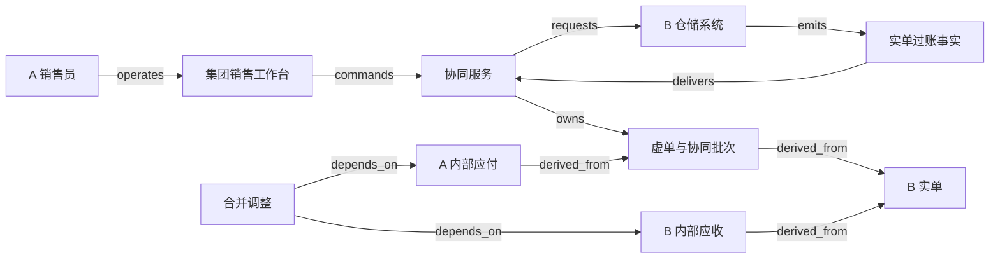

# X02 · Intercompany operations：一次发货，多个公司的责任

集团里的销售公司可以接单、开票和收款，生产公司负责把货直接送到客户。客户只收到一次货，但两个公司需要各自解释销售、成本和往来款。系统因此要保存多套相互关联的业务对象。单据变多不表示货物移动次数变多，集团合并时消除内部交易影响也不表示各公司的交易记录应该被删除。

本章以 **金蝶 EAS** 的“集中销售、分开发货、集中结算”作为已公开的产品参照，并构造一个独立的 synthetic 教学系统来推演数据与计算。销售公司 A 向外部客户 C 出售生产公司 B 的商品，B 直接发货。订单为 100 件，外售价每件 12 记账单位，内部结算价每件 9，B 的成本每件 6；首批实际交付并获客户确认 60 件，另外 40 件尚未发出。金额无税费，币种、期间、计量单位一致；A、B 都在本例合并范围内，并假设首批确认交付满足本例的收入记录条件。真实收入确认、税务、转移定价与合并范围需要专业判断，本章不提供通用合规结论。

## 识题：从现象找到方法

| 识别线索 | 可选解法 | 接着查什么、验什么 |
|---|---|---|
| 只发一次货，却出现多张出入库单 | 区分实物效果与结算用途，按源行追踪 | 查实单/虚单、协同参数与反审核边界；验库存只发生一次物理效果 |
| 个别公司账对，集团收入仍被放大 | 先明确报告范围，再消除内部重复 | 查合并范围和抵销政策；将内部收入成本与往来余额分别验算 |
| 集团净差为零，双边单据仍对不上 | 按交易身份、币种与期间逐键配对 | 查对手方映射、源批次和过账状态；保留相反差额为两项异常 |

下面沿这些线索建立对象与边界，再手算一组数据、用反例验算，最后改变前提重做判断。

## 解法：四条流必须分别画出来

实物流只有 `B 仓库 → C`。对外承诺属于 `A → C`，内部供应与结算关系属于 `B → A`。现金可以先从 C 到 A，再从 A 到 B，但资金是否先到不改变货物已从 B 发出的事实。集团报告把 A、B 放进一个观察边界，边界内的交易还须做合并核对。

金蝶 EAS 的该业务页说明：发货方销售出库单用于实际发货与内部结算；销售方的采购入库单（虚单）用于内部结算，销售出库单（虚单）用于生成对客应收。内部应付/应收以及付款/收款的协同生成受参数控制。文档还描述相关反审核会删除所生成的单据。`X02:claim:kingdee-flow`：[金蝶 EAS 8.6，业务流程说明及其控制要点，步骤 3–15](https://vip.kingdee.com/eascloud/help/8.6/SCM.web/topics/noname1184.html)。本章保留“虚单”“上拉”“下推”“审核”“反审核”的来源术语；不从这段说明推断其数据库事务、API 或已结账场景的回退能力。

虚单回答的是“这个公司凭什么对另一方形成结算责任”，而不是“仓库真的收到或发出了这件货”。如果给所有叫“出库单”的对象都接上同一个库存扣减动作，B 的实单扣 60，A 的虚单再扣 60，集团库存就错误减少 120；若把虚拟入库也算真实收货，又会捏造 A 仓库的物流轨迹。教学系统因此把 `physical_effect` 和 `settlement_role` 作为明确属性，不能靠单据名称猜测动作。`X02:claim:synthetic-model`。

| 对象 | 谁确认事实 | 合成系统保存什么 |
|---|---|---|
| 销售订单 | A 的销售主管确认价格、客户和承诺 | 100 件、外售价、客户、B 发货组织、批准版本；剩余数量独立于已收款 |
| 发货通知与 B 销售出库单（实单） | A 下达授权数量；B 仓库确认实际发出 | 通知只是要求；实单保存批次、数量、仓库和出库证据 |
| A 采购入库单（虚单） | 协同规则产生，A 财务核对 | 与 B 实单行的关联、60 件与内部价；不触发 A 的实物收货 |
| A 销售出库单（虚单） | 协同规则产生，A 财务核对 | 与同一实单关联的对客结算依据；不触发第二次发货 |
| A 对 C 应收 | A 财务经理批准 | 对外金额 720、来源数量与客户确认；收款状态另外核对 |
| B 对 A 应收、A 对 B 应付 | 两公司各自财务负责 | 同一内部交易身份、540 金额、对手方公司、币种与期间 |
| 收付款 | 各公司出纳确认各自现金事实 | C→A 与 A→B 分开；指令、银行结果和核销各有记录 |
| 合并核对与抵销批次 | 集团合并会计批准 | 取数版本、范围、配对差异、调整行；不覆写个别公司账簿 |

集团角色不意味着可以操作所有公司。A 的销售员能够查看 B 的可发数量与发货进度，并不因此能修改 B 的成本。集团合并会计可以访问经授权的财务映射，也不能替 B 仓管员补造出库事实。本例以 `(集团租户, 法人公司, 业务对象 ID)` 为最小数据身份，再以角色和业务关系决定跨公司可见字段。外部客户 C 只看到合同、交付与账单，不能沿单据关系读到内部价格。

## 状态分别在哪里推进

销售订单从 `draft` 到 `approved` 后才允许发货，数量承诺按“已交付、待交付、已取消”分别累计。发货通知从 `draft` 到 `approved` 表示允许 B 执行；B 实单从 `draft` 到 `posted` 才形成库存效果。已生成通知不是已发货，单据审核也不能替代本例额外要求的客户收货确认。

每一笔实单有一个协同批次，状态为 `pending → partial → complete` 或 `blocked`。它记录应生成的两张虚单、内部往来和来源版本。某公司服务暂时不可达时，批次可以 partial，实物不需要“退回数据库”。系统展示缺少哪一侧单据，安排恢复任务；只有完整性条件满足，才允许后续批次被视为配对完成。并非所有实现都必须拆成多个服务；这个批次对象无论跨服务还是跨数据库，都有助于解释不完整结果。

应收、应付按各自 `draft → posted → partially-settled → settled` 推进。对外应收已结清不能自动推出内部应付已结清；内部付款指令被银行接受，也不能推定 B 已确认收款。合并批次则为 `draft → reconciled → approved → posted`，差异进入 `blocked`。本例要求抵销批准绑定确定的取数快照；个别公司补记后必须使旧预览失效，不能把新账和旧抵销混在同一报告里。

“反审核”尤其要解释边界。金蝶来源描述了协同单据的删除行为，但未给出所有下游已入账、已收款、跨期间情况下的限制。本例不据此设计一键递归删除。教学政策是：下游尚为草稿时可撤回并保留审计事件；下游已过账或现金已确认时，冻结自动回退，建立可追踪的冲销或更正批次，交由对应财务角色批准。这是本章的选择，不是声称金蝶 EAS 必须这样实现。

## 一次发货怎样贯穿三个工作台

A 销售工作台创建订单时显示外部客户、销售组织、发货组织、内部协议和配置版本。用户下推 60 件发货通知前，服务校验剩余可执行数量，并为订单行预留这 60 件。第二个操作者同时请求 50 件时，必须在服务器端拒绝超出的部分或要求调整；页面缓存里显示的 100 件不能成为独立的发货额度。

B 仓库工作台按通知准备货物，提交出库时保存批次、仓位、数量与操作员身份。服务端在一个本地事务里记录库存扣减、实单版本和协同 outbox。页面先显示“出库已记录，协同结算单据生成中”，并提供同一批次的状态链接。若 A 侧暂时失败，仓管员不会再看到可重复扣库存的“重试发货”按钮；重试入口针对缺失的协同步骤。

A 财务工作台可以从两张虚单进入对外应收和内部应付，预览时同时展示外售价 12、内部价 9，以及这些价格所来自的订单或内部协议版本。内部价从 9 改成 9.50 时，不能让历史批次因实时读取价格表而自动从 540 变成 570。改价需要新的协议生效边界和修正批次；旧来源仍能回查。

集团核对工作台按内部交易列出两侧数量、金额、币种、期间与过账状态。发现 B 应收 540、A 应付 530 时，主动作是定位差异并分配负责人，不是“自动补差 10”。收付款台显示外部收款与内部付款两条独立进度；合并台显示抵销预览与取数时间，不把“报表已抵销”显示为“公司已付款”。

图中的 `requests` 是信息请求，实际货物 B→C 与现金 C→A→B 在业务明细中分别记录。完整拓扑见 [X02.json](X02.json)；金蝶 EAS 是上述业务机制的来源参照，图中仓储、银行与账务接口是合成边界，没有暗示已存在或已验证金蝶 API。

React 或 Vue 可以实现关联单据表格、差异高亮和批次追踪；服务端应对每个跳转重新授权，不能只隐藏内部价格列。Java/Spring 或 C#/.NET 可以承接协同服务及规则版本管理；PostgreSQL 保存源行、关系、状态、inbox/outbox 与配对快照，适合在事务中约束“同一源行同一用途只能生成一次”。既有 ERP 仍可作为各公司账务权威，adapter 用明确的导入/导出或公开接口合同核对结果。本章没有验证任何特定 ERP 接口格式。

规模较小时，关系表和递归查询足以追踪来源；只有多层流转、影响分析成为主要负载时，才值得考虑独立图索引。图数据库不替代会计分录的金额和版本约束。Redis 可以缓存列表，key 必须含集团、公司、权限范围及数据版本；批准出库、付款或抵销仍读取权威记录。这里的选型围绕事务和可追踪性，不归因于金蝶或 Microsoft 的实现。

## 演算：手算：个别公司各自正确，集团仍不能直接相加

首批 60 件完成后，教学账务如下。外部客户未付款、A 也尚未向 B 付款，便于把债权债务看清楚。

| 观察范围 | 收入 | 成本 | 利润 | 尚未结清的往来 |
|---|---:|---:|---:|---|
| B 个别公司 | `60×9=540` | `60×6=360` | 180 | 对 A 应收 540 |
| A 个别公司 | `60×12=720` | `60×9=540` | 180 | 对 C 应收 720；对 B 应付 540 |
| 直接相加 | 1,260 | 900 | 360 | 应收 1,260；应付 540 |
| 本例集团视角 | 720 | 360 | 360 | 对外应收 720；本批内部往来净影响为 0 |

直接相加的利润偶然仍为 360，不证明合并已经正确。收入多了内部交易 540，成本也多了 540；应收和应付各多出内部余额 540。教学合并批次分别作两组调整：把内部收入与相应成本各减少 540，再把内部应收与应付各减少 540。调整只作用在集团报告层，B 仍保留其对 A 的结算权利，A 仍须完成内部付款。

Microsoft Dynamics 365 Finance 的公开文档提供了合并规则、抵销建议和独立公司记录抵销等选项，说明合并取数与抵销可以有专门处理边界；它不证明金蝶采用相同功能或本例的分录政策。`X02:claim:consolidation-options`：[Consolidation and elimination overview，开头选项与相关 FAQ](https://learn.microsoft.com/en-us/dynamics365/finance/budgeting/consolidation-elimination-overview)。上述数字与四行演算属于本章 synthetic 模型。

客户支付 720 后，A 收入现金 720；A 再向 B 支付 540，A 净增现金 180，B 增现金 540，集团净增仍为 720。内部付款 540 不是集团从外部又赚到的 540。若付款仅在 A 侧成功而 B 侧尚未确认，本例保留在途核对项，不能单凭合并报表中净额为零就关闭现金异常。

## 用关系与配对键计算，不靠单据名字相似

本例需要两种计算。第一种是 `ALG:graph-paths`：从一条 B 实单出发，找到它派生的虚单、内部往来、外部应收与合并批次，以判断某个退货或改价影响哪里。每条关系保存来源行、目标行、用途与版本；关系本身不生成库存或现金动作。对 n 个对象、e 条边的完整遍历通常需要 O(n+e)，局部查询仅访问可达子图。旧版本到新版本的派生边保持有向无环；冲销“针对哪张原单”的引用另有语义，不能混进生成依赖后制造无限递归。

最简单的建单方法是在重试时重新创建所有下游单据，后果是同一实单被重复记账。合成改进是对 `(group, source_company, source_line, source_version, target_company, role)` 建唯一约束。role 区分“采购入库虚单”“销售出库虚单”等用途，不能只用源行当唯一键，否则第二张合法虚单也会被挡住。失败恢复先查这个身份，已有则复用；配置版本随源批次冻结，重试不换成今天的新配置。

第二种是 `ALG:lookup`：把内部应收和应付按稳定的交易身份配对。键包括集团、公司对、内部协议、源批次行、币种和核对期间，并保留双方原始方向；把应收记为 +540、应付记为 −540，相同键内的余额为零且两侧都齐全，才成为本例可抵销候选。哈希分组平均为 O(n)，需要约 O(k) 的键与累计存储；排序归并为 O(n log n)，可在数据大于内存时分批处理。具体延迟还取决于磁盘、分区和宽表，不由复杂度单独决定。

反例是集团总净额看起来为零：交易 T1 的 B 应收 540，A 应付 530，差 10；交易 T2 的 B 应收 360，A 应付 370，差 −10。总体恰好抵消，却有两条未解释的差异。如果只 `SUM(amount)` 然后亮绿灯，就永远不知道是价格错了还是单据串配。正确输出应是两条异常，分别追到来源；金额相等但币种不同、期间不同或一侧未过账，也不能直接认定匹配。`X02:claim:synthetic-algorithm`。

## 部分生成、退货与跨期怎样收尾

第一条失败轨迹从实物已经离开仓库开始。B 实单已提交，A 的采购虚单生成成功，A 的销售虚单接口超时。协同批次保持 partial，并记录超时步骤的业务键与外部尝试。恢复先查询该业务键：若已存在，登记映射并继续；若确定未生成，再按原身份重试；若接口没有可靠查询能力，进入人工核对，不以“超时”当作“未执行”。无论是哪一种，B 库存都不再扣一次。

第二条轨迹是客户退回首批中的 10 件，而且实物直接退回 B。教学政策先保存退货授权，再由 B 确认实际接收，关联原 60 件批次，产生 10 件库存恢复、120 外部金额调整、90 内部金额调整和 60 成本恢复。若已收到原货款，外部退款仍是独立资金任务；若只是开了负数应收，不能把现金显示为已退。若本例交付确认和入账条件同样满足，剩余有效销售为 50 件，集团收入 600、成本 300、利润 300。不能对最初 100 件订单整单冲回，也不能把 10 件退货冲到尚未发出的 40 件上。

第三条轨迹是月底截止不一致。B 在期间 P 已记内部应收，A 的应付仍在 P+1 草稿，按本章的配对规则就有一侧缺失。合并会计先确认经济事实、公司过账状态与适用期间，再决定补记、调整或暂缓。本章不把“跨期差异”自动归类为错误，也不让算法代替期间归属判断；恢复后的新快照使旧抵销预览失效。所有差异都有负责人和解释，即使在批准的会计政策下允许带解释结转，也不能在技术层默默丢弃。

负载假设为 200 个法人公司、每日 5 万条出库明细、月结核对 1,000 万条内部往来、50 名并发操作员。教学目标是普通源行查询 p95 小于 400 毫秒、跨公司协同正常完成 p95 小于 5 秒、月结全量配对 20 分钟内产生结果，均待验证。实单行按公司与期间索引；月结用固定水位的快照批次，避免读到一半时底层变化造成不可重复的结果。实时协同队列和月结计算分开分配资源，防止批量扫描饿死仓库提交。热点来自集中销售公司的大订单，数量预留按订单行锁定，不锁整个集团。至少跟踪 partial 批次年龄、两侧数量/金额差、在途现金与待批准调整数；它们比“服务都在线”更接近业务未完成的责任。

## 验算：验收必须同时看数量、责任和报告范围

本例不使用 AI 批准出库、判断收入或抵销，AI eval 不适用。若后续用模型解释核对差异，应把解释与过账权限分开；“价格、币种、期间、漏单、未知”应有人工标签、独立留出集和明确分母。模型说不出原因时必须保留 unknown，不能自动生成一笔补差。这里尚未执行模型评估。

| 场景 | Given / when | Then 与应取得的证据 |
|---|---|---|
| 正常链 | 首批 60 件真实出库，协同与应收应付完成 | B 库存减 60，A 真实库存不动；外部应收 720、内部双边 540；合并收入 720、成本 360 |
| 重复 | 同一实单事实重复送达 | 各用途各生成一份；两张合法虚单均在，库存只减一次；检查业务键与账务行 |
| 乱序 | 内部应付通知先于源实单映射到达 | 暂存依赖缺失，补齐来源后处理；不凭金额自动挂到别的单据 |
| 并发 | 订单可执行 100，两人同时通知 60 和 50 | 成功总量不超过 100；另一请求明确冲突，不能靠前端校验决定 |
| 租户/公司隔离 | 两集团、两公司复用订单号 | 键、查询、导出、关联追踪均按授权；客户 C 不能读内部价 |
| 未知结果 | A 虚单已生成但接口返回前断开 | 以原业务键查询，结果不明就保留 unknown；不新建第二笔 |
| 恢复 | B 实单与 outbox 已提交，发事件前崩溃 | 恢复继续协同，库存不重复扣减；对账证明下游最终完整 |
| 错配反例 | T1 差 +10，T2 差 −10 | 集团净额虽零仍报两条异常；只有逐键匹配才可抵销 |
| 退货 | 已交付 60 中退 10，货退回 B | 数量剩 50；调整分别 −120/−90，库存恢复 10；退款另取资金确认 |
| 跨期 | 应收在 P，应付在 P+1 草稿 | 不自动抵销；展示期间和过账差异，专业处理后重建快照 |
| 下游锁定 | 操作者反审核源单，下游已有付款 | 阻止教学系统的递归删除，创建需批准的更正任务并保留来源链 |

完整定义见 [X02.json](X02.json)。[本地检查](checks.py)只覆盖数值与配对反例；没有验证金蝶 API、银行、仓储实物、前端权限或负载目标。实际运行记录见 [CHANGELOG](CHANGELOG.md)。

## 变式：改变条件后的练习与迁移

**练习一：首批 60 件中，20 件尚未获客户确认；本例政策仍以确认交付作为收入记录条件。** 外部应收和收入能否照 60 件自动完成？

简答：不能从仓库出库直接跳到本例的收入条件。实物流仍为 B 发出 60，客户确认只有 40，需分别显示 20 件在途/待确认。教学收入仅对已满足条件的 40 件演算为 480，成本 240；应收是否已经形成须由所设合同与开票政策另行决定，本题没有授权把二者合并。检查库存、确认数量、应收与收入四项证据，不允许一个“已发货”标签替代全部条件。

**练习二：A 和 B 改用不同记账币种；两个账面的内部余额数字都为 540。** 能否直接抵销？

简答：不能。金额的单位改变，数字相等没有配对意义。保持不变的是交易身份、原币数量与双方责任；需要记录交易币种、汇率类型/日期、换算版本和专业确认的差异处理。未选定政策前输出不可比较，不输出零差异。反例是把 540 个币种 U 与 540 个币种 V 相减；检查混合币种 fixture 必须被拦下。

**练习三：销售公司先从 B 买入 100 件并真实入 A 仓库，月底只对外卖出 60 件。** 能否沿用“虚拟采购入库、全部内部利润已对外实现”的假设？

简答：不能。物流增加 B→A→C，A 有真实库存 40；按本题价格，内部剩余库存账面为 360，集团原成本为 240，差额 120 是本题待调整的内部利润。只抵销内部应收应付不足以完成本题合并计算，还要处理尚未对外出售库存中的 120。该演算仍以一致成本与完整纳入范围为前提；检查 A 的真实库存、集团库存成本和利润，不能只核对往来余额。

**下一步探索。** 进入一个集团业务，先画实际发货方、接单方、开票方、资金收付方与合并范围，再判断需要单公司履约、跨公司协同还是合并抵销这几类方案。研究ERP的实单/虚单属性、协同参数、反审核条件和可查询的外部业务键，不能只凭单据名称接库存动作。用一次60件直送制造一侧单据丢失和两笔相反差额，验证库存只动一次、每项下游责任可追踪、集团净差零仍暴露未配对明细。

机制迁到 H02 时，可沿源行追踪验收、发票与付款，但“采购入库单”在 X02 可以是虚单，不能直接拿来证明实物验收；对应 `TR:X02:H02:receipt-evidence-boundary`。迁到 H03 时，可把配对快照和调整版本作为关账输入，但个别账平衡不能证明集团内部交易已消除，对应 `TR:X02:H03:consolidation-scope`。迁到 V04 时，批次与部分履约数量关系仍成立，跨法人权限和内部定价则是新增约束，对应 `TR:X02:V04:direct-shipment-lineage`。

演示可以切换“直送客户/先入销售公司仓库”、延迟任一侧单据、改动内部价或客户确认数量，并同时展示真实库存、两公司账与集团报告。变化应沿来源关系传播，不能让一个动画箭头同时代表货物、现金与信息。来源及 synthetic 政策边界见 [evidence.json](evidence.json)。
