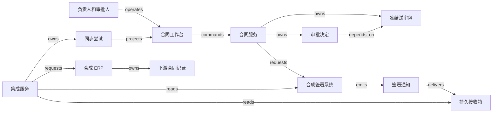

# H09 · 文档版本、审批与下游记录

一份合同经过内部批准后，仍可能停在签署、归档或下游同步中的任一环节。H09 接续共同企业图景中的“接受承诺”：销售要知道能否继续成交，法务要知道批准了哪些条款，财务要知道订单中的金额从何而来。完成条件因此需要同时指明文件版本、决定者和接收系统。一个“已完成”标签无法替三方保存依据。

本例构造一家出售年度服务的企业：一份合同有正文和数据处理附件，两位签署人，内部审批后才发起签署，归档后向合成 ERP 写入合同记录。所有金额、阈值、时长、角色和实现都是 **synthetic 教学政策**，不是法律结论或 Ironclad 的内部实现；合同效力、代理权限与终止条件由具备相应责任的人判断。本例不把内部批准推定为签约，不实现跨企业共同编辑，也不声称取消线上请求能消除已经发生的签名或法律义务。`H09:claim:scenario`

## 批准的对象必须可以重新找到

“我批准这个合同”至少省略了四个问题：看到的是哪份正文，附件有哪些，金额等业务字段是什么，适用哪版审批政策。编辑器中当前显示的内容会变，批准事实却必须能在以后重新解释。合成系统因此把可编辑工作稿与送审包分开。工作稿可以保存多次；提交审阅时，系统冻结一个 bundle（送审包），其身份包括 `tenant_id、contract_id、bundle_version`，内容包括有序文件清单、每个文件的摘要、结构化字段及其 schema 版本、审批政策版本。`H09:claim:version-binding`

文件摘要能发现字节改变，却不能证明合同意思正确，也不能发现漏掉清单的附件。DOCX 重新保存可能只改变内部元数据，因此本例保留原始文件摘要和供人审阅的差异视图，选择保守策略：任何送审包改变都产生新版本，并重新形成适用于新版本的审批轮次。不会先用“语义看起来相同”自动继承批准。金额按固定整数单位存储，缺值与零值分开；文件名、附件顺序与签署人清单也参加冻结。这样批准人稍后看到的内容与执行时取用的内容有同一定位。

Ironclad 的公开配置说明分别列出文档、工作流和字段变化的审批重置条件；其中还说明，上传文档改变了字段含义时，需要同步更新结构化字段，才能触发字段变化条件。这个产品事实说明了两种输入可能分离，不能由“上传成功”推断金额规则已重新计算。`H09:claim:provider-resets`：[Configure Approval Resets](https://support.ironcladapp.com/hc/en-us/articles/40675997675031-Configure-Approval-Resets-in-Workflow-Designer)。本例采用更保守的整体版本绑定，具体重置政策由自己的规则负责。

| 对象与负责者 | 身份与权威记录 | 独立状态及其含义 |
|---|---|---|
| 送审包；合同负责人提交 | 合同服务保存版本，文件仓保存不可变字节 | `draft → frozen → superseded`；旧包被替代后仍可回查 |
| 审批决定；法务、隐私与财务各自作出 | 每条决定绑定包版本、审批轮次、角色、政策与决定者 | `pending → approved / rejected`；后续变更使该轮 `invalidated`，历史决定仍在 |
| 签署请求；获授权负责人发起，双方签署人决定 | 外部签署系统确认请求及签名，本地只保存映射和证据 | `queued → dispatching → sent → partially_signed → fully_signed`；另有取消中、已取消及结果未知 |
| 签署归档；合同记录服务管理 | 原始签署文件、签署请求映射和复核记录 | `pending → recorded`；争议进入 `disputed`，修订后保存替代关系 |
| 同步尝试；集成 worker 执行 | 本地尝试账本解释请求，ERP 对自己的记录负责 | `queued → sending → confirmed`；可进入 `unknown`、`blocked` 或补偿中 |

合同负责人可以起草、提交和申请撤回，无权替法务批准；审批人只能处理被指派的角色和当前轮次；签署人只能对收到的确定签署包作出决定。集成账号只能读取已允许导出的字段并更新映射记录，不能制造审批。管理员修改政策是另一种权限：修改规则留下新政策版本，对已在审的包究竟沿用旧政策还是重新送审必须显式决定。本例选择重新送审。隐藏按钮和禁用按钮有助于解释权限，真正的授权在服务端，每次提交重新检查。表格和结构 JSON 只覆盖本例使用的状态与转换，不是任何 provider 的完整状态全集。`H09:claim:version-binding`

Ironclad 的 API 文档区分 Workflow 与 Record：前者描述流程，后者包含完成流程产生的签署文件及元数据；各有对象 ID，并用 Ironclad ID 连接同一合同生命周期。`H09:claim:provider-records`：[Getting Started — Workflows / Records / Ironclad ID](https://developer.ironcladapp.com/reference/getting-started-api)。接入该产品时应保留这些身份；本例中的本地 `contract_id` 不能随意代替 provider 的 Workflow ID 或 Record ID。

## 一次批准怎样成为可执行的依据

工作台列表分别显示“当前包 v7”“内部审阅 2/3”“签署未发起”“ERP 未同步”。详情页先展示当前包、相对于上一版的差异、未解决批注和本人的审批责任，再提供“批准此版本”“拒绝并说明原因”。预览页应能查看原始文件及全部附件；若有页面无法渲染，显示明确的缺页提示，并禁止把不完整预览称为已经审阅。

点击批准时，浏览器提交 `operation_id、bundle_version、approval_round、decision、comment`。服务端在同一事务中检查租户、当前指派、政策版本、包版本及尚未决定的状态，写入批准与审计记录。事务提交后，页面可以显示“v7 已由你批准”；其他审批尚未完成时，签署仍为等待。重复点击返回同一尝试；请求相同 operation ID 却带不同内容时拒绝。浏览器断网后重开页面，按 operation ID 查询结果，不能把一次本地 toast 当成持久化证据。`H09:claim:execution`

假设法务打开 v7 后，销售先提交了 v8。法务再批准 v7 时，服务端返回版本冲突，展示“当前为 v8；你查看的 v7 已被替代”以及差异入口。把批准自动挪到 v8，会让人承担尚未看过内容的责任。反过来，法务已批准 v7，销售随后提交 v8，则保存 v7 的批准事实，同时使旧轮次不能放行 v8。两个动作竞争同一当前版本标记，数据库的条件更新或行锁使它们出现一个可解释的先后顺序。

所有必要批准形成后，负责人点击“发送签署”。服务端再次核对送审包、签署人清单和当前有效批准，冻结签署请求 payload，在事务中写操作记录和 outbox（待发送记录）。worker 先在事务中条件认领任务，将 `queued` 改成 `dispatching` 并持久化固定尝试，再调用外部；从 outbox 读取字节引用，不从编辑器重新生成最新稿。外部受理后，UI 才显示具体签署请求；HTTP 超时或认领后的 worker 崩溃进入 `unknown`，显示“发送结果待核对”，并保留该尝试。租约到期只能说明执行者失联，不能证明网络请求没有发出。签署页面的原始请求 ID 与本地 bundle 版本必须始终能互查。

图中关系类型与 [拓扑 JSON](H09.json)一一对应，均为合成架构。关系 `depends_on` 指向前提，不表示文件已传输。Ironclad 在本例中是公开产品参照；若实际选用它作为 CLM 权威，适配层应读取它的工作流、记录与权限结果，而不能再用本地绿色状态覆盖其决定。`H09:claim:execution`

## 用审批依赖图计算等待时间

审批是否能并行取决于信息依赖。本例的隐私审阅 P 用 2 小时判断附件要求及额外实施成本；财务 F 需要 P 的成本结论，再用 1 小时审阅预算；法务 L 可以独立用 3 小时审阅正文；负责人 R 在 L、F 都完成后用 0.5 小时核对发签条件。这里的时长是假设的连续处理时间，先忽略排队、工作日历和返工。

计算用 `ALG:scheduling`。为了安排先后，把边写成“前提 → 后继”：`P → F`、`F → R`、`L → R`。这与对象图中 `F depends_on P` 的箭头方向相反，转换时必须明确。朴素做法按固定顺序串行执行，耗时 `2 + 1 + 3 + 0.5 = 6.5` 小时。拓扑排序先取入度为零的 P、L，完成 P 后才让 F 就绪，L、F 都完成才释放 R。对每个任务计算 `最早完成 = max(所有前提最早完成) + 本任务时长`，无前提时取零。`H09:claim:scheduling`

| 任务 | 前提 | 最早开始 | 最早完成 |
|---|---|---:|---:|
| P 隐私 | 无 | 0 小时 | 2 小时 |
| L 法务 | 无 | 0 小时 | 3 小时 |
| F 财务 | P | 2 小时 | 3 小时 |
| R 发签复核 | F、L | 3 小时 | 3.5 小时 |

该结果解释了为何并行有价值：最长前提链为 3 小时，最后复核再用 0.5 小时。它也解释了加速的边界：把 F 从 1 小时缩至 0.2 小时，L 仍需 3 小时，整体仍为 3.5 小时。把任务扔进更多 worker 不会加快正在由人审阅的法务节点。

Kahn 拓扑排序维护每个节点的剩余前提数，出队一个节点就减少它的后继计数，时间和空间量级均为 `O(V+E)`；V 是任务数，E 是依赖数。工作台可在配置发布时检查有无环：如果只处理了不足 V 个节点，剩余节点存在未消除的循环依赖。反例是配置者又要求“P 等 R 发签复核后开始”，形成 `P → F → R → P`，所有涉及节点互等；重试提醒和增加机器都无法解除这个政策错误。

拓扑排序产生合法先后关系，不能证明人员资源可用。若 P 和 L 必须由同一位有双重资格的人处理，就不能在第 0 小时并行开始，3.5 小时只是忽略资源竞争的下界。实际调度还需工作日历、资格、优先级和不可拆分时段。本例不实现资源优化，更不把最早完成时间当作合同处理 SLA。

版本变化也会改变图。v7 金额为 80,000 记账单位，v8 为 120,000；合成政策规定高于 100,000 需增加负责人上级 E，在 L、F 后用 1 小时批准，R 改为等待 E。重新计算得到 4.5 小时。若正文已经改成 120,000，metadata 仍写 80,000，拓扑算法会正确执行错误的图，漏掉 E。问题在输入一致性：提交前必须核对正文与结构化字段；自动抽取只能提示冲突，不能替代负责者确认。`H09:claim:scheduling`

## 签署回执、归档与映射

签署回调说明的是一次外部事件。Ironclad 文档区分签名收集事件和全部签署事件；手动上传路径中，“全部签署”还可能来自用户声明，产品不校验上传文件包含的签名是否正确。完成工作流通知则另外携带 Record IDs。`H09:claim:provider-webhooks`：[Webhooks — signatures collected / fully signed / workflow completed](https://developer.ironcladapp.com/reference/webhooks)。因此，本例的归档 guard 检查全部所需签署人、请求版本和证据路径；手动上传增加人工复核，不把收到带有 `signed` 字样的事件当成自动放行依据。

正常路径是：v7 的必要审批有效，签署请求 S7 被受理，两位签署人各完成签署，服务核对 S7 的最终状态，保存签署文件和证据，建立归档记录 A7。集成服务根据固定映射版本 M3 从 A7 提取金额、币种或记账单位、对方实体 ID 和生效区间，生成 ERP 命令。日期类型、枚举、缺失值及单位在映射前验证；不通过的记录进入 `blocked`，操作员看到具体字段及原始出处，不出现半空的成功记录。`H09:claim:downstream`

映射键至少包含 `(tenant, provider_account, contract_id, destination, destination_record_id)`；某一次写入另有 `(source_record_version, mapping_version, operation_id)`。合同号是给人看的编号，不能代替跨租户身份。同一合同的新修订通常更新同一下游业务记录并保留版本史；不同目的地各有同步尝试，CRM 成功不意味着 ERP 已成功。每个 `(tenant, contract_id, destination)` 还由本地事务分配单调递增的 `export_generation`，每次尝试冻结写前条件 `expected_destination_version`。成功回执保存写后 `committed_destination_version`；本合成协议每次新写入将版本加一，因此写前为0时写后应为1。外部返回记录 ID 后还要核对保存结果、导出代次、目标字段与写后版本，才能把本次尝试标为 `confirmed`，不能要求读回版本仍等于写前条件。UI 因而可以同时显示“已归档；ERP 待核对”。

最危险的故障发生在 ERP 已创建记录、worker 尚未保存响应时。若下游支持按外部键原子 upsert，并能按该键查询，重试可查询并确认原记录；若支持幂等请求键，保留同一键并遵守其有效期。两项能力均须由实际下游契约验证。本例的合成 ERP 提供按外部键定位的条件写入：在同一原子操作中检查导出代次不落后、目标当前版本等于请求的 `expected_destination_version`，再递增目标版本并保存 payload；相同代次和相同 payload 仅返回原提交结果及其写后版本，不再次递增；相同代次但内容不同则拒绝。这样旧导出迟到时无法把新金额覆盖回去。仅有 upsert 只能防重复建记录，仍可能错误覆盖。若查回时目标已是更高代次，旧尝试标为 `superseded`，保留被替代的证据，不能宣称旧 payload 仍是当前值。不能把这些能力归给任意真实 ERP。真实下游缺乏条件写入时，本地应按合同和目的地串行发送，并让 unknown 阻断后续导出；这种限制控制自己的发送顺序，仍无法保证外部人工或另一个集成账号不会并发覆盖。若还不能幂等写入或可靠查回，超时必须停在 unknown，由人工对账；换一个新 operation ID 继续创建会制造第二份承诺。`H09:claim:downstream`

接收边界先按实际 provider 的认证契约验证来源，并由已验证的账户映射确定租户，不能任由 payload 选择租户；具体认证协议需在接入时继续核查。签署通知可能迟到或被重复处理，因此接收箱先保存原始事件摘要、来源账户、接收序号与映射身份，处理时重新核对对应请求。不假定通知提供全局唯一事件 ID；订阅的 webhook ID 也不能直接用来去重每个事件。业务效果仍由“某租户、某签署请求、某归档版本只能形成一个对应结果”的唯一约束保护。旧 S7 通知抵达时，当前签署请求已是 S8，通知仍写入 S7 的历史，不将 S8 标为签完。以上是本例的保守接收设计，不是对 provider 投递顺序的声明。`H09:claim:execution`

## 撤回不能抹掉已经发生的事实

内部审阅期间撤回 v7，可以使当前审批轮次失效。只有仍为 `queued`、尚未被 worker 认领的 S7，才允许用条件更新在本地取消，并抑制发送；认领与取消只能有一方成功。处于 `dispatching` 的尝试可能已经发出请求，即使尚未保存外部 ID，也不能直接写成已取消。此时先保存取消意图并进入核对路径。已确认发出的请求改为 `cancel_pending`，再向外部请求取消，得到确认才显示 `cancelled`。Ironclad 文档提供签署期间取消请求并返回 Review 的操作；具体审批重置仍应按配置核查。`H09:claim:provider-cancel`：[Cancel Signatures and Return a Workflow to Review](https://support.ironcladapp.com/hc/en-us/articles/12274796145303-Cancel-Signatures-and-Return-a-Workflow-to-Review)。

`unknown` 查回后可能已经待签、部分签署、全部签署或已取消，恢复必须接受这些实际结果，不能固定重走“待签”。带有取消意图且查到仍待签或部分签署时进入取消中；查到全部签署时进入争议。查不到请求只有在 provider 能给出可靠的未受理证明时才允许重新发送，否则继续 unknown。

取消与最后一名签署人提交可能竞争。本例在取消结果未明时停止新的下游同步；若核对发现请求已完整签署，保留签名及时间，标记争议并由合同负责人处理。数据库不能为了迎合“撤回成功”的提示而把已签状态回退成未签。已经进入 ERP 的记录也需要独立的修订或作废命令；该命令自身有申请人、理由、权限、外部回执和失败状态。下游已开票、交付或支付时，合同字段被删除不等于那些义务随之消失。`H09:claim:withdrawal`

恢复路径据此分成三个不同动作：未认领的 queued outbox 可以在事务内阻止发送；已经发送但结果未知的请求先查回；已确认的外部效果用新操作补偿。补偿确认仍保留原记录和修订关系，不能用硬删除伪造“从未发生”。如果要求将某字段停止传播，本例把它作为后续映射政策和撤回任务处理，历史保留范围另由组织明确，不能由一条通用同步脚本决定。

## 技术选择与规模边界

一个可验证的第一版可以采用 React 或 Vue 做审批工作台，服务端用 TypeScript 的 NestJS 或 Python 的 FastAPI，PostgreSQL 保存版本元数据、决定、操作记录和 outbox，对象存储保存原始 DOCX/PDF。这里是候选组合，不描述 Ironclad 的技术栈。共用 TypeScript 可减少前后端数据类型分叉；Python 便于连接文本分析工具，但两者都必须在服务端验证输入，不能把编译期类型当作权限检查。`H09:claim:technology`

文档审阅若以 PDF 为主，可以用 [PDF.js](https://mozilla.github.io/pdf.js/) 显示已冻结 PDF 并把批注单独保存（`H09:claim:preview-capability`）；这种方案便于明确审阅版本，却不能承诺还原 DOCX 的可编辑布局。确需在线编辑时，可以评估 ONLYOFFICE 或 Collabora，但需另外验证修订标记、字体、转换一致性、授权与部署成本。富文本组件能快速做演示，不能未经试验承诺导入导出复杂法律文档不会丢失格式或批注。预览输出要与原始文件有可追踪关系，渲染失败不得通过空白页掩盖。

PostgreSQL 适合让“批准有效、写入决定、安排后续任务”共享事务，并用组合唯一约束限制重复记录；身份列应禁止空值，避免默认 NULL 比较语义留下重复空间。`H09:claim:storage-constraints`：[PostgreSQL — Unique Constraints](https://www.postgresql.org/docs/current/ddl-constraints.html#DDL-CONSTRAINTS-UNIQUE-CONSTRAINTS)。文件先上传到临时位置，校验大小和摘要后登记引用；崩溃留下的无引用文件由独立清理任务处理。对象存储的副本与数据库的权威角色分开：文件存在不代表批准已经成立，数据库有引用也不保证文件还能读取。备份恢复检查要实际取回被批准的旧版本，不能只数数据库行。

工作流规模小时，数据库 outbox 加 worker 已足够解释重试；长时间等待、多个取消分支与跨服务恢复越来越多时，可评估 Temporal 一类持久工作流工具。引入它是为了保存执行进度，不会自动解决审批权限、历史版本或外部请求是否成功。Temporal 自己也建议 Activity 幂等，以避免重试造成重复副作用。`H09:claim:durable-activities`：[Temporal Activities](https://docs.temporal.io/activities)。全文检索也应晚于基础权限与映射：索引只是查询副本，不能因一个文档在搜索结果中可见就授予下载权限。

合成容量规划假设 300 个租户、总计 200,000 份合同、每份 4 个版本、每版平均 2 MB，原始文件约 `200,000 × 4 × 2 = 1,600,000 MB`，即十进制 1.6 TB；未计预览、附件额外副本与备份。每秒 40 次列表读取和 5 次批准写入下，可把列表 p95 小于 500 毫秒、批准持久化 p95 小于 1 秒作为待测目标，外部签署与人工处理时间单独报告。它们是负载假设与目标，不是实测成绩。`H09:claim:scale`

真正可能占用资源的是文件上传、预览转换与批量同步，不是十几个审批节点的拓扑排序。预览任务应按租户限制并发；同一合同的批准与替代需要串行化，避免热点争用扩散到其他租户。只缓存不可变版本的预览较容易失效管理，key 包含租户、内容摘要和渲染器版本；当前包指针与权限仍在读取时校验。对签署、ERP 的积压分别测队列年龄和 unknown 数量，避免“平均处理快”掩盖少量长期无法确认的合同。

## AI 建议怎样接受检查

Ironclad 的 April 2025 更新介绍 Custom AI Properties，用示例改进合同字段抽取；这项公开功能描述不提供本例所需的准确率，也不证明模型可以批准合同。`H09:claim:provider-ai`：[What's New — Custom AI Properties](https://support.ironcladapp.com/hc/en-us/articles/30977258163607-What-s-New-in-Ironclad-April-2025)。本例可让模型建议金额、期限和需要复核的条款，并附原文位置；AI 输出是候选字段，确认后才进入送审包。模型没有“批准”“发送签署”或更改已批准包的权限。`H09:claim:ai-eval`

一个可计算的 synthetic 留出集包含 40 份合同，其中 10 份按人工标签需要额外升级审阅，30 份不需要。假设冻结配置的模型提示升级 12 份，其中 8 份命中，4 份误报；另漏掉 2 份。精确率为 `8/12 = 66.7%`，召回率为 `8/10 = 80%`，漏报率为 `2/10 = 20%`。只报总体正确率 `(8+26)/40 = 85%` 会淡化两份漏报的后果；本例因而不允许这组结果自动放行。这些数字是演算输入，未运行真实模型。

对同一留出集的金额抽取，另列 40 个有标签字段：34 个完全正确、2 个错误、4 个拒答；自动覆盖率为 `36/40 = 90%`，覆盖样本正确率为 `34/36 = 94.4%`。若人工逐项复核，至少 6 个字段需要补充或修正，比例 `6/40 = 15%`；被人工确认过的结果不能反过来算成模型正确。缺页、扫描质量差、币种冲突或跨文档矛盾均要求显式拒答或复核，不能自动填零。

真实评估需冻结原始文档、标签口径、模型与提示配置，按合同而非页面拆分训练集与留出集，避免同一合同版本泄漏。分别测试改数字、否定词、附件覆盖正文、扫描件以及把“忽略审批”藏进文本的样本；这些文本是待分析内容，无权改变工具权限。自动草稿只写入新的 draft，抽取变化必须重新走提交检查。AI eval 评价候选输出，业务检查评价人和系统是否仍守住授权边界，两者分别留证。

## 从界面一直检查到下游

以下检查要求记录真实观察，预期答案不能填作执行结果。固定输入、对应 ID 和详细证据要求见 [H09.json](H09.json)。本地纯计算检查可以验证依赖关系和版本规则，不能替代浏览器、数据库或 provider sandbox 的端到端试验。

| 类型与触发 | 应观察的结果及检查位置 |
|---|---|
| 正常路径：v7 审批齐备，两人签完，ERP 接受 | UI 分别显示批准、归档和 ERP 确认；从 bundle、签署请求、归档到下游记录能逐项核对摘要与金额 |
| 重复：批准按钮和完成通知各执行两次 | 同一批准尝试返回同一决定；只形成一份对应归档和一个下游业务效果；检查唯一键及尝试日志 |
| 乱序：S7 已取消、S8 等待签署，旧 S7 完成通知迟到 | 核对 S7 的实际结果，必要时转争议；S8 不变，不能按收到顺序改写当前版本 |
| 并发：v7 的批准与 v8 提交同时发生 | 旧批准只绑定 v7；v8 不能据此发签；查事务结果、版本冲突和 UI 差异提示 |
| 租户隔离：两个租户均有合同 C100 | 列表、预览缓存、文件下载和 ERP 映射均不串租户；无权访问不能由预览链接绕过 |
| 结果未知：ERP 已创建，响应丢失 | 保留 unknown；按外部键查回同一记录后确认；不因重开页面再创建一次 |
| 发签认领后崩溃：已处于 dispatching，尚未保存外部 ID | 本地取消被拒绝；保留取消意图并查回；全部签完时恢复为相应终态或争议，不能安全重发 |
| 恢复：归档事务提交后 worker 崩溃，outbox 未标记完成 | 重放能找到原归档与尝试；未处理项继续，已确认效果不重复，业务与通知进度均可解释 |
| 拒绝和撤回：一人拒绝，或签署取消与完成竞争 | 拒绝阻止发签；取消未确认期间不发布新下游效果；已签事实进入争议和人工处理 |
| 算法及输入反例：图有环、金额正文与字段冲突 | 有环配置不能发布；金额冲突不能形成冻结包；算法正确不掩盖输入错误 |
| 旧导出迟到：ERP 已保存代次 2 的新金额，代次 1 又到达 | 原子拒绝旧代次或目标版本冲突；新金额不回退，旧尝试标为被替代；检查外部代次、目标版本和 payload |
| 部分同步：CRM 确认、ERP 字段校验失败 | 详情保留每个目的地的状态；只修复 ERP，不能重放所有目的地制造重复更新 |

## 条件变化与迁移

**练习一：只改了联系方式，能否复用旧批准？** 假设联系人字段不出现在签署文件、金额或审批路由中。简答：本例的整体版本绑定仍会要求新轮次，这是保守策略带来的审阅成本。若要优化，必须把各审批的输入依赖明确登记，证明该字段不影响它们，产生可审计的“沿用决定”记录，指向旧决定与新包，而不能把原批准改成批准了新版本。不变量是每次放行都能证明当前执行输入被有效决定覆盖。失效条件是联系人同时决定通知对象或签署人；检查把联系人改成签署人后，旧批准能否仍错误地放行。`TR:H09:H07:versioned-approval-inputs` 可迁移到 BI 发布，但报表的受影响范围可以沿 lineage 计算，合同条款的语义依赖未必能由结构化字段穷尽。

**练习二：财务和法务由同一个人承担，时间还会是 3.5 小时吗？** 简答：前提图仍合法，但资源假设改变。若同一人负责 L 的 3 小时和 F 的 1 小时，P 由他人负责且需 2 小时，可以先在 `[0,3)` 做 L，再于 `[3,4)` 做 F，R 于 `[4,4.5)` 完成，总计 4.5 小时；另一合法安排未必更快。保留的是依赖约束，新增的是人的不重叠时间约束。反例是同时给同一人安排 L 与 F；检查甘特时间段有无重叠，并区分队列时间与处理时间。`TR:H09:H03:dependency-versus-capacity` 只迁移“先后与资源分开”的机制，不继承本例时长或审批规则。

**练习三：合同已归档并开通服务，后来审批人撤回了批准，能否直接停服并删合同？** 简答：先记录撤回及争议，后续效果按各对象的权限与政策处理。本例中撤回不是对方合同终止确认，也不是 H01 的退款证明；服务暂停、退款、ERP 作废分别需要独立命令及回执。不变量是保留已经发生的事实和因果关系。失效条件是把审批当作一种可无条件逆转所有下游效果的开关；检查已有付款、交付和签署记录是否被误删。`TR:H09:H01:commitment-evidence` 保留版本化承诺与独立履约状态，不能把内部审阅等同于客户接受；`TR:H09:H08:bounded-authorization` 可复用绑定对象、权限和期限的授权，但安全响应允许的紧急动作与合同撤回的责任边界仍须分别定义。

进入陌生行业时，先用一份合成文档走完修改、审阅、签署和下游使用，确认正文、附件与业务字段由谁负责，哪些改变必须重新决定。材料少且路由固定时，可先用版本库与审批工作流；跨组织签署、归档和字段同步成为主要责任时，再研究 CLM、电子签署及集成适配器。下一步核查签署证据类型、审批重置条件和目标系统条件写入能力，用“正文改金额、字段未改”“旧回执迟到”“同步已成功但响应丢失”验证边界。

演示可以让读者拖动 P、L、F 的时间，开关共享审批人，修改金额但暂不更新字段，再插入迟到回执或 ERP 超时。画面同时展示版本、审批图、签署请求和每个目的地的记录，使变化的后果可以逐项追踪；本地 Claude 可自行选择布局和动效。来源核查见 [evidence.json](evidence.json)，实际执行与缺口见 [CHANGELOG.md](CHANGELOG.md)。
