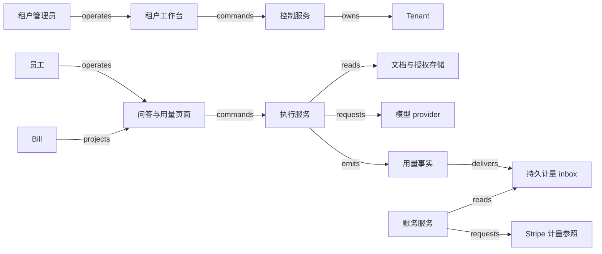

# X01 · 从租户开通到 AI 服务退出

一家合成 SaaS 向企业客户提供内部文档问答。租户管理员邀请员工、设定额度并决定何时退出；员工希望得到有依据的答案；运营要避免一个客户耗尽共享资源；财务要能解释每项收费。服务完成一次工作的条件是：在有效权限下读取被允许的文档，交付可追溯的结果，并留下可核对的用量。页面收到几个 token，只能说明流式输出开始，不能证明这三件事都完成。

本例的租户 A、B、单位价格、配额、拒答和保留策略均为 synthetic。AWS SaaS Lens、Okta、Stripe、PostgreSQL 和 OpenAI Frontier 提供边界各异的公开参照；下述内部数据库、调度、计费和检索设计不归因于这些 provider。本例不实现付款征收，也不判断特定行业的合规保留期限。设计政策见 `X01:claim:policy`。

## 识题路线：先划租户，再区分额度、消费和收费

看到“同一个用户访问多家公司”，先解身份与隔离题；看到“并发请求都认为余额足够”，先解预留题；看到“失败也花了资源”，再解计量与收费题。每一步都有独立的输入和检查答案。

| 识题线索 | 解法 | 演算 | 验算 | 变式与下一步研究 |
|---|---|---|---|---|
| 两个客户拥有相同编号，用户还能切换工作区 | 可信租户上下文贯穿身份、存储、队列和缓存 | A的run a=400，B的run a=900，各自归属 | 热缓存、导出及模型输入均不串租户 | 独立库仍需正确路由；查membership与当前权限从哪里取得 |
| 多请求同时承诺消耗额度 | 原子预留，再按实际消耗结算 | 额度1500，两次800只能先接一个；实际400后可接第二个 | 已消耗+预留不超额度；unknown不提前释放 | 实际消耗可能超预留时方法前提失效；查外部硬上限和取消语义 |
| 同一用量重复送达，失败成本与客户账单不同 | 稳定消费键、修订账本、业务时间窗和价格版本 | 成本400+600+300=1300；计费1000；金额2 | 重投不增量；冲突持久隔离；定稿后差异走调整 | 改失败收费得2.6；查合同计费资格、provider截止和汇总延迟 |
| 退出时仍有排队或在途任务 | 停新准入，终结未派发任务，核对已派发任务，再处理保留清单 | 退出先赢则queued→failed；派发先赢则unknown待核 | 无永远queued；不提前purged；成本仍能解释 | 身份停用不等于数据删除；查备份、导出与保留责任 |
| 模型答得流畅，却无引用或越权 | 分层留出题，分别计依据、拒答与权限违规 | 六条人工预测只有3/6符合预期，权限违规1/2 | 评分器必须显露失败，不能用平均正确率掩盖越权 | 换领域先研究证据标准和缺答案标签，再决定能否让模型参与动作 |

## 开通的其实是一组相互约束的对象

租户是一个管理与隔离边界，用户是一个行动主体，membership 是用户在特定租户中的成员关系。一个人可能属于 A 和 B，在 A 是管理员、在 B 是只读者。因此，“已经登录”不能回答“当前可否读 B 的合同”。服务端根据已验证的身份和当前 membership 选择租户，检查请求中的对象也属于该租户；不能相信浏览器自行提交的 `tenant_id`。AWS 文档要求将用户身份与租户身份结合，并在架构各层隔离租户资源；它没有替本例指定授权算法。`X01:claim:tenant-context`：[SaaS Lens — General design principles](https://docs.aws.amazon.com/wellarchitected/latest/saas-lens/general-design-principles.html)。

| 对象与责任方 | 独立状态 | 使状态变化成立的证据 |
|---|---|---|
| Tenant；控制服务权威 | requested → provisioning → active → draining → retained → purged；配置失败为 blocked | active 需要资源、管理员 membership 和隔离探针均通过；purged 需要各存储清单的处理回执 |
| Membership；身份适配与授权服务权威 | pending → active → revoked | tenant 内成员绑定和授权版本；撤销不等于删除业务记录 |
| Run；执行服务权威 | queued → running → succeeded / failed；外部调用超时为 unknown | 结果持久化且最终权限复检通过才 succeeded；unknown 需核对原 provider request |
| Usage entry；计量账本权威 | recorded → reconciled；冲突为 quarantined | 同一 run 的确定用量、计价版本及客户归属；重传不新增业务消费 |
| Bill；账务服务权威 | open → frozen → submitted → reconciled；外部不明为 unknown | 截止窗口、用量明细摘要、价格版本及 provider 回查；本例不将 submitted 解释为已付款 |

这几条状态轴允许同时存在。租户在 draining 时，一个先前准入的 run 仍可能等待回执；成员已 revoked 时，财务仍可能要保留此人的历史消费依据；账单已 frozen 时，迟到用量仍可能抵达。把这些事实都放进一个 `active` 布尔值，会让退出与计费彼此破坏。

控制服务负责开通、套餐、成员和退出，执行服务负责检索与生成，计量服务负责事件和账单依据。控制服务拥有跨租户运营能力，因此其后台不能直接复用普通用户 API 的宽权限连接。高权限操作使用明确目标、范围和操作记录，调查日志默认只含 opaque ID、阶段和用量，不把原始提示词和私密文档写进通用日志。

## 从开通页面到第一条回答

管理员提交套餐后，后端在一个事务中创建 tenant、开通 operation 与待执行任务，返回 operation ID。工作台分别显示“资源创建中”“成员绑定中”“隔离检查中”；只有全部通过才展示“可使用”。资源调用已经受理但响应丢失时，worker 用原 operation 查资源清单，不能新建另一套同名环境。若只完成存储创建，租户保持 provisioning，重启后继续补齐其余步骤；确定不再开通时，仅清理本次 operation 拥有且未被使用的资源。

员工进入问答页后选择当前工作区。提交时前端保存 run ID，显示排队、检索、生成、结果待核对几个事实；断线后可用同一 run ID 继续查看。流式传输采用 SSE 或分段轮询均可，传输序号用于续传，不能当作用量账本。浏览器断网不是服务端回滚：worker 可能已消耗模型资源，必须独立记录最终状态。

后端的顺序是：解析可信租户上下文 → 检查 membership 与额度 → 原子预留额度并创建 run → 在授权范围内检索 → 调用模型 → 核对结果与来源 → 再检查权限版本 → 持久化终态、计量记录和 outbox → 更新用户投影。模型输入里的“请改用 B 租户”只是一段文本，不能改写可信上下文。队列消息带 tenant、run 和授权版本；worker 也要复检，不能把入队时的权限永久缓存。

这幅图的外部调用是合成适配层，不表示已建立接入。详细 payload、失败条件和对象归属在 [X01.json](X01.json)。检索存储必须按 tenant 和当前文档 ACL 过滤候选，返回前再次检查引用对象；共享向量空间、缓存和日志同样在隔离边界内。给答案隐藏其他租户名称并不能修复已把其内容送进模型的泄露。

## 一次消费怎样变成可解释的费用

设合成套餐按成功交付的计费工作单位收费，每 1,000 单位收 2 个记账单位，无起步费、折扣和税。工作单位在本例中是服务自己定义的计量单位，不等同于任一模型的 token 价格。租户 A 的 run `a` 成功消耗 400，`b` 成功消耗 600，`c` 失败但已消耗 300；B 的 run 也叫 `a`，成功消耗 900。A 的内部成本依据是 1,300 单位，客户可计费量是 1,000，账单金额为 `1,000 × 2 / 1,000 = 2`。失败成本由本例服务承担；换一种商业约定可以收费，但须先改合同与策略，不能由重试代码偷偷决定。

输入不是“所有收到的消息数”，而是确定 run 身份的一组终态事实。持久唯一键为 `(tenant, run, meter, revision)`，初始 revision 为 1；相同键且 payload 相同的重复消息忽略，相同键不同 payload 进入 quarantine。否则网络重传 `a=400` 会让 A 的可计费量从 1,000 变成 1,400。若去重只用 `run=a`，B 的合法 900 又会被吞掉。修正以新的 revision 明确替代旧版，并要求连续版本或回查完整链；不能把修正量与原量同时累计。

这是 `ALG:lookup` 与 `ALG:windows` 的组合。朴素实现每到一条消息就扫描所有历史找重复，n 条累计最坏要 O(n²) 比较；数据库复合唯一索引使每次索引查找通常为 O(log n)，内存 hash 的平均 O(1) 只适合解释或有界批次，不替代持久账本。窗口用租户合同规定的业务时间区间 `[start, end)`：恰好等于 end 的消费归下一期；接收时间另存，迟到不是把消费挪到收到的月份。

Stripe 文档说明 meter events 异步处理，汇总与即将开票的数值可能暂未反映新事件；还说明事件可被接受，并不保证已定稿账单会更新。因此本例把“已发出”“provider 已受理”“汇总已核对”“账单已核对”分开。它不能仅因一次 API 成功就关闭对账。`X01:claim:metering-api`：[Record usage for billing with the API](https://docs.stripe.com/billing/subscriptions/usage-based/recording-usage-api)。

账务 worker 先冻结窗口与明细摘要，再以稳定 delivery ID 传递用量。其安全重试要遵守实际 provider 的去重范围和有效期，不能无限期依赖一个 idempotency key。超时后保留原请求身份，先核对接收、聚合和错误报告；若无法确定且安全重试条件已失效，就交人工核对。迟到更正若影响 frozen 账单，创建调整记录并走批准流程，不能静默重写已提交金额。`X01:claim:ledger-design`。

外部通知接收端先按 provider 要求验证来源，再存入 durable inbox，随后让 worker 核对对象。Stripe 文档要求使用原始请求体验证签名，并说明通知可能重复、送达顺序不保证。因此事件 ID 去重与业务用量唯一键分别保留：前者防重复消费通知，后者防两个不同通知产生两次收费。收到通知不能按到达顺序覆盖更可靠的当前对象。`X01:claim:webhook-boundary`：[Stripe webhooks](https://docs.stripe.com/webhooks)。

## 配额解决并发竞争，账本解决历史解释

A 的运行额度是 1,500 单位，已消耗为 0。两个并发 run 都申请最多 800：若各自先读剩余额度再写入，都可能通过，造成 1,600 的承诺。合成服务在同一事务中检查 `已消耗 + 未结算预留 + 新申请 ≤ 额度`。第一个取得 800 后，第二个被明确拒绝或排队；第一个完成并核定实际 400，释放剩余 400，第二个便可取得 800。第二个实际消耗 600 后，总消耗 1,000；再有失败 run 消耗 300，总消耗为 1,300，剩余 200，而计费量仍是 1,000。

预留不是估算账单。它限制当下可承诺的资源；实际用量记录历史发生的消耗；计费规则从这些事实选出应收费的部分。外部执行结果 unknown 时，不因浏览器退出就释放全部预留。worker 需先核定实际消耗或确认任务终止，再归还余额。供应商能否硬性限制生成长度、取消后还有多少消耗，是接入时必须测量的边界；本例的额度不变量只在执行确实不超过预留上限的假设下成立。

`ALG:scheduling` 在这里用于有资源约束的准入，而非断言某个云厂商使用特定排队算法。共享 worker 可按租户轮转取任务，再施加每租户并发上限，让 A 的大队列不会淹没 B；平均吞吐稍有下降，换来可解释的公平性。任务耗时差异很大时，仅按任务数轮转仍不公平，可以按估计工作单位分配预算，执行后纠正估算。估计用于调度，不直接进入确定金额。

## 技术选择服从隔离边界

一个教学实现可选 React/Next.js + TypeScript 显示阶段与引用，后端选 TypeScript 服务以共享请求类型，或 Python/FastAPI 便于连接检索和评估工具。共享类型减少字段漂移，却不会自动带来权限检查。SSE 适合单向进度；需要多方协作和双向状态时再考虑 WebSocket。前端缓存必须按 tenant、actor/权限范围、对象版本和策略版本分区；切换工作区立即清空可见旧结果，后台旧请求即使返回也不能覆盖新工作区。

小规模控制面与计量可以用 PostgreSQL 事务、复合唯一约束和 outbox；文档正文放对象存储，数据库存清单、hash 和 ACL；Redis 可缓存读模型，但权威额度扣减不能只依赖可丢失缓存。共享表配合 row-level security 可增加一道数据库约束，不过 PostgreSQL 官方文档明确超级用户、BYPASSRLS 角色以及通常情况下的表 owner 能绕过它。应用连接必须采用受限角色，并验证连接池复用时租户上下文不会残留。`X01:claim:rls-boundary`：[Row Security Policies](https://www.postgresql.org/docs/current/ddl-rowsecurity.html)。

另一种选择是为大客户独立数据库乃至独立运行环境，减少资源互扰，但迁移、版本一致性和成本更难控制。AWS 的 full stack isolation 仍强调统一开通与运营；独享基础设施不是每个客户维护一套分叉软件。此处选择 pool、silo 或混合模式是本例分析，不是对 provider 内部实现的推断。`X01:claim:silo-model`：[Full stack isolation](https://docs.aws.amazon.com/wellarchitected/latest/saas-lens/full-stack-isolation.html)。

合成测量计划设 100 个租户、20 个并发用户、每秒 20 次准入峰值、每日 10 万 run，单条精简计量记录约 400 字节。30 天原始计量约 `100,000 × 30 × 400 = 1.2 GB`，不含索引、副本、文档或模型输入。10 个 run 同时运行、平均持续 10 秒，容量只有约 1 run/s；20/s 短峰值必须排队、扩容或拒绝，不能靠“异步”掩盖积压。待测目标为准入 p95 < 200ms、队列等待 p95 < 5s（可承受流量下）、终态到用量可见 p95 < 60s；首 token 延迟另测，不与权限校验和队列等待混为一项。应按租户分位数和最大积压观测，不能只看全局均值。

## 退出是一段受约束的排空过程

正常路径是：管理员发起退出，控制服务将 tenant 从 active 改为 draining，并提高权限 epoch；禁止新的生成和新邀请。已准入 run 按本例政策停止继续执行，已发到外部的调用进入核对，不假定取消立即生效。待这些 run 均有终态和用量，账务完成截止核对，租户进入 retained，只允许约定的导出与审计读取。保留期届满且没有明确 hold，才逐项清除文档、索引、缓存、凭证与相关运行内容；完成清单齐备才显示 purged。备份的到期策略与恢复后重施删除清单也必须有验收证据。本例不宣称即时物理擦除。

排队中的 run 也必须有结束路径。若退出与 worker 取任务竞争，两者通过同一 run 的条件更新形成先后：确认尚未派发的任务转为 failed，记录零或已经明确发生的准备成本，并结算、释放预留；一旦派发已发生，就走 running/unknown 的核对路径。不能让 queued 永远等待一个因撤权而再也不会满足的启动条件，否则租户永远无法排空。这里使用 failed 表示本次请求未交付，原因字段区分退出取消与技术错误。

Okta 的 SCIM 2.0 文档说明，移除或停用用户时向应用设置 `active=false`，不对 SCIM user 执行 DELETE；Okta 内的 suspended 也没有对应的 deprovisioning event。它支持身份同步边界，不能证明应用自己的会话、文档和账单已经处理。`X01:claim:scim-deactivate`：[Okta and SCIM Version 2.0 — Delete users](https://developer.okta.com/docs/api/openapi/okta-scim/guides/scim-20)。因此退出由本地控制状态挡住运行入口，再分别核对身份 provider、执行队列和存储，不能等一个 SCIM 回执承担所有责任。

假设撤销发生在检索完成之后、答案返回之前。worker 已拿到 A 的文档，不应继续把答案交给已撤销的成员；最终授权复检发现 epoch 变化，丢弃待交付内容并记录受限终态，已消耗成本仍入账。失败后的恢复不是重新授予成员访问权，而是保留必要的核对信息，让获授权管理员处理成本和退出进度。租户重新加入要用新生命周期身份或 generation，旧消息不得复活旧 membership。

## AI 质量和业务正确性分别给出失败标准

OpenAI 将 Frontier 描述为帮助企业构建、部署和管理 AI agents 的平台，并在官方介绍中讨论上下文、评估、身份及权限。这里只核对它的实际产品身份，不把 Frontier 叫作本例的计费系统，也不从产品介绍推断它使用上述检索、数据库或预留算法。`X01:claim:frontier-identity`：[Introducing OpenAI Frontier](https://openai.com/index/introducing-openai-frontier/)。

问答的实际 eval 应冻结文档版本、ACL、测试身份、模型与配置、检索参数、提示词和判分标准。拟设 200 条留出题：80 条授权且可回答、40 条授权资料缺答案、40 条恶意指令干扰、20 条仅另一租户有答案、20 条权限已撤销。调参集合不能重复用作留出集；两位审核者对事实与引用的分歧要留记录。可回答题按“内容正确且引用支持”统计成功率；缺答案题统计恰当拒答率；对两类权限题单列任何越权内容泄露；工具动作越权必须为零，不能被高平均答案分抵消。业务方另设错误成本与放行阈值，不把 200 条样本自动解释为生产安全证明。

为了让分母可手算，随包提供六条**人工构造预测**：可回答且有正确引用、可回答但缺引用、资料无答案且拒答、资料无答案却编造、引用另一租户内容、撤销后正确拒答。按分组得到有依据正确回答 1/2、缺答案恰当拒答 1/2、权限违规 1/2；逐项符合预期为 3/6。这个故意失败的例子检查评分程序是否能识别错误，并非任何模型的成绩。检测到的越权样本使候选策略不能放行，修复后必须重新评估。对应本地执行范围见 [CHANGELOG](CHANGELOG.md)。

## 从 UI 到账单的验收轨迹

| 场景 | 可观察的完整链和失败判据 |
|---|---|
| 正常开通、生成与计费 | 提交开通 → 全部探针确认 → A 用户提交 a、b → 引用可读且终态成功 → 账本为 1,000 → bill 为 2 → 外部汇总与账单逐项核对。只看到回答不算全链通过 |
| 重复消费事件 | a 到达两次，两个接收轨迹指向一个业务 entry；相同键不同值进入 quarantine，不默默覆盖 |
| 乱序与迟到 | revision 2 先到而 1 缺失时不猜原值；旧成员激活消息在撤销 epoch 后到达不能恢复访问；截止后回执不改变业务时间 |
| 并发额度申请 | 两个 800 在 1,500 下只能先准入一个；进度页显示另一个排队/拒绝；测试需用真实并发事务证据 |
| 租户隔离 | A、B 都有 run a 和文档 d1；搜索、缓存 hit/miss、导出、重试、队列消费均只能读当前授权范围；检查模型输入也未夹带 B 内容 |
| 外部结果未知 | provider 已接收而本地 timeout，run/账单保留 unknown；恢复先查原请求身份；没有依据时不重复执行或多收费 |
| 崩溃恢复 | 在本地终态提交后、outbox 发送前终止 worker；重启后补送同一 entry，数据库账本与 provider 汇总均只有一个效果 |
| 退出与撤销 | 检索中撤销、draining 中重放旧请求、清理一处失败：答案交付被挡，新工作被拒，purged 不提前显示，已有费用仍可解释 |

这些行定义后续实现验收；本地纯计算与 SQLite 合成账本检查不能证明 SSE、真实 IAM、PostgreSQL RLS、provider sandbox、崩溃跨进程恢复或上述延迟目标。结构检查也不能证明 AI 能答对。检查身份与所需证据见 JSON 的 checks。

## 条件改变后怎样重画系统

**练习一：套餐改成失败请求也收费，但不得超过管理员预算。** a、b、c 的数值不变，金额如何变，哪些不变量仍然成立？短答：规则允许全部 1,300 单位计费时金额变为 2.6；消费事实、去重身份和租户隔离保持不变，bill 引用新的计价策略版本。若只有 2 单位预算，不能等失败后计算才发现超额，准入需按可发生的最高费用预留。反例是只改账单过滤条件，沿用“失败总会退回预算”；可观察检查是失败终态后的预算扣减、余额和明细三者一致。

**练习二：A 要求独立数据库，并允许同一员工加入 B。** 是否能删除所有 `tenant_id`？短答：不能。物理连接可以把部分数据隔离，但 membership、路由、缓存、队列和计量仍然共享；请求必须选对连接且验证对象身份。反例是 worker 按上一个任务保留的连接服务下一租户。检查交替发送 A/B 相同 object ID、连接池归还后再取出、冷缓存与热缓存，连模型上下文也要核对。把隔离从行条件迁到连接选择，会改变故障位置，不会消除授权责任。

**练习三：供应商无法查询超时的原生成请求。** 能否重发后把两次成本都收给客户？短答：不能从技术失败推导收费授权。本例保留 unknown 和预留，达到规定恢复期限后人工决定承担成本或经客户明确同意新建 run；新 run 关联旧尝试，不能伪装为同一次无成本重试。检查未知尝试在用量和操作面板中持续可见，不被“重试成功”覆盖。

迁移到 H07 时，账本输入版本与发布快照都要求可追溯；但 BI 可以探索性近似，客户费用不能凭近似值定稿（`TR:X01:H07:versioned-inputs`）。迁移到 H08 时，最终执行前复检授权可复用；账号隔离的误伤恢复不能用租户永久退出替代（`TR:X01:H08:execution-authority`）。迁移到 H09 时，frozen bill 与已批准文档都绑定确定版本；但签署的外部效力不同于账单汇总，不能套用相同撤销状态（`TR:X01:H09:version-bound-decision`）。与 H01 相接时，计费依据产生的 bill 不等于付款，更不等于收入确认（`TR:X01:H01:bill-payment-separation`）。

进入陌生行业时，先确定租户究竟代表客户法人、部门还是项目，再问同一人能否跨租户、失败工作如何收费、退出后哪些记录仍需保留。共享服务适合能接受共同资源管理的客群；独享方案适合有明确隔离或负载要求且能承担运营成本的客群，两者都需要统一身份与计量。下一步核查真实模型的用量和取消语义、账单截止以及数据清单，用同编号跨租户、失败计费、排队退出和未知消费验证，再决定是否需要更复杂的 agent 管理平台。

本地 Claude 可让读者切换租户、重复投递用量、调额度、撤销成员和制造超时，同时分别显示访问许可、run、成本量、计费量与账单。动作怎样排布和运动可自由设计；这些不同事实和失败判据应保留下来。逐源定位见 [evidence.json](evidence.json)。
