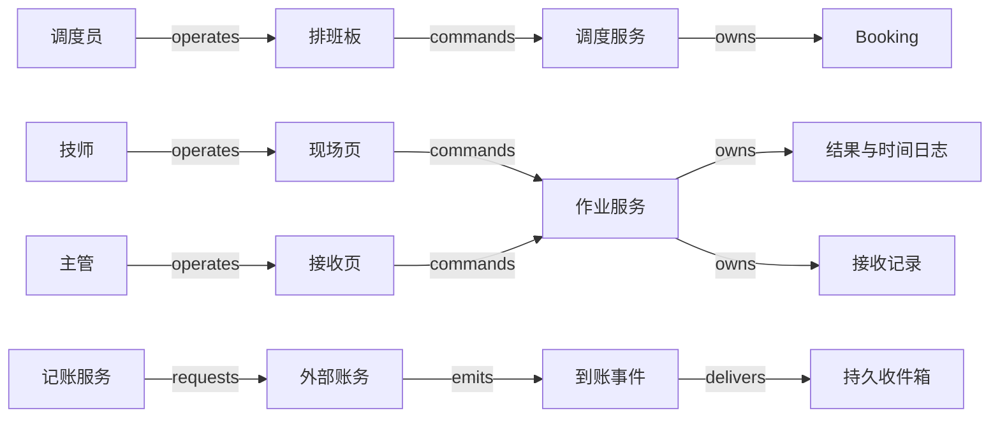

# V20 · 两次上门怎样兑现一项服务承诺

客户买的是设备能正常工作，而调度员安排的是某个技师在某段时间上门。安装完成后还要校准，第一次 booking（预约排班）结束只说明这次上门已经结束。要判断整个 work order（工单）是否履约，系统还得逐项核对约定范围、现场证据与接收决定。把工单直接当作日历事件，会在补件、返工和第二次上门时丢失责任。

本例是一项 synthetic 服务：安装需 90 分钟，安装结束后稳定 30 分钟，再校准 60 分钟。人工价格为每小时 120 个记账单位，零件 200；只收实际工作时间，不收休息、等待或路程。本例不计算税、质保和备件采购，也不把教学签认规则当作通用法定验收规则。调度、接收和金额规则属于自建应用，Dynamics 365 Field Service 仅作为可查证的对象与状态参照。

## 识题与选法

先按下面的线索选择方法，再读正文中的演算和反例；文末变式题改变其中一个条件，检验方法是否仍适用。

| 识题线索 | 解法与演算 | 验算要点 | 继续查证 |
|---|---|---|---|
| 任务先后有要求，人员空闲也有限 | 先传播依赖最早时刻，再找资源窗口；校准计划120—180，安装延迟后130—190 | 技能、稳定30分钟和资源时间窗同时成立 | 现场技能、路程、多人协作与需求同步配置 |
| 人在现场的时间长于真正工作时间 | 验证事件序列，累计工作状态的半开区间；90+60分钟算人工300 | 休息不计费；日志重排/重复仍为90安装分钟 | 离线序号、冲突裁决、计价与更正政策 |
| 一次上门结束，承诺包含多项工作 | 按需求逐项接收，再分别核对过账和付款 | 校准预约取消仍有未结需求；500应收收300仍欠200 | 多booking聚合、接收权限、posting与到账映射 |

## 工单、需求、预约与接收各管什么

Microsoft 的架构说明把 Resource Requirement 作为排程需求，把 Booking 作为某资源的时间安排；同一需求可以产生多次 booking。默认只自动同步工单与主要资源需求，手工增加的多个需求不会自动获得相同同步保证。这支持把“需要做的工作”与“安排了一次人手”分开建模，但不证明任意自定义配置都会正确分配资源。`V20:claim:requirement-booking`：[Work order architecture](https://learn.microsoft.com/en-us/dynamics365/field-service/field-service-architecture#the-work-order-is-scheduled-to-resources)。

状态文档另行说明工单和 booking 生命周期独立；默认流程中，关联 booking 都完成或取消时，工单可能进入 Completed，Posted 后的开票及 Actuals 又受配置影响。因此，Completed、Posted、已收款应分别观察。本文要求两项必需任务均有合格结果且主管接收，这是额外的合成业务规则。`V20:claim:status-boundary`：[Work order lifecycle and system statuses](https://learn.microsoft.com/en-us/dynamics365/field-service/work-order-status-booking-status#statuses-in-the-work-order-lifecycle)。

| 对象 | 身份与权威 | 状态及决定条件 |
|---|---|---|
| 服务请求与工单 | 租户、工单 ID、范围版本；服务主管拥有承诺范围 | 草稿提交后 approved；工作未开始可 authorized cancel；修改范围产生新版，不删旧承诺 |
| 安装/校准需求 | 每项 requirement ID 与范围版本；应用保存所需技能、时长、前置条件 | pending → satisfied 需要对应结果；取消预约只撤销安排；需求取消须由主管明确变更范围 |
| 两次 booking | booking ID、技师 ID、时段与版本；调度服务拥有安排，技师报告实际进度 | proposed → scheduled → in_progress → completed；未执行可 canceled；已完成错误用 correction 保留原记录 |
| 接收记录 | 工单范围版本、逐项结果、签认人；主管具有接受或退回权 | pending → accepted 或 rejected；缺任一必需结果不能接受；退回后补做保留旧记录 |
| Posting attempt | 工单、接收版本、费用版本组成唯一业务键；本地记账服务保存意图 | prepared → unknown/confirmed/rejected；外部未确认时保持 unknown |
| Invoice 与 Receipt | 账务系统拥有应收和到账；本地只存映射及查询副本 | 发票 open → partially_paid → paid；款项确认与工单状态无直接等号 |

请求人与技师可以相同，但权限不随界面身份合并。技师只提交自己被授权 booking 的进度和用料，不能修改价格或给自己接收结果；主管可退回作业，财务可过账。客户签认是证据的一部分，本例仍由主管检查范围是否全部满足。真实部署若允许客户直接接受，应明确授权、签名对象、撤回规则及版本变化后的重新确认条件。

## 从排班板到现场回执

调度员在详情页看到两项需求：安装尚未安排，校准依赖安装结果。拖动时间块只是预览。点击“确认安排”时，前端提交租户内的资源 ID、需求版本、起止时间和 operation ID；服务端重新核对资质、可用时间和冲突，在事务中保存 booking 与待发送通知。两位调度员同时占用同一技师时，后提交者看到“此时段已被另一安排占用”，并获得当前版本。只在浏览器中禁用重复点击无法发现另一台电脑的竞争。

现场页把“设备上已保存”与“服务器已确认”分开显示。技师断网后可以记录开始、休息、恢复和完成；本地队列保存设备操作 ID、booking 版本与事件序号。恢复网络时批量上传，服务器按操作身份去重，按同一 booking 的序号验证转换。两个设备同时报告互相矛盾的进度时，序号不能决定哪个事实真实：进入冲突队列，由主管根据现场证据更正。已处理的重复事件可以回原结果，迟到的旧事件不能覆盖新版接收或费用。

下面的图是自建参考拓扑，箭头与 [结构数据](V20.json)一致；没有假定 Dynamics 365 内部使用此架构。

移动页可用 React + IndexedDB 做离线草稿与待上传队列，桌面排班板沿用同一组件库；弱网频繁、需要受管设备能力时，可选择原生移动应用与 SQLite。前者部署方便，但必须测试浏览器存储清理、共享设备退出后的本地资料清除；后者增加客户端发布和版本兼容成本。两者都不能把未同步草稿当作组织已接受的记录。

后端可用 ASP.NET Core 或 FastAPI 实现有类型的命令入口，以 PostgreSQL 保存范围、booking、版本和 operation ledger。时间重叠可用资源行锁加事务内检查，或明确配置 PostgreSQL 区间排他约束；PostgreSQL 官方示例证明了此类约束可表达“同一资源的时间不重叠”，具体租户与状态过滤仍需自行验证；`V20:claim:range-exclusion`：[Constraints on Ranges](https://www.postgresql.org/docs/current/rangetypes.html#RANGETYPES-CONSTRAINT)。选择依据是跨资源预约是否必须一次提交。小规模单库方案容易检查原子性，拆成独立调度服务后则必须处理“占位成功、工单更新失败”的释放或补偿。对象存储保存照片，数据库只保存受租户与工单权限保护的引用及摘要；图片上传成功后尚需与具体作业版本关联，孤立文件不算验收证据。

通知从事务 outbox 交给 worker。账务集成用 adapter 封装外部身份、金额单位和状态映射，可先接本地 fake ledger。Redis 若用于排班查询，只缓存建议；提交时回数据库验证。托管消息队列有利于隔离现场上传突发，早期也可用数据库任务表，代价是轮询和热点需要监控。以上都是技术选项，没有声称 Microsoft 使用这些算法或组件。

## 手算排程：先满足约束，再比较方案

设 09:00 为第 0 分钟，窗口用半开区间 `[start,end)` 表示。资源窗口已扣除路程和固定休息；安装技能只有林技师具备，校准由林、陈两人都可做。林可用 `[0,120)`、`[180,300)`，陈可用 `[60,240)`。所有数字是固定的合成输入。

安装放在林的 `[0,90)`；稳定期使校准最早从第 120 分钟开始。陈可安排 `[120,180)`，林只能安排 `[180,240)`，所以以最早完成为目标时选陈，预计 12:00 完成。只按“谁最早空闲”排序会把校准放到陈的 `[60,120)`：它虽然不与陈的其他任务重叠，却在安装尚未结束时开始，违反业务依赖。先后依赖与资源空闲是两个不同约束，满足其中一个不代表另一个成立。

这对应 `ALG:scheduling` 和 `ALG:optimization`。只考虑依赖时，用拓扑顺序传播最早开始时间，代价为 O(V+E)，V 是任务数，E 是依赖数；检测到环就拒绝排程，而不是无限等待。加入资源窗口后，本例逐个扫描资源与窗口，候选数为资源数 R 乘每资源窗口数 W，单任务约 O(RW)。多工单争用同一资源时，局部最早结束可能挤掉一个只有窄窗口的紧急任务；可在小批次枚举或用约束求解器找可行方案，再比较迟到和路程成本。设置求解时间预算并返回约束检查结果，找到的启发式方案只能称可行或当前较好，不能称全局最优。

现场执行还会改变输入。安装实际在 `[0,40)` 工作、`[40,50)` 休息、`[50,100)` 工作，实际工作仍为 90 分钟，结束却晚了 10 分钟。校准最早开始随之变为第 130 分钟，陈的 `[130,190)` 仍可行。系统应显示受影响预约并请求调度确认；自动把客户已确认的时间向后移动会产生新的承诺问题。只修改工单预计时长而不重算后继预约，会让排班板看似空闲、现场却无法开工。

## 手算计费：消耗时间与经过时间

按 booking 事件排序并验证转换后，只累加 `in_progress` 区间。本例安装为 `40 + 50 = 90` 分钟，校准 60 分钟，总计 150 分钟。人工为 `150 × 120 / 60 = 300`，加零件 200，应收 500。若用安装从开始到结束的 100 分钟收费，会多计 `10 × 120 / 60 = 20`。如果把重复上传的 50 分钟工作段再相加，又会多计 100；这说明正确的区间算法还需要事件身份和有效转换作为前提。

`ALG:windows` 的朴素方式是对每次费用查询重扫并排序全部 m 条日志，约 O(m log m)。每个 booking 维护按序日志与版本化小计后，列表可以读小计；补录或更正只重算受影响 booking，已过账费用仍指向原版本并用调整记录纠正。跨设备时钟不能用来证明因果顺序，序号缺口、结束早于开始、没有开始的完成事件都进入核对。人工确认后形成新费用版本，不靠猜测补齐。

接收完成后，财务预览的 500 必须绑定范围、接收和费用版本。确认过账将操作意图落盘，再请求账务系统。若账务已建发票但响应丢失，本地显示“结果待核对”；按可查询的外部引用找回同一张发票。若 provider 不提供可靠查询或幂等键，则暂停自动重试并由财务核对，不假定所有系统都支持安全重放。先收到 300 时，发票仍欠 200；再确认 200 才 paid。booking、Posted 标签、发票送达都不能替代到账凭据。

## 一条正常路径与三次中断

正常路径是范围获批 → 两次预约确认 → 安装日志同步并满足安装需求 → 重新确认校准时间 → 校准完成 → 主管按当前范围接收 → 费用版本锁定并确认发票 → 两笔收款核销。每一步都有自己的对象与回执，回到详情页仍可看到未完成责任。

若校准 booking 被取消，调度占位可以释放，但校准需求仍为 pending。产品侧工单状态即使已 Completed，本例接收按钮仍显示“校准结果缺失”；主管可以重新预约，也可经明确范围变更取消校准。这个差异应出现在界面，而不藏在后台规则里。

若技师完成了安装但照片上传失败，日志可以同步成功，结果仍标明证据不齐。重传附件沿用同一内容引用和作业版本；主管只能在补齐或记录有权限的例外决定后接受。不得为了一个附件故障把真实工作时长清零，也不得把未保存的照片当成已审阅。

若 worker 在确认发票后、标记任务完成前崩溃，恢复时先读取 posting ledger 与外部引用。业务唯一键挡住第二张应收，inbox 去重挡住重复到账事件；两者保护的对象不同。真实系统还需处理已发票的结果后来被退回：以有权限的调整或贷项流程修正，保留原发票历史。本例只定义这条接管边界，没有实现退款或贷项。

## 在多大规模下检验

合成容量目标为 50 个服务组织、每组织 500 名技师、每天 2,000 个 booking；一个热点组织同时有 30 位调度员，移动端每分钟集中同步 300 次状态动作。先测一个组织当天的列表和局部调度，不把全历史日志装进浏览器。目标是 50 个 booking 的列表 p95 小于 500 ms，排程提交 p95 小于 1 s；冲突响应与冷缓存单独统计，离线上传另测积压消退时间。这些是测试输入与预算，未做性能实测。

资源时间轴按组织、资源和日期索引。热门技师可能形成锁竞争，应测同一资源而非只测均匀随机数据；一次事务尽量短，复杂方案求解放在锁外，提交时再次验证。如果只缓存日期而忘记组织或资源可见范围，两个组织相同工号会相互泄露。缓存键包含租户、权限范围、日期与投影版本；命中缓存也必须执行访问检查。预览允许显示更新时间，实际确认不接受陈旧可用性。

## 验收与 AI 的位置

本例关键排程约束、费用累计和接收 guard 用确定规则验证，不需要模型作裁决。若增加 AI 从现场描述提取任务结果，应先以人工标注的独立留出集测量缺项漏检、错误提取和拒答率，尤其覆盖“已安装但未校准”“取消预约而未取消需求”等否定与部分完成；模型不能直接触发接收或过账。本包没有实现该模型功能，因而没有 AI eval 成绩。

| Given / when | 应观察的业务结果与证据 |
|---|---|
| 两项合格结果、90+60 分钟工作、零件 200；接收并收两笔 300/200 | 一个已接受范围版本、一张 500 发票、最终余额 0；核对 UI、费用输入和账务凭据 |
| 相同现场事件上传两次 | 安装工作仍 90 分钟，未新增作业结果；保留操作去重回执 |
| 第 4 条 completed 先于第 3 条恢复工作事件到达 | 缺口待核对或缓冲，未虚构时长；齐备后重放得 90 分钟 |
| 两位调度员同时预占同一资源重叠区间 | 一个提交成功，一个明确冲突；检查持久预约而非两张截图 |
| 两个租户都有 booking 42，读缓存与离线同步 | 各自只能读取或修改本租户授权对象；未经授权的载荷被拒绝 |
| 外部已建发票而请求超时 | operation 为 unknown，重查同一引用确认一张发票；不能新增第二张 |
| 发票已确认后 worker 崩溃并重放 | 仍只一张应收；可解释任务消费状态和最终页面结果 |
| 安装 completed、校准 canceled | 接收被拒绝，校准需求仍待完成；工单产品状态不代替业务 guard |
| 安装日志先完成后补录休息 | 原费用版本可回查，新版本重新算价；已发票部分进入调整接管 |

这些端到端行是验收设计。可运行的 [合成检查](checks-v20.py)只覆盖固定排程、区间日志、取消聚合、租户键、抢占和过账恢复的本地模型，不执行真实 UI、数据库锁、网络或 Microsoft API。实际执行记录见 [CHANGELOG](CHANGELOG.md)。

## 条件变化与迁移

**练习一：把两次上门改成“安装与校准任选一项”。** 能否继续要求两个需求都 satisfied？

简答：不能。保持不变的是接收必须有与承诺匹配的证据，改变的是承诺中的数量逻辑。把范围版本改成明确的 `one_of` 需求组，已完成安装可以满足该组；另一预约应以“不再需要”的明确原因取消。反例是直接把任何 canceled 都当作成功，连尚未执行的唯一选项也被略过。检查在两项都取消时仍拒绝接收，在一项合格时允许，并确认客户接受的是新版范围。

**练习二：把按时收费改成固定总价 500，客户只付了 300。** 10 分钟休息更正是否改变余额？

简答：不改变本例固定价应收，余额仍为 200；时长仍影响内部成本与容量预测。保持履约、费用依据和到账分离，改动计价派生关系。反例是沿用按时算法，把休息更正自动改成客户折扣。检查发票仍 500，成本版本改变有记录，Receipt 合计仍 300；若合同明确超时费，再建立新的计价规则与授权。

**练习三：第二次预约改为两名技师同时在场。** 为两个人各找一个空闲段是否足够？

简答：需要共同时间交集、技能组合和一次原子占位；两人分别在 11:00 与 12:00 空闲无法满足同时到场。共享的是需求先于分配的模型，失效的是单资源最早槽位算法。检查两资源在同一区间成功占位，任一冲突都不留下孤立的半份安排。

`TR:V20:V19:versioned-labor` 向 V19 迁移时，工作区间与计费输入绑定版本的机制仍成立，但现场时段不能自动代替获得批准的项目工时，capped bill 还多出跨条目的额度竞争。`TR:V20:H06:acceptance-boundary` 向 H06 迁移时，接收与执行分离仍有用，但客服可能通过文字解决问题，不必有 booking。`TR:V20:H01:invoice-and-receipt` 向 H01 迁移时，发票与付款分离保持不变；本例后付款不能继承预付订阅的开通 guard。对应迁移 ID 和专业边界由 [handoff](handoff.md)交给整合者。

后续演示可以拖动两位技师的窗口、插入休息、取消第二次预约和丢弃过账响应，让读者同时观察需求、booking、接收、应收与付款。具体布局与动效留给本地 Claude；不以自动播放替代这些可触发的反例。来源范围与原创规则见 [evidence](evidence.json)。

## 从工作范围与现场约束做适配

进入现场服务业务时，先把承诺拆成必需工作项，再确认是否需要多技能、多人同时在场、行程、材料和离线记录；日历空位只是其中一个输入。Field Service、资源调度和移动作业方案可以承载需求/booking/作业日志，账务与客户接收仍需明确边界。下一步查目标系统的多booking聚合、自定义状态、资源需求同步、离线冲突和posting配置，把实际配置写成映射，不能直接继承产品默认标签的含义。用第二次预约取消、安装休息补录与开票响应丢失的组合，核对需求仍有责任、工时只收150分钟、最终应收只有500。
